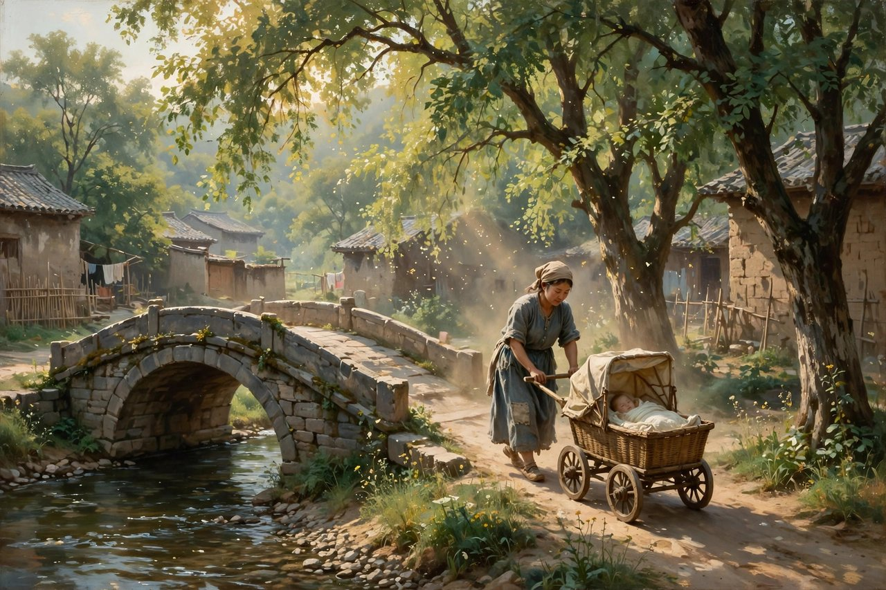
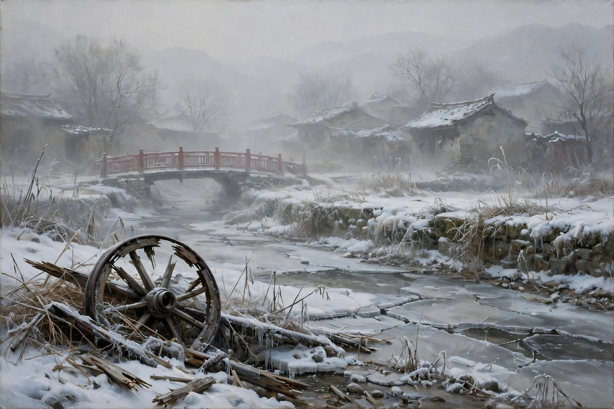

## 一座桥隔开两重人间

桥这个字，听起来是连通的意思，是把两岸连起来的意思，是让人走过去的意思。可在萧红的笔下，桥这个字，更多的是隔开的意思，是把两重人间分开的意思，是把一个母亲的心分开的意思。萧红的短篇小说桥，收在她一九三六年十一月由上海文化生活出版社出版的散文和短篇合集桥里，那本合集收了小说三篇、散文十篇，小说里有手，有小六，有桥，桥是同书名的一篇，也是最让人心疼的一篇。书里写的是一个叫黄良子的女人，写的是她推着小主人的车过桥的日子，写的是她自己的孩子在桥那头受苦的日子，写的是桥东和桥西两重人间，写的是一个母亲在两重人间之间，来回走，来回疼，来回哭不出来的日子。

黄良子是个奶妈，是个给有钱人家带孩子的女人，是个自己也有孩子的母亲。她的工作，是推着小主人的车，从桥东走到桥西，从桥西走到桥东，推着车，哄着孩子，唱着歌，说着话，让小主人高高兴兴的。小主人睡在小车里面，轮子呱啦呱啦地响着，那白嫩的圆面孔，眉毛上面齐着和霜一样白的帽边，满身穿着洁净的可爱的衣裳，看着就是有钱人家的孩子，看着就是被疼着、被护着、被好好养着的孩子。黄良子推着这样的车，心里是什么滋味，萧红写得细，写得冷，写得让人心疼。黄良子自己的孩子，也在桥那头，也在看着她，也在等着她，可自己的孩子黄瘦，眼圈发一点蓝，脖子略微长一些，看起来很像一条枯了的树枝，穿着破旧的衣裳，吃着粗糙的饭，过着穷日子，挨着打，受着委屈。两个孩子，一个在车里，一个在桥那头，一个白嫩，一个黄瘦，一个穿着洁净的衣裳，一个穿着破旧的衣裳，一个被疼着，一个被打着，这种对比，就是桥这篇小说的全部，就是一座桥隔开的两重人间，就是一个母亲的心被分开的样子。

桥东和桥西，在小说里不只是两个地方，更是两个世界。桥东是黄良子自己家的地方，是穷人的地方，是土丘、野狗、关着的门、睡觉的人家的地方，是黄良子自己的孩子住的地方，是黄良子自己受苦的地方。桥西是主人家的地方，是有钱人的地方，是大门、是院子、是小车、是洁净的衣裳、是白嫩的面孔的地方，是黄良子工作的地方，是黄良子推着小主人的车、哄着小主人睡觉的地方。黄良子每天在桥东和桥西之间走来走去，推着车，哄着孩子，心里想着自己的孩子，嘴上哄着别人的孩子，这种走来走去，就是她的日子，就是她的命，就是她的疼。她从桥东的空场上走出来，走到桥西去，走到主人家的大门里，走到小主人的身边，走到别人的生活里，可她自己的生活，还在桥东，还在土丘后面，还在野狗叫的地方，还在关着的门后面，还在自己的孩子哭的地方。这种两头走、两头疼的日子，今天的人也熟悉，今天的保姆、月嫂、护工、家政工，也是这样，每天在别人家里带孩子、照顾老人、做饭、打扫，照顾着别人的孩子，自己的孩子却在老家，在爷爷奶奶身边，在留守的日子里，在想妈妈的日子里。萧红写黄良子，写的是民国的奶妈，照见的是今天的家政工，照见的是今天千千万万个在别人家里工作、自己的孩子却在远方的母亲。

## 车轮掉进水沟的那天

小说里有一个场景，写得特别动人，特别让人心疼，就是车轮掉进水沟的那天。那天，黄良子推着小主人的车，从桥东往桥西走，走到水沟边上，心里不安，车子在水沟里颠乱着，车轮子两只高了，两只低了，孩子要从里面被颠出来了，还没有跑到水沟的尽端，车轮脱落了一只，脱落的车轮，像用力抛着一般旋进水沟里去了。黄良子停下来看一看，桥头的栏杆还模糊的可以看见，她推起三个轮子的车来，从水沟的东面，绕到水沟的西面，心里想着，这可怎么说，就说在水旁走走，轮子就掉了，就说抓蝴蝶吧，这时候没有蝴蝶了，就说抓蜻蜓吧，瞎说吧，反正车子站在桥西，并没有到桥东去。她这样想着，这样编着借口，这样怕主人家骂，这样怕丢了工作，这样怕自己的孩子也没有饭吃。她走到桥边去招呼，走到水沟里去捞车轮，当她的手拿到那车轮的时候，黄良子的泥污已经满到腰的部分，推着三个轮子的车走进主人家的大门去，她的头发是挂下来的，在她苍白的脸上划着条痕。这种泥污满腰、头发挂下来、脸上划着条痕的样子，就是黄良子的日子，就是一个奶妈在主人家和自己家之间，来回奔波、来回受怕、来回编借口的样子，就是一个母亲为了保住工作、为了养活自己的孩子，不得不在泥水里捞车轮、不得不在主人面前装作没事的样子。

小说里还有一个细节，写得更疼，就是黄良子发现自己的孩子的手上划着两条血痕，写她有的时候亲手把孩子牵过桥去，写那孩子在她膝盖前就不怎样活泼了，并且常常哭，并且脸上也发现着伤痕，写她在墙外、在道口、在没有人的地方，才把小主人的木枪夺下来，写她心里那种不敢在人前护着自己孩子、只能在没人的地方偷偷护着的疼。这种疼，是母亲的疼，是穷人的疼，是在别人家里工作的人的疼，是自己的孩子被打了、被划了、被欺负了，自己却不敢大声说、不敢在人前护着、只能在没人的地方偷偷护着的疼。今天的人，读到这里，可能会想起自己小时候被欺负、父母不敢出头的样子，可能会想起自己在外打工、孩子在老家被欺负、自己却远在千里之外的样子，可能会想起自己在别人家里工作、自己的孩子却在远方受委屈的样子。这种疼，萧红写得细，写得冷，写得不煽情，写得让人心里一紧，写得让人明白，穷人的母亲，不是没有爱，是爱不敢大声说，爱只能偷偷地护，爱只能在没人的地方，夺下木枪，抱一抱孩子，哄一哄孩子，然后再推着小主人的车，回到桥西去，回到别人的生活里去。

小说的结尾，写得更冷，写得更疼。等这桥头安息下来的时候，那是从一年中落着最后的一次雨的那天起，小良子从此丢失了。冬天，桥西和桥东都飘着云，红色的栏杆被雪花遮断了，桥上面走着行人和车马，到桥东去的，到桥西去的，来来往往，热热闹闹，可小良子不在了。那天，黄良子听到她的孩子掉下水沟去，她赶忙奔到了水沟边去，看到那被捞在沟沿上的孩子，连呼吸也没有的时候，她站起来，她从那些围观的人们的头上面望到桥的方向去，那颤抖的桥栏，那红色的桥栏，在模糊中她似乎看到了两道桥栏，于是肺叶在她的胸里面颤动和放大，这次，她真的哭了。这次真的哭了，这句话，读起来轻，落到心里重，因为在这之前，黄良子一直没有真的哭，一直忍着，一直憋着，一直推着车，哄着孩子，编着借口，护着孩子，忍着疼，忍着怕，忍着不敢说，直到自己的孩子死了，躺在沟沿上，没有呼吸了，她才真的哭出来了，才从围观的人们的头上面望到桥的方向去，才看到两道桥栏，才看到桥东和桥西，才看到自己的一生，才看到一个母亲的命，才看到一座桥隔开的两重人间，才看到自己的孩子再也回不来了。这种哭，是整篇小说最后的光，也是整篇小说最后的疼，是萧红留给读者的最后一点东西，是让读者读完之后，心里久久不能平静的东西。

## 桥这个意象有多重

桥这个意象，在萧红笔下，有很多层意思。桥是连通，也是隔开，桥是走过去，也是回不来，桥是工作的地方，也是失去孩子的地方，桥是红栏杆，也是雪花遮断的栏杆，桥是行人和车马来来往往的地方，也是小良子丢失的地方，桥是黄良子每天走的地方，也是黄良子最后哭的地方。这种多层的意思，就是萧红写作的高明之处，就是她不把桥写成一个简单的道具，不把桥写成一个简单的背景，她把桥写成了一个人物，写成了一个见证者，写成了一个沉默的看客，写成了一个隔开两重人间的分界线。今天的人，读桥这个意象，可能会想起自己生活里的桥，想起城乡之间的桥，想起贫富之间的桥，想起自己和孩子之间的桥，想起自己和父母之间的桥，想起自己和故乡之间的桥，这些桥，有的连通了，有的隔开了，有的走过去了，有的回不来了，有的还在走，有的已经断了。萧红写桥，就是把这些桥都写出来了，写成了一座红栏杆的桥，写成了一座雪花遮断的桥，写成了一座母亲哭过的桥，写成了后来人心里的一座桥。

桥这本合集，除了桥这篇小说，还有手，还有小六，还有十篇散文，这些篇目加在一起，构成了萧红中期写作的一个侧面，构成了她写小人物、写穷人、写女人、写母亲的一个侧面。手写的是染布匠的女儿因为一双黑手被学校赶出去的故事，小六写的是一个小人物的故事，桥写的是一个奶妈的故事，这些故事加在一起，就是萧红眼里的底层，就是萧红眼里的女人，就是萧红眼里的小人物。这些小人物，没有大事件，没有大英雄，没有大高潮，只有日子，只有桥，只有车轮，只有木枪，只有血痕，只有泥污，只有哭，只有两道桥栏，只有这些小事，这些小事堆在一起，就是桥这本合集，就是萧红的写作，就是中国现代文学里最动人的小人物群像。今天的人，读桥这本合集，就是读这些小人物，就是读这些小事，就是读这些在桥上桥下、在桥东桥西、在富贵和贫穷之间来回走、来回疼、来回哭不出来的人，就是读自己身边的小人物，就是读自己身边的保姆、月嫂、护工、家政工，就是读自己身边的母亲，就是读自己。

## 对照今天看桥

今天再读桥，很多人会觉得，这篇小说写的是民国的奶妈，写的是桥东桥西，写的是车轮水沟，写的是木枪血痕，跟今天没有关系。其实关系大得很，只不过换了个样子。今天的奶妈，换成了月嫂，换成了保姆，换成了育儿嫂，换成了家政工，换成了护工，桥东换成了老家，换成了农村，换成了留守儿童的家，桥西换成了雇主家，换成了城市，换成了高楼大厦，换成了有钱人家的客厅，小主人的车换成了婴儿车，换成了学步车，换成了各种各样的育儿工具，自己的孩子换成了留守儿童，换成了在爷爷奶奶身边长大的孩子，换成了在视频通话里喊妈妈的孩子，车轮掉进水沟换成了工作出了差错、怕被辞退、怕被扣钱、怕丢了饭碗的慌，木枪换成了雇主家孩子欺负自己孩子的玩具，换成了自己孩子在学校被欺负、自己却远在千里之外的无奈，血痕换成了孩子身上的伤、孩子心里的伤、孩子想妈妈想出来的伤，小良子丢失换成了孩子出事、孩子生病、孩子出意外、自己却赶不回去的疼，红栏杆换成了城市和乡村之间的栏杆，换成了贫富之间的栏杆，换成了自己和孩子之间的栏杆，换成了想回去又回不去、想抱孩子又抱不到的栏杆。换汤不换药，桥还是桥，桥东还是桥东，桥西还是桥西，母亲还是母亲，疼还是疼，哭还是哭，萧红写黄良子，写的是民国的奶妈，照见的是今天的家政工，照见的是今天千千万万个在别人家里工作、自己的孩子却在远方的母亲，照见的是今天每一个在城市里打工、孩子在老家留守的父母。

今天的桥，也换了个样子还在。今天的桥，不再是红栏杆的木桥了，不再是水沟上的小桥了，换成了城乡之间的桥，换成了贫富之间的桥，换成了线上和线下之间的桥，换成了父母和孩子之间的桥，换成了故乡和城市之间的桥，换成了自己和梦想之间的桥。这些桥，有的连通了，有的隔开了，有的走过去了，有的回不来了，有的还在走，有的已经断了。萧红写桥，就是把这些桥都写出来了，写成了一座红栏杆的桥，写成了一座雪花遮断的桥，写成了一座母亲哭过的桥，写成了后来人心里的一座桥。今天的人，走在这些桥上，可能会想起黄良子，想起她推着车的样子，想起她泥污满腰的样子，想起她头发挂下来、脸上划着条痕的样子，想起她最后真的哭了的样子，想起来了，就会明白，自己走的桥，黄良子也走过，自己疼的疼，黄良子也疼过，自己哭不出来的哭，黄良子也哭不出来过，直到孩子没了，才真的哭出来。这种明白，不是为了让人更疼，是为了让人更心疼自己身边的人，更心疼那些在桥上走来走去的母亲，更心疼那些在别人家里工作、自己的孩子却在远方的父母，更心疼那些在城乡之间、贫富之间、城市和故乡之间来回奔波的人。

今天的看客，也换了个样子还在。小说结尾，黄良子从围观的人们的头上面望到桥的方向去，那些围观的人，就是看客，就是站在水沟边上看热闹的人，就是看着一个母亲的孩子死了，还站在旁边看的人。今天的看客，换成了网友，换成了路人，换成了评论区里的人，换成了把别人的痛苦当成谈资、当成流量、当成笑料的人。看客的本质没有变，还是自己不疼，就觉得别人的疼不疼，还是自己没事，就觉得别人的事是热闹。萧红写看客，写得冷，写得狠，写得不留情，因为她知道，看客不是无辜的，看客是帮凶，是制度的一部分，是把一个母亲逼到哭出来的推手中的一个。今天的人，动不动就说自己只是吃瓜群众，只是围观一下，可萧红提醒我们，围观不是无辜的，起哄不是无辜的，把别人的痛苦当成谈资，也不是无辜的。读桥，就是把自己从看客的位置上拉下来，问一问自己，我是不是也在看热闹，我是不是也在跟着议论，我是不是也在把别人的命当成故事，问清楚了，才有可能不做看客，才有可能在别人哭的时候，搭把手，递一张纸，说一句暖话，帮一把忙。

## 为什么桥还值得读

桥值得读，原因很实在，原因在它的短，原因在它的深，原因在它的冷。小说不长，短篇的篇幅，一口气就能读完，可读完之后，心里会留很久，会想很久，会疼很久。这种短而深的小说，今天特别少，今天的小说要么太长，长到读不完，要么太浅，浅到读完就忘，桥不长不浅，刚刚好，刚刚能把一个奶妈的一生讲清楚，刚刚能把桥东桥西讲清楚，刚刚能把一个母亲的心讲清楚，讲得不见血，讲得让人连凶手都找不到，讲得让人读完之后，还要想一想，凶手到底是谁，是主人家，是木枪，是水沟，是桥，是看客，是规矩，是穷，还是所有这些加在一起。想不出来凶手，才是这篇小说最厉害的地方，因为真正的凶手，从来不是一个人，真正的凶手，是一群人，是一种规矩，是一种风气，是一种所有人都参与、所有人都不觉得自己有错的机制。认出这种机制，比认出一个凶手更重要，因为机制不改，黄良子还会哭，还会有一个又一个的黄良子，在桥上推着车，在桥东想着孩子，在桥西哄着别人的孩子，在水沟边捞车轮，在没人的地方夺木枪，在孩子死了之后，才真的哭出来。

原因在它的细节，萧红写细节，写得细，写得真，写得带着土味、带着汗味、带着血味，写小主人的白嫩圆面孔，写霜一样白的帽边，写洁净的可爱的衣裳，写自己孩子的黄瘦，写眼圈的蓝，写脖子的长，写像枯了的树枝的样子，写车轮的呱啦声，写车轮旋进水沟的样子，写泥污满到腰的样子，写头发挂下来、脸上划着条痕的样子，写孩子手上的两条血痕，写木枪的样子，写红栏杆的样子，写雪花遮断栏杆的样子，写两道桥栏的样子，写肺叶颤动和放大的样子，写真的哭了的样子。这些细节，不是装饰，是日子本身，是萧红用眼睛、用耳朵、用鼻子记下来的日子，是黄良子用命换来的日子。今天很多写小人物的作品，写的是概念，写的是标签，写的是苦情，细节是编出来的，是想象出来的，读起来假，读起来空。萧红的细节是活的，是带着泥水味、带着汗味、带着母亲的眼泪味的，读起来让人觉得，她真的在桥上站过，真的推过车，真的捞过车轮，真的看过黄良子哭，真的听过小良子掉进水沟的声音。

读桥的方法，也很简单，别急着找主题，别急着找思想，别急着划线，别急着写读后感。先慢慢读，读黄良子，读小主人，读自己的孩子，读桥东，读桥西，读车轮，读水沟，读木枪，读血痕，读泥污，读红栏杆，读雪花，读两道桥栏，读真的哭了，读完一遍，再读一遍，读出母亲的疼来，读出穷人的疼来，读出桥东桥西的疼来，读出自己身边的影子来。读进去了，你会发现，桥不只是一篇民国小说，桥是每一个母亲的故事，是每一个在别人家里工作、自己的孩子却在远方的母亲的故事，是每一个在城市里打工、孩子在老家留守的父母的故事，是每一个在桥上走来走去、来回疼、来回哭不出来的人的故事。读桥，就是读自己，就是读自己身边的母亲，就是读那些没有说出口的话，就是读那些被咽回去的疼，就是读那些被藏在泥污里、藏在头发里、藏在脸上的条痕里、藏在两道桥栏里的爱。读完了，你会想对自己说一句，也想对身边的母亲说一句，别像黄良子那样，等到孩子没了，才真的哭出来，要在孩子还活着的时候，就抱一抱，就护一护，就说一句，我爱你，我想你，我回来了，我不走了。

## 桥上桥下的日子

桥上桥下的日子，今天还在过，今天的黄良子，还在推着车，还在哄着孩子，还在想着自己的孩子，还在怕丢了工作，还在编借口，还在捞车轮，还在泥水里走，还在没人的地方护着孩子，还在孩子出事的时候赶不回去，还在孩子死了之后才真的哭出来。这种日子，听起来远，实际上近，近到就在我们身边，近到就在我们小区的保姆身上，近到就在我们公司的保洁身上，近到就在我们父母身上，近到就在我们自己身上。萧红写桥，就是把这种日子写出来了，写得冷，写得细，写得不煽情，写得让人心里一紧，写得让人明白，桥上桥下，从来不是两个世界，桥上桥下，是一个世界，是一个母亲的世界，是一个穷人的世界，是一个所有人都在走、都在疼、都在哭不出来的世界。读桥，就是把这个世界看清楚，就是把桥上桥下连起来，就是把桥东桥西连起来，就是把母亲和孩子连起来，就是把自己和身边的人连起来，连起来了，桥就不再是隔开的东西了，桥就变成了连通的东西，变成了让人走过去、走回来、走回家、走到孩子身边的东西。

桥这篇小说，留给今天的人，还有一个很实在的提醒，就是别等到失去了，才真的哭，别等到孩子没了，才真的疼，别等到母亲走了，才真的想，别等到桥断了，才真的后悔。黄良子等到了孩子没了，才真的哭出来，这种哭，太晚了，太疼了，太让人心碎了。今天的人，不要学黄良子这样晚，不要等到失去了才哭，不要等到没了才疼，不要等到断了才后悔，要在还活着的时候，就抱一抱，就护一护，就说一句，就回去一次，就打一个电话，就发一条消息，就请一天假，就回家看看，就陪孩子玩一会儿，就陪父母吃一顿饭，就把桥走回去，就把孩子抱回来，就把母亲接过来。这些小事，听起来小，做起来难，难在工作忙，难在路远，难在钱少，难在怕丢了工作，难在怕被骂，难在怕编不出借口，可再难，也要做，因为不做，桥就会断，孩子就会丢，母亲就会哭，哭出来的时候，就晚了，就真的晚了，就像黄良子那样，站在水沟边上，望着两道桥栏，肺叶颤动，真的哭出来，哭出来了，孩子也回不来了，桥也回不来了，日子也回不来了。

桥上的行人和车马，今天还在走，到桥东去的，到桥西去的，来来往往，热热闹闹，可小良子不在了，黄良子哭过了，红栏杆被雪花遮断了，冬天过去了，春天还会来，春天来了，桥上的雪化了，栏杆又露出来了，行人又走过去了，车马又走过去了，日子又往前走了，可黄良子的哭，还在桥上，还在水沟边，还在两道桥栏里，还在后来人的心里，还在今天的人读完这篇小说之后，心里久久不散的疼里。这篇小说，就是这样一篇小说，不长，不吵，不喊口号，可就是让人忘不掉，让人读完之后，还想再读一遍，还想把自己的桥走回去，还想把自己的孩子抱回来，还想把自己的母亲接过来，还想把自己的日子，过得连通一点，暖一点，近一点，像个人一点。

## 红栏杆还在风里

红栏杆这个意象，在小说里出现了很多次，红栏杆是桥的栏杆，是黄良子每天扶着、看着、走过的栏杆，是小良子丢失的时候，黄良子望过去的栏杆，是冬天被雪花遮断的栏杆，是黄良子最后看到两道栏杆的栏杆。红栏杆的颜色，是红的，是暖的，是喜庆的，可在小说里，红栏杆一点都不暖，一点都不喜庆，红栏杆是冷的，是颤抖的，是模糊的，是两道的，是母亲哭过的栏杆，是孩子死过的栏杆，是桥东桥西分开的栏杆。这种红和冷的对比，就是萧红写作的高明之处，就是她不把东西写成单面的，不把栏杆写成只红不冷，只暖不疼，她把栏杆写成红的，也写成冷的，写成颤抖的，也写成模糊的，写成一道的，也写成两道的，写成活着的，也写成死过的。今天的人，看红栏杆，可能会想起自己生活里的红栏杆，想起自己家里的红门，想起自己故乡的红桥，想起自己童年的红栏杆，想起来了，就会明白，红栏杆不只是栏杆，红栏杆是日子，是母亲，是孩子，是桥，是疼，是哭，是后来人心里的一道栏杆，是一道走过去、走回来、走回家、走到孩子身边的栏杆。

桥读到尾巴上，留在心里的，是黄良子的样子，是小主人的样子，是自己孩子的样子，是车轮的样子，是水沟的样子，是木枪的样子，是血痕的样子，是泥污的样子，是红栏杆的样子，是雪花的样子，是两道桥栏的样子，是真的哭了的样子。这些样子，拼在一起，就是桥，就是黄良子，就是萧红，就是一个母亲没有说出口的一生。今天的人，读完桥，再看自己身边的人，再看自己年轻的时候，再看自己没有说出口的话，心里会多一点疼，多一点想，多一点勇气，多一点为自己、为孩子、为母亲做一点事的念头。这篇小说，就是这样一篇小说，不长，不吵，不喊口号，可就是让人忘不掉，让人读完之后，还想再读一遍，还想把自己的桥走回去，把自己的孩子抱回来，把自己的母亲接过来，把自己的日子，过得连通一点，暖一点，近一点。

桥还在，桥东还在，桥西还在，行人还在，车马还在，红栏杆还在，雪花还在，冬天过去了，春天还会来，春天来了，桥上的雪化了，栏杆又露出来了，母亲又走过去了，孩子又走过来了，日子又往前走了，走下去了，桥就不再是隔开的东西了，桥就变成了连通的东西，变成了让人走过去、走回来、走回家、走到孩子身边的东西，走过去了，抱住了，哭出来了，疼说出来了，爱说出来了，人生就不再是黄良子的人生了，人生就变成了自己的日子，变成了暖的日子，变成了连通的日子，变成了像个人一样的日子。

读完桥，合上书，想一想，自己今天走在哪座桥上，是桥东，还是桥西，是连通，还是隔开，是推着别人的车，还是抱着自己的孩子，是忍着疼，还是哭出来了，想清楚了，就把桥走回去，把孩子抱回来，把母亲接过来，把日子过连通，把爱说出来，把疼说出来，说出来了，桥就通了，人生就暖了，日子就实了。

黄良子走了，萧红走了，桥还在，红栏杆还在，雪花还在，冬天过去了，春天还会来，后来的人，还在桥上，还在走，还在推车，还在哄孩子，还在想自己的孩子，还在怕，还在疼，还在哭不出来，还在等着有一天，能真的哭出来，能真的抱住孩子，能真的走回家，能真的把桥走通。

桥还在，桥东还在，桥西还在，行人还在，车马还在，红栏杆还在，雪花还在，冬天过去了，春天还会来，春天来了，桥上的雪化了，栏杆又露出来了，母亲又走过去了，孩子又走过来了，日子又往前走了。黄良子推过的车，捞过的车轮，夺过的木枪，哭过的两道桥栏，今天还在，还在每一个母亲心里，还在每一个在别人家里工作、自己的孩子却在远方的父母心里，还在每一个在城乡之间、贫富之间来回奔波的人心里。读完桥，再把桥走回去，把孩子抱回来，把母亲接过来，把日子过连通，把爱说出来，把疼说出来，说出来了，桥就通了，人生就暖了，日子就实了，萧红就没有白写，黄良子就没有白哭。

桥这篇小说，读一遍是疼，读两遍是冷，读三遍是哭，读很多遍，是认出自己，认出自己走的桥，认出自己推的车，认出自己捞的车轮，认出自己夺的木枪，认出自己看的两道桥栏，认出自己哭不出来的哭，认出自己真的哭了的哭。认出来了，才有可能把桥走回去，把孩子抱回来，把母亲接过来，把日子过连通，把爱说出来，把疼说出来，说出来了，桥就通了，人生就暖了，日子就实了，红栏杆就不再是隔开的东西了，红栏杆就变成了连通的东西，变成了让人走过去、走回来、走回家的东西。
