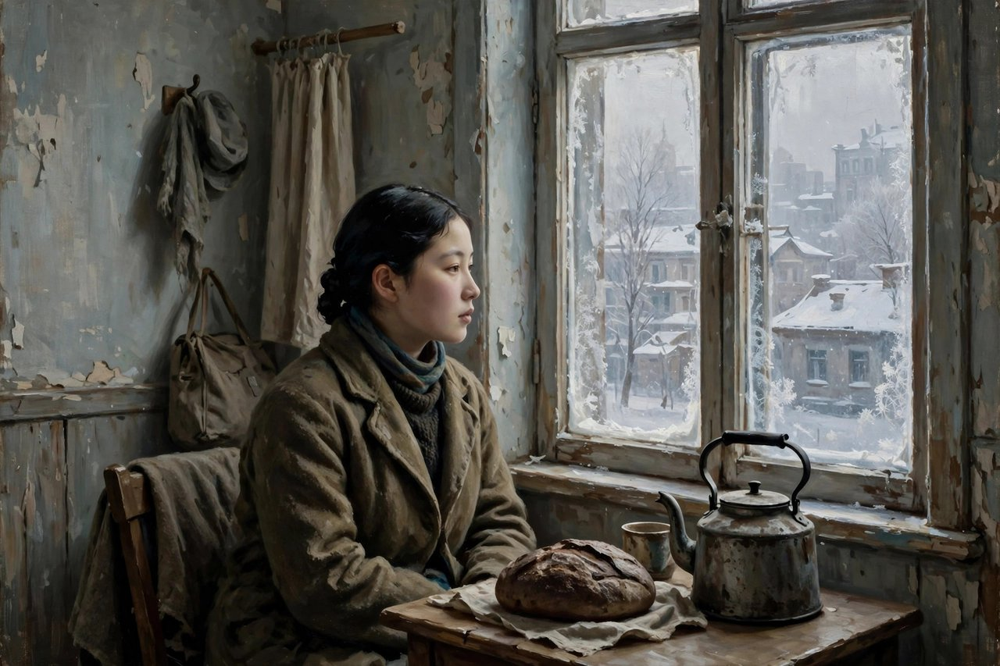
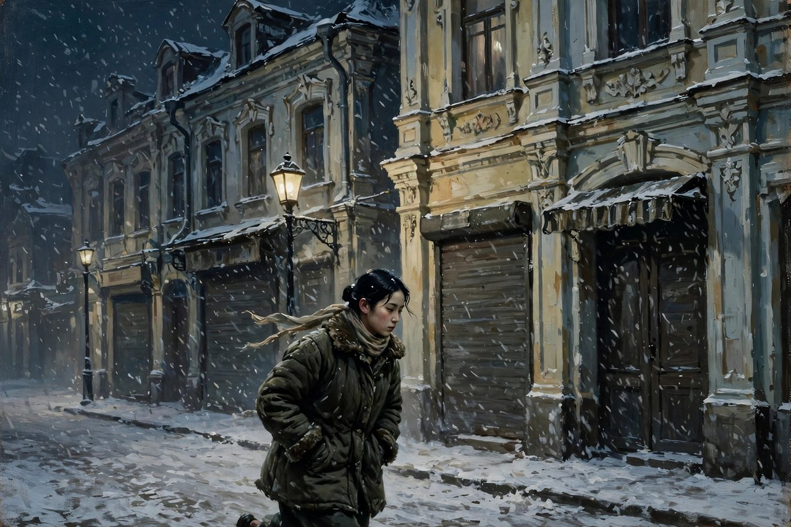

## 商市街这条街

商市街这个名字，听起来就是一条街的名字，就是哈尔滨中央大街旁边的一条街的名字，就是今天红霞街的前身的名字。可萧红把这条街的名字拿来当书名，这条街就不再只是一条街了，这条街就成了一段日子的名字，成了一段穷日子的名字，成了一段又苦又甜的日子的名字。萧红和萧军，在这条街的二十五号楼上，住过近两年的日子，从一九三二年十一月，一直住到一九三四年六月，十九个月的日子，十九个月的穷，十九个月的冷，十九个月的饿，十九个月的怕，十九个月的爱，十九个月的写作，全都写进了这本书里。这本书，是散文集，收了四十一篇散文，写于一九三五年春，在上海写成，一九三六年八月由上海文化生活出版社出版，是巴金主编的文学丛刊中的一本。写这本书的时候，萧红和萧军已经在鲁迅的帮助和接济之下，过上了比较安定的日子，可她偏偏要回过头去，写哈尔滨那段穷日子，写那段穷日子里的饥饿、寒冷、贫穷、孤独、愤恨、无聊，写那段日子在她精神上刻下的伤痕和影响，写得坦白，写得动人，写得不怕难看。

商市街这本书，写的是日常生活，写的是饥饿和恐惧，写的是一个女作家怎么在穷日子里活下来、写下来的故事。书的前半部分，讲的是饥饿，讲的是作者努力争取日常生活的时候，面临的最大挑战，书的后半部分，讲的是恐惧，讲的是作者极力挽留日常生活的时候，面临的最大障碍。饥饿和恐惧，这两种生理感觉，构成了这部作品真正的情节，构成了这本书真正的骨架。没有大事件，没有大冲突，没有大高潮，只有饥饿，只有恐惧，只有日子，只有黑列巴，只有白盐，只有当铺，只有借钱，只有买皮帽，只有广告员的梦想，只有牵牛房，只有十元钞票，只有拍卖家具，只有最后的一星期，只有这些小事，这些小事堆在一起，就是商市街，就是哈尔滨的穷日子，就是萧红和萧军的青春，就是中国现代文学里最动人的一段日子。

住进商市街之前，萧红和萧军的日子更苦。一九三二年八月，萧红在哈尔滨市立医院生产完，因为无家可归，被萧军接到朋友裴馨园家，裴馨园是国际协报文艺版的主要负责人，收入稳定，是朋友中经济状况最好的人。可长期的寄住，引起了裴家家眷的不满，裴馨园为了家庭和睦，请他们离去，二萧实在无处可去，裴家见状举家搬迁到另一处住所，日常用品也都带走，萧红和萧军这才不得已搬到欧罗巴旅馆，开始了正式的同居生活。欧罗巴旅馆是俄国人开的旅馆，里头住着各种各样的人，有妓女，有车夫，有小贩，有流浪者，有像萧红和萧军这样的穷作家。住在旅馆里，日子是冷的，是饿的，是没有着落的，萧军需要每日外出筹钱，加上他以往自由惯了，往往出门就是一整天，萧红独自留在旅馆里，长时间地隔绝独处、思考、游荡，形成了她这一时期主要的生命经验，也为后来的回忆写作储备了材料。这种独处，是商市街这本书的底色，是萧红写作的起点，是她后来所有写作的源头。她在独处里学会了看，学会了想，学会了写，学会了把日子一笔一笔地记下来，记成了商市街，记成了中国现代文学里最细腻的日子书。

## 饥饿是什么味道

商市街里写饥饿，写得最动人，写得最具体，写得最让人心疼。萧红写饥饿，不写抽象的饿，不写口号式的饿，写的是具体的饿，写的是清晨茶房把列巴圈挂在别的房间门上，新鲜面包的气味飘过来，饿着肚子的人闻了想做贼，又觉得羞耻的那种饿。写的是萧军白天出门找活、找钱，晚上回来，萧红强忍饥饿，安慰对方说自己不饿的那种饿，怎能不饿，白天萧军出门，只留她一个人面对清冷的四壁，面对空空的胃，面对飘过来的面包香味，面对想做贼又羞耻的心情。写的是两个人好不容易谋到一份家庭教师的职位，快乐得像孩子一样，酒足饭饱，含着糖果，对着镜子比着红舌头、绿舌头的那种快乐，快乐完了，还是要面对下一顿饭，下一顿饭在哪里，还是不知道。写的是买来黑列巴，两个人蘸着盐吃，就这样在欧罗巴旅馆里度过充满咸味的蜜月的那种甜，甜里带着咸，咸里带着苦，苦里带着爱，爱里带着穷，穷里带着年轻，年轻里带着不服气。

黑列巴这个东西，在商市街里出现了很多次，黑列巴是俄语黑面包的意思，是哈尔滨穷人吃的东西，是硬的，是酸的，是要蘸着盐吃的，是要就着水吃的，是要省着吃的。萧红写黑列巴，写的是穷人的主食，写的是穷日子的味道，写的是两个人分着吃一块黑面包、蘸着盐吃出蜜月感的日子。今天的人，吃黑面包，是为了健康，是为了减肥，是为了情调，是花大价钱买来的网红面包，可萧红那时候吃黑面包，是为了活命，是为了填饱肚子，是为了在饿肚子的时候，还能有一点东西嚼一嚼，还能有一点咸味刺激一下胃，还能有一点活下去的劲。这种差别，就是商市街这本书要告诉读者的东西，就是穷和情调的差别，就是活命和生活的差别，就是哈尔滨的穷日子和今天的精致生活的差别。读商市街，就是把这种差别看清楚，看清楚了，才不会轻飘飘地说穷也是一种生活，穷也是一种浪漫，穷也是一种体验，穷不是浪漫，穷是饿，穷是冷，穷是羞耻，穷是想做贼又觉得羞耻的心情，穷是强忍饥饿说自己不饿的谎话。

商市街里还写了很多找工作的事，写萧军每日出门谋职却无功而返，写萧红自己也想负担一点，想去外面求职业，写两个人发现国际协报登了招聘广告员的广告，写萧红以前学过画画，月薪四十元对她是个不小的诱惑，写她想去应聘，想去画画，想去赚钱，想去分担一点，想去让日子好过一点。这些找工作的事，今天的人也熟悉，今天的人找工作，也是投简历，也是面试，也是被拒绝，也是无功而返，也是想换个行业、换个城市、换个活法，也是想让日子好过一点。萧红写找工作，写得细，写得真，写得不怕难看，写萧军一身雪回到旅馆，写萧红强忍饥饿安慰对方，写两个人快乐得像孩子一样的那种小确幸，写两个人失望的时候那种无聊、那种孤独、那种愤恨。今天的人读到这里，可能会想起自己找工作的时候，想起自己投了几十份简历没有回音的时候，想起自己一个人留在出租屋里、等着对方回来的心情，想起自己强忍着说自己不饿、实际上饿得发慌的时候。商市街这本书，就是这样一本书，写的是民国的穷日子，照见的是今天的穷日子，写的是哈尔滨的雪，照见的是今天的出租屋，写的是黑列巴，照见的是今天的外卖和泡面。

## 恐惧是什么样子

商市街的后半部分，讲的是恐惧，讲的是日本便衣警察带来的恐惧，讲的是在哈尔滨这个被日本人控制的城市里，两个穷作家怎么提心吊胆地过日子，怎么在街上看见日本便衣警察就慌乱地跑进一家洋酒面包店，怎么在铺子里消费了三角五分钱，假若是更多的钱在那当儿丢在马路上，也不觉得可惜，怎么在铺子里聚精会神地观察外面日本人的动静，怎么把恐惧和慌乱表露出来，又怎么在事后觉得这真是一场大笑话。这种恐惧，不是战场上的恐惧，不是枪林弹雨的恐惧，是日常生活里的恐惧，是走在街上怕被抓、怕被盘问、怕被怀疑的恐惧，是住在旅馆里怕被搜查、怕被举报、怕被带走的恐惧，是写东西怕被审查、怕被禁、怕被抓的恐惧。这种日常的恐惧，今天的人也熟悉，换了个样子还在，换成了怕被裁员、怕被优化、怕被网暴、怕被举报、怕说错一句话就丢了工作、丢了账号、丢了名声的恐惧。恐惧的本质没有变，还是人在一个不确定的环境里，提心吊胆地过日子，还是人在街上走路要看脸色，在网上说话要看风向，在家里待着也要担心明天会不会出事。萧红写恐惧，写得细，写得真，写得带着自嘲，写得带着幽默，写得让人一边笑一边心疼，因为恐惧本身就是可笑的，就是荒唐的，就是一个人为了三角五分钱的面包，也要躲进铺子里观察外面的动静，就是一个人为了活下去，要学会各种各样的小聪明、小躲避、小谎话。

商市街里还写了很多日常的小事，写当铺，写借钱，写买皮帽，写广告员的梦想，写牵牛房，写十元钞票，写拍卖家具，写最后的一星期，这些小事，在很多作家笔下是会被略过的，是会被当成背景的，可在萧红笔下，这些小事就是正文，就是日子本身，就是商市街本身。当铺是什么地方，是穷人把东西换成钱的地方，是把棉袄、把皮帽、把家具一件一件当掉的地方，是把日子一件一件换成钱的地方。借钱是什么事，是向朋友借、向熟人借、向能借的人借，借来了，日子能过几天，借不来，日子就要断顿。买皮帽是什么事，是冬天来了，要买一顶帽子御寒，可钱不够，要算计，要犹豫，要想想买了帽子，饭怎么办，买了饭，帽子怎么办。广告员的梦想是什么，是萧红想去当广告员，想去画画，想去赚钱，想去分担，想去让日子好过一点，可梦想归梦想，现实归现实，梦想没有实现，日子还是要过。牵牛房是什么地方，是两个人住过的地方，是穷日子的一个住处，是风雪里的一个窝。十元钞票是什么，是两个人手里的一笔钱，是能过几天日子的钱，是要省着花的钱，是花完了就不知道下一笔在哪里来的钱。拍卖家具是什么事，是把家里的东西一件一件卖掉，卖掉了，屋子就空了，日子就更穷了，可不卖，日子就过不下去了。最后的一星期是什么，是两个人离开哈尔滨之前的一星期，是告别的日子，是收拾东西的日子，是把商市街的日子画上一个句号的日子。这些小事，堆在一起，就是商市街，就是萧红的青春，就是萧红的写作起点，就是中国现代文学里最细腻的日子书。

## 穷日子里的一点甜

商市街这本书，虽然写穷，写饿，写冷，写怕，可里头还有甜，还有爱，还有年轻，还有两个人互相取暖的样子。萧红和萧军，在最穷的日子里，还能快乐得像孩子一样，还能含着糖果对着镜子比舌头，还能买来黑列巴蘸着盐吃出蜜月的感觉，还能在雪天里互相安慰，还能在失望的时候互相打气，还能在独处的时候写东西、想事情、看书、做梦。这种甜，不是富贵里的甜，不是锦衣玉食里的甜，是穷日子里的甜，是两个人都没有钱、都没有着落、都没有未来的时候，还能互相取暖、互相心疼、互相笑出来的甜。这种甜，今天的人也熟悉，今天的年轻人，在出租屋里，在合租屋里，在加班的夜里，在还贷的压力里，也能找到这样的甜，也能和爱人分着吃一碗面，也能和朋友分着吃一块面包，也能在一个小小的屋子里，笑出来，暖起来，觉得日子虽然穷，可还是有盼头的，还是有爱人的，还是有写东西的劲的。萧红写这种甜，写得不煽情，不卖惨，不把穷日子写成浪漫，写得真实，写得具体，写得让人觉得，穷日子里的甜，是真的甜，是苦里长出来的甜，是咸里长出来的甜，是冷里长出来的甜，是值得珍惜的甜，也是值得心疼的甜。

商市街里写萧红一个人的独处，也写得特别动人。萧军出门找钱，萧红一个人留在旅馆里，长时间地隔绝独处、思考、游荡，这种独处，在很多人看来是孤独的，是可怜的，是无聊的，可在萧红笔下，这种独处也是写作的源头，也是思考的源头，也是看清楚日子的源头。她在独处里，看窗外的雪，看街上的人，看旅馆里的各色人等，看妓女的欢笑，看车夫的叫卖，看小贩的吆喝，看风雪里的行人，看饿着肚子的人怎么走路，看有钱的人怎么吃饭，看穷人怎么算计着过日子。她在独处里，想自己的命，想自己的将来，想自己的写作，想自己为什么要写，想自己写的东西有没有人看，想自己这样穷下去，还能不能写下去。她在独处里，游荡，游荡在旅馆里，游荡在街上，游荡在哈尔滨的风雪里，游荡在自己的心里，游荡完了，回来写下来，写成了商市街，写成了后来的生死场，写成了呼兰河传。今天的人，独处的时候，常常是刷手机，常常是看短视频，常常是被算法带着走，常常是越独处越焦虑，越独处越空虚，越独处越不知道自己是谁。萧红的独处，是反过来的，是越独处越清楚，越独处越能写，越独处越能看清楚日子，越独处越能找到自己的声音。这种独处的能力，今天特别缺，今天的人太怕独处了，太怕一个人待着了，太怕安静了，太怕没有手机、没有网络、没有热闹的日子了。读商市街，就是学一学独处，学一学一个人待着的时候，怎么看，怎么想，怎么写，怎么把日子过成文字，把文字过成日子。

商市街这本书的语言，也值得单说。萧红的语言，在这本书里是最日常的，是最口语的，是最没有架子的，是带着哈尔滨的口音、带着旅馆的气味、带着风雪的冷、带着黑列巴的酸的语言。她写雪，写的是雪落在帽子上、落在肩膀上、落在人心里头的冷。她写饿，写的是胃里空着、嘴里没味、眼睛盯着别人家门上的列巴圈走不动路的馋。她写怕，写的是心跳加速、手心出汗、脚步加快、躲进铺子里不敢出来的慌。她写爱，写的是两个人分着吃一块面包、蘸着盐吃出蜜月感的甜。她写无聊，写的是一个人对着四面墙发呆、想事情、游荡、不知道干什么好的空。这种语言，今天的写作者最该学，因为今天的文字太爱用大词了，太爱用概念了，太爱用金句了，大词一堆，日子没了，人才没了。萧红反过来，她不用大词，她用小词写大事，用日常写时代，用一碗饭写一个社会，用一块黑面包写一种制度，用三角五分钱写一种恐惧，这才是文字的真本事，这才是商市街这本书留给今天写作者最重要的东西。

## 对照今天看商市街

今天再读商市街，很多人会觉得，这本书写的是民国哈尔滨的穷日子，写的是旅馆、黑列巴、当铺、借钱这些旧东西，跟今天没有关系。其实关系大得很，只不过换了个样子。旅馆换成了出租屋，换成了合租屋，换成了城中村的小单间，黑列巴换成了泡面，换成了外卖，换成了打折的面包，当铺换成了网贷，换成了信用卡，换成了借呗花呗，借钱换成了向朋友借、向平台借、向家里借，买皮帽换成了买羽绒服、买取暖器、买过冬的装备，广告员的梦想换成了想当博主、想当主播、想当自由职业者、想靠写作、靠画画、靠手艺赚钱的梦想，牵牛房换成了各种各样的出租屋，十元钞票换成了工资卡里的余额，拍卖家具换成了闲鱼上卖旧东西，最后的一星期换成了离开一个城市之前的一星期，收拾东西、告别朋友、退租、搬家、把一个城市的日子画上句号。换汤不换药，日子还是日子，穷还是穷，饿还是饿，冷还是冷，怕还是怕，爱还是爱，年轻还是年轻，写作还是写作。读商市街，就是认出这些换了样子的东西，认出来了，才不会觉得自己的穷是独一无二的，才不会觉得自己的难是没人理解的，才会明白，萧红那时候也穷过，也饿过，也怕过，也找过工作，也独处过，也写过东西，也把日子写成了书，自己今天也可以这样，也可以把日子过下去，也可以把日子写下来，也可以把穷日子过出一点甜，过出一点光，过出一点文字来。

今天的年轻人，读商市街，还有一个特别的意义，就是学一学怎么在穷日子里写作，怎么在没有钱、没有名气、没有着落的时候，还坚持写东西，还坚持看日子，还坚持把日子记下来。萧红写商市街的时候，没有稿费，没有名气，没有大房子，没有安稳日子，只有旅馆的小屋，只有黑列巴，只有白盐，只有风雪，只有独处，可她还是写了，还是写了四十一篇，还是写成了书，还是写出了中国现代文学里最动人的日子书。今天的年轻人，写作的条件比她好多了，有电脑，有手机，有平台，有读者，有稿费，有各种各样的发表渠道，可很多人写不出来，写不下去，写了几篇就放弃了，写了几篇就觉得没人看、没意义、没前途，就不写了。萧红的例子告诉我们，写作看的不是条件，看的是眼睛，看的是心，看的是你有没有真正地看过日子，有没有真正地疼过，有没有真正地把日子记下来。她看过哈尔滨的雪，看过旅馆的人，看过黑列巴的味道，看过当铺的冷，看过借钱的难，她把这些都记下来了，记成了商市街，记成了后来人认识哈尔滨、认识穷日子、认识写作的入口。今天的年轻人，也可以这样，把自己的出租屋、自己的泡面、自己的外卖、自己的找工作、自己的独处、自己的加班、自己的还贷，全都记下来，记成自己的商市街，记成自己的日子书，记下来，日子就不会白过，写作就不会白写，人生就不会白活。

## 日子书的读法

商市街这本书的读法，也很简单，别急着找主题，别急着找思想，别急着划线，别急着写读后感。先慢慢读，读欧罗巴旅馆，读雪天，读家庭教师，读黑列巴和白盐，读当铺，读借钱，读买皮帽，读广告员的梦想，读牵牛房，读十元钞票，读拍卖家具，读最后的一星期，读完一篇，再读一篇，读出饿来，读出冷来，读出怕来，读出甜来，读出年轻来，读出写作来，读出自己身边的影子来。读进去了，你会发现，商市街不只是一条街，商市街是每一个年轻人在一个城市里打拼过的日子，是每一个穷作家在旅馆里写过的日子，是每一个找工作的人在雪天里走过的日子，是每一个独处的人在四面墙里想过的日子，是每一个相爱的人在穷日子里分着吃面包的日子。这些日子，今天还在，还在出租屋里，还在合租屋里，还在加班的夜里，还在还贷的压力里，还在找工作的路上，还在独处的夜里，还在写东西的电脑前。读商市街，就是把这些日子认出来，就是把这些日子过明白，就是把这些日子写下来，就是把自己的商市街，也写成一本书，写成自己的日子书，写成后来人认识自己的入口。

这本书留给今天的人，还有一个很实在的提醒，就是别把穷日子过成抱怨，别把饿日子过成躺平，别把怕日子过成逃避，别把独处的日子过成刷手机，别把找工作的日子过成焦虑，别把相爱的日子过成算计。萧红在最穷的日子里，没有抱怨，没有躺平，没有逃避，没有刷手机，没有焦虑到不写东西，她是把穷日子写下来了，把饿日子写下来了，把怕日子写下来了，把独处的日子写下来了，把找工作的日子写下来了，把相爱的日子写下来了，写成了商市街，写成了后来人手里的一本书，写成了今天的人读完之后，心里会多一点东西，多一点对日子的疼，多一点对穷人的心疼，多一点对自己的提醒，多一点把日子过下去、把日子写下来的勇气。这本书，今天还在，还在被阅读，还在被讨论，还在让一代又一代的读者想起自己的穷日子，想起自己的哈尔滨，想起自己的商市街，想起自己的黑列巴，想起自己的白盐，想起自己的旅馆，想起自己的独处，想起自己的爱人，想起自己的写作，想起自己年轻的时候，那种又苦又甜、又冷又暖、又怕又爱的日子。

商市街的灯火，今天还在亮，亮在哈尔滨的红霞街上，亮在中央大街的雪夜里，亮在旅馆的小屋里，亮在黑列巴的香味里，亮在白盐的咸味里，亮在萧红的文字里，亮在后来人的心里。走过商市街的人，读过商市街的人，心里都会有一盏灯，这盏灯不亮得刺眼，不暖得烫手，可就是在风雪里一直亮着，亮给后来的人看，亮给今天的人看，亮给每一个还在穷日子里、还在饿日子里、还在怕日子里、还在找工作、还在独处、还在写作的人看，告诉他们，日子再穷，也要看清楚，日子再冷，也要写下来，日子再怕，也要活下去，活下去了，写下来了，日子就不会白过，人生就不会白活，商市街就不会白住，黑列巴就不会白吃，白盐就不会白蘸，雪就不会白下，风就不会白吹，爱就不会白爱，年轻就不会白年轻。

## 哈尔滨的雪还在下

商市街读到尾巴上，留在心里的，是哈尔滨的雪，是旅馆的冷，是黑列巴的酸，是白盐的咸，是当铺的门，是借钱的难，是买皮帽的犹豫，是广告员的梦想，是牵牛房的窝，是十元钞票的分量，是拍卖家具的空，是最后的一星期的告别，是两个人分着吃面包的样子，是一个人独处时想事情的样子，是萧军一身雪回来的样子，是萧红强忍饥饿说自己不饿的样子。这些样子，拼在一起，就是商市街，就是哈尔滨，就是萧红的青春，就是萧红的写作起点，就是中国现代文学里最细腻的日子。今天的人，读到这里，可能会想起自己的哈尔滨，想起自己打拼过的城市，想起自己住过的出租屋，想起自己吃过的泡面，想起自己找过的工作，想起自己独处过的夜，想起自己爱过的人，想起自己写过的东西，想起来了，就会明白，商市街不是别人的日子，商市街是自己的日子，是每一个年轻人都住过的一条街，是每一个穷作家都写过的一本书，是每一个在风雪里还想活下去、还想写下去的人，心里都亮着的一盏灯。

这盏灯，萧红留下来了，留在了商市街里，留在了四十一篇散文里，留在了黑列巴和白盐里，留在了雪天和家庭教师里，留在了当铺和借钱里，留在了买皮帽和广告员的梦想里，留在了牵牛房和十元钞票里，留在了拍卖家具和最后的一星期里。今天的人，读这本书，就是接过这盏灯，就是把灯带回自己的出租屋，带回自己的合租屋，带回自己的加班夜，带回自己的找工作路上，带回自己的独处夜里，带回自己的写作电脑前，灯亮着，日子就不黑，灯亮着，饿就不怕，灯亮着，冷就不怕，灯亮着，怕就不怕，灯亮着，爱就还在，灯亮着，年轻就还在，灯亮着，写作就还在。商市街的灯，今天还在亮，还会继续亮下去，亮给后来的人看，亮给今天的人看，亮给每一个还在穷日子里、还在风雪里、还在找工作、还在独处、还在写作的人看，告诉他们，别怕，别躺平，别抱怨，别逃避，看清楚，写下来，活下去，活下去了，写下来了，日子就有了光，人生就有了分量。

商市街这本书，今天读起来，依然烫手，依然有用，依然能让人心里一紧，依然能让人想把自己的日子重新过一遍，过得清醒一点，过得诚实一点，过得像个人一点。萧红用十九个月的穷日子，换来了四十一篇散文，换来了中国现代文学里最动人的日子书，换来了后来人认识哈尔滨、认识穷日子、认识写作、认识自己的入口。这本书，值得放在枕边，时不时翻开一页，闻一闻黑列巴的香味，尝一尝白盐的咸味，看一看哈尔滨的雪，想一想自己今天的日子，想一想自己是不是也在商市街上住着，是不是也该把自己的日子写下来，写成自己的商市街，写成自己的日子书，写下来了，日子就不会白过，人生就不会白活。

读完商市街，合上书，走出门，看一看自己住的街，看一看自己吃的饭，看一看自己爱的人，看一看自己写的字，心里会多一点疼，多一点暖，多一点想把日子过好的念头，多一点把日子写下来的勇气。这本书，就是这样一本书，不长，不吵，不喊口号，可就是让人忘不掉，让人读完之后，还想再读一遍，还想把自己的商市街，也过下去，也写下来，也亮起一盏灯。

商市街的雪还在下，商市街的灯还在亮，商市街的日子还在过，后来的人，还在路上，还在找工作，还在独处，还在写作，还在相爱，还在分着吃面包，还在蘸着盐吃黑列巴，还在风雪里往前走，走下去了，日子就有了光，人生就有了分量，商市街就没有白住，萧红就没有白写。

商市街的灯，今天还在亮，亮在哈尔滨的红霞街上，亮在中央大街的雪夜里，亮在旅馆的小屋里，亮在黑列巴的香味里，亮在白盐的咸味里，亮在萧红的文字里，亮在后来人的心里。走过商市街的人，读过商市街的人，心里都会有一盏灯，这盏灯不亮得刺眼，不暖得烫手，可就是在风雪里一直亮着，亮给后来的人看，亮给今天的人看，亮给每一个还在穷日子里、还在饿日子里、还在怕日子里、还在找工作、还在独处、还在写作的人看，告诉他们，日子再穷，也要看清楚，日子再冷，也要写下来，日子再怕，也要活下去，活下去了，写下来了，日子就不会白过，人生就不会白活，商市街就不会白住，萧红就不会白写。

商市街这本书，读一遍是饿，读两遍是冷，读三遍是怕，读很多遍是甜，是穷日子里的甜，是黑列巴蘸盐的甜，是含着糖果比舌头的甜，是两个人分着吃面包的甜，是一个人独处时想事情的甜，是萧军一身雪回来的甜，是萧红强忍饥饿说自己不饿的甜。这种甜，读一遍读不出来，读很多遍才能读出来，读出来了，才明白，穷日子不是只有苦，穷日子里还有爱，还有年轻，还有写作，还有互相取暖，还有把日子写下来的劲，还有把商市街的灯点亮的劲，灯亮着，日子就不黑，灯亮着，饿就不怕，灯亮着，冷就不怕，灯亮着，怕就不怕。
