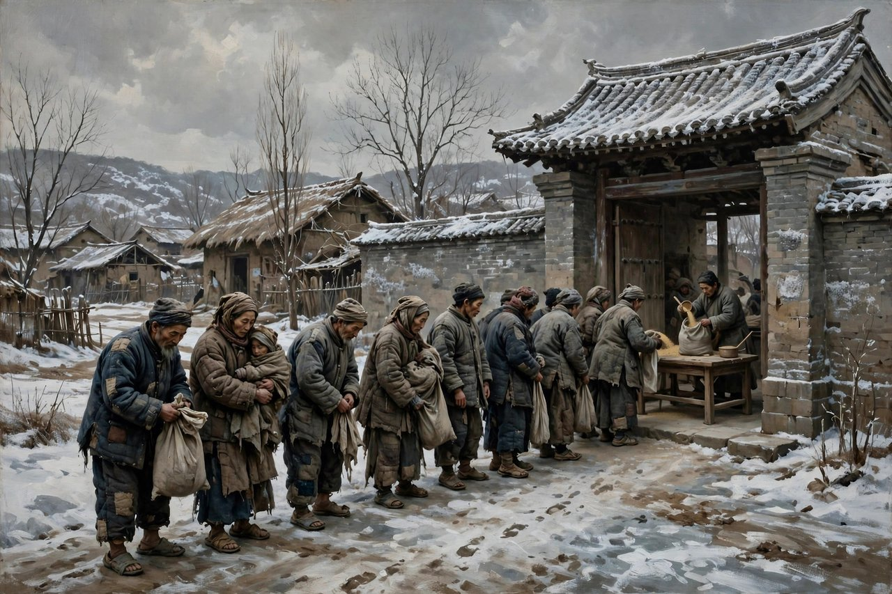
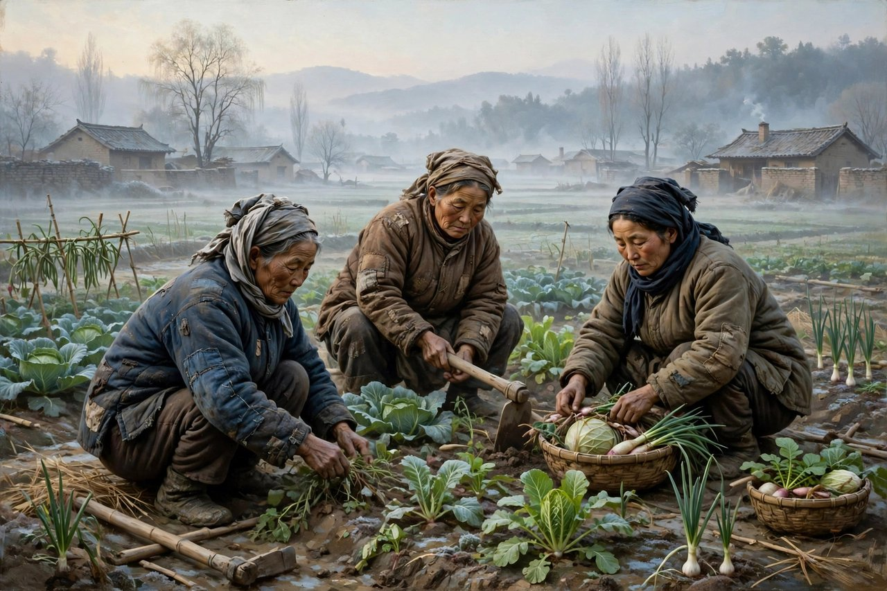

## 一块麦场摊开的日子

生死场这个名字，听起来就带着土腥味，带着血腥味，带着麦场上扬起的尘土味。麦场是什么地方，是村里打麦子的地方，是人跟牲口一起忙活的地方，是生孩子、死人、吵架、过日子全都挤在一起的地方。萧红把书名取成生死场，就是告诉读者，这本书不讲大道理，不讲英雄史诗，只讲一块场子上的生与死，讲农民怎么生孩子，怎么死人，怎么饿肚子，怎么被地主压着，怎么被官府压着，怎么在日本人打进来之后，慢慢从糊涂里醒过来，拿起家伙反抗。这本书写于一九三四年，写在哈尔滨的部分，写在青岛的部分，合起来是一本中篇，篇幅不算长，分量却重得很。一九三五年十二月，这本书由上海容光书局出版，列入奴隶丛书，鲁迅给它写了序，胡风给它写了读后记。鲁迅在序里说，这本书写的是北方人民对于生的坚强、对于死的挣扎，力透纸背。这句话不是客套，是鲁迅认真读完之后给出的判断，也是这本书后来几十年里最好的通行证。

书里写的是哈尔滨附近一个偏僻村庄的故事，时间跨度从日本人打进来之前，一直写到日本人打进来之后。村庄不大，人不多，可里头的人和事，全是东北农村的缩影。地是荒的，生产是凋敝的，饥馑遍地，瘟疫流行，农民在地主和官僚的双重压迫之下，在物质和精神都极度贫困的条件下，愚昧却顽强地活着。这种活法，不是书本里那种昂扬向上的活法，是糊涂的活法，是本能的活法，是今天不知道明天、今年不知道明年的活法。萧红写这种活法，不美化，不丑化，不站在高处评判，她就是把日子摊开，把麦场摊开，把菜圃摊开，把一个村庄的生老病死摊开，让读者自己看，看完了心里自然会发紧。

书里的人物，没有一个是完美的，也没有一个是单纯的坏。王婆是个苦命的女人，买马交租，日子过得紧巴巴的，前夫的儿子参加了红胡子，被官府枪毙了，她悲痛绝望，服毒自杀，又奇迹般地活了下来。活下来之后，她还是要过日子，还是要面对租子、面对饥荒、面对日本人。这种求生的本能，这种在死亡线上盲目挣扎的样子，就是生死场这个题目的全部意思。人不是因为懂了什么大道理才活着的，人是因为不想死，才咬着牙活着的。金枝夫妻更惨，穷得实在养不活孩子，竟然把自己的孩子活活摔死。写到这里，萧红的笔是冷的，她没有哭天抢地，没有喊口号，她就是把这件事写出来，写得平静，写得具体，平静到让人害怕。具体到让人明白，穷到一定地步，人是会做出连自己都不敢想的事情的，穷不是一个形容词，穷是一种能把人逼到绝路上的力量。

赵三和李青山是书里比较清醒的人，他们秘密组织镰刀会，反对地主加租，很快就被镇压下去了。镇压下去不等于没有意义，镇压下去说明，在这个村庄里，已经有人开始想反抗了，已经有人开始觉得日子不该这样过了。只不过，在日本人打进来之前，这种反抗还是零散的，还是糊涂的，还是没有找到路子的。萧红写这种反抗，写得不浪漫，不把反抗者写成英雄，写的是反抗者的软弱、反抗者的糊涂、反抗者的失败，以及失败之后还在心里留着的那点火星。这点火星很重要，因为到了日本人打进来之后，这点火星就烧起来了。

## 日本人打进来之后

九一八事变之后，村庄变了。兵营里飘起了日本太阳旗，日本人嘴上说着恢复大清帝国，说着中日亲善，实际上到处奸淫掳掠，杀人放火，稍有反抗，格杀勿论。村庄的平地里，出现了许多乱坟岗子，那些坟岗子，就是日本人罪行的见证，也是农民从糊涂里醒过来的代价。萧红写日本人的罪行，不写抽象的控诉，写具体的场面，写一个村庄怎么被糟蹋，写一家人怎么被拆散，写一个女人怎么被糟蹋之后还要活下去，写一个男人怎么看着妻儿被害之后，跛着脚也要追赶着加入队伍。这种具体的写法，比喊一百句口号都有力量，因为读者看到的不是一个概念，看到的是人，是血，是坟，是活生生被毁掉的日子。

李青山在革命队伍里干了一阵子之后回村，联络了三十多个青年农民，组成了队伍。赵三喊出了那句有名的话，生是中国人，死是中国鬼，不是亡国奴。这句话在书里不是口号，是一个人被逼到绝路上之后喊出来的话，是一个糊涂了半辈子的人终于明白自己是谁之后喊出来的话。在这句话之前，赵三也是个普通农民，也会糊涂，也会怕，也会为了租子发愁，可到了日本人打进来、妻儿被害、村庄被糟蹋的时候，他明白了，活着不只是为了吃饭、为了交租、为了生孩子，活着还为了不当亡国奴，还为了做一个中国人。这种醒悟，不是书本教出来的，是血教出来的，是坟岗子教出来的，是日本人的刺刀教出来的。萧红写这种醒悟，写得克制，写得真实，没有把赵三写成一下子就高大起来的人，写的是他喊完之后，还是要面对饥饿，还是要面对寒冷，还是要面对队伍里的困难，可他心里已经有了一根筋，这根筋，就是不做亡国奴。

二里半这个人物，也值得单说。书里写他，原先除了自己养的羊，对一切都不闻不问，是个典型的只顾自己的人。可在无数血的事实面前，在他的妻儿被害之后，他也变了，也跛着脚追赶着加入李青山的队伍。一个只顾自己羊的人，变成了愿意跟着队伍走的人，这个转变，说明日本人的罪行已经把最自私的人也逼醒了，也说明萧红对人性的看法不是简单的，她不认为人是天生觉悟的，也不认为人是天生麻木的，她认为人是在日子里、在血里、在疼里，一点一点醒过来的。这种醒过来，有快有慢，有早有晚，有人醒得早，有人醒得晚，可只要疼到了一定地步，人总是会醒的。这就是生死场里最动人的地方，也是最让人心疼的地方，因为醒过来的代价太大了，大到要用妻儿的命、要用村庄的血、要用乱坟岗子去换。

## 女人身上的生死场

生死场里，女人的命运尤其让人看不下去。萧红自己就是女人，她懂得女人在农村里的位置，懂得女人在家里没有话语权，懂得女人在生孩子、养孩子、伺候老人、伺候男人这些事里是怎么被磨掉的。金枝摔死自己的孩子，这件事不能只用残忍两个字来概括，要看她背后的日子，看她穷到什么地步，看她一天吃不上几顿饭，看她生了孩子养不活，看她丈夫也愁得没办法，看她在那个村庄里，连哭的地方都没有。萧红写金枝，写的是一个母亲在绝境里的选择，这个选择是错的，是惨的，可萧红没有站在道德高地上骂她，她是把金枝的日子摊开，让读者明白，逼死孩子的不是金枝一个人，是穷，是租子，是瘟疫，是整个压在农民身上的制度。

王婆的命，也是女人命的缩影。她买马交租，她失去儿子，她服毒自杀又活下来，她支持丈夫的工作，她在村庄里忙前忙后，她的一生，就是一部女人的生死史。她没有读过书，没有见过世面，没有喊过口号，可她活得顽强，活得硬，活得像麦场上的麦子，风吹雨打都不倒。萧红写王婆，写的是女人的韧性，写的是女人在最苦的日子里还能活下去的本事。这种韧性，不是浪漫化的坚强，是被逼出来的坚强，是没有退路之后的坚强，是哭完了还要起来做饭、还要起来交租、还要起来面对日本人的坚强。今天的人看王婆，可能会觉得她糊涂，觉得她迷信，觉得她没有反抗精神，可萧红要读者看到的，恰恰是这种糊涂背后的硬，是这种没有文化、没有理论的人身上，那种对于生的坚强、对于死的挣扎。这种坚强和挣扎，不比任何英雄差，甚至比英雄更真实，因为英雄是写出来的，王婆是活出来的。

书里还写了很多女人的日常，写女人怎么生孩子，怎么带孩子，怎么在菜圃里忙活，怎么在麦场上忙活，怎么在日本人打进来之后还要护着孩子、护着家。这些日常，在很多作家笔下是会被略过的，是会被当成背景的，可在萧红笔下，这些日常就是正文，就是生死场本身。因为对于农村女人来说，生死不是战场上的大事，生死就是生孩子、养孩子、孩子死了、自己还要活下去这些事。萧红把这些事写出来，就是把女人的生死场写出来了，就是告诉读者，别只看男人的战场，女人的炕头、女人的菜圃、女人的麦场，同样是生死场，同样有血，同样有疼，同样值得被写下来。

## 散的笔法和硬的现实

生死场的写法，是萧红后来一直用的写法，就是散文化的写法。书里没有一条笔直的故事线，没有一个贯穿始终的大事件，没有一个传统意义上的主人公，书里有的，是一个村庄的片段，是麦场、菜圃、村庄、人物一个一个地出场，又一个一个地消失，是日子一件一件地摆出来，摆着摆着，整个村庄的样子就出来了，整个时代的样子就出来了。这种写法，在当时是新鲜的，也是冒险的，因为很多读者习惯了有头有尾的故事，习惯了有主人公、有冲突、有高潮的故事，突然读到这样一本散的书，会觉得散，会觉得乱，会觉得没有重点。可萧红偏偏要这样写，因为她觉得，农村的日子本身就是散的，就是碎的，就是没有大高潮的，农民的日子不是戏剧，农民的日子是麦场、是菜圃、是租子、是瘟疫、是日本人，是一件一件的小事堆起来的大事。她用散的笔法写散的日子，写得越散，越真实，越让人觉得这就是农村，这就是生活，这就是生死场。

这种写法的好处，是真实，是细腻，是女性特有的观察。萧红看东西看得细，她写麦场，写的是麦子扬起的尘土，写的是人脸上的汗，写的是牲口的喘气。她写菜圃，写的是菜叶子上的虫，写的是女人弯腰的样子，写的是菜圃边上孩子的哭声。她写瘟疫，写的是人一个一个地病倒，写的是村庄里慢慢安静下来，写的是死人的气味，写的是活着的人的恐惧。这些细节，不是装饰，是日子本身，是萧红用眼睛、用耳朵、用鼻子记下来的日子。今天很多写农村的作品，写的是概念，写的是乡愁，写的是滤镜，细节是编出来的，是想象出来的，读起来假，读起来空。萧红的细节是活的，是带着土味、带着汗味、带着血味的，读起来让人觉得，她真的在那个村庄里待过，真的在那个麦场上站过，真的闻过那个味道。

鲁迅给生死场写序，胡风给生死场写读后记，这两个人对萧红的评价，都指向了一个点，就是这本书的新鲜和明丽。鲁迅说，叙事和写景，胜于人物的描写，女性作者的细致观察和越轨的笔致，增加了不少明丽和新鲜。这句话的意思是，萧红不按规矩写，不按男作家的路子写，她有自己的路子，自己的眼睛，自己的笔致。这种越轨，在当时是被看重的，在今天看，依然是被看重的，因为今天的写作太按规矩了，太按套路了，太按流量公式了，写出来的东西千篇一律，读起来都像一个人写的。萧红的越轨，就是不按套路，不按公式，不为了讨好读者而写，只为了把自己看到的日子写下来。这种越轨，是写作的生命力，也是萧红留给今天写作者最重要的提醒。

## 对照今天看生死场

今天再读生死场，很多人会觉得，这本书写的是民国东北，写的是日本人打进来的事，跟今天没有关系。其实关系大得很，只不过换了个样子。书里写的穷，换了个样子还在。今天的穷，不再是吃不上饭的穷，不再是交不起租子的穷，可新的穷换了个样子，换成了还不起房贷的穷，换成了看不起病的穷，换成了孩子上学要花大钱的穷，换成了打工一年到头存不下钱的穷。穷的本质没有变，还是人被日子压着，还是人为了活下去要咬牙，还是人在绝境里会做出连自己都不敢想的选择。金枝摔死孩子的事，今天不会再以同样的样子发生，可今天依然有父母因为穷、因为压力、因为看不到希望，对孩子发火，对家庭发火，对自己发火，依然有家庭在重压之下散架。读生死场，不是为了猎奇，不是为了看旧社会的惨，是为了认出穷的力量，认出穷是怎么把人逼到绝路上的，认出来了，才不会轻飘飘地骂穷人懒、骂穷人笨、骂穷人不上进，才会明白，很多人的所谓懒和笨，背后都是日子压出来的无奈。

书里写的愚昧，换了个样子也在。今天的人不信跳大神了，不信偏方治大病了，可新的愚昧换了个样子，换成了信谣言，信偏方保健品，信网络上的大师，信朋友圈里的伪科学，信一夜暴富的神话，信只要努力就能成功的心灵鸡汤。愚昧的本质没有变，还是人在不懂的时候，愿意相信一个简单的答案，愿意把自己的命交给一个看似神奇的东西，愿意跟着一群人起哄，愿意把别人的命也搭进去。呼兰河传里写小团圆媳妇被迷信折腾死，生死场里写农民信鬼神、信谣言、信各种偏方，写的是旧社会的愚昧，可那种一群人围着一个病人出主意、出偏方、出仪式，最后把人折腾死的机制，今天在网络上、在保健品推销里、在各种大师讲座里，照样活着。读生死场，就是认出这种机制，认出来了，才不会跟着起哄，才不会把自己的命交给别人，才不会在别人生病的时候，跟着出馊主意。

书里写的看客，换了个样子更厉害了。旧社会的看客，是站在街边看热闹的人，是看着小团圆媳妇被打还觉得理所当然的人，是看着别人家出事还议论纷纷的人。今天的看客，是拿着手机看热搜的人，是在评论区里围观别人家事的人，是把别人的痛苦当成谈资、当成流量、当成笑料的人。看客的本质没有变，还是自己不疼，就觉得别人的疼不疼，还是自己没事，就觉得别人的事是热闹。萧红写看客，写得冷，写得狠，写得不留情，因为她知道，看客不是无辜的，看客是帮凶，是制度的一部分，是把一个活人逼到死路上的推手中的一个。今天的人，动不动就说自己只是吃瓜群众，只是围观一下，可萧红提醒我们，围观不是无辜的，起哄不是无辜的，把别人的痛苦当成谈资，也不是无辜的。读生死场，就是把自己从看客的位置上拉下来，问一问自己，我是不是也在看热闹，我是不是也在跟着议论，我是不是也在把别人的命当成故事。

书里写的醒悟，也值得今天的人想一想。赵三和二里半的醒悟，是被血逼出来的，是被日本人的刺刀逼出来的，是被妻儿的死逼出来的。这种醒悟的代价太大了，大到让人不忍心看。可今天的人，醒悟的代价是不是也可以小一点，是不是可以在没有血、没有死、没有妻儿被害之前，就先醒过来，先看清楚自己身边的日子，先看清楚自己是不是在被压着，是不是在被糊弄，是不是在跟着起哄。萧红写醒悟，不是为了歌颂醒悟，是为了让人心疼醒悟的代价，是为了提醒后来的人，别等到疼到极点才醒，别等到家破人亡才明白自己是谁，别等到村庄变成乱坟岗子才喊出自己是中国人。这句话，今天听起来可能有点远，可换个说法，就是别等到自己被坑了、被骗了、被压垮了，才明白自己该争取什么，该拒绝什么，该为什么活着。

## 为什么生死场还值得读

生死场值得读，原因很实在。原因在它的真实。萧红写的东西，是她见过的，是她在哈尔滨、在青岛、在东北农村里见过的，不是编出来的，不是想象出来的，不是照着别人的书抄出来的。她写麦场，是因为她见过麦场，写菜圃，是因为她见过菜圃，写农民交租，是因为她见过农民交租，写日本人糟蹋村庄，是因为她见过日本人糟蹋东北。这种真实，在今天这个满世界都是编造、满世界都是人设、满世界都是文案的时代，特别稀缺。今天很多人写农村，没有在农村待过，写出来的农村是想象的农村，是旅游宣传片里的农村，是电视剧里的农村，读起来假，读起来空。萧红的农村是真的，是带着土味、带着汗味、带着血味的，读起来让人觉得，她真的在那个村庄里站过，真的闻过那个味道，真的看过那些人。

原因在它的冷静。萧红写惨事，不煽情，不卖惨，不哭天抢地，不喊口号，她就是把事情摆出来，摆得平静，摆得具体，平静到让人害怕，具体到让人心疼。这种冷静，比煽情更有力量，因为煽情是作者在替读者哭，冷静是让读者自己哭，是让读者自己觉得疼，自己觉得不忍心，自己觉得应该做点什么。今天很多作品，写惨就拼命煽情，音乐一响，眼泪一掉，观众跟着哭一场，哭完就忘了，什么也没留下。萧红不这样，她不替读者哭，她只把日子摆出来，摆完了，读者心里那点疼，是自己长出来的，是忘不掉的，是会跟着读者走很久的。这种冷静的写作，是最难学的，也是最值得学的。

原因在它的女性视角。萧红写战争，写的不只是男人的战场，写的是女人的炕头，写的是女人的菜圃，写的是女人的麦场，写的是女人在战争里的位置。很多写战争的作品，只写男人怎么打仗，怎么牺牲，怎么英雄，女人只是背景，只是等待，只是哭。可在生死场里，女人是正文，女人的生孩子、养孩子、失去孩子、还要活下去，就是战争本身，就是生死场本身。这种女性视角，在今天依然重要，因为今天写战争、写历史、写时代，依然很容易把女人写成背景，写成点缀，写成等待男人的那个人。萧红提醒我们，历史不只是男人的历史，战争不只是男人的战争，生死场里，有女人的一半，有女人的血，有女人的疼，有女人的坚强，有女人的挣扎，缺了这一半，历史就是不完整的。

原因在它的文学价值。生死场的散文化写法，表面上看是散的，实际上是有讲究的，是有节奏的，是有诗意的。萧红的语言，带着东北的土味，带着女性的细腻，带着诗人的感觉，写麦场像写诗，写菜圃像写诗，写死人也像写诗，可诗的背后是硬的现实，是冷的现实，是疼的现实。这种诗和硬的结合，是萧红独有的，是别人学不来的，也是中国现代文学里很独特的一笔。后来的作家，写乡土，写女性，写散文化的小说，都从萧红这里借过东西，都受过她的影响。读生死场，就是读中国现代文学的一个源头，就是读一种写作的可能性，就是明白，小说不一定要按套路写，不一定要有大高潮，不一定要有英雄，小说可以散，可以碎，可以像日子本身一样，摆出来就够了，摆出来就有力量。

读生死场的方法，也很简单，别急着找主题，别急着找思想，别急着划线，别急着写读后感。先慢慢读，读麦场，读菜圃，读王婆，读金枝，读赵三，读李青山，读二里半，读日本人打进来前后的村庄，读乱坟岗子，读那句生是中国人、死是中国鬼的话，读完一遍，再读一遍，读出味道来，读出疼来，读出自己身边的影子来。读进去了，你会发现，这本书不是民国的旧书，这本书是写给今天的人的，是写给那些还在为日子发愁、还在为孩子发愁、还在为房子发愁、还在为看病发愁的人的，是写给那些还在看热闹、还在跟着起哄、还没有醒过来的人的。生死场这个名字，今天听起来依然烫手，因为生与死，从来没有离开过我们的日子，从来没有离开过我们的麦场，从来没有离开过我们的菜圃，从来没有离开过我们每一个人的家里。

## 麦场上的回声

生死场读到尾巴上，留在心里的不是一个故事的结局，而是一种声音，一种麦场上的回声。那种声音，是麦子被打下来的声音，是女人在菜圃里弯腰的声音，是孩子哭的声音，是日本人的马蹄声，是乱坟岗子上的风声，是赵三喊出自己是中国人之后，村庄里久久不散的回声。这种回声，今天听起来依然清楚，因为今天的村庄变了样子，麦场变成了工厂，菜圃变成了超市，乱坟岗子变成了高楼，可人心里那种对于生的坚强、对于死的挣扎，没有变。人还是要吃饭，还是要交租，还是要还贷，还是要看病，还是要养孩子，还是要在压着的日子里找一条活路。萧红写生死场，就是把这种活路写出来了，把这种挣扎写出来了，把这种坚强写出来了，写得不漂亮，写得不励志，写得不让人舒服，可写得真实，写得让人服气。

给今天的读者一个建议，读生死场的时候，别把它当成历史书，别把它当成政治课本，别把它当成需要背诵的经典。把它当成一本日子书，当成一个村庄的日记，当成一个女人在麦场上站着、看着、记着的日记。读王婆的时候，想想自己家里的老人，想想那些一辈子没出过远门、没读过几本书，却把一家人拉扯大的人。读金枝的时候，想想那些被穷逼到绝路上的父母，想想那些在重压之下做出错事的人，想想自己有没有轻飘飘地骂过他们。读赵三的时候，想想自己有没有在关键时刻说过一句硬话，有没有在别人都低头的时候，还敢抬起头说自己是谁。读二里半的时候，想想自己是不是也曾经只顾自己的羊，只顾自己的日子，直到疼落到自己头上，才明白过来。读到这些地方，生死场就不再是一本民国的书了，就变成了你自己的书，变成了你家里的书，变成了你身边人的书。

萧红写生死场的时候，才二十出头，年纪轻轻，日子穷得叮当响，身体也不好，可她写出来的东西，却比很多活了一辈子、写了一辈子的人还要老练，还要硬，还要深。这说明，写作看的不是年纪，看的是眼睛，看的是心，看的是你有没有真正地看过日子，有没有真正地疼过，有没有真正地把日子记下来。她看过东北的村庄，看过麦场，看过菜圃，看过日本人糟蹋村庄的样子，看过农民从糊涂到醒来的样子，她把这些都记下来了，记成了生死场，记成了中国现代文学里一块硬邦邦的石头。这块石头，今天还在，还在麦场上，还在菜圃边，还在每一个为日子发愁的人心里，提醒我们，生与死，从来不是抽象的词，生与死就是一碗饭，就是一件衣裳，就是一个孩子，就是一座房子，就是一句自己是中国人的喊声，就是在风雪里还想活下去的那股劲。这股劲，萧红写出来了，留下来了，今天的人，读到它，就等于接过了它，就等于在自己的日子里，也有了那么一股劲。

## 写在麦场边的话

最后再说一句，生死场这本书，不适合速读，不适合只读梗概，不适合只看别人讲给你听的版本。梗概能告诉你故事，告诉你人物，告诉你结局，可梗概告诉不了你麦场上的尘土味，告诉不了你菜圃里的汗味，告诉不了你王婆活下来之后那种又苦又硬的眼神，告诉不了你金枝怀里那个孩子的分量，告诉不了你赵三喊出那句话的时候，村庄里那种安静到能听见风声的气氛。这些东西，只有慢慢读原文才能读出来，只有跟着萧红的笔，一步一步走进村庄，走进麦场，走进菜圃，走进那些人的家里，才能读出来。读原文的时候，可能会觉得散，可能会觉得慢，可能会觉得没有传统小说那种抓人的劲，可读进去了，你会发现，散就是真实，慢就是日子，日子本身就是这样，没有大高潮，没有大反转，只有生，只有死，只有在生与死之间咬着牙活下去的人。萧红把这种日子写下来了，写成了生死场，写成了后来人认识东北、认识农村、认识战争、认识女人的入口。这本书，今天还在，还值得一读再读，还值得放在枕边，时不时翻开一页，闻一闻麦场上的尘土味，想一想自己今天的日子，想一想自己是不是也在生死场上活着，是不是也该像书里那些人一样，在疼里醒过来，在醒里活下去。

生死场留给今天的人，还有一个很实在的提醒，就是别把别人的苦当成故事，别把别人的死当成数字。书里的每一个死人，都有名字，有家里人，有没吃完的饭，有没交完的租，有没养大的孩子。书里的每一个活人，都有疼，有怕，有舍不得，有放不下。今天看新闻，看热搜，很容易把苦难看成数字，看成标题，看成转发量，看完就划过去了。萧红不允许这样看，她把每一个人都写具体了，把每一顿饭都写具体了，把每一次疼都写具体了，具体到你没法划过去，没法只看标题，没法只看数字。你读完生死场，再看今天的新闻，看今天身边的人，眼光会不一样，会慢一点，会细一点，会多问一句，这个人家里怎么样，这个人今天吃饭了没有，这个人疼不疼，这个人需不需要搭把手。这种眼光，就是萧红留给我们的东西，就是生死场留给我们的东西，就是一块麦场上的日子，留给后来人的全部意义。

生死场这本书，读一遍是冷，读两遍是疼，读三遍是硬，读很多遍是认出自己，认出自己麦场上的日子，认出自己菜圃里的日子，认出自己交租的日子，认出自己饿肚子的日子，认出自己看热闹的日子，认出自己从糊涂到醒来的日子。认出来了，才有可能不做看客，才有可能不跟着起哄，才有可能在别人疼的时候搭把手，才有可能在自己疼的时候喊一声，才有可能在村庄变成乱坟岗子之前，先醒过来，先说一句，自己是中国人，生是中国人，死是中国鬼，不是亡国奴，这句话，萧红写下来了，留下来了，今天的人，读到它，就等于接过了它，就等于在自己的日子里，也有了那么一股劲。
