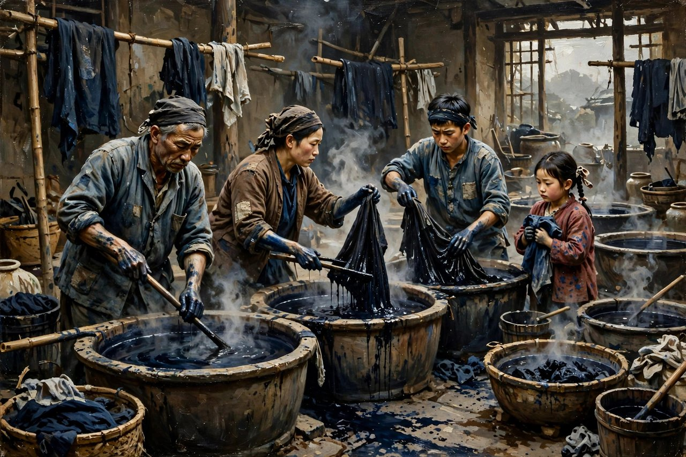
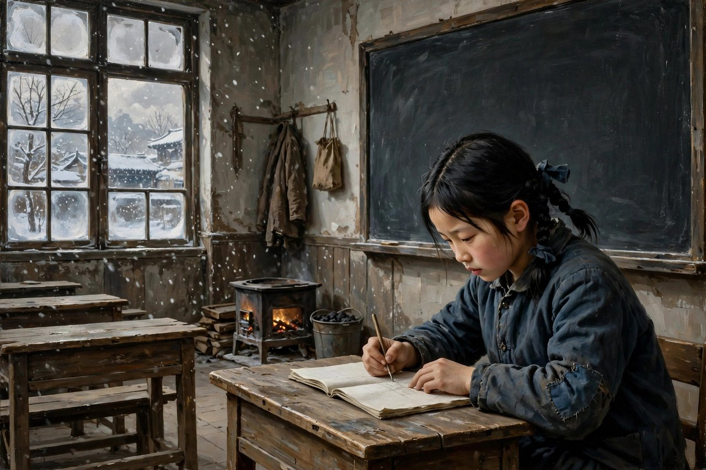

## 一双手挡住了学堂的门

手这个题目，听起来简单，听起来小，听起来像一个身体部位的名字，可在萧红的笔下，手这个题目，一点都不小，一点都不简单，手这个题目，是一双染黑的手，是一双洗不掉的手，是一双被歧视的手，是一双伸不进学堂的手，是一双照见社会势利与残忍的手。萧红的短篇小说手，发表于一九三六年四月上海作家创刊号上，后来收入她一九三六年十一月出版的散文和短篇合集桥里，那本合集收了小说三篇、散文十篇，手是里头最有名的一篇，也是最让人心疼的一篇，也是被翻译、被研究、被写进教材最多的一篇。小说讲的是一个叫王亚明的姑娘，讲的是她从乡下来到城里念中学，满怀读书的理想，却因为一双因劳动而染黑的手，成了洗刷不掉的耻辱，受尽歧视，最后被赶出校门的故事。作者通过这个故事，有力地鞭挞了贫富悬殊而又金钱至上的罪恶社会，同时发出了争取人的权利与尊严的正义呼声。

王亚明是个什么人，是个乡下染匠的女儿，是个家里很穷的姑娘，是个母亲体弱多病、家里除了她还有四个孩子的姑娘，是个父亲带着全家做染布生意、赚得不多的姑娘，是个从小帮家里染布、手被染料染黑了的姑娘。她的手，是黑的，细看才带点紫色，她的两个妹妹也都和她一样，手都是黑的，都是蓝的，都是紫的，都是染布染出来的颜色，都是洗不掉的颜色，都是劳动的颜色，都是穷的颜色。她们家的分工，是这样的，爹爹染黑的和蓝的，姐姐染红的，姐姐定亲的那年，上冬的时候，姐姐的婆婆从乡下来住在她们家里，一看到姐姐她就说，唉呀，那杀人的手，从这起，爹爹就说不许某个人专染红的，某个人专染蓝的，每个人都要换着染，换着染的结果，是每个人的手都变了颜色，都变黑了，都变蓝了，都变紫了，都洗不掉了，都成了耻辱的记号，成了穷的记号，成了底层出身的记号。王亚明就是这样一双手，走进了城里的中学，走进了宿舍，走进了教室，走进了同学和老师的眼光里，走进了歧视和排挤里，走进了被赶出校门的故事里。

王亚明到城里念中学，是带着理想来的，是带着读书改变命运的理想来的，是带着辅导弟弟妹妹、让家里好过一点的理想来的，是带着一个穷姑娘对知识的渴望来的。她学习很勤奋，生活要求很低，不放过任何一点学习机会，每天都睡在宿舍楼的长椅上，天蒙蒙亮就开始读书，夜里总是咳嗽着，还在用颜料染着袜子和上衣，因为她没有钱买新袜子、新上衣，只能把旧的染一染，染黑了，染蓝了，继续穿。她比任何人都要刻苦，比任何人都要认真，比任何人都要想读书，可她的刻苦，在同学和老师眼里，不是优点，是笑话，是怪异，是特别，是不合群。老师点名的时候，每次一喊到王亚明，她都起来，把两只青黑手垂得很直，肩头落下去，面向着棚顶说，到，到，到。这种点名的样子，就是王亚明在学校里的样子，就是一个穷姑娘在城里学校里，羞耻、害怕、又想读书、又怕被看的样子，就是一双青黑手垂得很直、肩头落下去、面向棚顶不敢看人的样子。今天的人，读到这里，可能会想起自己小时候在学校里，因为穷、因为衣服旧、因为口音土、因为家里没钱，被同学笑、被老师看不起的样子，可能会想起自己在人群里，把手藏起来、把衣服拉一拉、把头低下去的样子，可能会想起自己想读书、想出人头地、想让家里好过一点，可就是被一双手、被一件衣裳、被一个出身挡在门外的样子。

## 宿舍里的歧视是怎么来的

王亚明在宿舍里的日子，是这篇小说最让人心疼的部分，也是最让人愤怒的部分。全宿舍的人都在厌烦她，虽然她是住在过道里的，因为她夜里总是咳嗽着，因为她在宿舍里边开始用颜料染着袜子和上衣，因为她的手是黑的，因为她的衣裳是旧的，因为她是乡下来的，因为她是穷人家的女儿。同学们不想和她一起睡，同学们因为她煮了两双袜子而不要铁锅，校役不给她开门，老师不让她一起做早操，学校来了参观团，因为她的蓝手，老师拒绝让她出现在参观团的视线内。王亚明为了让自己看起来没那么恐怖，特地戴上了父亲给她的手套，没想到继续遭到校长的鄙视，校长说，你自己看看，谁像你这样特别，两只蓝手还不说，你看看，你这件上衣，快变成灰的了。这种鄙视，一句接一句，一件接一件，从同学到老师，从老师到校长，从宿舍到教室，从早操到参观团，从铁锅到手套，从手到衣裳，从衣裳到人，从人到出身，从出身到命运，一步一步，把一个想读书的姑娘，推到了校门外面，推到了绝路上，推到了被劝退、被赶回老家的结局里。

这种歧视，是怎么来的，是从哪里来的，是从金钱至上的社会来的，是从贫富悬殊的社会来的，是从以貌取人、以衣取人、以手取人的社会来的。在那个社会里，有钱人的手是白的，是嫩的，是好看的，穷人的手是黑的，是粗的，是难看的，有钱人的衣裳是新的，是干净的，是体面的，穷人的衣裳是旧的，是染过的，是快变成灰的，有钱人的孩子是体面的，是受欢迎的，是可以出现在参观团面前的，穷人的孩子是特别的，是厌烦的，是要藏起来的，是不能被看见的。萧红写这种歧视，写得细，写得真，写得不煽情，写得让人心里一紧，写得让人明白，歧视不是抽象的词，歧视就是同学不要铁锅，就是老师不让做早操，就是参观团不让见，就是校役不开门，就是校长的一句鄙视，就是一双手被当成耻辱，就是一件上衣被当成笑话，就是一个姑娘被当成特别的人，就是一个想读书的人被当成不配读书的人。今天的人，读到这里，可能会想起自己身边的歧视，想起自己因为出身、因为口音、因为衣裳、因为长相、因为家里没钱，被歧视、被排挤、被看不起的样子，可能会想起自己在职场里，因为学历、因为学校、因为户口、因为年龄、因为性别，被歧视、被排挤、被挡在门外的样子，歧视的本质没有变，变的只是样子，变的是从手到学历，从衣裳到户口，从蓝手到各种各样的标签，标签换了，歧视还在，门还在，门外的人还在。

王亚明和书里的我的关系，也是这篇小说很动人的部分。书里的我，是王亚明的同学，是宿舍里的人，是看着王亚明被歧视、被排挤、被赶出去的人，是借给王亚明一本书的人，是读着屠场上女工马利亚昏倒在雪地上的那段、觉得很感动的人。有一个星期日，宿舍里面空朗的，我就大声读着屠场上正是女工马利亚昏倒在雪地上的那段，我一面看着窗外的雪地一面读着，觉得很感动。王亚明站在我的背后，我一点也不知道，她听见了马利亚的故事，听见了女工倒在雪地上的故事，听见了医生知道她是没有钱的人、就不给她看病的故事，她笑了，借着笑的抖动眼泪才滚落下来，她说，我也去请过医生，我母亲生病的时候，你看那医生他来吗，他先向我要马车钱，我说钱在家里，先坐车来吧，人要不行了，你看他来吗，他站在院心问我，你家是干什么的，你家开染缸房吗，不知为什么，一告诉他是开染缸房的，他就拉开门进屋去了，我等他，他没有出来，我又去敲门，他在门里面说，不能去看这病，你回去吧，我回来了。这种医生问开染缸房才进屋、进屋又说不能看的故事，就是王亚明家的故事，就是穷人看病难的故事，就是医生以貌取人、以钱取人的故事，就是今天的人也熟悉的故事，今天的看病难，换了个样子还在，换成了挂号难，换成了看专家难，换成了没钱看不起病、没关系住不进医院的难，换成了医生先问你有没有钱、有没有保险、有没有关系的难。萧红写医生，写得冷，写得狠，写得不留情，因为她知道，医生不是无辜的，医生是社会的一部分，是金钱至上的社会的一部分，是把穷人的命当成买卖的一部分。

## 最后一天抄下的生字

小说的结尾，写得最疼，写得最让人忘不掉。还不到放寒假时，一天的早晨，王亚明整理着手提箱和零碎，没有人和她告别，她说，我的父亲还没有来，多学一点钟是一点钟，这最后的每一点钟都使她流着汗，在英文课上她忙着用小册子记下来黑板上所有的生字，连教师随手写的她也记了下来，地理课上她又费着力气模仿着黑板上教师画的地图，好像所有这最末一天经过她的思想都重要起来，都必得留下一个痕迹。下课，我看了她的小册子，那完全记错了，英文字母，有的脱落一个，有的她多加上一个，她的心情已经慌乱了。太阳停在颤抖的挂着雪的树枝上面，鸟雀刚出巢的时候，她的父亲来了。这种记错了生字、记错了地图、心情慌乱的样子，就是王亚明最后一天的样子，就是一个被劝退的姑娘，在最后一天里，还想多学一点、还想多记一点、还想把最后一点钟都留下来、都变成痕迹的样子。这种想多学一点的心情，今天的人也熟悉，今天的学生，在毕业前、在离校前、在最后一天里，也会这样，想多记一点，想多学一点，想把最后一点时间都留下来，都变成回忆，都变成痕迹。王亚明和他们不一样的地方，是她不是毕业，是被劝退，是被赶出去，是被一双手赶出去，是被一件上衣赶出去，是被同学的厌烦赶出去，是被老师的鄙视赶出去，是被校长的冷漠赶出去，是被整个金钱至上的社会赶出去。这种被赶出去的疼，比毕业的疼更疼，比离别的疼更疼，比失恋的疼更疼，因为毕业是光荣的，离别是暂时的，失恋是两个人的事，被赶出去是耻辱的，是一个人的事，是一个姑娘想读书、想改变命运、想让家里好过一点，却被一双手挡在门外的事。

王亚明走的时候，没有人和她告别，没有人送她，没有人说一句暖话，没有人说一句对不起，没有人说一句你还会回来的，没有人说一句你的手其实不难看，没有人说一句你的刻苦其实很动人。她就这样走了，跟着父亲回了老家，回到了染缸房，回到了黑的、蓝的、紫的手的世界里，回到了照顾弟弟妹妹的日子里，回到了帮家里染布的日子里。可她仍然没有放弃读书的念头，她仍然想读书，仍然想学，仍然想改变命运，仍然想让自己的手，不再是耻辱，不再是挡住学堂门的东西，不再是被人鄙视的记号。这种没有放弃，是王亚明这个人物最后的光，是萧红留给读者的最后一点希望，是一个被赶出去的姑娘，还没有死心，还没有认命，还没有把读书的念头放下，还没有把改变命运的念头放下。这种没有放弃，今天的人也该学，今天的人，被拒绝、被歧视、被排挤、被赶出去的时候，也该像王亚明这样，没有放弃，没有认命，没有把读书的念头放下，没有把改变命运的念头放下，没有把做人的尊严放下，坚持下去了，日子才有可能变，门才有可能开，手才有可能伸进去，学堂才有可能走进去，命运才有可能改过来。

## 对照今天看手

今天再读手，很多人会觉得，这篇小说写的是民国的女中学生，写的是染布匠的女儿，写的是青黑手，写的是宿舍过道，写的是铁锅，写的是手套，写的是参观团，跟今天没有关系。其实关系大得很，只不过换了个样子。今天的青黑手，换成了各种各样的标签，换成了学历标签，换成了学校标签，换成了户口标签，换成了年龄标签，换成了性别标签，换成了长相标签，换成了口音标签，换成了家里没钱的标签，换成了农村出身的标签，换成了各种各样洗不掉、藏不住、被人一眼看出来的标签。今天的宿舍过道，换成了合租屋的过道，换成了城中村的过道，换成了写字楼的茶水间，换成了各种各样被人厌烦、被人排挤、被人看不起的地方。今天的铁锅，换成了共用的东西，换成了食堂的餐具，换成了办公室的微波炉，换成了各种各样因为一个人用了、别人就不要的东西。今天的手套，换成了各种各样的遮掩，换成了化妆，换成了整容，换成了名牌衣裳，换成了假装有钱、假装体面、假装不是穷人的遮掩，遮掩完了，还是被鄙视，还是被看出来，还是被校长、被领导、被同事一句，你自己看看，谁像你这样特别，给打回去。今天的参观团，换成了各种各样的检查，换成了领导视察，换成了客户参观，换成了各种各样要把不体面的人藏起来、要把穷人藏起来、要把特别的人藏起来的检查，检查来了，穷人要躲，穷人要藏，穷人要不在视线内，穷人要像王亚明那样，戴上手套，还要被鄙视，穿上新衣裳，还要被说快变成灰的了。换汤不换药，手还是手，标签还是标签，歧视还是歧视，门还是门，门外的人还在，萧红写王亚明，写的是民国的姑娘，照见的是今天的年轻人，照见的是今天千千万万个因为一个标签、因为一个出身、因为一件衣裳、因为一双手，被挡在门外的人。

今天的学校，也换了个样子还在。今天的学校，不再是女中学生的宿舍了，不再是过道里的长椅了，换成了大学宿舍，换成了研究生宿舍，换成了各种各样的学校，换成了各种各样的教室，可学校里的歧视，还在，同学之间的歧视，还在，老师对学生的歧视，还在，学校对穷学生的歧视，还在。今天的同学，不想和穷同学一起睡，不想和穷同学一起吃饭，不想和穷同学一起用铁锅，不想和穷同学一起做小组作业，不想和穷同学一起出现在参观团面前，不想和穷同学一起出现在合影里，不想和穷同学一起出现在朋友圈里，这种不想，今天还在，换了个说法还在，换成了嫌弃，换成了疏远，换成了拉黑，换成了不回消息，换成了各种各样冷暴力的样子。今天的老师，不让穷学生参加活动，不让穷学生出现在检查面前，不让穷学生当班干部，不让穷学生拿奖学金，不让穷学生保研，不让穷学生出国，这种不让，今天还在，换了个说法还在，换成了名额有限，换成了综合考量，换成了不太合适，换成了下次再说，换成了各种各样冠冕堂皇的理由。今天的校长，不再说你这件上衣快变成灰的了，换成了说你的形象不太符合要求，你的气质不太适合这个岗位，你的背景不太符合我们的标准，你的学历不太符合我们的门槛，换汤不换药，鄙视还是鄙视，门还是门，门外的人还在，王亚明还在，萧红还在，手还在，青黑手还在，洗不掉的手还在，伸不进学堂的手还在。

今天的医生，也换了个样子还在。今天的医生，不再问你家开染缸房吗，不再站在院心问你家是干什么的了，换成了问你有没有医保，换成了问你有没有保险，换成了问你挂的是普通号还是专家号，换成了问你住的是普通病房还是单间，换成了各种各样先问钱、再问病、先问身份、再问病情的问法。问完了，有钱的，能看病，能住院，能做手术，能住单间，能请专家，没钱的，要排队，要等床位，要凑钱，要借钱，要众筹，要在网上求助，要在医院走廊里打地铺，要在医院门口哭，要在医生面前说，医生，求求你，先救救我妈，先救救我爸，钱在家里，先坐车来吧，人要不行了。这种先问钱、再问病的事，王亚明那时候有，今天也有，换了个样子还在，换成了医保，换成了保险，换成了挂号费，换成了床位费，换成了各种各样的费用，费用交不上，病就看不上，病看不上，人就没了，家就散了，日子就垮了。萧红写医生问染缸房，写的是民国的医生，照见的是今天的医生，照见的是今天金钱至上的医疗，照见的是今天穷人看病难、看病贵的现实，照见的是今天每一个在医院里，因为没钱、因为没关系、因为没保险，被挡在门外的人。读手，就是认出这种医生，就是认出这种医疗，就是认出这种金钱至上的社会，就是认出这种把人的命当成买卖的社会，认出来了，才有可能改，才有可能不做这样的医生，才有可能不做这样的社会，才有可能让王亚明的手，伸进学堂，让穷人的病，走进医院，让穷人的命，不再被钱挡在门外。

## 为什么手还值得读

手值得读，原因很实在，原因在它的短，原因在它的深，原因在它的真。小说不长，短篇的篇幅，一口气就能读完，可读完之后，心里会留很久，会想很久，会疼很久。这种短而深的小说，今天特别少，今天的小说要么太长，长到读不完，要么太浅，浅到读完就忘，手不长不浅，刚刚好，刚刚能把一个姑娘的一生讲清楚，刚刚能把一双手讲清楚，刚刚能把一个社会的势利讲清楚，讲得不见血，讲得让人连凶手都找不到，讲得让人读完之后，还要想一想，凶手到底是谁，是同学，是老师，是校长，是校役，是医生，是姐姐的婆婆，是爹爹的规矩，是金钱至上的社会，是贫富悬殊的社会，还是所有这些加在一起。想不出来凶手，才是这篇小说最厉害的地方，因为真正的凶手，从来不是一个人，真正的凶手，是一群人，是一种社会，是一种风气，是一种所有人都参与、所有人都不觉得自己有错的机制。认出这种机制，比认出一个凶手更重要，因为机制不改，王亚明还会哭，还会有一个又一个的王亚明，在宿舍过道里咳嗽，在教室里抄生字，在参观团面前被藏起来，在寒假前被劝退，在最后一天里记错生字，在父亲来了之后，跟着父亲回老家，回到染缸房，回到黑的、蓝的、紫的手的世界里，回到想读书又读不成的日子里。

原因在它的细节，萧红写细节，写得细，写得真，写得带着染料味、带着汗味、带着咳嗽声、带着雪地味，写王亚明的手，写青黑手，写细看带紫色的手，写垂得很直的手，写面向棚顶的手，写戴着手套的手，写染着袜子的手，写染着上衣的手，写抄生字的手，写模仿地图的手，写整理手提箱的手，写这些手，拼在一起，就是王亚明，就是一个染布匠的女儿，就是一个想读书的姑娘，就是一个被歧视的姑娘，就是一个被赶出去的姑娘，就是一个还没有放弃读书的姑娘。今天很多写歧视、写穷人、写学生的作品，写的是概念，写的是标签，写的是苦情，细节是编出来的，是想象出来的，读起来假，读起来空。萧红的细节是活的，是带着染料味、带着汗味、带着咳嗽声、带着雪地味的，读起来让人觉得，她真的在宿舍里待过，真的看过王亚明的手，真的听过王亚明的咳嗽，真的读过屠场，真的看过马利亚倒在雪地上，真的听过王亚明讲医生问染缸房的故事，真的看过王亚明最后一天抄生字的样子，真的看过王亚明的父亲在太阳停在挂着雪的树枝上面、鸟雀刚出巢的时候，来到学校接女儿的样子。

读手的方法，也很简单，别急着找主题，别急着找思想，别急着划线，别急着写读后感。先慢慢读，读王亚明，读染缸房，读青黑手，读宿舍过道，读咳嗽声，读染袜子，读屠场，读马利亚，读医生问染缸房，读照顾弟弟妹妹，读姐姐定亲，读杀人的手，读点名说到，读早操，读参观团，读铁锅，读手套，读上衣快变成灰的，读最后一天抄生字，读记错了生字，读父亲来了，读完一遍，再读一遍，读出姑娘的疼来，读出穷人的疼来，读出歧视的疼来，读出自己身边的影子来。读进去了，你会发现，手不只是一篇民国小说，手是每一个被歧视的人的故事，是每一个因为一个标签、因为一个出身、因为一件衣裳、因为一双手，被挡在门外的人的故事，是每一个在学校里、在职场里、在医院里、在社会上，被看不起、被排挤、被赶出去的人的故事。读手，就是读自己，就是读自己身边的王亚明，就是读那些没有说出口的话，就是读那些被咽回去的疼，就是读那些被藏在手套里、藏在上衣里、藏在咳嗽声里、藏在抄错的生字里的爱和尊严。读完了，你会想对自己说一句，也想对身边的王亚明说一句，别把手藏起来，别把手套戴起来，别把上衣拉一拉，别把头低下去，别把到字说得面向棚顶，要把手伸出来，要把头抬起来，要把到字说得响亮，要把生字抄对，要把地图画好，要把学堂走进去，要把命运改过来，要把尊严挣回来。

## 手伸出去才有未来

手这篇小说，留给今天的人，还有一个很实在的提醒，就是别把手藏起来，别把自己的出身藏起来，别把自己的穷藏起来，别把自己的标签藏起来，别把自己的手套戴起来，别把自己的上衣拉一拉，别把自己的头低下去，别把自己的到字说得面向棚顶。王亚明把手藏起来了，把手套戴起来了，把头低下来了，把到字说得面向棚顶了，结果还是被鄙视，还是被排挤，还是被赶出去，还是没有改变命运，还是没有走进学堂，还是没有挣回尊严。藏起来是没有用的，戴手套是没有用的，低头是没有用的，面向棚顶是没有用的，真正有用的，是把手伸出来，是把头抬起来，是把到字说得响亮，是把生字抄对，是把地图画好，是把书读下去，是把尊严挣回来，是把门推开，是把学堂走进去，是把命运改过来。今天的人，被歧视、被排挤、被看不起的时候，也该这样，不要藏，不要躲，不要戴手套，不要低头，不要面向棚顶，要伸出手，要抬起头，要说得响亮，要读下去，要学下去，要做下去，要把自己的手，变成劳动的手，变成写字的手，变成挣钱的手，变成改变命运的手，变成推开学堂门的手，变成推开社会门的手，变成推开未来门的手。

手读到尾巴上，留在心里的，是王亚明的样子，是青黑手的样子，是宿舍过道的样子，是咳嗽声的样子，是染袜子的样子，是屠场的样子，是马利亚倒在雪地上的样子，是医生问染缸房的样子，是照顾弟弟妹妹的样子，是姐姐定亲的样子，是杀人的手的样子，是点名说到的样子，是早操的样子，是参观团的样子，是铁锅的样子，是手套的样子，是上衣快变成灰的的样子，是最后一天抄生字的样子，是记错了生字的样子，是父亲来了的样子，是太阳停在挂着雪的树枝上面的样子，是鸟雀刚出巢的样子。这些样子，拼在一起，就是手，就是王亚明，就是萧红，就是一个姑娘没有说出口的一生，就是一个染布匠的女儿想读书、想改变命运、想挣回尊严的一生。今天的人，读完手，再看自己身边的人，再看自己年轻的时候，再看自己没有说出口的话，心里会多一点疼，多一点想，多一点勇气，多一点把手伸出来、把头抬起来、把到字说响亮、把学堂走进去的念头。这篇小说，就是这样一篇小说，不长，不吵，不喊口号，可就是让人忘不掉，让人读完之后，还想再读一遍，还想把自己的手伸出来，把自己的头抬起来，把自己的命运改过来，把自己的尊严挣回来。

王亚明走了，萧红走了，学堂还在，宿舍还在，过道还在，咳嗽声还在，青黑手还在，染缸房还在，屠场还在，马利亚还在雪地上，医生还在问染缸房，父亲还在太阳停在挂着雪的树枝上面、鸟雀刚出巢的时候，来接女儿，后来的人，还在学堂里，还在宿舍里，还在过道里，还在咳嗽，还在染袜子，还在抄生字，还在想读书，还在想改变命运，还在想挣回尊严，还在把手伸出来，还在把头抬起来，还在把到字说响亮，还在把学堂走进去，走进去了，命运就改了，尊严就回来了，手就不再是耻辱了，手就变成了劳动的手，变成了写字的手，变成了未来的手。

读完手，合上书，想一想，自己今天有没有手藏起来，有没有头低下去，有没有到字说得面向棚顶，有没有生字抄错，有没有学堂不敢进，有没有命运不敢改，想清楚了，就把手伸出来，把头抬起来，把到字说响亮，把生字抄对，把学堂走进去，把命运改过来，把尊严挣回来，挣回来了，手就干净了，人生就亮了，日子就实了。

王亚明的手，今天还在，还在每一个被歧视的人身上，还在每一个因为一个标签、因为一个出身、因为一件衣裳、因为一双手，被挡在门外的人身上，还在每一个在学校里、在职场里、在医院里，被看不起、被排挤、被赶出去的人身上。读完手，再看一看自己的手，再问一问自己，自己的手藏起来了没有，自己的头低下来了没有，自己的到字说得响亮不响亮，自己的生字抄对了没有，自己的学堂走进去了没有，想清楚了，就把手伸出来，把头抬起来，把到字说响亮，把生字抄对，把学堂走进去，把命运改过来，把尊严挣回来，挣回来了，手就干净了，人生就亮了，日子就实了，萧红就没有白写，王亚明就没有白哭。

手这篇小说，读一遍是疼，读两遍是气，读三遍是硬，读很多遍是认出自己，认出自己的手，认出自己的衣裳，认出自己的宿舍，认出自己的咳嗽，认出自己的生字，认出自己的地图，认出自己的父亲，认出自己最后一天的样子。认出来了，才有可能把手伸出来，把头抬起来，把到字说响亮，把生字抄对，把地图画好，把学堂走进去，把命运改过来，把尊严挣回来，挣回来了，手就不再是耻辱了，手就变成了劳动的手，变成了写字的手，变成了推开学堂门的手，变成了推开未来门的手，变成了自己的手，变成了未来的手。
