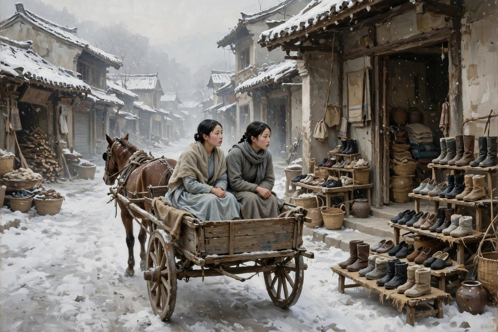
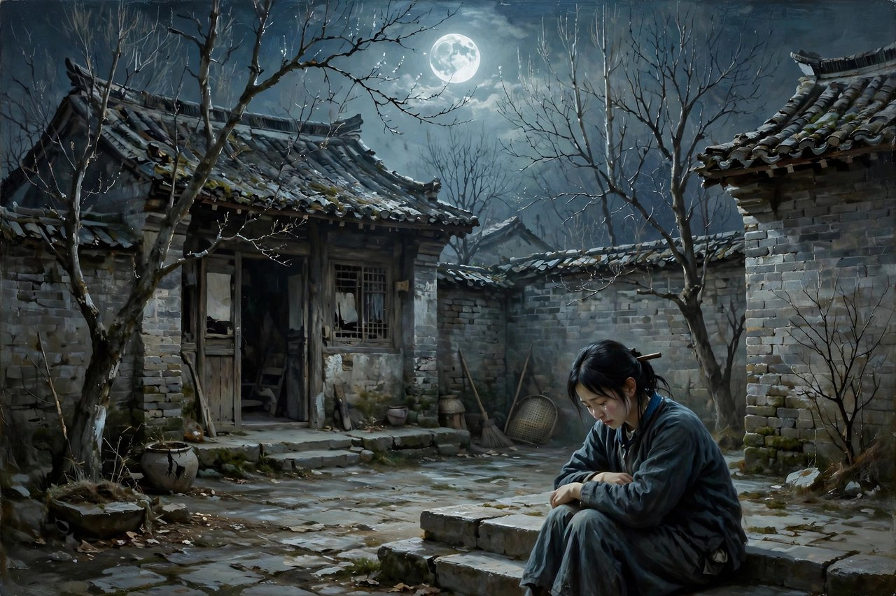

## 小城三月的风

小城三月这个名字，听起来是暖的，是春天的意思，是花开的意思，是冰雪化开的意思。可这本书写的东西，却是冷的，是一个姑娘在春天里死去的故事，是一个姑娘的爱在春天里没有开花就谢了的故事。萧红写这本书，写于一九四一年七月，发表于同年八月的时代文学上，写的是她晚期的代表作，也是她的绝笔中篇，是她用最后的力气写下的一本书。书里讲故事的人，是一个正在读中学的女孩子，就是书里的我，这个我，年龄不大，见识不多，可眼睛是亮的，心是细的，能看见大人看不见的东西，能听见大人听不见的心事。书里的主角，是翠姨，是我的一个亲戚，是一个温柔内向、诚挚多情的少女，言谈举止娴静幽雅，可时常流露出淡淡的忧伤。翠姨没有读过书，却很喜欢和正在读中学的我亲近，从我身上学习新知识，体验新文化，慢慢走出了封建思想的圈子，又慢慢走进了自己的悲剧里。

翠姨的身世，一开始就带着一点冷。她是寡妇的女儿，家里条件一般，身份上就比别人矮一截。在那个小城里，寡妇的女儿，本身就是一个标签，就是一个让人低看一眼的身份。翠姨长得好看，性子温柔，会弹日本琴，会吹箫和笛子，参加家庭音乐会的时候，整个人是亮的，是活的，是有光的。可就是这样一个姑娘，在小城的规矩里，却连爱一个人的自由都没有，连读书的自由都没有，连为自己做主的自由都没有。她的悲剧，不是一下子发生的，不是被人打死的，不是被人害死的，是慢慢发生的，是被规矩一点一点闷死的，是被看客一点一点看死的，是被自己的不敢说、不敢争、不敢反抗一点一点拖死的。这种慢慢闷死的悲剧，比一下子打死的悲剧更让人心疼，因为慢慢闷死的时候，周围的人都觉得没事，都觉得日子就是这样过的，都觉得姑娘病了、瘦了、死了，都是命，都是天意，都是没办法的事。

书里的堂哥，是翠姨爱上的人，是我的堂兄，是地主家里才学出众的公子，是读洋书、见过世面的人。翠姨爱上他，不是一见钟情那种俗套的爱，是在家庭音乐会之后，在日常的接触里，在一起说话、一起听琴、一起看书的日子里，慢慢长出来的爱。这种爱，是安静的，是克制的，是不敢说出口的，是只能藏在心里的。翠姨不敢说，不敢让家里人知道，不敢让堂哥知道，不敢让街坊知道，她只能在心里想，只能在夜里哭，只能在和我单独在一起的时候，流露出一点点心事。而我这个孩子，看出来了，惊奇地窥视到了翠姨的一些异常，看出来她的心事，看出来她的爱，看出来她的愁，可我也是个孩子，我也帮不了她，我也只能看着，看着她一天一天地瘦下去，看着她一天一天地闷下去，看着她一步一步走向死亡。

## 一双绒绳鞋的心事

书里有一个细节，写得特别动人，特别让人心疼，就是翠姨对一双绒绳鞋的心事。绒绳鞋是当时小城里新鲜的时髦物件，是女孩子们都想要的东西。翠姨对这双鞋，一往情深，小心翼翼，等到多数人拥有了，她才敢动心，才敢想要，才敢和我一起坐着马车，奔驰在小城的街上，去找一双属于她的绒绳鞋。雪天里，两个人一无所获，翠姨深深地看进我的眼睛里，诉说自己的命不会好，诉说自己将来的远景已经摆在面前了，诉说自己将孤寂忧悒以终身。这种诉说，不是抱怨，是认命，是一个姑娘在看清楚自己的命运之后，那种无可奈何的认命。她想要一双鞋，想要一点属于自己的东西，想要一点时髦，想要一点快乐，可就是这样一点小小的想要，在小城的规矩里，也要小心翼翼，也要等到别人都有了才敢要，也要冒着被人议论的风险。这种小心翼翼，就是翠姨一生的缩影，就是她对爱的态度，对读书的态度，对自由的态度，全都是小心翼翼，全都是不敢先要，全都是等到别人都有了、别人都允许了，才敢动一点心。

翠姨对堂哥的爱，也是这样小心翼翼的爱。她爱堂哥，不敢说，不敢表白，不敢让堂哥知道，不敢让家里人知道，只能把爱藏在心里，带进坟墓里去。书里写她，似乎要把她的爱带到坟墓里去，一直不要说出口，好像天底下没有一个人值得听她表白，而到头来，翠姨真的把她的爱带到坟墓里去了，没有人知道她为什么死，包括她的堂哥。堂哥后来提起翠姨，常常落泪，可他不知道翠姨为什么死，大家也都心中纳闷。这种不知道，是这本书最残忍的地方，是萧红最狠的一笔。一个姑娘爱了一个人，爱到死，爱到病，爱到瘦，爱到没命，可被爱的那个人，到头来还不知道她为什么死，还不知道她爱过他，还不知道她的死和爱有关系。这种残忍，不是堂哥一个人造成的，是小城的规矩造成的，是那个不允许女孩子说爱的规矩造成的，是那个把爱当成羞耻、把表白当成不要脸的规矩造成的。在那个规矩里，女孩子爱一个人，是不能说的，说了就是不要脸，就是不知羞，就是坏了名声，就是给家里丢脸。所以翠姨只能不说，只能闷着，只能病，只能死，死了之后，还要被人纳闷，还要被人议论，还要被人说，真是可惜，年纪轻轻怎么就没了。

翠姨想读书，也是这样小心翼翼的想。她没有读过书，却很喜欢和我亲近，很喜欢从我身上学习新知识，很喜欢体验新文化。她向外祖母勇敢地表达要读书的恳求，甚至以出嫁为要挟，可这种勇敢，在小城的规矩里，是短暂的，是会被压回去的。她从城里回来之后，拿起书本，并没有从知识中获取更进一步抗争的力量，反而变得整天地闷闷不乐，开始潜心地思考，思考自己的命运，思考自己的爱，思考自己的将来，思考完了，结论是更绝望了，是更看清楚了自己没有出路，是更明白了自己在这个小城里，是没有活路的。她后来支持不了啦，躺下了，在出嫁之前悄然病逝在家中。病逝这个词，听起来平静，实际上一点都不平静，病逝的背后，是相思成疾，是郁郁而终，是一个姑娘在爱不敢说、书不敢读、命不敢争的日子里，一点一点把自己耗没了，耗干了，耗死了。

## 孩子的眼睛看大人

小城三月最特别的地方，是它的叙事视角，是孩子的眼睛。书里的我，是个正在读中学的女孩子，是个略涉世事的孩子，是个能看见翠姨心事的孩子。孩子的眼睛，没有被世故污染，没有被规矩磨平，能看见大人看不见的东西，能听见大人听不见的心事。大人看翠姨，看的是她温柔，看的是她娴静，看的是她该出嫁了，看的是她该听家里安排了，孩子看翠姨，看的是她的心事，看的是她的爱，看的是她的愁，看的是她在夜里哭的样子，看的是她在雪天里说命不会好的样子。这种孩子的视角，让这本书的批判变得不生硬，不说教，不喊口号，批判是藏在孩子的眼睛里的，是藏在孩子的惊奇里的，是读者自己读出来、自己想出来的。今天很多写女性命运的作品，写得太直白，太说教，太喊口号，读起来像上课，像训话，读者听不进去。萧红不这样，她让孩子看，让孩子问，让孩子疼，读者跟着孩子看，跟着孩子问，跟着孩子疼，批判就自然而然地长出来了，长在了读者心里，忘不掉了。

孩子的视角，还有一个好处，就是真实。孩子不懂大人的规矩，不懂大人的算计，不懂大人的面子，孩子只看真实的东西，只看一个人高兴还是不高兴，只看一个人哭还是笑，只看一个人瘦了还是胖了。翠姨瘦了，孩子看出来了，翠姨哭了，孩子看出来了，翠姨爱了，孩子看出来了，翠姨死了，孩子看出来了，可大人看不出来，大人只看她该出嫁了，只看她该听安排了，只看她死了可惜了。这种孩子看出来、大人看不出来的对比，就是这本书最动人的地方，也是最让人愤怒的地方。一个孩子都能看出来的心事，一群大人都看不出来，或者看出来了也不当回事，这种麻木，这种冷漠，就是小城的病，就是旧规矩的病，就是萧红要写出来的病。今天的人，读到这里，可能会想一想，自己身边有没有这样的孩子，有没有这样被大人忽视的心事，有没有这样被规矩压着的姑娘，有没有这样被看客围着的爱。

翠姨的妹妹，在书里也是一个对照。妹妹出嫁之后，翠姨就住到了我的家里，妹妹的命运，和翠姨的命运，形成了一种对照，妹妹听从安排，嫁了人，过了日子，日子平平淡淡，翠姨不肯委曲求全，不肯把自己的爱藏一辈子又活一辈子，结果是宁为玉碎，不为瓦全的悲剧。这种对照，不是说听从安排就是对的，也不是说反抗就是错的，而是说，在那个小城里，女孩子无论听从还是反抗，都没有好出路，听从了，是平平淡淡安度一生，是把自己的心磨没了，反抗了，是病死、是死去、是被人纳闷，这种两头都没有出路的处境，就是旧规矩最残忍的地方，就是萧红要写出来的地方。今天的女孩子，处境比翠姨好多了，可以读书，可以工作，可以自己做主，可以自己选择爱谁、不爱谁，可新的规矩换了个样子还在，换成了婚恋市场上的标价，换成了职场上的天花板，换成了网络上的围观和评判，换成了家庭里的催婚和催生，女孩子无论听从还是反抗，依然要付出代价，依然要面对议论，依然要面对压力。翠姨的故事，今天读起来，依然能照见很多女孩子的处境，依然能让人想一想，女孩子的自由，到底走了多远，到底还差多远。

## 对照今天看翠姨

今天再读小城三月，很多人会问，翠姨的故事，跟今天有什么关系，翠姨是民国小城里的姑娘，今天的姑娘不用再被包办婚姻了，不用再因为爱一个人不敢说就病死了，翠姨的故事是不是已经过时了。过时没有，换了个样子还在。今天的姑娘，可以自由恋爱了，可以自己选择对象了，可新的不敢说换了个样子还在，换成了不敢在职场上说自己要结婚生孩子，怕被辞退，换成了不敢在家里说自己不想结婚，怕被催婚，换成了不敢在网络上说自己的真实想法，怕被围攻，换成了不敢在朋友圈里说自己过得不好，怕被人笑话。不敢说这个毛病，从翠姨身上没有消失，只是换了个地方，换了个说法，换了个场景，继续活着。翠姨不敢说爱，怕坏了名声，今天的姑娘不敢说真话，怕丢了工作、怕丢了面子、怕丢了朋友，本质没有变，还是人在规矩面前不敢开口，还是人在看客面前不敢做自己，还是人在压力面前把话咽回去，把疼咽回去，把爱咽回去，咽到最后，咽出病来，咽出抑郁来，咽出各种各样的心病来。

今天的姑娘读书，也比翠姨容易多了，可以上大学，可以读研究生，可以出国，可以读很多书，可读书之后呢，读了书就能自由了吗，读了书就能做主了吗，读了书就能不被规矩压着了吗。翠姨的例子告诉我们，读书本身不等于自由，读书之后，还要面对规矩，还要面对家庭，还要面对婚恋市场，还要面对职场，还要面对一群人的眼光。翠姨从城里回来，拿起书本，反而更闷闷不乐了，因为书让她看清楚了自己的处境，看清楚了自己没有出路，看清楚了小城的规矩有多硬，这种看清楚，本身就是一种疼。今天很多读了书的姑娘，也有这种疼，读了书，看清楚了，明白了，可明白了之后，还是要面对现实，还是要面对催婚，还是要面对职场天花板，还是要面对家庭压力，明白不等于自由，明白只是自由的开始，自由还要靠争取，靠坚持，靠不怕议论，靠不怕丢脸，靠敢说、敢争、敢做主。翠姨没有走到这一步，她停在了明白这一步，停在了闷闷不乐这一步，停在了病逝这一步，今天的姑娘，要比翠姨多走一步，多走几步，走到敢说、敢争、敢做主那一步，才算真正走出了小城，走出了翠姨的命运。

今天的堂哥，也换了个样子还在。今天的堂哥，不再是地主家的公子了，不再是读洋书的堂兄了，可那种不知道对方为什么死、不知道对方爱过自己的男人，换了个样子还在，换成了不知道女朋友为什么生气、不知道妻子为什么哭、不知道同事为什么抑郁的男人，换成了在一段关系里，永远后知后觉、永远慢半拍、永远等到对方走了、病了、死了才落泪的男人。这种后知后觉，不是堂哥一个人傻，是整个社会教男人后知后觉，教男人不用细心，教男人不用体贴，教男人爱就是给钱、给房子、给名分，不用问对方心里想什么，不用看对方瘦了还是胖了，不用听对方夜里哭没哭。萧红写堂哥，写得不狠，写得甚至有点同情，写他后来提起翠姨常常落泪，写他不知道翠姨为什么死，写他的无辜，也写他的可怜。可这种无辜和可怜，背后是男人的特权，是男人可以不知道、可以后知后觉、可以落泪了事的特权，而女人没有这种特权，女人不知道就要付出代价，女人后知后觉就要付出代价，女人落泪了事就要付出代价。读小城三月，就是认出这种特权，认出来了，男人才会学着细心，学着体贴，学着在对方还活着的时候，就问一句，你怎么了，你疼不疼，你爱不爱我，你想不想读书，你想不想做主。

## 萧红写给自己的回望

小城三月还有一层意思，是萧红写给自己的回望，是萧红用翠姨的故事，回望自己的人生。萧红自己，就是从小城里逃出来的姑娘，就是一九三零年逃婚前往北平、入读女师大附中的姑娘，就是不肯听家里安排、不肯把自己的爱藏一辈子、不肯把自己的命交给规矩的姑娘。她逃出来了，翠姨没有逃出来，她活下来了，翠姨没有活下来，她写书了，翠姨没有写书，她用自己的命，换来了自由，换来了写作，换来了呼兰河传，换来了生死场，翠姨用自己的命，换来的只是一声纳闷，只是一句可惜，只是一个坟头上的草籽发芽。这种对照，是萧红写这本书时心里最疼的地方，也是她最想告诉后来姑娘的地方，就是逃出来是难的，是要付出代价的，是要吃苦、要漂泊、要生病、要失去很多东西的，可不逃出来，代价更大，大到要用命去换，大到要把爱带进坟墓里去，大到要让爱你的人都不知道你为什么死。萧红自己，就是那个逃出来的娜拉，就是那个大喜大悲、大开大合的娜拉，她的险途没有深陷泥沼，也没能重返她魂牵梦绕的呼兰河，她走了一条中间的路，一条漂泊的路，一条写作的路，一条用文字把小城留下来、把翠姨留下来、把自己留下来路。

这本书的结尾，写得也很萧红，写得也很冷，写的是我看见翠姨坟头草籽发芽，只能慨叹春天是快的，春天的命运就是这么短。春天是快的，这句话，听起来像感叹，像诗，像一个孩子在坟头前的自言自语，可里头藏着整本书的魂。翠姨的春天，是短的，是三月里的一阵风，是花开了一下就谢了，是爱动了一下心就没了，是书读了一下就放下了，是命挣扎了一下就躺下了。萧红用小城的三月，埋葬翠姨短暂的挣扎与爱，埋葬一个姑娘没有说出口的话，埋葬一个时代对女孩子的压迫，也埋葬自己对小城的最后一丝留恋。从此之后，小城的三月，还是会开花，还是会化雪，还是会热闹，可翠姨不在了，萧红也不在了，留在书里的，只有一个姑娘的心事，只有一个孩子的眼睛，只有一个春天短暂的命运，只有一句春天是快的叹息。今天的人读到这里，可能会想起自己身边的翠姨，想起自己年轻的时候，有没有过这样短暂的春天，有没有过这样没有说出口的爱，有没有过这样小心翼翼的想要，有没有过这样闷闷不乐的思考，想起来了，就会明白，萧红写的不只是翠姨，写的是每一个姑娘，写的是每一个在春天里短暂地挣扎过、爱过、想过、最后又被规矩压回去的人。

## 为什么小城三月还值得读

小城三月值得读，原因很实在，原因在它的短，原因在它的深，原因在它的冷。书不长，中篇的篇幅，一口气就能读完，可读完之后，心里会留很久，会想很久，会疼很久。这种短而深的书，今天特别少，今天的书要么太长，长到读不完，要么太浅，浅到读完就忘，小城三月不长不浅，刚刚好，刚刚能把一个姑娘的一生讲清楚，刚刚能把一个小城的规矩讲清楚，刚刚能把一种制度怎么杀人讲清楚，讲得不见血，讲得让人连凶手都找不到，讲得让人读完之后，还要想一想，凶手到底是谁，是婆家，是堂哥，是街坊，是规矩，是迷信，是自己，还是所有这些加在一起。想不出来凶手，才是这本书最厉害的地方，因为真正的凶手，从来不是一个人，真正的凶手，是一群人，是一种规矩，是一种风气，是一种所有人都参与、所有人都不觉得自己有错的机制。认出这种机制，比认出一个凶手更重要，因为机制不改，翠姨还会死，还会有一个又一个的翠姨，在小城的三月里，在今天的城市里，在职场里，在家庭里，在网络上，悄悄地病，悄悄地瘦，悄悄地死，死了之后，还被人纳闷，还被人说可惜。

原因在它的视角，孩子的视角，女孩子的视角，这种视角，今天写女性命运的时候，依然是最好的视角中的一个。孩子的视角，能看见大人看不见的心事，能听见大人听不见的哭声，能问出大人不敢问的问题，能疼出大人已经麻木的疼。今天很多写女性命运的作品，写得太成人化，太理论化，太口号化，写出来的女人，像论文，像标语，像概念，不像活人。萧红写翠姨，写得像活人，写得有琴，有笛子，有绒绳鞋，有马车，有雪天，有月夜，有瘦下去的脸，有哭红的眼睛，有没有说出口的话，这些具体的细节，拼在一起，就是一个活生生的姑娘，就是一个让人心疼的姑娘，就是一个让人读完之后，还想去小城看看，还想去坟头看看，还想问一句，翠姨，你当年到底想说什么，你当年到底爱着谁，你当年到底想不想读书，你当年到底想不想活下去。这些问题，书里没有直接回答，书里只给了孩子的眼睛，给了读者的眼睛，让读者自己去问，自己去想，自己去疼。

读小城三月的方法，也很简单，别急着找主题，别急着找思想，别急着划线，别急着写读后感。先慢慢读，读翠姨，读堂哥，读我这个孩子，读绒绳鞋，读马车，读雪天，读月夜，读家庭音乐会，读读书的恳求，读病逝的夜晚，读坟头的草籽，读春天是快的叹息，读完一遍，再读一遍，读出翠姨的爱来，读出翠姨的愁来，读出翠姨的不敢说来，读出小城的冷来，读出自己的影子来。读进去了，你会发现，翠姨不只是一个民国姑娘，翠姨是每一个不敢说的姑娘，翠姨是每一个小心翼翼想要一双鞋的姑娘，翠姨是每一个想读书又不敢坚持的姑娘，翠姨是每一个爱了一个人又不敢表白的姑娘，翠姨是每一个在春天里短暂地挣扎过、最后又被规矩压回去的姑娘。读翠姨，就是读自己，就是读自己身边的姑娘，就是读那些没有说出口的话，就是读那些被咽回去的疼，就是读那些被藏进坟墓里的爱。读完了，你会想对自己说一句，也想对身边的姑娘说一句，别像翠姨那样，把爱藏进坟墓里去，把话咽回去，把命交给规矩，要敢说，要敢争，要敢读书，要敢做主，要敢在春天里活得长一点，活得久一点，活得像个人一点。

小城三月的花，还在开，小城三月的雪，还在化，小城三月的风，还在吹，翠姨没有说出口的话，还在等着有人听见。萧红用最后的力气，把这些话写下来了，写成了小城三月，写成了后来姑娘手里的一面镜子，写成了后来读者心里的一根刺。这面镜子，今天还在，这根刺，今天还在，照一照，疼一疼，想一想，自己是不是也在小城里，自己是不是也在不敢说，自己是不是也在小心翼翼，自己是不是也在把爱藏起来，自己是不是也该在春天里，多活几天，多说几句，多争一争，多读几本书，多为自己做一次主。想清楚了，翠姨的死，就没有白死，萧红的写，就没有白写，小城三月的春天，就没有白开，小城三月的花，就没有白谢。

## 春天短也要开花

翠姨的春天是短的，可短不等于没有开过花。她弹过琴，吹过笛子，参加过家庭音乐会，坐过马车，找过绒绳鞋，和我一起在雪天里走过，在月夜里哭过，在心里爱过一个人，在嘴边想过读书的事，这些，都是她开过的花，都是她活过的证据，都是她没有白活的证明。萧红写她，不是为了让她只当一个悲剧符号，不是为了让她只当一个被规矩压死的例子，萧红写她，是为了让她活过来，是为了让后来的人看见她，看见她的琴，看见她的鞋，看见她的爱，看见她的愁，看见她这个人。今天的人，读翠姨，也该这样读，别只读她的死，要读她的活，别只读她的悲剧，要读她的光，别只读她被压着的样子，要读她想读书、想爱、想做主的样子。读出这些，翠姨就不再是一个死去的姑娘了，翠姨就成了一个活过的姑娘，成了一个提醒后来姑娘要敢说、敢争、敢活的姑娘，成了一个在小城三月里，虽然春天短，可还是开过花的姑娘。这朵花，萧红留下来了，留在了书里，留在了后来人的心里，留在了每一个春天里，提醒我们，春天再短，也要开花，爱再难说，也要说出来，书再难读，也要读下去，命再难争，也要争一争，争不赢，也要争过，争过了，春天才算没有白来，花才算没有白开，人，才算没有白活。

## 给后来姑娘的话

如果翠姨能对今天的姑娘说一句话，她大概会说，别学我，别把爱藏起来，别把话咽回去，别把书放下，别把命交给家里安排，别等到病了、瘦了、躺下了，才后悔没有说过、没有争过、没有读过、没有活过。她大概会说，绒绳鞋要自己去找，找到了就穿上，穿上就走路，走路就抬头，抬头就看远方，远方有哈尔滨，有北平，有大城市，有大学，有工作，有自由，有爱你的人，有你自己的日子。她大概会说，堂哥不知道你爱他，不是你的错，是他的慢，是规矩的错，是小城的错，你不用为他的慢付出命的代价，你可以自己告诉他，也可以自己转身走开，走开不是输，走开是活。她大概会说，读书不是为了让家里高兴，不是为了让别人看得起，是为了让自己看清楚，看清楚了，就敢说了，敢说了，就敢争了，敢争了，就敢活了。这些话，翠姨生前没有说出来，死后也没有人替她说出来，萧红替她说出来了，写成了小城三月，写成了后来姑娘手里的一本书，写成了今天的人读完之后，心里会多一句提醒的话，会多一点敢说的勇气，会多一点为自己做主的底气。这本书，今天还在，还在等着后来姑娘去读，去听，去想，去为自己多活几天，多说几句，多争一争。

小城三月读到尾巴上，留在心里的，是翠姨的琴声，是绒绳鞋的样子，是雪天马车的声音，是月夜下姑娘的眼泪，是坟头草籽发芽的样子，是春天是快的叹息。这些样子，拼在一起，就是翠姨，就是小城，就是萧红，就是一个姑娘没有说出口的一生。今天的人，读完这本书，再看自己身边的人，再看自己年轻的时候，再看自己没有说出口的话，心里会多一点疼，多一点想，多一点勇气，多一点为自己做主的念头。这本书，就是这样一本书，不长，不吵，不喊口号，可就是让人忘不掉，让人读完之后，还想再读一遍，还想把自己的爱说出来，把自己的书读下去，把自己的命争一争，把自己的春天，过得长一点，再长一点。

翠姨走了，萧红走了，小城还在，三月还在，花还在开，雪还在化，风还在吹，后来姑娘的路，还在往前走，走出小城，走出规矩，走出不敢说，走进自己的日子，走进自己的春天，走得长，走得远，走得像个人，走得对得起翠姨没有说出口的爱，对得起萧红写下来的这本书。

小城三月的花，今天还在开，小城三月的雪，今天还在化，小城三月的风，今天还在吹，翠姨没有说出口的话，今天还在等着有人听见，翠姨弹过的琴，吹过的笛子，找过的绒绳鞋，坐过的马车，走过的雪天，哭过的月夜，今天还在，还在每一个不敢说的姑娘心里，还在每一个小心翼翼想要一双鞋的姑娘心里，还在每一个想读书又不敢坚持的姑娘心里。读完小城三月，再对自己说一句，也对身边的姑娘说一句，别像翠姨那样，把爱藏进坟墓里去，把话咽回去，把书放下，把命交给家里安排，要敢说，要敢争，要敢读书，要敢做主，要敢在春天里活得长一点，活得久一点，活得像个人一点，活下去了，春天就没有白来，花就没有白开，萧红就没有白写，翠姨就没有白死。

小城三月这本书，读一遍是疼，读两遍是冷，读三遍是叹息，读很多遍是认出自己，认出自己的绒绳鞋，认出自己的马车，认出自己的雪天，认出自己的月夜，认出自己的琴，认出自己的笛子，认出自己的爱，认出自己的不敢说，认出自己的小心翼翼。认出来了，才有可能敢说，敢争，敢读书，敢做主，敢在春天里活得长一点，活得久一点，活得像个人一点，活下去了，春天就没有白来，花就没有白开，翠姨就没有白死，萧红就没有白写，小城三月就没有白开，小城三月的花，就还在开，还在等着后来姑娘去看，去听，去想，去为自己多活几天。
