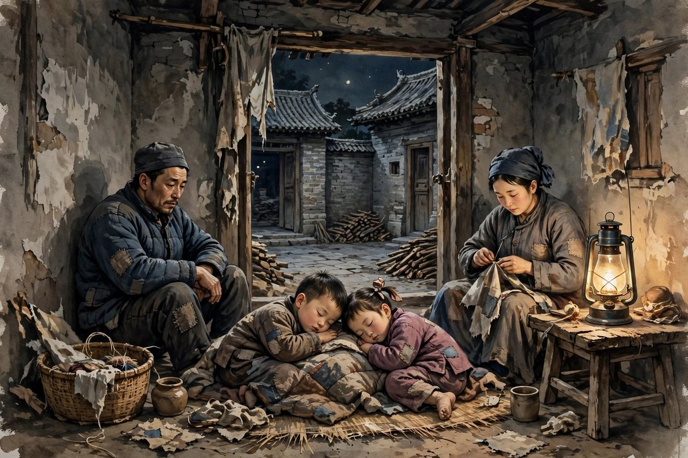
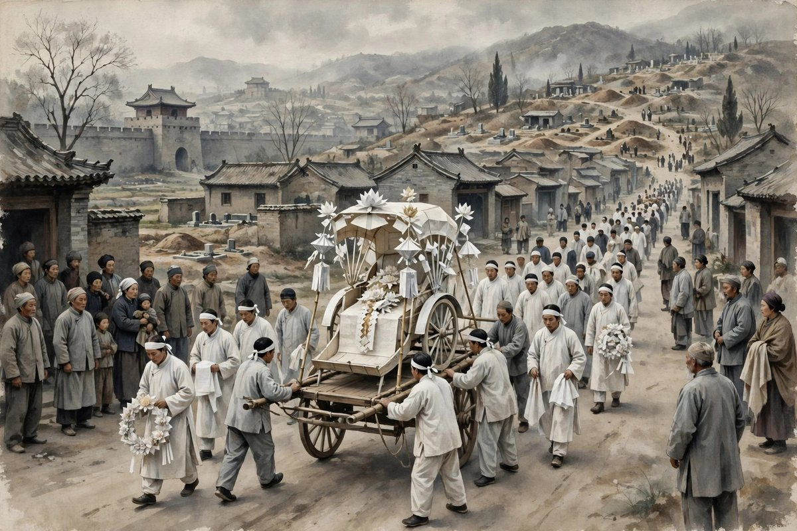

## 风沙里的北京

薄奠写的是北京，写的是一个人力车夫，写的是一个知识分子和一个车夫之间的交情。小说的开头，写的是北京的风沙，写的是一个下午，风大得让人睁不开眼，街上的人都匆匆忙忙，洋车夫们趁着风沙漫天要价，知识分子身上只有几十枚铜子，雇不起车，只好一直往前走，走到正阳桥边，被一辆汽车喷了一身灰土，决心动摇了，就向道旁停着的一辆洋车问了一句，拉不拉，车夫恭恭敬敬地点了点头，说，坐上吧，先生。就这么一句话，就这么一次坐车，两个人就认识了，认识之后，知识分子就喜欢上了和车夫聊天，喜欢在车上和车夫说闲话，喜欢用自己的言语来缓和车夫的劳苦，喜欢把车夫当成朋友，而不是当成一个拉车的工具。这种喜欢，在当时是很少见的，因为很多坐车的人，把车夫当成牛马，当成机器，当成可以随意使唤，随意克扣，随意骂的人，郁达夫笔下的知识分子，却把车夫当成朋友，当成同胞，当成一个值得尊敬的人。

车夫是一个真诚朴实的壮年汉子，一家四口，挤住在一间狭小的屋子里，妻子和两个孩子，都靠他一个人拉车养活。他每天拉车拉来的几个钱，还不够供洋车主的盘剥，还不够付房钱，还不够买米买面，日子过得非常艰苦。他才四十多岁，背已经有些驼了，看起来像五十多岁的人，背驼的原因，是常年拉车压的，是常年弯着腰，顶着风沙，拉着沉重的车子和客人，一步一步走出来的。他的愿望非常简单，简单到让人心酸：他想积些钱，买一辆属于自己的旧车来拉，买了自己的车，就不用再给车主交份子钱，就不用再被人盘剥，就能多挣几个钱，就能让妻子和孩子过得好一点。这个愿望，放在今天看，简直小得不能再小，小到任何一个有点钱的人，都觉得这算什么愿望，可是对于车夫来说，这个愿望就是他活着的全部意义，就是他每天起早贪黑拉车的动力，就是他咬着牙也要活下去的理由。

## 一块表和一颗不肯要的心

知识分子和车夫熟了之后，有一次，他有意将一块表悄悄留在车夫桌上，希望能在经济上稍加帮助，希望车夫能把表当了，换几个钱，贴补家用。可是车夫发现之后，坚持不肯要，坚持把表还给知识分子，坚持说，自己不能要别人的东西，自己拉车挣的钱，才是干净的钱，别人施舍的钱，再多也不能要。这种坚持，在今天看来，可能有点傻，有点迂，有点不识抬举，可是放在车夫身上，却是他身上最宝贵的东西：穷，可是穷得有骨气，穷得不愿意占便宜，穷得不愿意欠人情，穷得要靠自己的力气吃饭。这种骨气，是很多有钱人都没有的，是很多知识分子嘴上说，心里却没有的。知识分子被车夫的骨气感动了，感动到觉得，这个车夫的愿望，将来一定能实现，这个车夫，将来一定能买到属于自己的车，一定能过上好日子。这种感动，是真诚的，是知识分子对劳动者的敬意，是一个坐车的人，对拉车的人的敬意，是一个有文化的人，对一个没有文化，可是有人格的人的敬意。

可是生活并没有按照知识分子的感动来发展，车夫的妻子，有一次把他的几块钱用去买了白洋布，车夫非常恼怒，痛骂妻子把他的钱花完了，骂完之后，心里又后悔，后悔自己不该骂妻子，后悔妻子也是为了家里好，后悔自己把买车的希望，看得比妻子的日子还重。这种家庭里的小争吵，写得非常真实，真实到让读者觉得，这就是穷人家的日子：钱太少了，少到每一块钱都有用处，少到花一块钱都要吵架，少到买一块布，都可能耽误买车的计划，少到夫妻之间，连吵架都是因为穷，都是因为爱，都是因为想让日子好一点，却不知道怎么才能好一点。车夫骂妻子，不是恨妻子，是恨穷，是恨自己挣得太少，是恨这个社会，让他拉了一辈子车，却连一辆旧车都买不起。这种恨，骂不出来，只能骂到妻子身上，骂完之后，心里更难受，更觉得对不起妻子，更觉得自己没用。这种循环，就是穷人的日常，就是穷人家庭里，最让人心酸的部分。

## 一场大水和一个噩耗

不久之后，车夫就出事了。他在南下洼的大水里淹死了，死了之后，妻子还不知道，直到隔日傍晚，由拉车的同伴认出了他的相貌，才跑回来告诉她。妻子听到噩耗，悲痛欲绝，后来自己也跳在附近的一个水池里自尽过一次，经她儿子的呼救，附近的居民费了许多气力，才把她捞救上来。一个家庭，就这样垮了，男人死了，女人差点也死了，两个孩子，差点成了孤儿。知识分子听到噩耗的时候，心里也是翻江倒海，他想起车夫的愿望，想起车夫的骨气，想起车夫的背，想起车夫的笑，想起自己曾经以为，车夫一定能买到自己的车，一定能过上好日子，可是现实告诉他，没有，车夫到死都没有买到车，到死都没有摆脱车主的盘剥，到死都没有过上一天好日子。他的死，不是死于疾病，不是死于年老，是死于穷，是死于一场大水，是死于一个让穷人连活下去都很难的社会，是死于一个让车夫拉了一辈子车，却连一辆车都买不起的世道。

妻子找到知识分子，哭着对他说，车夫活着的时候，老想自己买一辆车，可是这个心愿终究没有达到，前几天她到冥衣铺去定一辆纸糊的洋车，想烧给他，那一家掌柜的要她六块多钱，她没有定下来，她请知识分子去买一辆好好的纸车来烧给他。这段话，写得让人眼泪直流：一个活着的时候买不起真车的人，死了之后，妻子想给他烧一辆纸车，都买不起，都要去求别人，都要看别人的脸色。这就是穷人的悲哀，活着的时候穷，死了之后还是穷，穷到连死后的体面，都要靠别人的施舍。知识分子听了之后，答应了，他说，你别哭了，他是我的朋友，那纸糊的洋车，我明天一定去买了来，和你一块去烧到他的坟前去。这句话，不是客套，是承诺，是一个朋友对另一个朋友的承诺，是一个知识分子对一个车夫的承诺，是一个人对另一个已经死去的人的承诺。

## 纸车上路的时候

知识分子从来没有办过丧事，寻来寻去，总寻不出一家冥衣铺来定那纸糊的洋车，后来直到四牌楼附近，找定了一家，付了他钱，要他赶紧为他糊一辆车。两天之后，纸洋车糊好了，天也不下雨，知识分子早早吃了午饭，就雇了四辆洋车，同她及两个小孩一道去上她男人的坟。车过顺治门内大街的时候，前面的一乘人力车上，只载着一辆纸糊的很美丽的洋车和两包锭子，大街上来往的红男绿女，只是凝目地看着知识分子和后面车上的那个眼睛哭得红肿，衣服褴褛的中年妇人。知识分子被众人的目光鞭挞不过，心里起了一种不可抑遏的反抗和诅咒的毒念，只想放大了喉咙，向着那些红男绿女和汽车中的贵人狠命地叫骂着说，你们看什么，我的朋友，这可怜的拉车者是为你们所逼死的呀，你们还看什么。这段叫骂，是小说的高潮，是郁达夫写得最有力量的一段，是一个知识分子，在纸车上路的时候，终于忍不住了，终于把心里的话喊出来了，喊给那些看热闹的人听，喊给那个社会听，喊给所有逼死车夫的人听。

这段叫骂，放在今天，同样让人觉得解气。今天的社会里，同样有很多人，站在路边看热闹，看穷人的热闹，看弱者的热闹，看别人的悲剧，像看戏一样，看完之后，还要议论几句，还要说几句风凉话，还要觉得，穷人穷是活该，弱者弱是自己没本事。郁达夫用这段叫骂，告诉这些人，你们看什么，你们看的热闹，是别人的命，是别人的血，是别人的眼泪，是一个家庭的垮塌，是一个车夫的一生。你们如果还有一点良心，就不应该看热闹，就应该问一问，这个车夫为什么会死，这个社会为什么会让一个想买一辆旧车的人，到死都买不起，这个世道为什么会让一个老实巴交，勤劳善良的人，活得这么难，死得这么惨。叫骂不是目的，叫骂是为了让看热闹的人醒过来，是为了让社会醒过来，是为了让后来的人，不要再站在路边看热闹，而是走到路中间去，走到穷人身边去，走到车夫的坟前去，烧一辆纸车，说一句公道话。

## 薄奠是什么意思

薄奠这个题目，意思很简单，就是微薄的祭奠，就是一份很薄的祭品，就是一辆纸车，就是两包锭子，就是一个知识分子对一个车夫的一点心意。薄，是因为知识分子也没有多少钱，薄，是因为车夫生前也没有享过什么福，薄，是因为这个社会，给穷人的东西，永远都是薄的，薄到连一辆纸车，都要精打细算，薄到连一场葬礼，都要靠别人的帮助。可是薄奠里的情，并不薄，情是很厚的，厚到知识分子愿意为一个车夫去买纸车，愿意陪着他的妻子和孩子去上坟，愿意在众目睽睽之下，为他叫骂，为他讨公道。这种厚情，放在今天，同样是稀缺的，今天的人，愿意为朋友花钱的人很多，愿意为朋友在众人面前说话的人很少，愿意为一个已经死去的人说话的人更少，愿意为一个穷人，一个车夫，一个社会底层的人说话的人，少之又少。郁达夫写薄奠，就是在说，情的厚薄，不在于祭品的贵贱，不在于葬礼的排场，而在于你心里，有没有把这个人当成朋友，有没有把他的死，当成自己的事，有没有在他死后，还愿意为他说一句公道话。

从文学的角度看，薄奠是郁达夫从写自己，走向写社会的一个重要作品。早期的他，写沉沦，写自己的苦闷，写自己的欲望，写自己的自卑，到了薄奠，他开始写别人，写车夫，写穷人，写社会，写阶级压迫，写一个知识分子怎么从同情穷人，走向为穷人呐喊。这个转变，和春风沉醉的晚上一样，都是他走向社会关怀的标志，都是他从一个颓废文人，走向一个有良知的作家的标志。这种转变，在今天同样有意义：一个写文章的人，不能永远只写自己，不能永远只写自己的小情绪，要走到社会里去，走到穷人中间去，走到那些被忽视，被压迫，被看热闹的人中间去，写他们的日子，写他们的愿望，写他们的死，写他们的纸车，只有这样，文章才有分量，才有温度，才有力量，才不只是个人的呻吟，而是社会的呐喊。

## 车夫的妻子和孩子

车夫死后，留下来的妻子和两个孩子，日子过得比他活着的时候更难。妻子是一个中年妇人，眼睛哭得红肿，衣服褴褛，带着两个孩子，住在狭小的屋子里，没有男人挣钱，没有人拉车，没有人给家里带来收入，靠什么活下去，靠邻居的接济，靠亲戚的帮忙，靠自己做一点零活，靠把日子一分一分地熬过去。两个孩子还小，小到还不懂得父亲为什么死了，小到还以为父亲只是出门拉车去了，还会回来，还会给他们带好吃的回来，可是父亲再也不会回来了，父亲已经死在大水里了，父亲的尸体已经被同伴认出来了，父亲的纸车已经被烧到坟前去了，父亲的故事，已经变成了一个知识分子小说里的故事，变成了一个让读者读了之后心里发酸的故事。妻子和孩子，在小说里，出现的篇幅并不多，可是他们站在纸车后面，站在大街上，站在众人的目光里，站在那个眼睛哭得红肿的位置上，就已经足够让读者明白，一个车夫的死，不只是一个人的死，是一个家庭的垮塌，是一个妻子失去丈夫的痛，是两个孩子失去父亲的痛，是一个家庭从穷，变成更穷，从难，变成更难的痛。

这种家庭的垮塌，放在今天，同样是很多人会遇到的事：一个家庭的顶梁柱倒了，倒在工伤里，倒在疾病里，倒在意外里，倒在经济下行里，倒在被裁员里，倒在被平台封号里，倒下之后，留下来的人，日子会过得非常难，难到要靠借钱过日子，难到要靠亲戚接济，难到孩子要辍学，难到妻子要打几份工，难到一个家庭，从勉强维持，变成彻底维持不下去。郁达夫写车夫的妻子和孩子，就是在说，一个人的死，从来都不是一个人的事，一个人的穷，从来都不是一个人的穷，一个家庭的垮塌，背后是整个社会的责任，是整个社会没有给穷人一点保障，没有给车夫一点保险，没有给他的妻子和孩子一点出路。社会如果对穷人有一点保障，车夫死了之后，他的妻子和孩子，至少能活下去，至少能上学，至少能吃饱饭，可是那个社会没有，那个社会给穷人的，只有看热闹的目光，只有红男绿女的凝视，只有汽车里贵人的冷眼，只有纸车上路的时候，一路的围观。

## 知识分子的愧疚和觉醒

知识分子在小说里，是一个有良心的人，可是他的良心，也带着愧疚，带着无力，带着一种坐车的人，对拉车的人的愧疚。他平时坐在车上，和车夫聊天，用言语来缓和车夫的劳苦，自以为这就是社会主义，自以为这就是同情，自以为这就是对穷人的好，可是车夫死了之后，他才明白，聊天是解决不了问题的，言语是缓和不了劳苦的，同情是买不来一辆车的，施舍一块表，是解决不了车夫一家人的穷的。真正的帮助，不是坐在车上说几句闲话，不是悄悄留一块表，不是事后买一辆纸车，真正的帮助，是改变那个让车夫买不起车的社会，是改变那个让车主盘剥车夫的制度，是改变那个让穷人拉一辈子车，却连一辆旧车都买不起的世道。可是知识分子一个人，改变不了社会，改变不了制度，改变不了世道，他能做的，只有一辆纸车，只有一声叫骂，只有一篇小说，只有一点良心，只有一点对车夫的怀念，只有一点对社会的愤怒。这种无力，放在今天，同样是很多有良心的人会感到的无力：看到外卖员被平台压榨，看到快递员被罚款，看到农民工被欠薪，看到穷人被欺负，心里很愤怒，很想帮忙，可是自己一个人，能做的事很少，能改变的事很少，只能写一篇文章，只能发一条动态，只能捐一点钱，只能在心里骂一句，只能在纸车上路的时候，喊一声，你们看什么。这种无力，不是借口，是现实，可是无力不等于不做，无力的人，至少可以做一辆纸车，至少可以喊一声，至少可以写一篇文章，至少可以让更多的人，看到车夫的死，看到穷人的苦，看到社会的不公，这，就是知识分子的责任，就是郁达夫写这篇小说的责任。

## 纸车和真车的距离

纸车和真车之间，隔着的距离，就是穷人和富人之间的距离，就是梦想和现实之间的距离，就是车夫活着的时候，想要的东西，和他死后才能得到的东西之间的距离。活着的时候，他想要一辆真车，想要一辆属于自己的旧车，想要靠这辆车，多挣几个钱，让家里人过得好一点，可是活着的时候，他没有得到，死后，他得到了一辆纸车，一辆糊出来的车，一辆烧给他的车，一辆只能在坟前烧掉的车，一辆不能拉人，不能挣钱，不能养家，只能化成灰的车。纸车和真车的距离，就是生和死的距离，就是希望和绝望的距离，就是一个人活着的时候，得不到的东西，死了之后，才有人愿意给他的距离。这种距离，放在今天，同样存在：很多穷人活着的时候，得不到的东西，死了之后，才有人来纪念，才有人来写文章，才有人来拍纪录片，才有人来说，这个人真可怜，这个人真不容易，可是活着的时候，没有人管，没有人问，没有人给一辆真车，没有人给一点帮助。郁达夫写纸车，就是在问这个社会，为什么活着的时候，不给车夫一辆真车，为什么要等到他死了，才给他一辆纸车，为什么活着的时候，不能让他过上好日子，为什么死了之后，才来为他叫骂，才来为他烧纸，才来为他流泪。这个问题，放在今天，同样值得问：为什么外卖员活着的时候，没有人关心他的社保，为什么快递员活着的时候，没有人关心他的罚款，为什么农民工活着的时候，没有人关心他的欠薪，为什么一定要等到他们出事了，等到他们死了，等到他们成了新闻，才有人来关心，才有人来捐款，才有人来写文章。活着的时候给一点帮助，比死了之后烧一辆纸车，要管用得多，要温暖得多，要有良心得多。

## 北京的风沙和人心的冷暖

小说里的北京，写得风沙很大，风沙大到让人睁不开眼，风沙大到街上的人都匆匆忙忙，风沙大到洋车夫都要漫天要价，风沙大到知识分子身上只有几十枚铜子，雇不起车，只能一直往前走。风沙，是北京的天气，也是社会的天气，是穷人的天气，是车夫的天气，是让穷人睁不开眼，让穷人走不动路，让穷人连雇车都雇不起的天气。可是风沙再大，车夫还是拉车，还是顶着风沙走，还是弯着背，喘着气，一步一步往前走，走到正阳桥边，走到西单牌楼，走到巡捕厅胡同，走到知识分子的家门口，走到自己生命的尽头。风沙里的人心，有冷的，也有暖的，冷的是那些看热闹的红男绿女，冷的是汽车里的贵人，冷的是车主的盘剥，冷的是社会的制度，暖的是车夫的骨气，暖的是妻子的眼泪，暖的是知识分子的纸车，暖的是那一声叫骂，暖的是郁达夫写这篇小说的心。风沙会过去，人心里的冷暖，却会留下来，留在一篇小说里，留在一个读者的心里，留在一个后来人读到薄奠的时候，心里翻起的那股暖和那股冷里。

## 对照今天的车夫

今天的北京，已经没有人力车夫了，可是车夫的影子，还在，还在外卖员身上，还在网约车司机身上，还在快递员身上，还在那些靠体力吃饭，靠平台派单，被抽成，被罚款，被算法压榨的人身上。他们的愿望，和一百年前车夫的愿望，本质上是一样的：想买一辆属于自己的车，想摆脱平台的抽成，想多挣几个钱，想让家里人过得好一点，想不再被人当成牛马，想活得有尊严一点。今天的外卖员，想买一辆属于自己的电动车，想不再租平台的车，想不再被扣钱，今天的网约车司机，想买一辆属于自己的车，想不再给租赁公司交租金，想不再被平台抽走大头，今天的快递员，想攒钱开一家属于自己的小店，想不再风里来雨里去，想不再被罚款罚到白干。这些愿望，和车夫想买一辆旧车的愿望，是一样的愿望，是穷人最朴素的愿望，是任何一个靠力气吃饭的人，最基本的愿望。

可是这些愿望，在今天同样很难实现，平台抽成越来越高，租金越来越贵，罚款越来越多，算法越来越严，穷人想靠自己的力气摆脱穷，越来越难，难到很多人干了一辈子，还是买不起一辆属于自己的车，还是摆脱不了被盘剥的命运，还是活得像牛马，死得像牛马。郁达夫写薄奠，写到最后忍不住叫骂，骂那些看热闹的人，今天的人读到那一段，同样会觉得解气，同样会觉得，这个作家没有站在岸上看热闹，他是站在车夫那一边，和车夫一起骂街的。这种站队，在今天同样重要：写文章的人，到底站在谁那一边，站在平台那一边，还是站在外卖员那一边，站在强者那一边，还是站在弱者那一边，读者是看得出来的，时间也是看得出来的。薄奠留给今天读者的，就是这个站队的问题，就是这个为穷人说话的勇气，就是这个在纸车上路的时候，敢于向看热闹的人叫骂的勇气。

## 一个知识分子的自我审视

知识分子在薄奠里，不只是一个旁观者，不只是一个坐车的人，不只是一个买纸车的人，更是一个在自我审视的人，一个在问自己，我平时说的社会主义，是不是真的，我平时对车夫的好，是不是真的，我平时坐在车上，和车夫聊天，是不是真的在帮助他，还是只是在安慰自己，让自己觉得，自己是一个好人，一个有良心的人，一个和穷人站在一起的人。车夫死了之后，他才明白，聊天是没有用的，言语是缓和不了劳苦的，留一块表是没有用的，施舍是解决不了穷的，真正的社会主义，不是坐在车上说几句闲话，是要改变车主盘剥车夫的制度，是要让车夫能买到属于自己的车，是要让穷人能靠自己的力气，过上有尊严的日子。可是他一个人，做不到这些，做不到改变制度，做不到改变社会，做不到让车夫活过来，做不到让车夫的妻子和孩子，过上好日子，他能做的，只有一辆纸车，只有一声叫骂，只有一篇小说，只有一点良心。这种自我审视，放在今天，同样是很多知识分子，很多写文章的人，很多自称关心穷人的人，应该做的事：问问自己，我对穷人的关心，是不是真的，我写穷人的文章，是不是真的在帮助穷人，还是只是在消费穷人，只是在用穷人的苦，来换自己的名声，来换自己的流量，来换自己的良心安慰。郁达夫写薄奠，就是在做这种自我审视，就是在告诉读者，关心穷人，不能只停留在嘴上，不能只停留在车上，不能只停留在纸车上，要走到制度里去，走到社会里去，走到穷人的日子里去，走到能改变一点什么的地方去，哪怕改变的只是一点点，哪怕只是一辆纸车，哪怕只是一声叫骂，也比只说不做，要好得多。

## 纸车烧完之后

纸车烧完之后，灰飞起来了，飞到天上，飞到风里，飞到北京的大街上，飞到看热闹的人的眼睛里，飞到知识分子的心里，飞到车夫妻子的心里，飞到两个孩子的心里，飞到后来读者的心里。灰飞完之后，纸车就没有了，真车还是没有来，车夫还是死了，妻子还是穷，孩子还是小，社会还是那个社会，制度还是那个制度，车主还是盘剥，风沙还是很大，北京还是北京。可是纸车烧完之后，留下来的东西，并不只是灰，还有知识分子的一声叫骂，还有一篇小说，还有一个让后来人读了之后，心里发酸，心里想着，车夫不应该死，穷人不应该这么穷，社会不应该这么冷的故事。这篇小说，留下来了，留了一百年，留到今天，留到今天的人，读到薄奠的时候，还是会觉得，纸车烧完之后，灰还在，叫骂还在，愤怒还在，希望还在，穷人的日子，虽然还是难，可是至少有人，愿意为穷人烧一辆纸车，愿意为穷人叫骂一声，愿意为穷人写一篇文章，愿意让后来人，记住车夫，记住他的愿望，记住他想买一辆属于自己的车，到死都没有买到的愿望，记住这个愿望，本身就是一种希望，就是一种不让车夫白死的方式，就是一种让纸车，变成真车的方式，虽然真车还没有来，虽然纸车已经烧完了，可是希望还在，希望就是，终有一天，穷人能买到属于自己的车，能靠自己的力气，过上有尊严的日子，能不再被人盘剥，不再被人看热闹，不再死在大水里，不再只剩下一辆纸车。

## 结尾的话

薄奠的结尾，停在知识分子的叫骂上，停在纸车上路的时候，停在众人的目光里，停在那个眼睛哭得红肿的妇人身上，停在两个孩子身上，停在那个已经死去的车夫身上。结局没有写车夫的妻子后来怎么样了，没有写两个孩子后来怎么样了，没有写知识分子后来怎么样了，结局只写了叫骂，只写了愤怒，只写了不平，只写了一个知识分子，在为一个车夫讨公道的时候，心里翻起的毒念和反抗。这种结局，放在今天看，可能有点不完整，可是恰恰是这种不完整，让小说有了力量，有了余味，有了让读者自己去想，车夫的妻子后来怎么办，两个孩子后来怎么办，这个社会后来怎么办，穷人的日子后来怎么办。读者想完之后，会发现，答案并不乐观，穷人的日子，在很长一段时间里，并没有变好，车夫的愿望，在很长一段时间里，并没有实现，纸车烧完了，真车还是没有来，叫骂喊完了，社会还是那个社会。可是叫骂本身，就是一种希望，就是一种不服，就是一种不愿意接受现实的态度，就是一种告诉后来人，穷人的死，不应该被遗忘，不应该被看热闹，不应该被当成戏来看的态度。这，就够了，这就是薄奠留给后来人的东西，就是一辆纸车，就是一声叫骂，就是一个知识分子，对一个车夫的薄奠，薄，可是真，薄，可是有情。

## 再说一句

薄奠写完之后，纸车已经烧完了，叫骂已经喊完了，知识分子已经回家了，车夫的妻子和孩子，还要继续过日子，还要继续面对穷，还要继续面对风沙，还要继续面对没有男人的家，还要继续把日子，一分一分地熬过去。熬过去的日子，很难，很苦，很长，可是熬过去的人，心里还有一点东西，还有知识分子买的那辆纸车，还有那一声叫骂，还有一篇小说，还有一个后来人，读到薄奠的时候，心里翻起的那股暖，和那股愤怒，这股暖和愤怒，就是穷人活下去的理由，就是后来人，不要再站在路边看热闹的理由，就是社会，不要再让车夫买不起一辆真车的理由。

纸车烧过去之后，烟也就散了，散了的烟里，活着的人还要接着过日子。接着过日子的人，心里都揣着一句话：送走的人已经走了，留下的人还要走下去。走下去的路不好走，可走下去本身，就是对送走的人最好的交代。郁达夫写薄奠，写的就是这份交代：纸车虽薄，情意却厚，厚到烧成了灰，灰里还留着暖，暖到后来的人读到这里，心里也跟着热起来。
