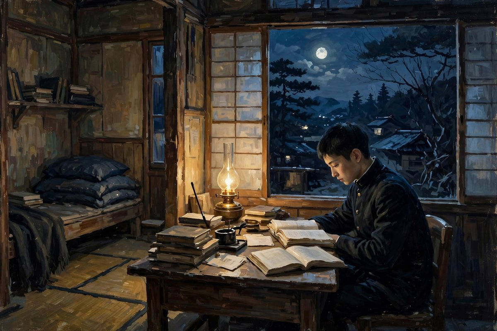
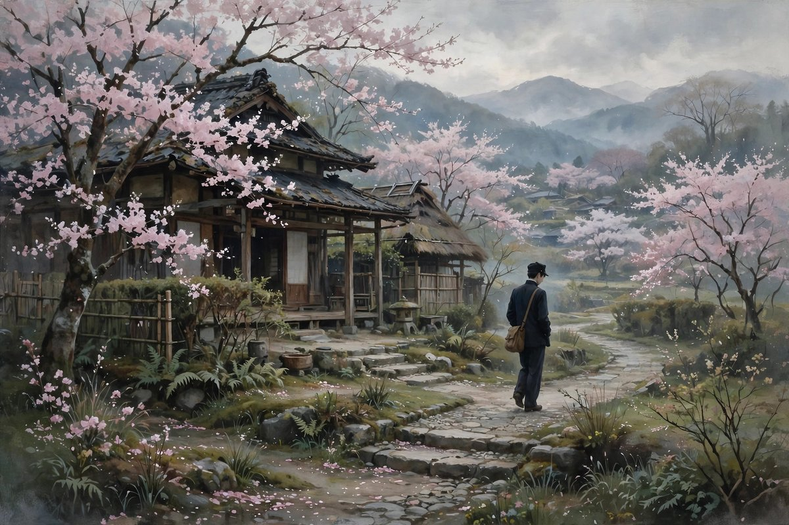

## 海边的青年

沉沦写的是一个中国青年在日本留学的日子，这个青年没有名字，或者说，他的名字并不重要，重要的是他的处境：一个人，离家万里，在异国的学校里读书，身边没有亲人，没有朋友，没有可以说心里话的人，语言不通，钱不够花，身体也不好，整天被一种说不出来的闷气压着。他住的地方很简陋，吃的也很差，学校里的功课他并不喜欢，老师讲的东西他听不进去，同学之间的交往他也融不进去，走到哪里都像一个外人。更难受的是，他心里清楚，自己之所以融不进去，不只是因为语言和钱，更因为他的国家弱，弱国的人走到哪里，都会被人低看一眼，哪怕别人嘴上不说，眼睛里的那种轻视还是藏不住。他把这种轻视内化成了自卑，自卑又变成了敏感，敏感又变成了多疑，多疑到最后，看谁都像在嘲笑自己，听谁说话都像在讽刺自己，于是他越来越不愿意出门，越来越不愿意和人打交道，越来越把自己关在屋子里，关在自己的念头里，关在自己的欲望和羞耻里。

小说的开头并没有大场面，没有激烈的冲突，只有一个青年在海边的踱步，在山上的独坐，在宿舍里的失眠，在酒馆里的独饮。郁达夫写这种日常写得非常细，细到一个人在月光底下想什么，在雨声里想什么，在看到一对情侣走过的时候心里翻起什么，都写得清清楚楚。这种细，不是为了炫技，而是为了让读者明白，一个人的沉沦不是一天造成的，是很多个这样的夜晚，很多个这样的白天，很多个没有人说话的日子，一点一点堆出来的。就像今天很多人在大城市里打工，住在合租房里，下班之后一个人吃饭，一个人刷手机，一个人失眠，隔日又一个人去上班，日子久了，人就会变得敏感，变得多疑，变得不敢和人深交，变得把所有的情绪都憋在心里，憋到最后，要么爆发，要么沉下去。沉沦里的青年，就是沉下去的那一种，他不是坏人，他甚至是一个很善良，很敏感，很有才气的人，可是善良和敏感在那个环境里，并没有保护他，反而让他更痛苦，因为他看得太清楚，想得太多，感受得太深，深到自己承受不住。

## 欲望与羞耻的拉扯

沉沦里最让人读得不舒服，也最让人读得忘不掉的部分，是青年对欲望的描写。他年轻，血气方刚，身体里有正常的欲望，可是他的环境不允许他正当地满足这种欲望，他的道德观念又让他为这种欲望感到羞耻，于是欲望和羞耻在他心里打架，打得他夜不能寐，打得他白天也心神不宁。他偷看过女人洗澡，他去过妓院，他在妓院里花了钱，出来之后又后悔，后悔之后又想去，想去之后又骂自己，这种循环，像一个转不出来的圈子，圈子越转越小，小到最后把他自己勒得喘不过气来。郁达夫写这些，没有遮遮掩掩，没有用隐喻去绕弯子，他就是直写，写一个青年心里到底在想什么，写他怎么被欲望折磨，怎么被羞耻折磨，怎么在两种折磨之间找不到出口。这种直写，在当时是惊世骇俗的，很多人骂他伤风败俗，骂他把文学写成了黄色小说，可是今天回过头来看，他写的恰恰是文学最应该写的东西：一个人真实的内心，一个青年真实的困境，一个被旧道德压着，又被新思想撩拨着的青年，到底应该怎么活。

这种困境，放在今天一点都没有过时。今天的年轻人，照样会被欲望和羞耻拉扯，照样会在深夜里刷着手机，心里想着一些不敢说出口的事，照样会在隔日清晨醒来，觉得自己昨天晚上很不堪，照样会在社交平台上看到别人光鲜的生活，觉得自己活得很失败，照样会在想爱一个人的时候，又怕自己配不上对方，又怕对方看不起自己。区别只在于，一百年前的青年，把这种拉扯写成了小说，把这种拉扯变成了一种时代病，今天的青年，把这种拉扯发成了动态，发成了匿名帖子，发完之后还是没有人真正懂他。郁达夫的好处在于，他没有给青年开药方，没有告诉青年应该怎么办，他只是把青年的病状写得清清楚楚，让读者自己去看，自己去想，自己去判断：这个青年到底是活该，还是可怜，到底是道德败坏，还是时代害了他，到底是他自己的问题，还是整个社会的病在他一个人身上发作了。读者读完之后，答案往往不是单一的，而是复杂的，是既可怜又可气，既同情又批判，这种复杂，才是好小说应该有的样子。

## 弱国子民的心结

沉沦里还有一层更深的意思，就是弱国子民的心结。青年在日本，常常会想，为什么中国那么弱，为什么中国人走到哪里都被人看不起，为什么日本人可以趾高气扬，中国人就只能低声下气。他把这种国家层面的屈辱，内化成了个人层面的自卑，自卑到觉得自己连爱一个日本姑娘都不配，自卑到觉得自己连和日本同学正常交往都不配，自卑到觉得自己活着本身就是一种丢脸。这种心结，在今天听起来可能有点夸张，可是放在那个年代，是非常真实的：一个国家的弱，会直接变成每一个国民的弱，会变成每一个出国的人身上的包袱，会变成每一个留学生在异乡抬不起头的理由。青年在小说里，有一次对着大海喊，喊祖国啊，你为什么这么弱，喊完之后，他觉得自己更绝望了，因为喊是没有用的，祖国不会因为他喊一声就变强，他也不会因为喊一声就变自信，喊完之后，他还是那个孤独的留学生，还是那个住在破屋子里，吃不饱饭，睡不好觉的人。

这种心结，今天的人其实也能理解，只是换了一个形式。今天的中国已经强大了很多，中国人出国不再像一百年前那样被人低看，可是很多人在异乡，在大城市，在职场里，照样会有一种抬不起头的感觉，照样会觉得自己出身不好，学历不好，口音不好，穿着不好，照样会在和别人比较的时候，觉得自己处处不如人，照样会把这种比较变成自卑，把自卑变成敏感，把敏感变成自我封闭。郁达夫写沉沦，写的就是这种自我封闭是怎么一步一步形成的：先是觉得自己不如人，然后是不敢和人说话，然后是躲起来，然后是在躲起来的日子里胡思乱想，然后是胡思乱想变成病，病到最后，人就沉下去了。沉下去不是一个决定，是一个过程，是很多个小决定堆出来的结果：今天决定不出门，明天决定不回信，后天决定不去上课，大后天决定不吃饭，再往后，决定就不是决定了，是惯性，是病，是沉沦本身。

## 山上的房子和海边的夜

小说里有几个场景，写得非常美，也非常痛。青年在山上租了一间房子，想一个人清静清静，想靠山水来治自己的病，可是山水并没有治好他，反而让他更清楚地看到自己的病：山是美的，海是美的，月光是美的，可是美的东西越美，越衬得他心里越荒凉。他在山上遇到过一对野合的男女，看到别人可以那么放纵，那么快乐，他心里既羡慕，又鄙视，既想加入，又觉得自己不配，这种矛盾，让他在山上的日子过得比在城里更难受。他又回到海边，在海边的酒店里喝酒，在酒店里遇到过一个女人，两个人有过一夜的欢愉，欢愉过后，他并没有觉得解脱，反而觉得更空虚，更羞耻，更绝望，因为他发现，欲望的满足并不能解决他的问题，问题不在身体上，而在心里，在国家上，在前途上，在他这个人到底应该怎么活的问题上。身体上的满足，像一杯酒，喝的时候痛快，喝完之后更渴，更难受，更想死。

最后，青年走向大海，在海边长叹一声，投海自杀了。这个结局，在今天看来，可能显得极端，可能显得不值得，可是放在小说的逻辑里，却是顺理成章的：一个人在所有的路都试过之后，发现每一条路都走不通，在所有的感情都试过之后，发现每一种感情都不能救他，在所有的呐喊都喊过之后，发现没有人听见他的呐喊，他最后的选择，就只剩下了死。郁达夫写死，写得并不煽情，没有大段的抒情，没有廉价的眼泪，只是写青年走到海边，写海浪的声音，写月光的颜色，写他心里的最后一句话，然后就是一片寂静。这种寂静，比任何哭喊都让人难受，因为读者读到这里，会忽然明白，这个青年的死，不是他一个人的死，是那个时代很多青年的死，是很多有心气，有才气，有感情的青年，在找不到出路的时候，共同的结局。小说出版之后，很多青年读者读得心里发烫，读得夜不能寐，读得觉得这个青年就是自己，这种共鸣，就是沉沦成功的证明：它不是在讲一个虚构的故事，它是在讲一代人的病。

## 为什么这篇小说能炸开文坛

沉沦在一九二一年十月出版，收在同名短篇小说集里，集子里还有南迁和银灰色的死两篇，都是写留日学生的苦闷和死亡，都是写同一个时代病。集子一出来，就引起了很大的反响，青年读者抢着买，抢着读，江浙一带的青年纷纷到上海去买这本书，一时间洛阳纸贵，人人都在谈郁达夫。为什么一篇写留学生自杀的小说，能有这么大的影响？原因并不复杂：因为它写出了别人不敢写的东西，写出了别人心里有，嘴上不敢说，笔下不敢写的东西。在沉沦之前，中国的小说很少这么直白地写人的内心，很少这么坦率地写欲望，写自卑，写民族屈辱，写一个青年怎么一步一步沉下去，郁达夫把这些都写了，写得不加修饰，写得不怕骂，写得像把自己的心剖开给人看。这种剖开，在当时是革命性的，是文学上的一次破冰，破冰之后，后来的作家才敢跟着写内心，敢写欲望，敢写真实的人。

从文学史的角度看，沉沦是中国现代文学史上的一部白话短篇小说集里的开篇之作，它的意义不只在于故事本身，更在于它开创了一种写法：自叙传式的抒情小说。意思就是，小说的主人公就是作家自己，小说里的经历就是作家自己的经历，小说里的感情就是作家自己的感情，这种写法，把小说和作者的距离拉到了最近，近到几乎没有距离。好处是真诚，是动人，是让读者觉得这不是编出来的，是真的，坏处是容易变成自恋，容易变成絮叨，容易变成只写自己，不写社会。郁达夫在沉沦里，好处占了上风，因为他写自己的时候，也写出了时代，写自己的苦闷的时候，也写出了弱国子民的苦闷，写自己的欲望的时候，也写出了旧道德对人的压迫，个人和时代，在这篇小说里是合在一起的，分不开的，这就是它伟大的地方。

## 对照今天再读沉沦

今天再读沉沦，很多人会觉得青年的选择太极端，会觉得他为什么不去找心理医生，为什么不去换个环境，为什么不去找朋友聊聊，为什么不去努力工作，为什么非要死不可。这些问题，放在今天都是有道理的，今天的社会，有心理咨询，有社交平台，有各种各样的出路，有各种各样的帮助，可是放在一百年前，这些出路几乎都没有，心理医生没有，社会支持没有，留学生的圈子也很小，一个人沉下去，几乎没有人拉他一把。更重要的是，青年的问题不只是心理问题，更是时代问题，是国家弱的问题，是旧道德压人的问题，是前途不明的问题，这些问题，不是找个心理医生就能解决的，不是换个环境就能解决的，是需要整个社会变，需要国家变强，需要新的思想进来，才能解决的。青年等不到那个时候，他就先沉下去了，这种等不到，就是悲剧的根源。

今天的人读沉沦，不应该只读青年的死，更应该读青年的活，读他是怎么活的，读他活的时候想了什么，读他活的时候为什么那么痛苦，读他的痛苦里，有多少是自己的原因，有多少是社会的原因，有多少是时代的原因。读完之后，再对照自己的生活，对照自己身边的人，对照那些在深夜里失眠，在异乡里孤独，在职场里自卑，在感情里卑微的人，你会发现，沉沦并没有过时，它只是换了一个样子，换了一件衣服，换了一个场景，内核还是那个内核：一个人，在找不到出路的时候，会怎么一步一步沉下去，而社会，在一个人沉下去的时候，有没有伸手拉他一把。郁达夫写沉沦，不是为了让读者跟着青年一起去死，而是为了让读者看到沉沦的过程，看到沉沦的原因，看到沉沦背后的社会和时代，从而在自己的人生里，尽量不要走到那一步，在看到别人沉下去的时候，尽量伸手拉一把。这，才是这篇小说留给后来人最有用的东西。

## 小说里的月光和海

沉沦里的景物写得非常讲究，月光，海，山，雨，松树，酒店的灯，宿舍的窗，每一样景物都不是随便写的，都是青年心里的外化。月光是冷的，海是灰的，山是远的，雨是绵绵不断的，这些景物放在一起，就是青年心里的颜色：冷，灰，远，绵绵不断。郁达夫写景，从来不是为了写景而写景，他写景，是为了写人，是为了让景物替人说话，人心里说不出来的话，景物替他说出来了。青年站在海边，看着海浪一层一层地涌上来，又一层一层地退下去，心里想的是，自己的日子也是这样，涌上来一点希望，又退下去一点希望，涌上来一点勇气，又退下去一点勇气，到最后，海还是海，人还是人，希望还是没有留下来。这种写法，放在今天的写作课上，会被叫做意象，会被叫做象征，会被叫做情景交融，可是在郁达夫手里，这些词都不重要，重要的是，读者读到海的时候，心里真的能感觉到青年的绝望，读到月光的时候，心里真的能感觉到青年的孤独，读到雨的时候，心里真的能感觉到青年的绵绵不绝的烦恼。景物和人，在这篇小说里是分不开的，景物就是人，人就是景物。

还有一个细节值得注意：青年在小说里，常常是一个人看景，一个人喝酒，一个人走路，一个人想事情，身边很少有可以说话的人。这种一个人，在小说里反复出现，出现到最后，读者会觉得，这个青年的世界里，只剩下他一个人了，其他人都是背景，都是过客，都是让他更孤独的对照。别人成双成对，他一个人，别人谈笑风生，他一个人，别人有家有业，他一个人，这种对照，比任何直接的描写都更伤人。郁达夫用这种对照，写出了孤独的本质：孤独不是没有人，而是身边有人，却没有人懂你，是热闹里的一种冷清，是人群里的一种落单。今天的人，在地铁里，在办公室里，在聚会上，照样会感到这种孤独，照样会觉得，身边那么多人，却没有一个可以说心里话的人，照样会觉得，自己像沉沦里的青年一样，站在海边，看着别人的灯火，自己的灯却是灭的。这种孤独，是跨越时代的，是任何时代的人都可能遇到的，这就是沉沦里的景物和孤独，到今天还管用的原因。

## 郁达夫自己的影子

沉沦里的青年，身上有很明显的郁达夫自己的影子。郁达夫留学日本的时候，也住过破屋子，也缺过钱，也失过眠，也为欲望和羞耻苦恼过，也为国家弱而自卑过，也想过死，也写过诗来排遣，也喝过酒来麻醉自己。他把这些经历，几乎原样搬进了小说里，只不过把时间、地点、细节做了一些改动，把自己的名字隐去了，把自己的故事变成了青年的故事。这种写法，后来被人叫做自叙传，可是郁达夫自己并不喜欢这个标签，他觉得，小说就是小说，作家就是作家，小说里的人，哪怕再像作家，也不是作家本人，因为小说里的人，活在小说的逻辑里，作家活在现实的逻辑里，两个逻辑是不一样的。可是读者不管这些，读者读沉沦的时候，就是觉得，这个青年就是郁达夫，郁达夫就是这个青年，这种感觉，让小说更有说服力，也更有感染力，因为读者相信，这不是编出来的，是真的有人这样活过，这样苦过，这样死过。

这种相信，在今天同样重要。今天的小说，很多都是编出来的，编得再精彩，读者也知道是编的，读完之后，心里不会留下什么。沉沦不一样，读者读完之后，心里会留下一个人，会留下一种感觉，会留下一种挥之不去的闷气，这种闷气，就是真实的力量。郁达夫用自己的经历做燃料，烧出了一篇小说，燃料烧完了，小说留下来了，后来的人读小说的时候，还能闻到燃料的味道，还能感觉到火的温度。这种写法，风险很大，因为作家把自己烧进去了，烧完之后，自己也受了伤，可是郁达夫不在乎，他觉得，写文章就是要这样，不把自己烧进去，文章就没有温度，没有温度的文章，不值得写。这种态度，放在今天，同样值得尊敬：今天写文章的人很多，写得安全的人很多，写得正确的人很多，可是敢把自己烧进去的人，并不多，敢把自己的伤口给人看的人，并不多，郁达夫敢，而且他烧得彻底，烧得不留余地，这就是他和一般作家的区别。

## 给今天读者的信

如果你是一个在异乡读书或者工作的人，如果你是一个在深夜里失眠的人，如果你是一个觉得自己活得很窝囊的人，如果你是一个在感情里卑微过的人，读沉沦的时候，你可能会觉得，这个青年就是你，你可能会觉得，郁达夫是在写你，你可能会觉得，原来一百年前的人，和你是一样的。这种感觉，不是错觉，是真的，因为人的苦闷，在很多时候是相通的，是跨越时代的，是跨越国界的，是任何一个敏感的人，都可能遇到的。读完之后，你可能会问，那我应该怎么办，我是不是也会像青年一样沉下去。答案是，不一定，青年的结局，不是你的结局，青年的时代，不是你的时代，青年的出路很少，你的出路比他多得多，你有朋友可以找，有家人可以打电话，有心理咨询可以去，有换工作的自由，有换城市的自由，有在网上找到同类的自由，这些自由，青年都没有，你有，你就应该用好这些自由，不要像青年一样，把自己关起来，关到最后，关出病来。

更重要的是，你要学会向别人求助，学会把心里的话说出来，学会不要把自卑内化成自我攻击，学会不要把国家的弱，社会的错，全部算到自己一个人头上。青年的悲剧，有一部分是他自己的性格造成的，有一部分是时代造成的，时代的那一部分，你今天已经不用再背了，性格的那一部分，你今天可以慢慢改，改得慢一点也没有关系，只要你在改，只要你没有放弃自己，只要你还愿意向别人伸手，还愿意让别人拉你一把，你就不会沉下去。沉沦这篇小说，最好的读法，不是跟着青年一起沉下去，而是看着青年沉下去，然后提醒自己，不要走他的老路，不要重复他的错误，不要让他的结局，变成你的结局。郁达夫写这篇小说，不是为了让读者去死，是为了让读者活下去，活得清醒一点，活得勇敢一点，活得不要那么孤独。这，才是沉沦留给今天读者最重要的一句话。

## 读完之后的话

沉沦是一篇让人读得难受的小说，读完之后，心里会堵得慌，会想一个人静静地坐一会儿，会想给远方的朋友打个电话，会想自己的人生是不是也有沉下去的危险。这种难受，不是坏事，是好小说应该有的效果：它让你不舒服，让你反思，让你不敢再把自己的苦闷不当回事，也不敢再把别人的苦闷不当回事。郁达夫用这篇小说，告诉读者一个简单的道理：一个人的苦闷，从来都不是小事，苦闷堆得多了，就会变成病，病得久了，就会变成死，社会如果对青年的苦闷视而不见，青年就会用最极端的方式，让社会看见他的苦闷。这种道理，放在今天同样适用：一个社会，如果对年轻人的焦虑视而不见，对年轻人的孤独视而不见，对年轻人的自卑视而不见，年轻人就会用各种方式，让社会看见他们，不管是躺平，还是发疯，还是沉默，还是离开，都是在用自己的方式喊话。沉沦里的青年，用死来喊话，今天的青年，用别的方式来喊话，喊话的方式变了，喊话的内容没有变：我们很苦，我们很孤独，我们需要被看见，需要被理解，需要一条出路。

所以，读沉沦，不要只把它当成一篇旧小说来读，要把它当成一面镜子来读，照照自己，照照身边的人，照照这个社会。镜子里的人，一百年前穿着学生制服，站在日本的海边，今天穿着各种各样的衣服，站在大城市的街头，站在异国的校园里，站在合租房的窗前，站在深夜的地铁里，站在每一个让人觉得孤独的地方。镜子里的海，还在，海浪的声音，还在，月光的颜色，还在，青年心里的那句话，还在：祖国啊，你为什么这么弱，我啊，为什么这么孤独。只不过今天，这句话可以换一个问法：我啊，为什么这么孤独，这个社会，能不能给我一条不沉下去的路。郁达夫没有给出答案，他只是把问题写了出来，把问题留给了读者，留给了一百年之后的我们，这个问题，到今天还没有完全解决，这就是沉沦还活着的原因，这就是郁达夫还活着的原因。

## 沉沦之后的人生

沉沦出版之后，郁达夫并没有停留在沉沦里，他继续写小说，继续办刊物，继续教书，继续吵架，继续恋爱，继续喝酒，继续写诗，继续过一种乱七八糟又充满生命力的日子。他的小说也在变，从纯粹写自己的苦闷，慢慢变成写社会上各种各样的人，写贫民窟里的女工，写北京的车夫，写杭州山里的中年人，写上海弄堂里的旧情人，写南洋的抗战，写一个民族的愤怒。这种变化，说明他并没有被沉沦困住，他从沉沦里走了出来，走到了更宽的地方，走到了更多的人中间，走到了历史的大潮里。一个作家，能从自己的小圈子里走出来，能从自己的苦闷里走出来，能把笔从对着自己，转到对着社会，对着穷人，对着国家，这个转变，本身就是一种成长，本身就是一种救赎。读者读沉沦的时候，也应该看到这个转变，看到郁达夫后来的路，看到他最后在南洋殉难的样子，看到他从一个想死的青年，变成了一个为国而死的烈士，这条路，就是沉沦这篇小说最好的续篇，就是青年如果活下来，本来可以走的路。

## 沉沦里的日本

沉沦里的日本，写得非常具体，具体到东京的街道，具体到大学的宿舍，具体到酒馆的灯，具体到山上的房子，具体到海边的酒店，具体到月光底下的路，具体到雨声里的夜。日本，在小说里，不只是一个国家，不只是一个留学的地方，更是一个镜子，是一面照出中国弱，照出中国留学生自卑，照出弱国子民心结的镜子。青年在日本，看到日本的强大，看到日本的整洁，看到日本的秩序，看到日本人的自信，再回头看看自己的国家，看看自己的同胞，看看自己的处境，心里就更自卑了，更敏感了，更觉得自己低人一等了。这种对比，放在今天，同样是很多留学生会遇到的对比：到一个发达国家留学，看到那里的整洁，看到那里的秩序，看到那里的自信，再回头看看自己的国家，看看自己的家乡，心里会有一种复杂的感觉，既骄傲，又自卑，既想为自己的国家辩护，又觉得自己的国家，确实有很多地方，不如别人。这种复杂，在今天，同样是很多人心里的结，是留学生心里的结，是出国的人心里的结，是任何一个在异乡，看到别人好，看到自己不好的时候，心里会翻起的结。郁达夫写沉沦里的日本，就是在写这个结，写这个对比带来的自卑，写这个自卑带来的敏感，写这个敏感带来的孤独，写这个孤独带来的沉沦，写这个沉沦带来的死。这个链条，从日本开始，从对比开始，从自卑开始，到最后，到海边，到月光，到死亡，到一片寂静，到一个青年，在异国的海边，留下的最后一句话。

## 海浪还在

沉沦的结尾，青年走向大海，海浪还在，海浪一层一层地涌上来，又一层一层地退下去，月光还在，月光照在海面上，照在青年的脸上，照在他的最后一句话上，照在他沉下去的地方。海浪还在，意味着生活还在，意味着世界还在运转，意味着青年死了之后，世界并没有停下来，世界还是照常升起太阳，照常退潮涨潮，照常有人走过海边，照常有人谈恋爱，照常有人失眠，照常有人沉沦，照常有人从沉沦里爬出来。海浪还在，就是希望还在，就是后来人读沉沦的时候，还能听到海浪的声音，还能看到月光的颜色，还能想起青年，还能提醒自己，不要沉下去，不要走到海边，不要让海浪，成为自己最后的归宿，要让海浪，成为自己看风景的地方，成为自己散步的地方，成为自己想清楚之后，重新出发的地方。

## 结尾再说一句

沉沦写的是一个人的沉下去，读沉沦的人，不应该跟着沉下去，而应该看着这个人沉下去的样子，记住他沉下去的原因，记住他沉下去的过程，然后在自己的日子里，尽量走得稳一点，走得亮一点，走得不要那么孤独，走到海边的时候，不要只看见海浪，要看见海浪后面的岸，看见岸上的灯，看见灯下等你的人。
