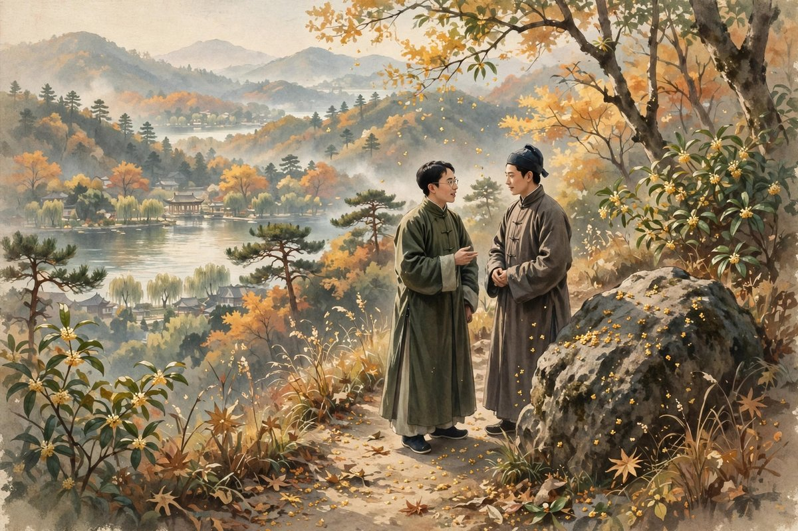
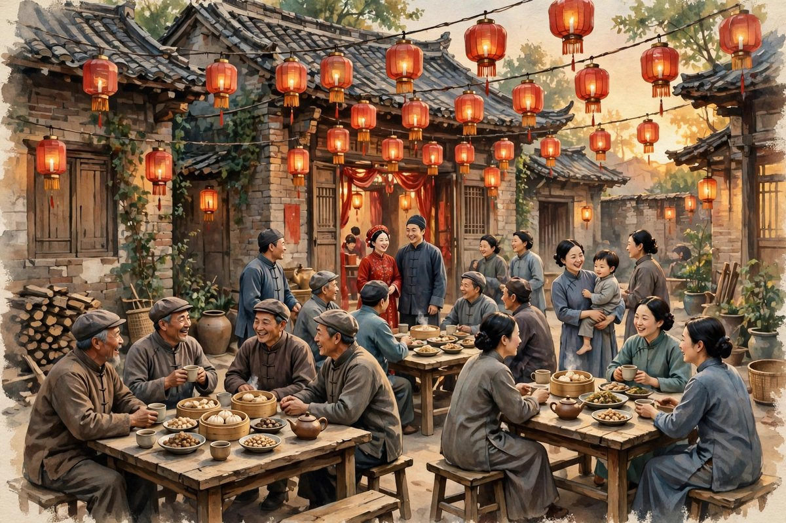

## 一封长信的开头

迟桂花发表在一九三二年，是郁达夫写得最温柔，最克制，最有余味的一篇小说。小说的开头，是一封长信，翁则生给同级同乡的老同学郁先生写的一封长信，信很长，长到占了全部文章的四分之一，信里写的是翁家的生活环境，写的是翁莲不幸的婚姻和个性，写的是翁则生自己这些年的遭遇，写的是他怎么从一个留日学生，变成一个在家乡养病的中年人，写的是他怎么在母亲的期盼下，准备结婚，写的是他怎么在书铺里看到老同学的著作，想起老同学，邀请老同学来参加他的婚礼。用一封长信做开头，放在今天看，可能显得不够紧凑，显得有点慢，可是郁达夫写得妙，写得让读者没有生涩冗长的感觉，反而被带进了翁家以前的生活里，被带进了杭州山里的日子里，被带进了三个中年人的世界里。信里的人，信里的事，信里的山水，信里的桂花，都像一幅慢慢展开的画，画展开了，人就进去了。

翁则生出身书香门第，年轻的时候留学日本，踌躇满志，觉得自己将来一定能干一番大事业，可是后来家道中落，自己又患病辍学，婚姻也受挫，从此在老家静心养病。养病的日子，他当了家乡的小学教师，教孩子读书，日子过得平淡，平淡到让他觉得，自己这一生，也就这样了，没有什么大野心了，没有什么大指望了，只想安安稳稳地过日子，只想让母亲安心，只想在母亲的期盼下，娶一个媳妇，成一个家。他的妹妹翁莲，命运更坎坷，丈夫早逝，守寡之后回娘家长住，一个年轻的寡妇，在那个年代，日子并不好过，别人看她的眼光，总是带着一点同情，一点议论，一点说不出来的意味，可是翁莲自己，却活得纯洁，可爱，善良，像山里的迟桂花一样，清新，干净，不染尘埃。翁则生在信里写翁莲，写得既心疼，又骄傲，心疼的是妹妹的命不好，骄傲的是妹妹的人好，好到像花一样，好到让任何一个看到她的人，都会觉得，这个姑娘，值得过上好日子。

## 翁家山的风景

郁先生接到信之后，如约前来，到了杭州翁家山，被翁家的美景所吸引，被翁家山的桂花所吸引，被翁莲的纯洁所吸引。翁家山在杭州，山不高，水不深，可是风景好，好到让人来了就不想走，好到让郁先生觉得，城里的喧嚣，城里的争吵，城里的名利，在这里都变得不重要了，重要的是山，是水，是桂花，是和老朋友喝一杯茶，是和翁莲一起去游五云山，是在山路上说说话，是在大岩石旁作倾心交谈。小说的重点情节，就是翁莲陪郁先生游五云山，两个人在一块大岩石旁，作倾心交谈，谈的是什么，郁达夫没有全写出来，写出来的部分，是含蓄的，是克制的，是点到为止的，可是读者读到这里，会觉得，两个人之间，有一种感情在生长，有一种超越了普通朋友的感情在生长，有一种中年人之间的，克制的，温柔的，不敢说出口的感情在生长。

这种感情，放在今天看，同样是很多人会遇到的感情：人到中年，遇到一个让自己心动的人，可是自己已经不是年轻的时候了，已经有了家庭，有了责任，有了顾虑，有了不敢轻举妄动的理由，于是感情只能停在心里，只能变成兄妹之情，只能变成互相祝福，只能变成一句话，但愿得我们都是迟桂花。郁先生和翁莲，最后结为兄妹，这个结尾，放在今天看，可能有点遗憾，有点不尽如人意，可是放在小说的逻辑里，却是最合适的结局：两个人都不是年轻人了，都经历过生活的打击，都知道感情的轻重，都知道克制比放纵更难，也更珍贵。克制，不是没有感情，是感情太深，深到不敢轻易说出来，深到怕说出来之后，反而毁了这份感情，毁了翁家的平静，毁了翁则生的婚礼，毁了三个人的友谊。于是克制就变成了成全，成全翁则生的婚礼，成全翁莲的平静，成全自己心里的那份美好，让它像迟桂花一样，开得晚一点，开得久一点，香得远一点。

## 迟桂花是什么意思

迟桂花，顾名思义，就是开得迟的桂花。桂花一般在秋天开，开得早的桂花，香得快，谢得也快，开得迟的桂花，香得慢，可是香得久，经得日子久。翁则生在小说里说，桂花开得越迟越好，因为开得迟，所以经得日子久。这句话，不只是说桂花，也是说人，说翁则生自己，说翁莲，说郁先生，说三个中年人，说他们的人生，说他们的感情，说他们的希望。三个中年人，都不是年轻的时候就成功的人，都不是年轻的时候就幸福的人，翁则生年轻的时候留学日本，后来家道中落，患病辍学，到了中年才结婚，才当小学教师，才过上安稳日子，翁莲年轻的时候结婚，后来丈夫早逝，守寡之后回娘家，到了中年才遇到郁先生，才遇到一份让她心动的感情，郁先生年轻的时候写小说，写得轰轰烈烈，到了中年，才懂得克制，才懂得珍惜，才懂得，有一种感情，不一定要说出来，不一定要占有，只要心里有，只要互相祝福，就已经很好了。这三个人，都是迟桂花，都是开得晚的人，都是香得久的人，都是经得日子久的人。

这个道理，放在今天，同样是很多人需要的道理。今天的社会，太急了，急着成功，急着结婚，急着买房，急着出名，急着在三十岁之前，就把一辈子的事都干完，干不完，就觉得自己失败了，就觉得自己是迟到的人，就觉得自己不如别人。可是迟桂花的故事告诉我们，开得晚，并不是失败，开得晚，有时候反而是好事，因为开得晚的人，经历得多，想得深，懂得珍惜，懂得克制，懂得什么是真正重要的东西，什么是虚假的东西，什么是可以放下的东西，什么是一定要守住的东西。年轻的时候开得早的花，香得快，谢得也快，中年的时候开得晚的花，香得慢，可是香得久，久到可以陪你走过很多个秋天，久到可以在你老了之后，还能闻到它的香气。这种香气，就是中年人的希望，就是迟桂花留给今天读者的东西。

## 和早期小说不一样的地方

和郁达夫早期的小说相比，迟桂花有很大的不同。早期的小说，注重主观抒情，不重视故事情节，结构比较散文化，写的是一个人的内心，写的是一个人的欲望，写的是一个人的苦闷，到了迟桂花，结构安排是经过认真思考的，开头是一封长信，中间是游山和谈心，结尾是婚礼和送别，情节线索单纯清晰，人物关系也比较复杂，不再是一男一女单一的情节模式，而是通过三个人，郁先生，翁则生，翁莲，形成两两对照的三角形镜面，互相映照，互相衬托，互相成全。这种结构上的进步，说明郁达夫的写作，也在成熟，也在从写自己，走向写别人，走向写社会，走向写人际关系，走向写中年人的生活。他的感情，也在净化，也在提升，从早期的性苦闷，走向后期的情欲净化，从汪洋恣肆的情感宣泄，走向平静通达的社会关照，从一个年轻人的冲动，走向一个中年人的克制。

这种成熟，放在今天同样有意义。今天很多写文章的人，年轻的时候写得冲，写得狠，写得不管不顾，到了中年，才慢慢懂得克制，懂得含蓄，懂得点到为止，懂得有一种感情，不一定要喊出来，不一定要写满整篇文章，只要写一句，写一个眼神，写一个动作，读者就能懂，就能感受到。这种克制，不是退步，是进步，是写作上的成熟，是人生上的成熟。郁达夫写迟桂花，就是在展示这种成熟，展示一个中年作家，怎么把年轻时候的冲动，变成中年时候的温柔，怎么把年轻时候的欲望，变成中年时候的祝福，怎么把年轻时候的苦闷，变成中年时候的希望。这种转变，不是每个人都能做到的，很多人年轻的时候冲，中年的时候还是冲，冲到老，还是冲，冲到最后，冲成了笑话。郁达夫没有，他冲过之后，学会了收，学会了慢，学会了等桂花开，学会了等中年人的好日子来。

## 杭州的山水和人的关系

小说里的杭州山水，写得非常美，美到让人想去杭州，想去翁家山，想去五云山，想去看看迟桂花，想去闻闻桂花的香气。可是杭州的山水，在小说里，不只是背景，不只是风景，更是人物心里的外化，是翁则生养病的地方，是翁莲长大的地方，是郁先生散心的地方，是三个人相遇的地方，是三个人谈心的地方，是三个人互相祝福的地方。山水和人，在小说里是分不开的，山水养人，人也养山水，翁家山的桂花，因为翁莲而香，因为翁则生而久，因为郁先生而有了故事，郁先生、翁则生、翁莲三个人，因为翁家山的桂花，而有了相遇，有了谈心，有了祝福，有了迟桂花的寓意。这种山水和人的关系，放在今天同样重要：今天的人，去杭州旅游，去西湖拍照，去灵隐寺烧香，去龙井村喝茶，拍完照就走，喝完茶就走，走完之后，杭州还是杭州，人还是人，人和山水之间，没有发生任何关系，没有留下任何故事。郁达夫写迟桂花，就是在说，人和山水之间，应该发生关系，应该留下故事，应该让山水成为你人生的一部分，让你的人生，成为山水的一部分，只有这样，旅游才不是打卡，才不是拍照，才是生活，才是记忆。

## 结尾的婚礼和送别

小说的结尾，写的是翁则生的婚礼和喜宴，写的是郁先生在婚礼上，代表来宾说几句话，写的是他抄了翁则生的一段话来恭祝他们，写的是翁氏兄妹送郁先生搭火车返回上海，写的是三个人互相勉励，但愿得我们都是迟桂花。婚礼虽然是新旧合参的仪式，可是因为两家都不喜欢铺张，所以百事也还比较简单，简单到让人觉得，这才是结婚应该有的样子：不是为了给别人看，不是为了排场，不是为了面子，是为了两个人过日子，是为了让母亲安心，是为了让老朋友见证，是为了让日子有个新的开始。郁先生在婚礼上说的话，不多，可是每一句都是真心的，都是祝福的，都是带着迟桂花的香气的。送别的时候，三个人都没有哭，都没有说太多煽情的话，只是互相勉励，互相祝福，互相说，迟桂花，迟桂花，开得晚一点没有关系，香得久一点才重要。

这个结尾，放在今天看，同样让人觉得温暖。今天的婚礼，常常办得很大，很贵，很铺张，很累人，累到新郎新娘都没有时间说话，累到宾客都只记得菜好不好吃，累到婚礼结束之后，新人只记得累，不记得祝福。翁则生的婚礼，简单，可是真，真到让人觉得，这才是婚礼应该有的样子：简单，真诚，有老朋友，有桂花，有祝福，有希望。送别也是一样，今天的送别，常常是在机场，在高铁站，匆匆忙忙，挥挥手就走了，走完之后，各自回到各自的生活里，各自忙各自的事，很少再有互相勉励的话，很少再有迟桂花这样的祝福。郁达夫写送别，写得克制，写得温柔，写得让人觉得，送别不是结束，是开始，是三个人各自回到生活里之后，还能互相记得，还能互相祝福，还能像迟桂花一样，开得晚，香得久，经得日子久。

## 翁莲这个人物

翁莲是迟桂花里最动人的人物，动人到让很多读者读完之后，都会记得她，都会觉得，她像山里的桂花一样，清新，干净，不染尘埃。她的命运并不好，丈夫早逝，守寡之后回娘家长住，在那个年代，一个年轻的寡妇，日子并不好过，别人看她的眼光，总是带着一点同情，一点议论，一点说不出来的意味，好像寡妇就应该整天哭哭啼啼，就应该守着贞节牌坊，就应该不再笑，不再活泼，不再和男人说话。可是翁莲不是这样的，她活泼，可爱，善良，陪郁先生游五云山的时候，走在山路上，说话的时候，笑的时候，都像一个没有被生活打倒的人，像一个心里还亮着灯的人，像一个虽然命运不好，可是人并没有变坏的人。这种活泼，不是装出来的，是她天性里的东西，是她即使守寡，即使回娘家，即使被人议论，也没有丢掉的东西。这种东西，放在今天，同样是很多人需要的东西：命运不好的人，往往会把自己变得刻薄，变得阴暗，变得见不得别人好，变得对世界充满怨恨，可是翁莲没有，她命运不好，可是她没有怨恨，没有刻薄，没有阴暗，她还是善良的，还是可爱的，还是像桂花一样的，这种善良，在命运面前，显得特别珍贵，特别难得，特别值得被记住。

翁莲和郁先生之间的感情，写得非常克制，克制到两个人最后结为兄妹，克制到两个人都没有说出那句最重要的话，克制到读者读完之后，会觉得遗憾，会觉得，为什么不说出来，为什么不在一起，为什么要变成兄妹。可是克制，恰恰是这篇小说最动人的地方：因为两个人都是中年人了，都经历过生活的打击，都知道感情的轻重，都知道说出来之后，可能会毁掉的东西，比说出来之后，得到的东西要多。说出来，可能会让翁则生为难，可能会让翁家不安，可能会让翁莲的名声受损，可能会让三个人的友谊破裂，不说出来，感情可以留在心里，可以变成祝福，可以变成迟桂花，可以香得很久，可以经得日子久。这种克制，不是懦弱，是成熟，是中年人对感情的理解，是中年人对生活的理解，是中年人知道，有些感情，不一定要占有，不一定要说出来，不一定要变成婚姻，只要心里有，只要互相祝福，就已经很好了。今天的人，谈感情，常常太急，急着表白，急着确定关系，急着占有，急着把感情变成婚姻，变成结果，变成一个可以晒出来的东西，可是翁莲和郁先生的故事告诉我们，感情有时候，慢一点好，克制一点好，留在心里好，变成兄妹也好，变成祝福也好，只要感情是真的，只要心里是暖的，只要互相记得，就已经很好了。

## 翁则生的信为什么写得好

翁则生的长信，是小说开头最重要的部分，信很长，长到占了全部文章的四分之一，可是读起来，一点都不觉得长，一点都不觉得啰嗦，反而觉得，信里的人，信里的事，信里的山水，信里的桂花，都像一幅画，慢慢展开，展开之后，人就进去了。信写得好，好在它不是一封普通的信，不是一封只写客套话的信，而是一封把翁家十几年的生活，都写进去了的信，把翁则生从留学日本，到家道中落，到患病辍学，到在家乡养病，到当小学教师，到准备结婚，到想起老同学，到邀请老同学来参加婚礼，全部写进去了，把翁莲从结婚，到丈夫早逝，到守寡回娘家，到活泼可爱的个性，全部写进去了，把翁家山的风景，把桂花的香气，把杭州的生活，全部写进去了。读者读这封信，就像读翁则生的人生，就像读翁家十几年的历史，就像读一个中年人，是怎么从年轻时候的踌躇满志，变成中年时候的平淡安稳的。这种写法，放在今天，同样值得学习：今天的人写文章，常常太急，急着进入主题，急着讲道理，急着给结论，急着让读者看完之后，马上点赞，马上转发，可是翁则生的信告诉我们，文章有时候，慢一点好，长一点好，把背景写清楚，把人物写清楚，把生活写清楚，读者自然会进去，自然会懂，自然会感动，急着讲道理的文章，往往没有人记得，慢慢展开的画，往往让人记得很久。

信里还有一个细节，值得注意：翁则生在信里，写到自己在书铺里，看到老同学的著作，想起老同学，特请出版社转信，邀老友前来吃喜酒，顺便话旧叙怀。这个细节，写得非常真实，真实到让读者觉得，这就是老朋友之间的样子：很多年不见，忽然在书铺里看到老朋友的书，忽然想起老朋友，忽然想请老朋友来参加自己的婚礼，忽然想和老朋友说说话，叙叙旧。这种忽然想起，在今天同样会发生：今天的人，在社交平台上，忽然看到老朋友的动态，忽然想起老朋友，忽然想给老朋友发一条消息，忽然想请老朋友吃顿饭，忽然想和老朋友说说话。可是今天的人，忽然想起之后，往往只是点个赞，只是发一条消息，只是说一句好久不见，然后就没有然后了，没有请老朋友来参加婚礼，没有和老朋友去游山，没有和老朋友在大岩石旁谈心，没有和老朋友互相祝福，没有迟桂花。翁则生的信，提醒我们，忽然想起老朋友的时候，不要只点个赞，不要只发一条消息，要请老朋友来，要和老朋友见面，要和老朋友说说话，要和老朋友一起去看看桂花，一起去走走山路，一起去吃顿饭，这样，老朋友才不会只存在于记忆里，才会重新回到生活里，才会像迟桂花一样，重新香起来。

## 五云山上的谈心

五云山上的谈心，是小说里最重要的场景，是翁莲陪郁先生游五云山，是两个人在一块大岩石旁，作倾心交谈，是全文的至高点，是两个中年人之间，感情最浓，最真，最克制的地方。谈心谈的是什么，郁达夫没有全写出来，写出来的部分，是含蓄的，是点到为止的，可是读者读到这里，会觉得，两个人谈的，不只是山水，不只是桂花，不只是翁则生的婚礼，不只是过去的日子，谈的是人生，谈的是命运，谈的是中年人的苦，谈的是中年人的希望，谈的是两个人都经历过打击，都知道生活不容易，都知道感情不容易，都知道克制不容易，可是还是愿意互相祝福，还是愿意互相勉励，还是愿意说，但愿得我们都是迟桂花。这种谈心，放在今天，同样是很多人渴望的东西：今天的人，谈心越来越少了，谈的都是工作，都是房子，都是孩子，都是钱，都是社交平台上的热点，很少有人，愿意坐下来，和一个老朋友，在山上，在大岩石旁，谈一谈人生，谈一谈命运，谈一谈自己的苦，谈一谈自己的希望，谈一谈自己心里，那个不敢说出口的感情。五云山上的谈心，提醒我们，谈心是需要时间的，是需要山水的，是需要安静的，是需要两个人，都愿意把心打开一点，都愿意把过去说出来，都愿意把未来祝福一下的，谈心谈完之后，两个人可能还是各回各家，还是各过各的日子，可是心里，已经暖了，已经亮了，已经像迟桂花一样，香起来了。

## 翁家山的生活气息

翁家山的生活，写得非常有气息，有茶，有饭，有桂花，有山路，有小学教师的日子，有母亲的期盼，有婚礼的准备，有老朋友的到来，有妹妹的陪伴，有山里的风，有山里的雾，有山里的安静。这种生活气息，放在今天，同样是很多人向往的东西：今天的人，住在城市里，每天赶地铁，赶公交，赶打卡，赶开会，赶加班，赶着把日子过完，日子过完了，却不知道自己到底过了什么，到底吃了什么，到底见了什么人，到底说了什么话，日子像流水一样，流过去了，就没有了。翁家山的生活，慢，慢到可以喝一杯茶，慢到可以走一段山路，慢到可以闻一闻桂花，慢到可以和老朋友说说话，慢到可以准备一场简单的婚礼，慢到可以送老朋友去火车站，慢到可以互相勉励一句，迟桂花。这种慢，不是懒，不是无所事事，是生活本身的样子，是人应该有的样子，是中年人应该有的样子，是经历过风浪之后，懂得慢下来，懂得珍惜，懂得生活不只是赶路，不只是成功，不只是赚钱，生活也是茶，也是饭，也是桂花，也是山路，也是老朋友，也是互相祝福的一句话。郁达夫写翁家山，就是在写这种慢生活，就是在告诉读者，慢下来，并不是失败，慢下来，有时候反而是成功，是中年人的成功，是迟桂花的成功。

## 桂花的香气

桂花的香气，是迟桂花里，最动人的东西，香气很淡，淡到不仔细闻，闻不到，香气很远，远到站在山下，闻不到，走到山上，才能闻到，香气很久，久到秋天过去了，香气还在，久到婚礼结束了，香气还在，久到郁先生回到上海了，香气还在，久到三个中年人，各自回到生活里了，香气还在。这种香气，不是浓烈的香，不是扑鼻的香，不是让人一下子就记住的香，是淡淡的香，是远方的香，是久久不散的香，是中年人的香，是迟开的花的香，是经历过风浪之后，才开出来的香，是经历过打击之后，才香起来的香。今天的人，闻桂花，常常太急，急着闻到最浓的香，急着拍一张最美的照片，急着发一条最火的动态，急着让所有人都知道，自己闻到了桂花，可是迟桂花的香，急是闻不到的，迟桂花的香，要慢慢闻，要走到山上，要坐下来，要和老朋友说说话，要在大岩石旁，谈一谈心，谈完心之后，才能闻到，才能闻到那种淡淡的，远方的，久久不散的香。这种香，闻到了之后，会留在心里，会留在记忆里，会留在很多个秋天里，会在你老了之后，还能闻到，还能想起翁家山，还能想起翁莲，还能想起郁先生，还能想起那句话，但愿得我们都是迟桂花。

## 中年人的体面

翁则生中年结婚，婚礼办得简单，不铺张，不奢华，不为了给别人看，不为了面子，只为了两个人过日子，只为了让母亲安心，只为了让老朋友见证，这种简单，就是中年人的体面。年轻人的婚礼，常常办得很大，很贵，很累人，累到新郎新娘都没有时间说话，累到宾客都只记得菜好不好吃，累到婚礼结束之后，新人只记得累，不记得祝福。中年人的婚礼，简单，可是真，真到让人觉得，这才是结婚应该有的样子：不是为了排场，不是为了晒朋友圈，不是为了收礼金，是为了过日子，是为了让家里人安心，是为了让老朋友祝福，是为了让日子有个新的开始。翁则生的体面，不在于他有多少钱，不在于他办了多大的婚礼，在于他懂得，体面不是给别人看的，是给自己过的，是心里安稳，是母亲安心，是朋友祝福，是桂花香，是日子久。这种体面，放在今天，同样是很多人需要的：今天的人，常常把体面理解成排场，理解成名牌，理解成大房子，理解成豪车，理解成朋友圈里的光鲜，可是真正的体面，是心里安稳，是家人安心，是朋友祝福，是日子过得踏实，是像迟桂花一样，开得晚，可是香得久，经得日子久。翁则生懂得这个道理，所以他的婚礼简单，可是体面，他的体面，不在排场上，在心里，在日子里，在桂花里，在老朋友的祝福里。

## 给今天中年人的话

如果你已经到了中年，如果你觉得自己年轻的时候没有成功，没有幸福，没有干成什么大事，如果你觉得自己开花开得晚了，如果你觉得自己不如那些年轻的时候就成功的人，不妨读一读迟桂花，读一读翁则生，读一读翁莲，读一读郁先生，读完之后，你会发现，开得晚，并不是坏事，开得晚的人，往往更懂得珍惜，更懂得克制，更懂得什么是真正重要的东西，更懂得，幸福不是年轻的时候就一定要得到的，幸福可以在中年的时候来，可以在晚年的时候来，可以在你以为已经没有希望的时候，忽然像迟桂花一样，开出来，香出来，久久不散。翁则生中年才结婚，中年才安稳，翁莲中年才遇到心动的人，中年才懂得什么是感情，郁先生中年才懂得克制，中年才懂得祝福，这三个人，没有一个是年轻的时候就圆满的，可是他们中年的时候，都找到了自己的位置，找到了自己的香气，找到了自己的日子。

所以，不要急，不要慌，不要因为别人开得早，就觉得自己开得晚就是失败，不要因为别人香得快，就觉得自己香得慢就是无能。桂花有早开的，有晚开的，早开的有早开的好，晚开的有晚开的好，早开的香得快，晚开的香得久，你如果是迟桂花，你就安心做迟桂花，开得晚一点没有关系，香得久一点才重要，经得日子久一点才重要，陪着你爱的人，走过很多个秋天，才重要。郁达夫写迟桂花，就是在对所有中年人说这句话，就是在对所有觉得自己开花开晚了的人说这句话，就是在对所有还在等，还在盼，还在熬的人说这句话：别急，桂花会开的，迟一点开，也会香的，香得久的，才是好花。

## 再说一句

迟桂花写完之后，桂花还在开，开在翁家山上，开在五云山上，开在杭州的秋天里，开在三个中年人的心里，开在郁先生回到上海之后的心里，开在翁则生婚礼之后的日子里，开在翁莲陪郁先生游山之后的心里。桂花开得晚，可是香得久，香到很多个秋天之后，还能闻到，香到很多年之后，还能想起，香到后来人读到迟桂花的时候，心里也跟着香起来，心里也跟着想，自己是不是也是迟桂花，自己开得晚一点没有关系，自己香得久一点才重要，自己经得日子久一点才重要。

说到底，迟桂花的好，不在开得好看，而在香得住日子。香得住日子的花，经得起风，经得起雨，经得起人到中年的凉意。日子凉下来的时候，有一缕桂花香在身边，人就不慌了。不慌的人，才能慢慢走，慢慢想，慢慢把剩下的日子过出味道。郁达夫把这缕香留给读者，就是留一句话：开得晚不要紧，香得久才要紧，陪着身边的人走得远，才要紧。
