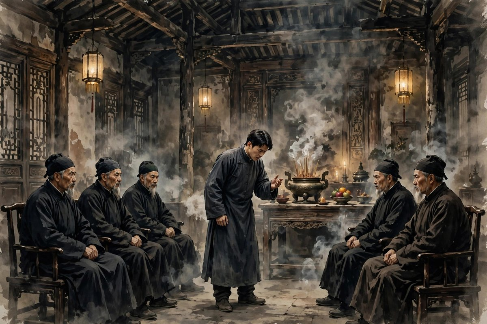
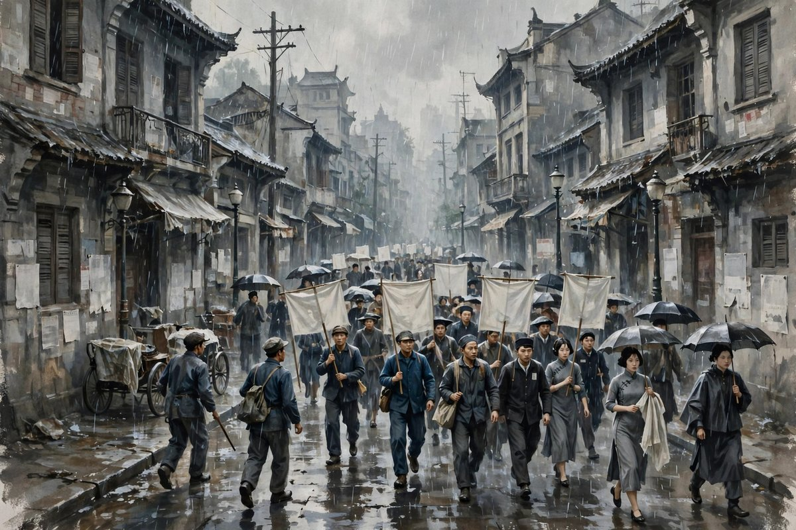

## 出奔是什么意思

出奔这个词，古书里的意思，是出走，是逃亡，是离开自己的国家，离开自己的家，到别的地方去。郁达夫用出奔做小说的题目，意思也很清楚：小说里的人，要从旧家庭里出走，要从旧社会里出走，要从旧的生活里出走，要到新的生活里去，到革命里去，到时代里去，到一个不知道会怎么样，可是总比待在旧家里好的地方去。出奔发表在一九三五年，是郁达夫的最后一部小说，写的是大革命失败之后的故事，写的是革命热情冷却之后的故事，写的是一个青年，在革命失败，社会黑暗，压迫加重的时候，怎么从家庭里走出来，怎么在时代的风浪里，寻找一条出路。这篇小说，政治意图比早期的作品更明显，社会性也更强，写的不再只是一个人的苦闷，而是一个时代的苦闷，一个家庭的苦闷，一个青年在家庭和时代之间的挣扎。

小说里的青年，家里是旧式的家庭，家里有长辈，有规矩，有体面，有不能违背的家法，有不能说出口的秘密，有不能反抗的权威。青年在家里，活得像一个囚犯，活得像一个被关在笼子里的人，笼子是旧礼教做的，笼子是旧家庭做的，笼子是旧社会做的，笼子外面，是新的思想，是新的生活，是革命的风浪，是时代的呼唤，青年听到了呼唤，想走出去，想打破笼子，想呼吸外面的空气，可是走出去并不容易，走出去意味着和家里决裂，意味着和长辈翻脸，意味着放弃家里的体面，放弃家里的财产，放弃家里的保护，意味着一个人走到外面去，走到风浪里去，走到不知道会怎么样，可是总比待在笼子里好的地方去。这种走出去，需要勇气，需要决心，需要把过去的生活，全部扔掉的勇气，需要把过去的自己，全部扔掉的决心。

## 旧家庭的笼子

旧家庭的笼子，写得非常具体，具体到让读者觉得，这个笼子，就在自己家里，就在自己身边。笼子的一根栏杆，是长辈的权威，长辈说的话，就是圣旨，长辈定的规矩，就是家法，晚辈不能反驳，不能质疑，不能说不，只能听，只能服从，只能把自己的想法，藏在心里，藏到夜深人静的时候，藏到一个人失眠的时候，才敢想一想。笼子的另一根栏杆，是婚姻的包办，青年不能自己选择爱人，不能自己选择生活，只能听家里的安排，只能娶家里指定的人，只能过家里指定的日子，指定的日子，往往不是自己想要的日子，往往是让自己痛苦的日子，可是痛苦也没有用，痛苦也要过，因为家里就是这样，因为社会就是这样，因为所有人都是这样过的。笼子的还有一根栏杆，是经济的依赖，青年没有自己的收入，没有自己的财产，没有自己的出路，只能靠家里养活，靠家里给钱，靠家里给饭吃，靠家里给屋子住，经济上的依赖，变成了精神上的依赖，变成了不敢反抗的理由，变成了走不出去的借口：走了出去，吃什么，住哪里，靠什么活，这些问题，像一座山，压在青年的心里，压得他喘不过气来。

这种笼子，放在今天，同样是很多人会遇到的笼子，只不过笼子的材料变了，栏杆的样子变了。今日的家庭里，长辈的权威，虽然没有旧社会那么绝对，可是依然存在，依然有很多年轻人，活在父母的期待里，活在父母的安排里，活在父母的控制里，活在考什么大学，找什么工作，娶什么人，买什么房子的安排里，安排得越细，年轻人越觉得，自己不是在过自己的日子，是在过父母的日子，是在替父母完成他们没有完成的愿望。今日的婚姻，虽然已经不是包办了，可是依然有很多年轻人，在婚姻里感到压抑，感到不自由，感到被家庭，被孩子，被房子，被车子，被各种各样的责任，捆住了手脚，捆住了心，想走出去，又不敢走出去，想离婚，又怕离婚之后的日子更难，想自由，又怕自由之后，没有人管，没有人疼，没有人给自己做饭，没有人给自己留一盏灯。这种笼子，和旧家庭的笼子，本质上是一样的：都是爱和控制搅在一起，都是亲情和压迫搅在一起，都是让人既想逃，又舍不得逃，既想走，又走不出去的笼子。

## 大革命的风浪

出奔的背景，是大革命失败之后的日子，是日本帝国主义侵略加深的日子，是国民党反动派黑暗统治的日子，是郁达夫从革命时的热情里，冷却下来的日子。青年在这样的时代里，看到的是革命失败了，看到的是同志被杀了，看到的是希望破灭了，看到的是社会更黑了，看到的是压迫更重了，看到的是自己曾经相信的东西，一夜之间，全都变了，全都碎了，全都成了泡影。这种破灭，比个人的苦闷更痛，比家庭的压迫更痛，因为个人的苦闷，还可以靠自己调节，家庭的压迫，还可以靠自己忍耐，时代的破灭，却是任何一个人都无法忍耐，无法调节，无法靠自己解决的。青年站在时代的风浪里，觉得自己像一片叶子，风浪一来，叶子就被卷走了，卷到哪里去，叶子自己也不知道，卷到岸上，还是卷到水里，卷到活路，还是卷到死路，叶子自己都做不了主。

这种时代的风浪，放在今天，同样是很多人会遇到的风浪，只不过风浪的样子变了。今日的年轻人，同样会遇到时代的风浪，遇到经济下行，遇到找工作难，遇到房价高，遇到内卷严重，遇到行业变化快，遇到自己学了几年的专业，一毕业就过时了，遇到自己拼了命考上的岗位，一夜之间就被裁掉了，遇到自己相信的东西，忽然之间就不值钱了，遇到自己努力的方向，忽然之间就走不通了。这种风浪，和大革命失败之后的风浪，本质上是一样的：都是个人在时代面前，显得非常渺小，非常无力，非常不知道该怎么办。郁达夫写出奔，就是在写这种渺小，写这种无力，写这种不知道该怎么办，可是还是要走出去，还是要寻找出路，还是要在风浪里，抓住一点东西，抓住一点希望，抓住一点不让自己沉下去的东西。这种抓住，就是出奔的意义，就是青年走出家庭的意义，就是人在时代风浪里，不认输的意义。

## 走出去之后的日子

青年走出家庭之后的日子，并不好过，走出去，并不等于找到了出路，走出去，只是换了一个地方受苦，换了一个地方挣扎，换了一个地方面对风浪。外面没有家里那么舒服，没有人给他做饭，没有人给他留灯，没有人给他钱，没有人保护他，他要自己找工作，自己找房子，自己吃饭，自己面对社会的黑暗，自己面对压迫，自己面对孤独，自己面对失败。可是走出去之后，他至少是自由的，至少是自己做主的，至少是呼吸到了外面的空气，至少是看到了外面的世界，至少是知道了，世界原来这么大，大到不只是家里那几间屋子，不只是家乡那几条街，不只是旧社会那一套规矩。自由的代价，是苦，是穷，是孤独，是失败，可是自由本身，就是值得的，就是比待在笼子里，舒服地腐烂，舒服地变老，舒服地变成一个没有自己的人，要好得多的。

这种走出去之后的日子，放在今天，同样是很多年轻人正在过的日子：离开家乡，到大城市打工，到异国留学，到陌生的城市创业，到没有人认识自己的地方，重新开始。重新开始的日子，并不好过，房租贵，工资低，加班多，人情冷，孤独感强，失败感强，想家的时候，只能给家里打个电话，打完电话，还是要一个人面对隔日的日子。可是重新开始的人，往往都不后悔，因为他们知道，待在家里，待在舒适区里，待在父母的安排里，虽然舒服，可是舒服的代价，是失去自己，是变成一个没有自己的人，是到老了之后，后悔自己年轻的时候，为什么没有走出去，为什么没有去看看外面的世界，为什么没有去试一试自己到底能走多远。郁达夫写出奔，就是在为这些走出去的人说话，就是在说，走出去，哪怕苦，哪怕穷，哪怕失败，也比待在笼子里好，因为走出去的人，至少活过，至少试过，至少知道自己是谁，至少没有白活一辈子。

## 郁达夫自己的出奔

出奔里的青年，身上也有郁达夫自己的影子。郁达夫自己，就是一个不断出奔的人，从富阳出奔到日本，从日本出奔回国，从教书出奔到写作，从创造社出奔到别的地方，从上海出奔到杭州，从杭州出奔到福建，从福建出奔到武汉，从武汉出奔到新加坡，从新加坡出奔到苏门答腊，一辈子都在出奔，一辈子都在走出去，一辈子都没有在一个地方，安心地待下来，安心地过安稳日子。他的出奔，有时候是主动的，有时候是被迫的，有时候是为了理想，有时候是为了逃命，有时候是为了爱情，有时候是为了抗战，可是每一次出奔，他都走得坚决，走得不回头，走得像是要把过去，全部扔掉一样。这种不断出奔的人生，放在今天看，可能显得不安分，显得折腾，显得不懂得珍惜安稳，可是放在郁达夫身上，却是他生命力的证明：一个不断出奔的人，说明他心里还有火，还有希望，还有不愿意被困住的劲头，还有不愿意向现实低头的骨气。一个不再出奔的人，说明他已经认命了，已经向现实低头了，已经把自己交给了笼子，交给了安排，交给了命运。

## 出奔和革命的关系

出奔和革命的关系，写得非常紧密，紧密到小说里的人，走出家庭，就是走进革命，走进时代，走进风浪，走进一个不知道会怎么样，可是总比待在家里好的地方。革命，在小说里，不是一个抽象的概念，不是一个口号，不是一个主义，而是一个具体的选择，是一个青年，在家庭和革命之间，选择了革命，选择了走出去，选择了和旧家庭决裂，选择了和旧社会决裂，选择了把自己的命运，交给时代，交给风浪，交给一个更大的事业。这种选择，在大革命失败之后，显得特别悲壮，特别无奈，特别让人心酸，因为革命失败了，希望破灭了，同志被杀了，社会更黑了，青年走出去之后，面对的不是胜利，不是光明，不是好日子，而是更黑的社会，更重的压迫，更难的日子，更孤独的路。可是青年还是走出去了，还是选择了革命，还是选择了风浪，还是选择了不回头，这种选择，放在今天看，可能有点傻，有点不值得，有点明知山有虎，偏向虎山行，可是放在小说的逻辑里，却是唯一的选择：待在家里，是腐烂，是变老，是变成一个没有自己的人，走出去，是受苦，是失败，是孤独，可是至少是活着，至少是自由的，至少是自己做主的，至少是没有白活的。

这种革命和个人的关系，放在今天，同样值得思考：今天的人，谈革命，谈理想，谈事业，谈改变社会，往往会觉得，这些词太大了，太远了，和自己的日子没有关系，和自己的工作没有关系，和自己的家庭没有关系，可是郁达夫写出奔，就是在说，革命和个人，从来都不是分开的，个人的出奔，就是革命的一部分，个人的自由，就是社会自由的一部分，个人的反抗，就是社会反抗的一部分，一个青年走出旧家庭，就是对旧社会的一次反抗，就是对旧礼教的一次打击，就是对新生活的一次尝试，就是对时代的一次回应。今天的人，走出一个让你压抑的家庭，走出一个让你喘不过气的工作，走出一个让你慢慢腐烂的环境，走出一个让你失去自己的地方，同样是一种革命，是一种小小的革命，是一种个人的革命，是一种不向现实低头的革命，这种革命，虽然小，虽然个人，虽然不会改变整个社会，可是会改变你自己，会让你活得像一个人，会让你在老了之后，可以对自己说，我年轻的时候，曾经出奔过，曾经自由过，曾经为自己活过，这，就够了。

## 家庭和时代的两座山

小说里的青年，面对的是两座山，一座是家庭的山，一座是时代的山，家庭的山，压在他的心里，时代的山，压在他的肩上，两座山合在一起，压得他喘不过气来，压得他想走出去，压得他想逃，压得他想出奔。家庭的山，是旧礼教，是长辈的权威，是包办的婚姻，是经济的依赖，是不能违背的家法，是不能说出口的秘密，时代的山，是革命的失败，是社会的黑暗，是日本的侵略，是国民党的压迫，是希望的破灭，是同志的牺牲，两座山，一座在家里，一座在外面，一座是私人的，一座是公共的，一座是小的，一座是大的，可是两座山压在一起，就是一个人的全部命运，就是一个青年，在家庭和时代之间，进退两难，左右为难，走也不是，留也不是，留下来，是腐烂，走出去，是受苦，留下来，是失去自己，走出去，是失去保护，这种两难，就是出奔这篇小说的核心，就是郁达夫写这篇小说，想要告诉读者的东西：一个人在家庭和时代之间，往往是没有好选择的，往往只能选择一个比较不坏的选择，往往只能选择走出去，受苦，可是自由，或者留下来，舒服，可是腐烂，青年选择了走出去，选择了受苦，可是自由，这个选择，就是出奔的意义，就是小说的意义，就是后来人读这篇小说，应该记住的东西。

## 走出去的代价和收获

走出去，是要付出代价的，代价是失去家里的保护，失去家里的钱，失去家里的体面，失去长辈的疼爱，失去一个安稳的窝，失去一个可以回去的地方，失去一个在外面受了委屈，还可以回家哭的地方。青年走出去之后，没有家了，没有保护了，没有钱了，没有体面了，只有一个人，一双脚，一颗心，一点理想，一点勇气，和一个不知道会怎么样的未来。这种代价，放在今天，同样是走出去的人，要付出的代价：离开家乡，到大城市打工，代价是失去家里的照顾，失去父母的疼爱，失去一个可以随时回去的地方，失去一个在外面受了委屈，还可以回家吃饭的地方，得到的是自由，是独立，是自己做主的日子，是自己挣钱自己花的日子，是自己失败自己承担的日子，是自己成功自己享受的日子。代价和收获，放在一起看，代价很大，收获也很大，大到让走出去的人，觉得值得，觉得不后悔，觉得哪怕再苦，再穷，再孤独，再失败，也比待在家里，待在笼子里，待到老，待到头发白了，才后悔没有走出去，要好得多。郁达夫写出奔，就是在算这笔账，算走出去的代价，算走出去的收获，算完之后，告诉读者，代价虽大，收获更大，收获不是钱，不是房子，不是车子，不是体面，收获是自由，是自己，是活过，是没有白活，是老了之后，可以对自己说，我年轻的时候，曾经出奔过，曾经自由过，曾经为自己活过，这，就够了。

## 出奔之后的路还很长

出奔，不是终点，是起点，走出家庭，只是迈出了起步，起步之后，还有很多步，还有很多路，还有很多风浪，还有很多失败，还有很多孤独，还有很多不知道会怎么样的日子。青年走出家庭之后，路还很长，长到他要自己找工作，自己找房子，自己吃饭，自己面对社会的黑暗，自己面对压迫，自己面对孤独，自己面对失败，自己面对时代的风浪，自己面对革命的失败，自己面对希望的破灭，自己面对一个不知道会怎么样的未来。可是路再长，也要走，走一步，算一步，走一步，离笼子远一步，走一步，离自由近一步，走一步，离自己近一步，走一步，离过去远一步，走得越远，越知道自己是谁，走得越远，越知道自己想要什么，走得越远，越知道，自由的代价，值得付，自由的收获，值得要。郁达夫写出奔，不是写青年走出去之后，就过上了好日子，就找到了出路，就成功了，就幸福了，他写的是，青年走出去之后，日子还是很难，路还是很长，风浪还是很大，可是青年还是走下去了，还是没有回头，还是没有向家庭低头，还是没有向社会低头，还是没有向命运低头，这种没有低头，就是出奔的意义，就是小说的意义，就是后来人读这篇小说，应该记住的东西：路还很长，可是只要不回头，只要一直走，走下去，总会走到一个地方，一个可以让自己喘口气的地方，一个可以让自己看到光的地方，一个可以让自己觉得，走出去，是值得的地方。

## 出奔者的孤独

出奔者是孤独的，孤独到走出家庭之后，没有人陪，没有人疼，没有人给饭吃，没有人给灯，没有人问你冷不冷，没有人问你饿不饿，没有人问你今天过得怎么样，没有人问你明天打算怎么办。孤独，是出奔的代价，是自由的代价，是自己做主的代价，是走出笼子之后，必须面对的东西。可是孤独，并不是坏事，孤独有时候，是清醒的开始，是自由的开始，是认识自己的开始，是一个人在没有人陪的时候，才开始想，自己到底是谁，自己到底想要什么，自己到底为什么要走出来，自己到底要走到哪里去。青年走出家庭之后，孤独了很久，孤独到在风浪里，不知道该抓住什么，孤独到在时代里，不知道该相信什么，孤独到在社会里，不知道该依靠谁，可是孤独到最后，他还是没有回头，还是没有向家庭低头，还是没有向社会低头，还是没有向命运低头，这种没有低头，就是孤独的意义，就是出奔的意义，就是一个人在孤独里，还能坚持，还能走，还能找，还能活的意义。今天的人，走出去之后，同样会孤独，孤独到在陌生的城市里，没有朋友，孤独到在深夜里，没有人说话，孤独到在失败的时候，没有人安慰，可是孤独到最后，只要不回头，只要一直走，只要还相信，自己走出去是对的，孤独就会变成力量，变成清醒，变成自由，变成自己，变成老了之后，可以对自己说，我年轻的时候，曾经孤独过，曾经出奔过，曾经自由过，这，就够了。

## 旧家庭的回声

旧家庭的回声，在青年走出去之后，还会跟很久，跟到他做梦的时候，跟到他失眠的时候，跟到他听到长辈的声音的时候，跟到他看到和家里相似的东西的时候，跟到他想起母亲的期盼，想起父亲的权威，想起家里的规矩，想起家里的体面，想起自己曾经在家里，过过的日子。回声很烦，烦到让人想回去，烦到让人想低头，烦到让人想，算了，回去吧，回去虽然腐烂，可是至少舒服，至少有人疼，至少有饭吃，至少有灯，至少不用一个人面对风浪。可是青年没有回去，没有被回声叫回去，没有被过去拉回去，他听着回声，继续走，继续往前走，走到回声越来越远，走到回声越来越小，走到回声最后，变成记忆，变成过去，变成小说里的一个词，变成出奔这两个字。回声变成记忆之后，青年就自由了，真正自由了，自由到可以自己做决定，自由到可以自己选择，自由到可以自己负责，自由到可以自己活，自由到老了之后，可以对自己说，我年轻的时候，听过旧家庭的回声，可是我没有回去，我走出来了，我自由了，这，就够了。

## 出奔者的行囊

出奔者走的时候，行囊很轻，轻到只有几件衣服，轻到只有一点钱，轻到只有一颗心，轻到只有一点理想，轻到只有一点勇气，轻到没有家里的体面，没有家里的财产，没有家里的保护，没有长辈的祝福，没有过去的日子，没有过去的自己。行囊轻，是因为走出去的人，不能带太多东西，带太多东西，走不远，走不快，走不出笼子，走不出旧家庭，走不出旧社会，走不出过去的日子。行囊轻，也是一种决心，是一种把过去扔掉的决心，是一种把过去的自己，扔掉的决心，是一种告诉自己，从今天起，我要过自己的日子，我要为自己负责，我要为自己的选择，付出代价的决心。这种决心，放在今天，同样是走出去的人，需要的决心：离开家乡，到大城市打工，行囊不能太重，重到走不动，重到舍不得扔，重到把过去的包袱，全部带到新的城市里，带到新的日子里，带到新的生活里，包袱太重，新的生活，就走不远，就走不快，就走不出过去的影子。行囊轻一点好，轻到只有几件衣服，只有自己，只有理想，只有勇气，只有未来，只有希望，轻到可以走很远，走到一个陌生的城市，走到一个没有人认识自己的地方，走到一个可以重新开始的地方，重新开始，就是出奔的意义，就是行囊轻的意义，就是后来人读出奔的时候，应该记住的东西：走的时候，带得越少，走得越远，带得越少，活得越自由，带得越少，自己越清楚，自己到底是谁，自己到底想要什么，自己到底要走到哪里去。

## 给今天想走出去的人的话

如果你现在正待在一个让你感到压抑的地方，如果你正待在一个旧家庭里，如果你正待在一个让你喘不过气的工作里，如果你正待在一个让你觉得，自己正在慢慢腐烂的环境里，不妨读一读出奔，读一读那个青年是怎么走出去的，读完之后，你会发现，走出去并没有你想象的那么难，难的是下决心，难的是迈出一步，难的是把过去的生活，全部扔掉的勇气，难的是告诉自己，我要过自己的日子，我要为自己负责，我要为自己的选择，付出代价。迈出一步之后，日子并不会马上变好，日子可能会更苦，可能会更穷，可能会更孤独，可是迈出一步之后，你至少是自由的，至少是自己做主的，至少是呼吸到了外面的空气，至少是看到了外面的世界，至少是知道了，自己原来可以走这么远，可以活得这么有劲头。

所以，不要害怕走出去，不要害怕失败，不要害怕穷，不要害怕孤独，害怕的应该是，待在笼子里，待到老，待到头发白了，才后悔自己年轻的时候，为什么没有走出去，为什么没有去试一试，为什么没有去看看外面的世界。郁达夫写出奔，就是在对所有想走出去的人说这句话，就是在对所有待在笼子里的人说这句话，就是在对所有觉得，自己正在慢慢腐烂的人说这句话：走出去吧，哪怕风浪很大，哪怕前途不明，哪怕日子很苦，走出去，总比待在笼子里好，走出去的人，至少活过，至少试过，至少没有白活，至少在老了之后，可以对自己说，我年轻的时候，曾经出奔过，曾经自由过，曾经为自己活过，这，就够了。

## 再说一句

出奔写完之后，青年还在路上，还在风浪里，还在寻找出路，还在面对社会的黑暗，还在面对时代的破灭，还在面对家庭的回声，还在面对孤独，还在面对失败，还在面对一个不知道会怎么样的未来。可是青年没有回头，没有向家庭低头，没有向社会低头，没有向命运低头，他还在走，还在往前走，走到回声越来越远，走到风浪越来越小，走到光越来越近，走到一个可以让自己喘口气的地方，走到一个可以让自己看到希望的地方。走下去，就是出奔的意义，就是青年活着的意义，就是后来人，读到出奔的时候，应该记住的东西：路还很长，可是只要不回头，只要一直走，走下去，总会走到一个地方，一个值得的地方。

## 尾声

出奔者的路，还在脚下，还在风里，还在雨里，还在时代里，还在家庭的回声里，还在孤独里，还在希望里。走下去，走过风，走过雨，走过回声，走过孤独，走过失败，走过一个又一个不知道会怎么样的日子，走下去，总会走到一个地方，一个可以喘口气的地方，一个可以看到光的地方，一个可以对自己说，走出来是对的地方。青年走出去了，你也可以走出去，走出去的人，至少活过，至少试过，至少没有白活，这就够了。

## 再补一句

出奔者的脚步声，还在路上，还在风里，还在雨里，还在夜里，还在黎明里，脚步声很轻，轻到只有自己听得见，轻到只有风听得见，轻到只有后来人，读到出奔的时候，才能听得见。脚步声轻，可是坚定，坚定到没有回头，坚定到没有低头，坚定到走过风，走过雨，走过回声，走过孤独，走过失败，走过一个又一个不知道会怎么样的日子，走下去，走下去，总会走到光里，走到自由里，走到自己里。

出奔者的路还在脚下，脚步声还在风里，风还在吹，路还在走，走下去，走过夜，走过雨，走过回声，走过孤独，走过失败，走下去，总会走到光里，走到自由里，走到自己心里，走到一个可以喘口气的地方，走到一个值得的地方，这就是出奔，这就是自由，这就是后来人应该记住的话。

走下去吧，出奔者，走过风，走过雨，走过夜，走过孤独，走下去，总会走到光里，走到自由里，走到自己心里，走到一个值得的地方，走到一个可以喘口气的地方，这就是出奔的意义，这就是自由的意义。

出奔从来不是一句话的事，而是一双脚的事。脚迈出去，旧家的门就在身后合上了，合上的门里，是旧规矩，是旧日子，是旧的自己。门外是风，是雨，是夜，是不知道通向哪里的路。路不知道通向哪里没有关系，脚在走，人就在往前走，往前走的人，总会走到一个可以喘口气的地方，走到一个不必再逃的地方。
