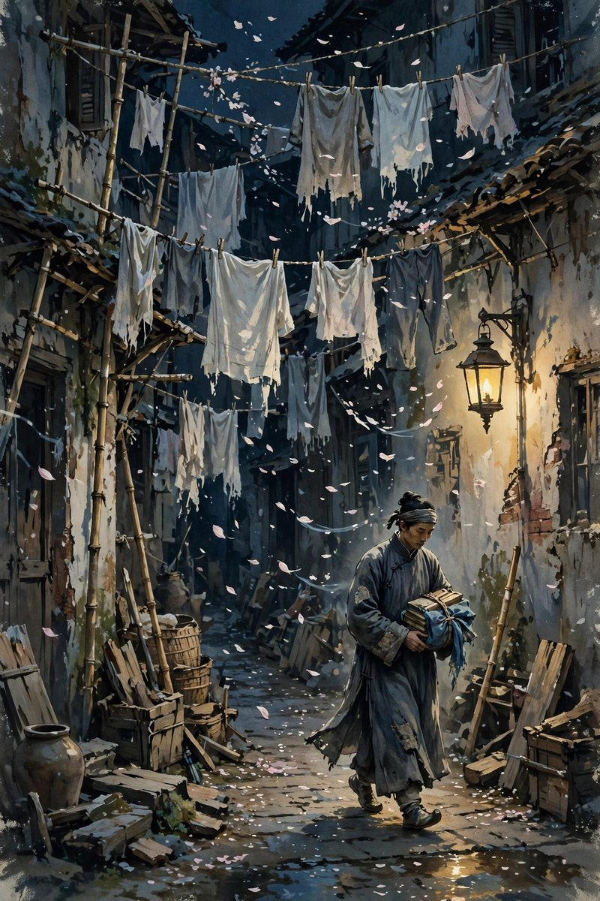

## 阁楼里的穷文人

春风沉醉的晚上写的是上海，写的是一个穷文人，写的是他住进贫民窟阁楼里的日子。这个文人没有正经工作，靠翻译一点稿费过日子，稿费时有时无，有的时候能吃上饭，有的时候只能饿着，住的地方又小又破，楼上楼下都是穷人，隔壁住着一个烟厂女工，叫陈二妹。文人患有严重的神经衰弱，夜里睡不着觉，白天也没有精神，整天浑浑噩噩，觉得自己活着没有意思，觉得前途一片黑暗，觉得社会对不起他，他也对不起自己。他住进贫民窟，不是体验生活，是实在没有钱了，只能住到最便宜的地方去，最便宜的地方，就是最脏最乱最吵的地方，就是楼道里堆着垃圾，屋子里漏着雨，晚上老鼠跑来跑去的地方。可是就是在这样的地方，他遇到了陈二妹，遇到了一个和他一样穷，一样苦，一样对社会不满，可是心里还亮着一盏灯的人。

陈二妹只有十七岁，在一家小烟厂里做包烟工，每天从早到晚，要站在机器旁边干十几个小时的活，有的时候还要被迫加班，得到的报酬却低得可怜，除了吃饭，根本不够付房钱和买衣服。她的父亲也是烟厂工人，去年秋天去世了，留下她一个人，住在原来和父亲一起住的屋子里，无依无靠，工厂里的管理人员还总想乘机戏弄她，占她的便宜。她恨那些骑在人民头上的剥削者，恨那个烟厂，恨那个让她每天累得直不起腰，却连一件新衣服都买不起的社会。可是她恨归恨，心里却没有变坏，没有变得刻薄，没有变得只顾自己，她对和她一样穷的人，特别有同情心，特别愿意伸手帮忙，特别懂得穷人的难处。这种善良，不是装出来的，是穷日子里长出来的，是自己淋过雨，所以愿意给别人撑伞的那种善良。

## 一块面包和一颗心

文人和二妹相识的过程，写得非常平常，没有戏剧性的相遇，没有英雄救美，没有一见钟情，只有一个穷邻居和另一个穷邻居，在楼道里打招呼，在门口说几句话，在对方生病的时候问一句，在对方没饭吃的时候，分一块面包。这种平常，恰恰是小说最动人的地方：真正的感情，往往不是从惊天动地开始的，而是从一顿饭，一句话，一次搭把手开始的。二妹发现文人的生活和她一样窘迫之后，就主动买来面包留给文人充饥，文人发现二妹被工厂管理人员欺负之后，心里就替她不平，就想为她说句话，就想保护她。两个人都是穷人，穷人之间的互相帮助，看起来很小，其实很大，因为穷人手里本来就没有多少东西，能分出来的东西，都是从自己嘴里省下来的，都是带着体温的。

小说里有一个细节，写得让人心里发酸：文人因为神经衰弱，夜里常常出外散步，散步回来的时候，身上带着外面的寒气，带着夜里的露水，二妹看到他整夜不归，行为令人可疑，就真切地担忧他走上了邪路，规劝他改过，规劝他不要和坏人来往，不要把自己毁了。这种规劝，放在今天看，可能有点啰嗦，有点管得宽，可是在那个年代，在贫民窟里，一个女工对一个邻居说这样的话，是需要勇气的，是需要真心的，是把对方当成自己人，才会说的话。文人听了之后，心里既感动，又惭愧，感动的是，这个世界上还有人关心他，惭愧的是，自己活得这么窝囊，还要一个十七岁的女工来操心。两个人之间的感情，就是在这种互相操心，互相分面包，互相说真话的日子里，一点一点长出来的，长得不快，可是长得很结实。

## 一场误会和一颗真心

故事的波澜，来自一场误会。文人有一天收到了翻译的稿费，生活忽然改善了一点，穿上了新衣服，吃起了巧克力，看起来像是有钱了，像是交上了坏朋友，像是堕落了。二妹看到他突然穿上新衣，吃起巧克力，误以为他沦落为资本家的走狗，误以为他和坏人一起干了坏事，含着眼泪规劝他，劝他不要走邪路，劝他不要为了钱出卖自己，劝他想想穷人的日子，想想自己的良心。这段规劝，写得非常动人，因为二妹的眼泪是真的，她的担忧是真的，她的愤怒也是真的，她不是在演戏，她是真的怕这个邻居，这个她有点喜欢的人，变成她最恨的那种人。文人听了之后，先是愣住，然后是感动，然后是坦白，坦白自己的稿费是怎么来的，坦白自己并没有堕落，坦白自己还是那个穷文人，还是那个和她一样恨剥削者的人。误会消除之后，两个人的友谊反而更深了，因为误会让他们把心里的话都说出来了，把各自的底线都亮出来了，亮出来之后，发现两个人的底线是一样的，都是不愿意出卖良心，不愿意向压迫者低头，不愿意为了钱变成自己讨厌的人。

这场误会，放在今天同样有意义。今天的人，也常常会因为对方忽然有钱了，忽然穿得好了，忽然吃得好了，就怀疑对方是不是变了，是不是傍上了什么人，是不是干了什么见不得人的事，这种怀疑，表面上是嫉妒，深层里其实是关心，是怕对方走错路，是怕自己看错人。小说告诉我们，怀疑不可怕，可怕的是怀疑之后不说话，不问清楚，不给对方解释的机会，任由误会长大，长成隔阂，长成仇恨。二妹的可贵之处就在于，她怀疑之后，不是背后说闲话，不是偷偷疏远，而是当面说出来，含着眼泪说出来，说出来之后，两个人反而更近了。这种当面说清楚的勇气，在今天这个动不动就拉黑，动不动就冷战，动不动就背后议论的年代里，显得特别珍贵。感情里最怕的不是误会，是误会之后没有人愿意先开口，是两个人明明在乎对方，却都等着对方先低头，等到最后，等来的只是疏远和遗憾。

## 春风到底是什么风

小说的题目叫春风沉醉的晚上，春风是什么风，沉醉又是什么沉醉，郁达夫没有明说，可是读者读完之后，心里会有自己的答案。春风，可以是上海春天的风，吹进贫民窟的阁楼里，吹动窗帘，吹动二妹的头发，吹动文人心里那点快要灭掉的火。春风，也可以是两个人之间的那点温情，那点同是天涯沦落人的感觉，那点在黑夜里互相取暖的暖意，那点让文人觉得，生活虽然苦，可是还有人关心他，还有人愿意为他流泪，还有人愿意和他一起恨剥削者，一起盼着好日子。沉醉，可以是文人被这种温情醉倒了，醉到觉得周围更加光明，醉到觉得黑暗的社会里，还有光，还有希望，还有值得活下去的理由。也可以是二妹被文人的真诚醉倒了，醉到觉得，这个穷文人虽然没有钱，虽然神经衰弱，虽然活得窝囊，可是他的心是好的，他的眼睛是干净的，他值得被喜欢，值得被关心。

这种春风和沉醉，放在今天，同样是很多人渴望的东西。今天的城市里，春天照样会来，风照样会吹，可是很多人的心里，却吹不进春风，因为心里的窗户关得太紧了，因为对人失望太多次了，因为被生活打击太多次了，因为不敢再相信别人了。郁达夫写这篇小说，就是想告诉读者，春风不是等来的，是两个人互相给的，是穷人和穷人互相取暖取出来的，是一个人在另一个人最难的时候，分一块面包，说一句真话，流一滴眼泪，取出来的。只要还有人愿意分面包，愿意说真话，愿意流眼泪，春风就还在，沉醉就还在，希望就还在。贫民窟的阁楼再破，窗户外面还是春天，春天再冷，风里还是带着一点暖意，这点暖意，就是小说留给读者的东西，就是郁达夫留给后来人的东西。

## 从性苦闷到社会关怀

从文学史的角度看，春风沉醉的晚上是郁达夫创作上的一个转折。早期的郁达夫，写沉沦，写银灰色的死，写南迁，写的都是留日学生的性苦闷，都是一个人的内心挣扎，都是自我剖白，到了春风沉醉的晚上，他的目光开始从狭小的个人圈子，转向更广大的劳动人民，转向贫民窟里的女工，转向社会上的穷人，转向阶级压迫的问题。这个转变，不是偶然的，是他接触了新的思想，是他看到了中国社会的现实，是他意识到，青年的苦闷不只是个人的问题，更是社会的问题，穷人的苦，不只是穷人自己的问题，更是整个社会结构的问题。小说里的文人，不再只是为自己的欲望苦恼，他开始为二妹的遭遇不平，开始为工人的处境愤怒，开始把自己的苦闷，和工人的苦连在一起，这种连在一起，就是他走向社会关怀的开始，就是他从一个颓废的文人，走向一个有社会责任感的作家的开始。

这个转变，放在今天同样有启发意义。今天很多写文章的人，写来写去都是写自己，写自己的焦虑，写自己的失眠，写自己的感情，写自己的原生家庭，写得越细，圈子越小，写到最后，读者会觉得，你的焦虑是你的焦虑，和我有什么关系。郁达夫的转变告诉我们，写自己没有错，可是写自己不能只停留在自己身上，要把自己的苦闷，和更多人的苦闷连起来，要把自己的遭遇，放到社会的结构里去看，要看到，自己的穷，和别人的穷，是同一个原因造成的，自己的恨，和别人的恨，是同一个对象造成的，只有这样，个人的文章，才能变成社会的文章，个人的苦闷，才能变成时代的苦闷，个人的故事，才能让更多的人读了之后觉得，这也是我的故事。春风沉醉的晚上，就是这样一篇从个人走向社会的文章，它从一个阁楼开始，走到整个上海，走到整个中国，走到所有穷人的心里。

## 二妹这个人物为什么立得住

陈二妹这个人物，在中国现代文学史上，是一个很特别的女工形象。她不是高大全的英雄，不是完美无缺的圣人，她是一个十七岁的姑娘，文化不高，见识不多，说话直，脾气倔，爱憎分明，恨起剥削者来，咬牙切齿，爱起穷人来，掏心掏肺。她身上有朴素的阶级意识，这种意识不是从书本上学来的，是从每天十几个小时的劳动里，从微薄的工资里，从父亲去世后的孤苦里，从管理人员戏弄她的屈辱里，一点一点长出来的。她恨烟厂，恨到连文人吸烟都要规劝，规劝他不要吸烟，尤其不要吸她所在工厂的烟，因为她痛恨那个厂，这种恨，看起来有点孩子气，有点不讲道理，可是恰恰是这种孩子气，让她的人物立住了：一个被压迫的人，恨压迫者的方式，往往就是这样朴素的，这样直接的，这样不讲什么大道理的，她不会写檄文，不会讲理论，她只会用自己的方式表达恨，用不吸烟来抵制，用规劝来反抗，用眼泪来控诉。

今天的人，读二妹这个人物，会觉得她很亲切，很真实，很像身边那些在工厂里打工，在餐馆里端盘子，在快递站里分拣，在工地上搬砖的姑娘们。她们文化不高，可是心里有杆秤，知道谁对她们好，谁对她们坏，知道什么是公平，什么是欺负，知道自己穷，可是穷得有骨气，穷得不愿意出卖自己。她们可能不会讲什么大道理，可是她们会在同事被欺负的时候站出来，会在邻居没饭吃的时候分一口，会在看到不公平的时候骂一句，这种朴素的善良和朴素的愤怒，就是二妹留给今天读者的东西。郁达夫写二妹，不是把她写成一个符号，写成一个概念，他是把她写成一个人，一个活生生的人，一个会哭会笑会生气会分面包的人，这种写法，让二妹在一百年之后还活着，还能让读者觉得，她就住在隔壁阁楼里，就在上海的某个弄堂里，就在今天的某个城市里。

## 贫民窟里的人情味

小说里的贫民窟，写得并不美，写得脏，写得乱，写得吵，写得让人不舒服，可是贫民窟里的人情味，却写得很美，美到让人觉得，穷地方也有穷地方的好，好就好在，人和人之间的距离近，近到可以互相闻到对方做饭的味道，近到可以听到对方夜里咳嗽的声音，近到可以在对方没饭吃的时候，顺手递过去一块面包。这种人情味，在今天的高楼大厦里，已经很少见了，今天的人，住在同一个小区里，住了几年都不知道邻居姓什么，住在同一个楼层里，见面也只是点个头，点完头就各自回屋，各自刷手机，各自过自己的日子。贫民窟里的那种互相取暖，在今天看来，简直有点奢侈，有点怀旧，可是小说告诉我们，人情味不是贫穷的专利，也不是过去的专利，人情味是人对人的关心，是人在看到别人难的时候，愿意伸手，愿意说话，愿意分一点东西，这种关心，在任何时代都可以有，在任何地方都可以有，只要人还愿意把心打开一点，还愿意把窗户打开一点，让春风吹进来一点。

读春风沉醉的晚上，最好的方式，是把它当成一篇写人情的小说来读，不要只读它的思想意义，不要只读它的文学史意义，要读它里面的人，读文人的神经衰弱，读二妹的倔强，读两个人在阁楼里的对话，读那块面包的温度，读那滴眼泪的重量，读那场误会里的真心，读那个春夜里的风。读完之后，你会发现，这篇小说并没有过时，它写的东西，今天还在发生，今天的城市里，照样有贫民窟，照样有合租房，照样有穷文人，照样有女工，照样有在黑夜里互相取暖的人，照样有在春风里沉醉的人，只不过贫民窟换成了城中村，阁楼换成了隔断间，烟厂换成了电子厂，面包换成了外卖，风还是春风，夜还是那个夜，人还是那个人，善良还是那个善良，恨还是那个恨，希望还是那个希望。

## 文人的病和二妹的药

文人患有神经衰弱，这个病在小说里写得很具体：夜里睡不着，白天没精神，听到一点动静就心慌，看到一点光就觉得刺眼，整个人像一根绷得太紧的弦，随时可能断掉。这种病，在今天会被叫做焦虑，会被叫做抑郁，会被叫做睡眠障碍，会被建议去看医生，去吃药，去做心理咨询，可是在那个年代，没有这些东西，文人的药，就是二妹，就是二妹的一块面包，就是二妹的一句话，就是二妹的眼泪，就是阁楼里那点人情味。这些东西，看起来不是药，可是对文人来说，比药还管用，因为他的病，根子不在身体上，而在心里，在孤独上，在觉得自己被全世界抛弃了的感觉上。二妹的出现，让他觉得，自己并没有被全世界抛弃，至少还有一个人关心他，至少还有一个人愿意为他流泪，至少还有一个人和他一样恨这个社会，一样盼着好日子。这种感觉，就是药，就是能让一根绷紧的弦，慢慢松下来的药。

今天的人，神经衰弱的人，焦虑的人，失眠的人，越来越多，药也越来越多，可是真正能治病的药，往往不是药片，而是人，是关心你的人，是愿意听你说话的人，是愿意分你一块面包的人，是愿意在你整夜不归的时候，问你一句去哪里了的人。郁达夫写春风沉醉的晚上，就是在说这个道理：一个人的病，有时候需要另一个人来治，需要人情味来治，需要春风来治，需要阁楼里的灯来治。医生可以开药，可是医生开不出人情味，药片可以让人睡着，可是药片睡不着心里的孤独，只有另一个人的真心，才能让孤独的人觉得，自己还活着，自己还值得活下去，自己还不是一个人。这种道理，放在今天，放在每一个失眠的夜里，放在每一个焦虑的白天里，都是管用的，都是值得被记住的。

## 上海的夜和穷人的光

小说里的上海，写得并不光鲜，写得不是外滩的灯红酒绿，不是十里洋场的纸醉金迷，写的是上海的背面，是贫民窟的背面，是阁楼的背面，是烟厂的背面，是那些住在上海，却享受不到上海繁华的人的背面。这些人，每天在上海的工厂里干活，在上海的街上走路，在上海的弄堂里吃饭睡觉，可是上海的好处，和他们没有关系，上海的灯，照不到他们的阁楼，上海的钱，流不到他们的口袋，上海的春风，吹到他们这里的时候，已经变成了一股冷风。可是就是在这样的背面，郁达夫写出了光，写出了二妹心里的光，写出了文人心里的光，写出了两个穷人互相取暖的光。这种光，不是从外面照进来的，是从人心里长出来的，是穷日子里长出来的善良，是压迫里长出来的愤怒，是黑夜里长出来的希望。这种光，很小，小到只是一块面包，只是一滴眼泪，只是一句话，可是小光在黑夜里，显得特别亮，亮到让读者觉得，上海再黑，贫民窟里还是有灯的，社会再冷，穷人心里还是有火的。

今天的城市，同样有背面，同样有住在城中村里的人，同样有在工厂里熬夜的人，同样有在深夜里送外卖的人，同样有在合租房里失眠的人，这些人的生活，同样不光鲜，同样不体面，同样不被看见，可是他们心里，同样有光，同样有善良，同样有愤怒，同样有希望。写文章的人，如果只写城市的光鲜面，只写外滩的灯，只写高楼的玻璃，只写有钱人的生活，那是不完整的，是虚假的，是对不起那些住在背面的人的。郁达夫写春风沉醉的晚上，就是给城市的背面立了一块碑，给贫民窟里的灯，留了一个位置，给二妹这样的人，留了一个名字。今天的人读这篇小说，应该记住这个位置，记住这个名字，记住城市背面的人，记住他们心里的光，记住他们也值得被写，值得被爱，值得过上好日子。

## 阁楼里的一盏灯

小说里的阁楼，写得又小又破，可是阁楼里有一盏灯，灯很小，小到只能照亮一张桌子，照亮一个人的脸，照亮二妹分给文人的那块面包，照亮文人夜里写翻译稿的纸，可是灯虽小，在黑夜里，显得特别亮，亮到让文人觉得，自己的日子，虽然穷，虽然苦，虽然没有前途，可是还有灯，还有光，还有人，还有希望。这盏灯，不是电灯，是人情味的灯，是二妹心里的灯，是文人心里的灯，是两个穷人互相取暖的时候，点起来的灯。灯点起来之后，阁楼就不只是阁楼了，阁楼就变成了一个家，变成了一个可以让人喘口气的地方，变成了一个可以让人在黑夜里，不至于冻死的地方。今天的人，住在高楼大厦里，住在装修很好的房子里，房子里有很多灯，吊灯，台灯，落地灯，氛围灯，灯很多，可是心里那盏灯，却不一定亮着，很多人回到家里，打开所有的灯，心里还是黑的，还是冷的，还是孤独的，还是觉得，没有人关心自己，没有人愿意分自己一块面包，没有人愿意为自己流一滴眼泪。郁达夫写阁楼里的灯，就是在说，灯的多少，不在于房子里的灯有多少，而在于心里有没有灯，有没有人，有没有情，有没有在黑夜里，愿意为你点一盏灯的人。

这盏灯，放在今天，同样是很多人需要的：今天的城市里，灯很多，霓虹灯，路灯，车灯，广告灯，灯把城市照得很亮，亮到夜里像白天，可是很多人的心里，却是黑的，是冷的，是孤独的，是觉得，自己在这个亮得像白天的城市里，却找不到一个可以说话的人，找不到一个可以分面包的人，找不到一个可以为自己流泪的人。春风沉醉的晚上，告诉我们，城市再亮，心里的灯，也要自己点，也要别人帮你点，也要在阁楼里，在合租房里，在城中村里，在任何一个穷地方，任何一个黑夜里，点一盏灯，点一盏人情味的灯，点一盏让别人觉得，自己还不是一个人，还不是被全世界抛弃的灯。这盏灯，点起来并不难，难的是，愿意点灯的人，越来越少了，愿意分面包的人，越来越少了，愿意说真话的人，越来越少了，愿意流眼泪的人，越来越少了。可是只要还有人愿意点灯，灯就还在，春风就还在，希望就还在。

## 烟厂女工的恨和爱

二妹恨烟厂，恨得非常具体，具体到她不愿意让文人吸烟，尤其不愿意让文人吸她所在工厂的烟，因为她痛恨那个厂，痛恨那个厂里，管理人员对她的戏弄，痛恨那个厂里，每天十几个小时的劳动，痛恨那个厂里，微薄的工资，痛恨那个厂里，让她父亲累死，让她一个人孤苦伶仃的日子。这种恨，不是抽象的恨，不是书本上的恨，是从每天的劳动里，从每天的疲倦里，从每天的屈辱里，长出来的恨，是一个十七岁的姑娘，用自己的身体，用自己的青春，用自己的眼泪，换来的恨。这种恨，放在今天，同样是很多打工人的恨：恨工厂，恨平台，恨公司，恨那个让自己每天工作十几个小时，却连一件新衣服都买不起的地方，恨那个让自己被管理人员欺负，被客户骂，被算法压榨，被罚款罚到白干的地方。可是恨归恨，二妹心里，还有爱，还有对穷人的爱，还有对文人的爱，还有对生活的爱，还有对好日子的盼望，还有对春风的渴望。恨和爱，在二妹心里，是搅在一起的，恨让她清醒，爱让她温暖，恨让她不向压迫者低头，爱让她不向生活低头，恨和爱合在一起，就是二妹这个人物，就是一个完整的人，就是一个值得被记住的人。

今天的人，读二妹的恨和爱，会觉得，她很真实，很像身边的人，很像那些在工厂里打工，在餐馆里端盘子，在快递站里分拣的姑娘们，她们恨自己的工作，可是爱自己的生活，恨自己的老板，可是爱自己的家人，恨这个社会的不公，可是爱这个世界里的好人，恨和爱搅在一起，就是她们的人生，就是她们活下去的动力。郁达夫写二妹，不是把她写成一个只会恨的人，也不是把她写成一个只会爱的人，他是把她写成一个既恨又爱的人，一个完整的人，一个在恨里，还能爱，在爱里，还能恨的人。这种完整，在今天同样重要：今天的人，往往被要求，要么只爱，要么只恨，要么是正能量，要么是负能量，要么是感恩，要么是抱怨，可是真实的人，从来都是既爱又恨的，既感恩又抱怨的，既想好好活，又想骂这个社会的，二妹就是这样的人，真实的人，值得被记住的人。

## 春夜里的憧憬

小说的结尾，停在两个人对未来的憧憬上，停在文人和二妹，对未来又憧憬期待着的地方，停在春风吹进阁楼，停在希望刚刚升起的地方。这种憧憬，写得并不具体，具体到两个人将来会怎么样，郁达夫没有写，没有写文人会不会找到工作，没有写二妹会不会离开烟厂，没有写两个人会不会在一起，没有写两个人会不会过上好日子，他只写了憧憬，只写了期待，只写了两个人心里，那点刚刚升起的希望。这点希望，很小，小到只是一个眼神，只是一句话，只是一个春夜里的风，可是小希望在黑夜里，显得特别亮，亮到让读者觉得，贫民窟的阁楼再破，窗户外面还是春天，春天再冷，风里还是带着一点暖意，这点暖意，就是小说留给读者的东西，就是郁达夫留给后来人的东西。今天的人，同样需要这种憧憬，需要在黑夜里，对未来有一点憧憬，有一点期待，有一点觉得，明天可能会好一点，后天可能会好一点，下个月可能会好一点，明年可能会好一点，哪怕这种憧憬，最后没有实现，哪怕这种期待，最后落空了，憧憬本身，就是活下去的动力，就是在黑夜里，点起一盏灯的动力，就是在贫民窟里，吹进一股春风的动力。没有憧憬的人，活着就像没有灯的阁楼，活着就像没有春风的夜，活着就像没有希望的日子，有憧憬的人，哪怕日子再穷，哪怕阁楼再破，哪怕烟厂再黑，心里还是亮的，还是暖的，还是有春风的。

## 阁楼里的面包

阁楼里的面包，是一块很普通的面包，普通到任何一家面包铺里，都能买到，普通到任何一个穷人，都能吃到，可是二妹分给文人的那块面包，一点都不普通，因为那块面包，是从二妹自己嘴里省下来的，是从她微薄的工资里省下来的，是从她每天十几个小时的劳动里，省下来的一点希望，是一块带着体温的面包，是一块带着人情味的面包，是一块在黑夜里，让文人觉得，自己还不是一个人，还不是被全世界抛弃的面包。这块面包，放在今天，同样是很多人需要的：今天的人，在城市里，在合租房里，在城中村里，在深夜里，常常会觉得饿，饿的不是肚子，是心，是觉得，没有人关心自己，没有人分自己一块面包，没有人愿意在自己最难的时候，伸手帮一把。可是只要还有人，愿意分一块面包，愿意说一句真话，愿意流一滴眼泪，愿意在春夜里，点一盏灯，愿意在阁楼里，吹进一股春风，日子就还是可以过下去的，希望就还是在的，春风就还是在的，沉醉就还是在的。

## 结尾的话

春风沉醉的晚上，结局并没有写两个人后来怎么样了，没有写他们是不是在一起了，没有写文人是不是找到了工作，没有写二妹是不是离开了烟厂，结局停在两个人互相理解，互相憧憬未来的地方，停在春风吹进阁楼的地方，停在希望刚刚升起的地方。这种结局，放在今天看，可能有点不完整，有点意犹未尽，可是恰恰是这种不完整，让小说有了余味，有了想象的空间，有了让读者自己去续写结局的权利。读者可以想象，文人后来找到了工作，二妹后来离开了烟厂，两个人一起过上了好日子，读者也可以想象，两个人后来还是分开了，还是各自过各自的穷日子，可是那个春夜里的温情，那个阁楼里的灯，那块面包的温度，那滴眼泪的重量，会一直留在他们心里，留在读者心里，成为他们在以后漫长的黑夜里，可以拿出来取暖的东西。郁达夫写这篇小说，不是为了给读者一个圆满的结局，是为了给读者一个希望，一个在黑夜里还亮着的灯，一个在贫民窟里还吹着的春风，一个在穷日子里还值得相信的人情味。这，就够了。
