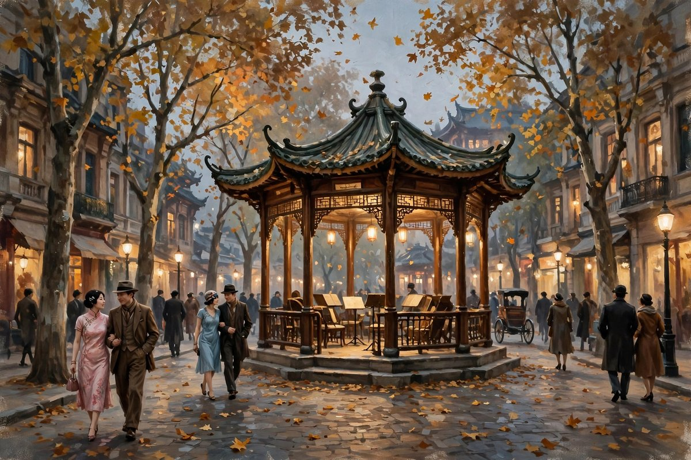
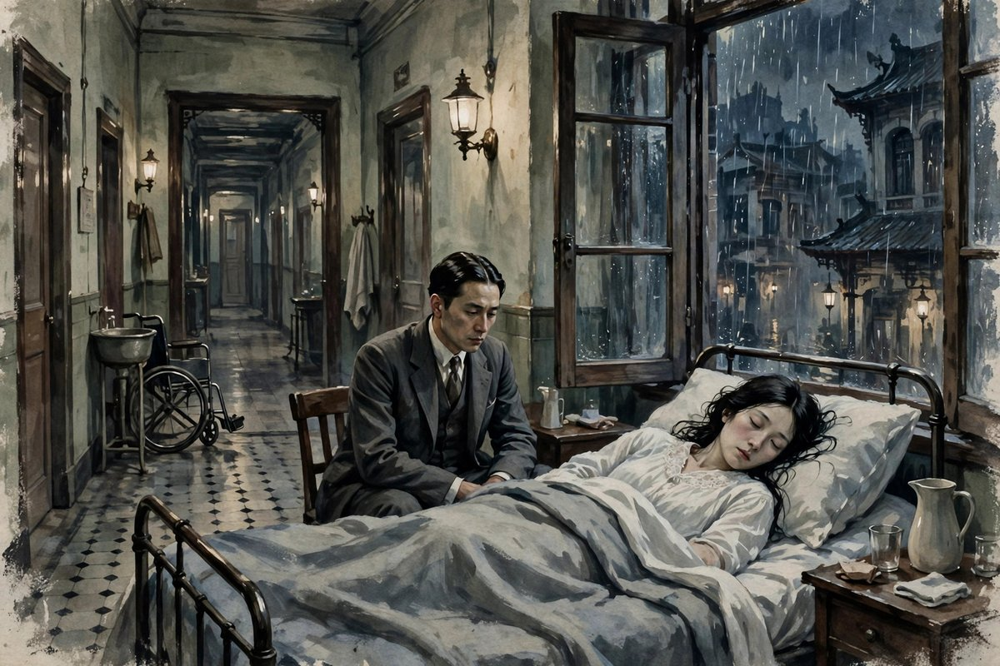

## 弄堂里的旧相识

过去写于一九二七年，发表的时候，郁达夫已经从早期的性苦闷，走向了后期的生的苦闷，走向了情欲的净化，走向了社会性的写实，走向了平静通达的风格。小说的开头，写的是一个男人在上海的街上，忽然遇到了一个熟人，熟人叫他，李先生，问他，上海民德里的那一年新年，你还记得吗。男人一听，心里就起了波纹，平静得像山里的静水湖一样的心里，又起了些波纹。回想起来，已经是三年前的旧事了，那时候她的年纪不上二十岁，住在上海民德里，男人寄寓着的对门的一间洋房里。那间洋房里，除了她一家的几个年轻女子以外，还有楼上的一家华侨的家族在住。男人当时也不晓得谁是房东，谁是房客，更不晓得她们几个姐妹的生计是如何维持的，只知道，她们中间最活泼的那个，叫老二，老二活泼放达，男人自己柔顺蠢笨，两个人在半年里，发生了一段关系，发生了一段让男人到今天还忘不掉的关系。

老二这个人物，写得非常生动，生动到让读者觉得，她就住在对门，就在上海的弄堂里，就在男人的对门洋房里。她活泼，放达，敢说敢笑，敢和男人打牌，敢和男人在酒楼上喝热酒，敢在男人向她表白的时候，劈面打他一个嘴巴，打完之后，还笑着对他说，李先生，不要这样，下回你若再干这些事情，我还要打得凶哩。这种活泼，这种放达，这种敢打敢笑，在那个年代的女子身上，是很少见的，是很特别的，是让男人又爱又怕的。男人自己，柔顺，蠢笨，木讷，怕羞，对将来的希望，很有自负心，可是对感情，却一点都不敢主动，不敢说，不敢做，只能在心里想，只能在酒后壮着胆子说一句，我很想和你长在一块儿，说完之后，就被打了一个嘴巴，打完之后，就把感情压住了，压到心里去，压到三年之后，压到再相见的时候，才又翻出来。

## 酒楼上的一个嘴巴

小说里有一个场景，写得非常经典，经典到很多读者读完之后，都会记得这个场景：有一天礼拜六的晚上，男人和老二在大马路市政厅听音乐出来，老大老三都跟了大姐夫的朋友看电影去了，两个人走到一家酒馆的门口，忽然吹来了两阵冷风，这时候正是九十月之交的秋晚的时候，男人就拉住了老二的手，颤抖着说，老二，我们上去吃一点熟的东西再回去吧，老二也笑了笑说，去吃点热酒吧。男人在酒楼上吃了两杯热酒之后，把平时的那种木讷怕羞的态度除掉了，向前后左右看了一看，看见空洞的楼上，一个人也没有，就挨近了老二的身边，对她媚视着，一边发着颤声，一句一逗地对她说，老二，我的心，你可能了解，我，我，我很想和你长在一块儿。老二举起眼睛来看了他一眼，又曲了嘴唇的两条线在口角上含着播弄人的微笑，回问他说，长在一块便怎么啦。男人大了胆，便摆过嘴去和她亲了一个嘴，她竟劈面地打了他一个嘴巴。楼下的伙计，听了拍的一声大响声，就急忙地跑了上来，向他们问，还要什么酒菜。男人忍着眼泪，还是微微地笑着对伙计说，不要了，打手巾来。等到伙计下去的时候，老二仍旧是不改常态地对他说，李先生，不要这样，下回你若再干这些事情，我还要打得凶哩。男人也只好当作了一场笑话，很不自然地把自己的感情压住了。

这个场景，写得既好笑，又心酸，好笑的是，男人的表白，那么笨拙，那么颤抖，那么像一个孩子，好笑到让读者忍不住笑出来，心酸的是，男人的表白，被打回去了，被一个嘴巴打回去了，打回去之后，他只能笑着，只能说打手巾来，只能把眼泪忍住，只能把感情压住。这种笑，是苦笑，是男人式的苦笑，是一个想爱又不敢爱，爱了又被打回来的人，只能苦笑的笑。老二打他，不是恨他，是逗他，是用打来告诉他，不要这么急，不要这么直，不要在酒楼上就亲嘴，不要把感情弄得这么难看，打完之后，她还是笑着的，还是活泼的，还是把他当成朋友的，可是男人心里，已经留下了一个印子，一个嘴巴的印子，一个三年之后还忘不掉的印子。这个印子，就是过去这篇小说的起点，就是男人和老二之间，那段没有说清楚，没有做明白，没有走到最后的感情的起点。

## 三年之后的重逢

三年之后，男人和老二重逢了，重逢的地点，是在一个朋友家里，是在打牌的时候，是在很平常的一个场合里，可是重逢的感觉，一点都不平常。老二看到男人，开口那句话就是，李先生，这两三年的分离，把你的容貌变得极老了，你看我怎么样，也完全变过了吧。这句话，听起来像寒暄，其实像刀子，刀子割在两个人的心里，割在过去三年的日子里，割在两个人各自的遭遇里。男人看着老二，发现她变了，变得不再像三年前那么活泼，那么放达，那么敢说敢笑，变得憔悴了，变得疲倦了，变得像一个被生活磨过的人，老二看着男人，发现他也变了，变得老了，变得沉默了，变得像一个被生活压过的人。两个人互相看着，心里都明白，过去三年里，各自都吃了不少苦，各自都走了不少弯路，各自都把日子过得不像样子，可是话到嘴边，又说不出来，只能说一些寒暄的话，只能说一些不疼不痒的话，只能把真正想说的话，藏在心里，藏到夜深人静的时候，藏到老二哭出来的时候，才说出来。

重逢之后的夜里，老二哭了，哭得非常厉害，哭着对男人说，李先生，我们的事情，早已经结束了，那一年要是那一年，你能像现在一样的爱我，那我也不会吃这一种苦的，我，你晓得，我这两三年来，说到这里，她抽咽得更加厉害，把被窝蒙上头去，索性任情哭了一个痛快。男人想想她的身世，想想她目下的状态，想想过去她对自己的情节，更想想自己沦落的半生，也被她的哀泣所感动，虽然滴不下眼泪来，但心里也尽在酸一阵痛一阵地难过。她哭了半点多钟，男人在床上默坐了半点多钟，觉得她的眼泪，已经把自己的邪念洗清，心里头什么也不想了。又静坐了几分钟，听听她的哭声，也已经停止，就又伏过身去，诚诚恳恳地对她说了一些安慰的话，说了一些过去的话，说了一些现在的话，可是话说出来之后，两个人心里都明白，过去就是过去了，过去的事情，已经结束了，结束的东西，再也回不来了，再哭，也哭不回来，再说，也说不回来，再爱，也爱不回去了。

## 过去为什么回不去

过去这篇小说，题目就叫过去，过去是什么意思，过去就是已经过去的东西，就是回不去的东西，就是只能在记忆里，在重逢的时候，在哭的时候，才能摸一下的东西。男人和老二的过去，是三年前上海民德里的一段感情，是一段没有说清楚，没有做明白，没有走到最后的感情，是一段因为男人的木讷，因为老二的活泼，因为两个人的年轻，因为两个人的不懂事，而错过的感情。错过的感情，在三年之后重逢的时候，本来可以再续，本来可以再说，本来可以再爱，可是两个人都没有再续，没有再说，没有再爱，因为三年过去，人都变了，日子都变了，心都变了，过去的感情，放在现在的人身上，已经不合适了，已经像一件小了的衣服，穿不上了，硬穿，只会把衣服撑破，把人都弄得难受。于是两个人只能哭，哭完之后，各自回去，各自过各自的日子，各自把过去，留在过去里。

这个道理，放在今天，同样是很多人会遇到的道理：旧情人重逢，本来是一件让人激动的事，可是重逢之后，往往会发现，对方变了，自己也变了，过去的感觉，已经找不回来了，过去的话，已经说不出口了，过去的爱，已经变成了一种怀念，一种遗憾，一种只能在心里想想，不能再拿到现实里来的东西。很多人重逢之后，会后悔，会觉得，还不如不见，还不如让过去留在记忆里，留在最美的时候，留在三年前上海民德里的那个秋夜里，留在酒楼上的那个嘴巴里，留在老二活泼的笑里，留在男人颤抖的表白里。可是郁达夫写过去，不是为了让读者后悔重逢，是为了让读者明白，过去就是过去，过去的美，恰恰在于它已经过去了，在于它不能再来，在于它只能被怀念，不能被重复，重复的过去，就不是过去了，就是现在了，现在的过去，往往没有过去那么美，往往带着生活的磨痕，带着岁月的疲倦，带着各自的苦，带着各自的泪，带着一种说不出来的酸楚。

## 从性苦闷到生的苦闷

从文学史的角度看，过去是郁达夫创作上的一个标志，标志着他从早期的性苦闷，转向了后期的生的苦闷，标志着他的小说，从写欲望的冲动，转向写情欲的净化，标志着他的风格，从汪洋恣肆的情感宣泄，转向平静通达的社会关照，标志着他的自我坦露，有所节制，社会性的写实内容，得到加强。早期的他，写沉沦，写的是一个青年被欲望折磨，被羞耻折磨，被自卑折磨，到最后投海自杀，到了过去，他写的是一个男人和一个女人的重逢，写的是两个人各自的苦，写的是生活的苦，写的是命运的苦，写的是人在时间面前的无力，写的是感情在时间面前的脆弱。这种转变，不是偶然的，是他到了中年之后，对生活的理解深了，对感情的理解深了，对时间的理解深了，才写出来的。年轻的时候，写苦闷，写的是性，写的是欲望，写的是身体，中年的时候，写苦闷，写的是生，写的是命运，写的是时间，写的是人活着本身的难。

这种转变，放在今天同样有意义：今天很多年轻人，写文章，写感情，写来写去都是写欲望，写身体，写荷尔蒙，写得越直白，越觉得自己深刻，可是到了中年，才会发现，真正让人苦的，不是欲望，是生活，是时间，是命运，是过去回不去，是爱的人变了，是自己老了，是日子过得不如意，是想爱又不敢爱，想恨又恨不起来，想放下又放不下。郁达夫写过去，就是在写这种中年的苦，写这种生的苦，写这种时间带来的苦，写这种过去回不去的苦。这种苦，比性苦闷更深，更广，更难写，也更值得写，因为性苦闷是年轻人的苦，生的苦是所有人的苦，是任何一个活过三年，活过十年，活过半辈子的人，都会遇到的苦。读过去，就是在读这种苦，读这种所有人都会遇到的苦，读完之后，你会觉得，自己并不孤单，自己的苦，别人也苦过，自己的过去，别人也有过，自己的遗憾，别人也有过。

## 老二的活泼和男人的木讷

老二和男人，是一对非常有意思的对照：老二活泼，放达，敢说敢笑，敢打敢闹，男人木讷，怕羞，柔顺，蠢笨，想爱不敢说，想做不敢做，只能在心里想，只能在酒后壮着胆子说一句，只能在被打了一个嘴巴之后，笑着说打手巾来。这种对照，放在今天，同样是很多情侣之间的对照：一个人活泼，一个人木讷，一个人主动，一个人被动，一个人敢爱，一个人不敢爱，活泼的人，往往会觉得，木讷的人太闷，太无趣，太不解风情，木讷的人，往往会觉得，活泼的人太闹，太直接，太让人招架不住，可是两个人偏偏就在一起了，偏偏就互相吸引了，偏偏就发生了一段让彼此都忘不掉的感情。这种吸引，不是偶然的，是性格上的互补，是活泼的人，需要一个安静的人来听她说话，是木讷的人，需要一个活泼的人来带他走出自己的壳，是两个人都需要对方，来补上自己缺的那一块。可是互补的感情，往往也很难走到最后，因为活泼的人，时间长了，会觉得木讷的人太闷，木讷的人，时间长了，会觉得活泼的人太闹，两个人互相吸引的地方，时间长了，会变成互相嫌弃的地方，互相嫌弃的地方，时间长了，会变成互相伤害的地方，互相伤害的地方，时间长了，会变成过去，会变成遗憾，会变成重逢的时候，哭一场也说不清楚的东西。

男人和老二的感情，就是这样开始的，也是这样结束的：开始的时候，男人被老二的活泼吸引，老二被男人的柔顺吸引，两个人打牌，听音乐，吃热酒，表白，打嘴巴，笑着把感情压住，压住之后，感情并没有消失，感情只是藏起来了，藏到三年之后，藏到重逢的时候，藏到老二哭出来的时候，才又翻出来。翻出来之后，两个人发现，感情还在，可是人已经变了，日子已经变了，心已经变了，感情放在现在的人身上，已经不合适了，已经像一件小了的衣服，穿不上了。这种不合适，不是任何一个人的错，是时间的错，是生活的错，是命运的错，是两个人在三年里，各自走了不同的路，各自吃了不同的苦，各自变成了不同的人，变成不同的人之后，过去的感情，就只能留在过去里，只能被怀念，不能被重复。郁达夫写老二和男人，就是在写这种时间的无情，写这种生活的无情，写这种命运的无情，写这种过去回不去的无情。

## 上海民德里的日子

上海民德里，是小说里最重要的地方，是男人和老二相遇的地方，是男人寄寓的地方，是老二一家住的地方，是几个年轻女子住的地方，是楼上华侨家族住的地方，是一个弄堂，是一个洋房，是一个上海老弄堂的样子。弄堂里的日子，写得非常具体，具体到男人和老二打牌，具体到老二一家的生计，具体到楼上楼下的往来，具体到男人寄寓在陈君家里，具体到男人对上海情形不熟，不能另外去租房子，只能寄住在别人家里。弄堂里的日子，放在今天，同样是很多人会过的日子：到一个陌生的城市，租一间房子，住在合租房里，和陌生人做邻居，和房东打交道，和对门的姑娘打招呼，在楼道里说几句话，在门口分一块面包，在夜里听到对门的动静，在白天看到对门的人出门上班。弄堂里的日子，看起来很平常，其实很珍贵，珍贵在，人和人之间的距离近，近到可以互相闻到对方做饭的味道，近到可以听到对方夜里咳嗽的声音，近到可以在对方难的时候，顺手递过去一块面包，顺手说一句真心话，顺手流一滴眼泪。这种近，在今天的高楼大厦里，已经很少见了，今天的人，住在同一个小区里，住了几年都不知道邻居姓什么，住在同一个楼层里，见面也只是点个头，点完头就各自回屋，各自刷手机，各自过自己的日子。过去这篇小说，写民德里的日子，就是在怀念这种近，怀念弄堂里的人情味，怀念对门洋房里的姑娘，怀念那个秋夜里的音乐，怀念那个酒楼上的嘴巴，怀念那个三年之后，还能让男人心里起波纹的过去。

## 哭完之后的安静

小说里，老二哭了半点多钟，男人默坐了半点多钟，哭完之后，安静了，静坐了几分钟，听听哭声，也已经停止，男人又伏过身去，诚诚恳恳地对老二说了几句安慰的话，说了几句过去的话，说了几句现在的话，可是话说出来之后，两个人心里都明白，过去就是过去了，过去的事情，已经结束了，结束的东西，再也回不来了。哭完之后的安静，写得非常好，好在它不是大哭大闹之后的安静，不是吵架之后的安静，不是分手之后的安静，而是一种认命的安静，一种接受的安静，一种知道过去回不去了，知道感情已经变了，知道日子已经变了，知道自己已经老了，知道对方也已经老了，知道哭也没有用，知道说也没有用，知道只能安静地坐一会儿，安静地想一会儿，安静地把过去，留在心里，留在记忆里，留在上海民德里的那个秋夜里，留在酒楼上的那个嘴巴里，留在老二的笑里，留在男人的颤抖里。这种安静，放在今天，同样是很多人重逢之后，会有的安静：旧情人重逢，哭一场，吵一场，说一场，闹一场，闹完之后，安静了，安静地坐一会儿，安静地想一会儿，安静地明白，过去回不去了，安静地接受，过去就是过去，现在就是现在，未来就是未来，过去的人，就是过去的人，过去的感情，就是过去的感情，把它们留在心里，就已经很好了，不用再拿出来，不用再重复，不用再续，不用再爱，不用再恨，不用再哭，不用再闹，安静，就是最好的告别，安静，就是对过去最好的尊重。

## 时间是最好的筛子

时间，在过去这篇小说里，像一个筛子，筛掉了很多东西，筛掉了年轻时候的活泼，筛掉了年轻时候的放达，筛掉了年轻时候的自负，筛掉了年轻时候的木讷，筛掉了三年前的上海民德里，筛掉了酒楼上的热酒，筛掉了市政厅的音乐，筛掉了老二的笑，筛掉了男人的颤抖，筛到最后，筛剩下的，只有两个人，老了的两个人，疲倦的两个人，哭过的两个人，安静的两个人，和一段回不去的过去。时间筛东西，筛得很无情，筛得很彻底，筛到最后，剩下的东西，往往不是最美的东西，而是最真实的东西，是两个人各自的苦，是两个人各自的泪，是两个人各自的遗憾，是两个人各自的安静。这种真实，放在今天，同样是时间会做的事情：时间会筛掉很多朋友，筛掉很多感情，筛掉很多梦想，筛掉很多年轻时候的冲动，筛掉很多以为会一辈子的东西，筛到最后，剩下的，往往是几个真正的好朋友，几段真正值得怀念的感情，几个真正值得记住的日子，和一个已经老了，可是还活着的自己。过去这篇小说，就是在写时间的筛子，写时间是怎么把三年前的感情，筛成三年后的遗憾，写时间是怎么把上海民德里的日子，筛成重逢时候的哭，写时间是怎么把活泼的老二，筛成疲倦的老二，写时间是怎么把木讷的男人，筛成老了的男人，写时间是怎么把过去，筛成过去的。

## 民德里的一盏灯

上海民德里的一间洋房里，曾经亮过一盏灯，灯很小，小到只能照亮一张牌桌，照亮老二的脸，照亮男人的脸，照亮几个年轻女子的笑，照亮楼上华侨家族的窗，照亮男人寄寓的屋子，照亮三年前的一个秋夜，照亮酒楼上的热酒，照亮市政厅的音乐，照亮老二打男人的那个嘴巴，照亮男人笑着说打手巾来的那一刻。这盏灯，亮了三年，亮到三年之后，男人和老二重逢的时候，灯已经灭了，灭到两个人互相看着，都觉得对方变了，都觉得自己变了，都觉得灯再也点不亮了，都觉得过去再也回不来了。可是灯灭了之后，记忆还在，记忆里的灯，还亮着，亮在男人的心里，亮在老二的哭里，亮在重逢之后的安静里，亮在小说的题目里，亮在过去这两个字里。过去，就是一盏灭了的灯，灭了之后，只能在记忆里亮，只能在怀念里亮，只能在哭的时候亮，只能在写成小说的时候亮，亮完之后，人还是要往前走，还是要过现在的日子，还是要爱现在的人，还是要珍惜现在的日子，因为现在的灯，还亮着，现在的日子，还过着，现在的人，还在身边，现在的感情，还来得及珍惜，不要等到现在的灯也灭了，才想起，过去的灯，曾经亮过，现在的灯，也曾经亮过，亮过的时候，自己没有珍惜，没有好好地看，没有好好地爱，没有好好地过。

## 打牌桌上的旧时光

小说里，男人和老二重逢，是在打牌的时候，是在一个朋友家里，是在很平常的一个场合里，可是打牌桌上的旧时光，一点都不平常。打牌，是上海民德里的时候，男人和老二常常做的事情，是两个人相识的方式，是两个人互相了解的方式，是两个人把感情，藏在牌桌上的方式。三年之后，再坐到牌桌上，牌还是牌，人已经不是原来的人了，牌桌上的人，变老了，变疲倦了，变沉默了，牌桌上的话，也变了，变得寒暄了，变得不疼不痒了，变得不敢说真心话了。可是牌桌上的记忆，还在，记忆里的牌桌，还是三年前的牌桌，还是上海民德里的牌桌，还是老二活泼的笑，还是男人木讷的脸，还是酒楼上的热酒，还是市政厅的音乐，还是那个秋夜里的风。打牌桌上的旧时光，就是过去的缩影，就是三年前的日子，缩成一张牌桌，缩成几句话，缩成一声叹息，缩成一场哭，缩成一段安静，缩成一篇小说，缩成过去这两个字。读过去，就是在读这张牌桌，就是在读牌桌上的旧时光，就是在读旧时光里的人，就是在读旧时光里的感情，就是在读旧时光，怎么变成现在的遗憾，怎么变成现在的安静，怎么变成现在的过去。

## 给今天旧情人的话

如果你有一个旧情人，如果你和旧情人重逢过，如果你重逢之后，发现话说不出口了，发现过去回不去了，发现哭完之后，还是要各自回去，不妨读一读过去，读一读男人和老二，读完之后，你会发现，你的遭遇，并不是你一个人的遭遇，是很多人的遭遇，是郁达夫写过的遭遇，是时间带给所有人的遭遇。旧情人重逢，最好的方式，不是再续前缘，不是再爱一次，不是把过去硬拉到现在来，是像男人和老二一样，哭一场，说几句真心话，互相安慰一下，互相祝福一下，然后各自回去，各自过好各自的日子，各自把过去，留在过去里，留在最美的时候，留在记忆里，留在心里最柔软的地方。过去留在记忆里，才是最美的，过去拿到现实里来，往往会变味，会变苦，会变酸，会变成一场遗憾，会变成一场后悔。

所以，不要害怕重逢，也不要执着于重逢，重逢了，就好好说几句话，好好哭一场，好好告个别，没有重逢，也没有关系，过去就是过去，过去的人，就是过去的人，过去的感情，就是过去的感情，把它们留在心里，留在记忆里，留在上海民德里的那个秋夜里，留在酒楼上的那个嘴巴里，留在老二的笑里，留在男人的颤抖里，就已经很好了。郁达夫写过去，就是在告诉读者，过去不可追，过去不可留，过去只能被怀念，只能被哭一场，只能被写成小说，写成文章，写成记忆，写完之后，人还是要往前走，还是要过现在的日子，还是要爱现在的人，还是要珍惜现在的日子。过去再美，也已经过去了，现在再苦，也是现在的日子，过好现在的日子，才是对过去最好的告别，才是对过去最好的尊重。

## 再说一句

过去写完之后，男人和老二，已经各自回去了，各自过各自的日子了，各自把过去，留在了过去里，留在了上海民德里的那个秋夜里，留在了酒楼上的那个嘴巴里，留在了老二的笑里，留在了男人的颤抖里，留在了重逢之后的哭里，留在了哭完之后的安静里。过去留下来，就是记忆，就是怀念，就是遗憾，就是安静，就是一篇小说，就是后来人，读到过去的时候，心里翻起的那股酸，和那股暖，酸在过去回不去，暖在过去曾经美过，曾经真过，曾经让两个人，在三年前的一个秋夜里，互相喜欢过，互相笑过，互相哭过，这，就够了，这就是过去，留给后来人的东西。

## 尾声

过去的日子，已经过去了，过去的人，已经过去了，过去的感情，已经过去了，可是过去的记忆，还在，还在上海民德里的弄堂里，还在酒楼上的热酒里，还在市政厅的音乐里，还在老二的笑里，还在男人的颤抖里，还在重逢之后的哭里，还在哭完之后的安静里。记忆在，过去就在，过去在，人就还在，人还在，希望就在，希望在，日子就可以过下去，就可以爱现在的人，就可以珍惜现在的日子，就可以把过去，好好地留在心里，留在最美的时候，留在记忆里，这就够了。

## 再补一句

过去的风，还在上海民德里的弄堂里吹，还在酒楼上吹，还在市政厅的音乐里吹，还在老二的笑里吹，还在男人的颤抖里吹，还在重逢之后的哭里吹，还在哭完之后的安静里吹。风吹过去了，日子也过去了，人也过去了，可是风里的记忆，还在，记忆里的风，还在，风里的过去，还在，过去里的风，还在，风和过去搅在一起，就是一篇小说，就是后来人，读到过去的时候，心里翻起的那股酸，和那股暖。

过去的风还在吹，吹过上海民德里的弄堂，吹过酒楼上的热酒，吹过市政厅的音乐，吹过老二的笑，吹过男人的颤抖，吹过重逢之后的哭，吹过哭完之后的安静，风吹过去了，日子也过去了，可是风里的记忆还在，记忆里的过去还在，过去里的风还在，风和过去，就是一篇小说，就是后来人心里的酸和暖。

过去已经过去了，风已经吹过去了，日子已经过去了，人已经过去了，可是记忆还在，记忆里的风还在，记忆里的过去还在，过去里的记忆还在，记忆和过去，就是一篇小说，就是后来人心里的酸和暖，就是过去留给后来人的话。

过去最磨人的地方，是它明明过去了，却还留在人心里。留在心里的过去，像弄堂里的风，吹过去了，又吹回来，吹回来的时候，带着酒楼的热气，带着音乐的尾音，带着重逢的眼泪。眼泪流过了，人也就放下了，放下了的过去，才真正成了过去，成了过去的故事，才能讲给后来的人听，听的人心里，也就有了酸，有了暖。
