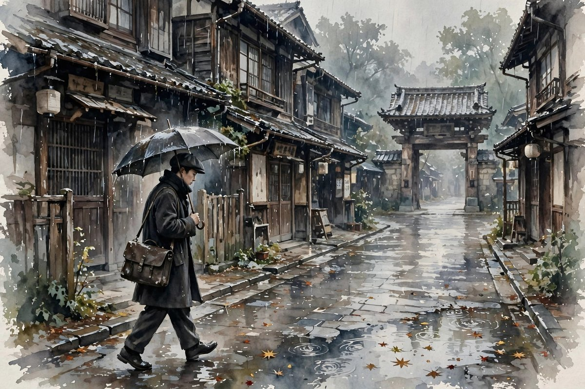
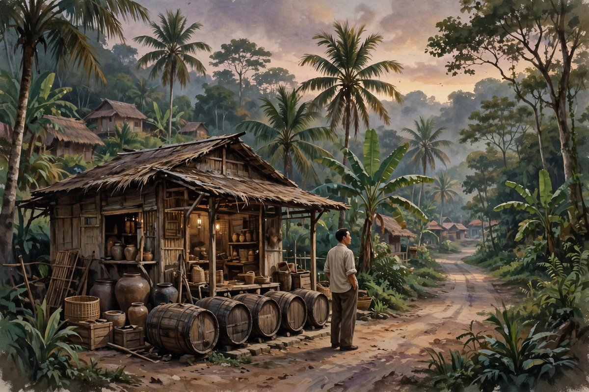

## 富阳江边走出来的孩子

郁达夫原名郁文，浙江富阳人，生在一八九六年十二月七日，家里并不宽裕，父亲去世得早，母亲一个人拉扯着几个孩子过日子。富阳在富春江边，江水一年四季地流，山是青的，水是绿的，风景好看得不像话，可是一个穷人家的孩子，看风景的时候心里想的往往不是风景，是下一顿饭从哪里来，是书费从哪里凑，是将来能不能走出这个小地方。郁达夫从小读书就灵，旧体诗写得早，十来岁已经会在报刊上投稿，那种灵气不是装出来的，是穷日子里逼出来的早熟：一个人越早知道家里没钱，越早学会用笔给自己找一条出路。

他后来考进之江大学预科，因为参加学潮被学校开除，这件事放在今天看，简直就是一个预告：这个人一辈子都不会老老实实待在规矩里。规矩让他不舒服，规矩里的体面让他觉得假，他宁可被开除，也不要把话咽回去。家里长兄郁华带着他去日本留学，一九一三年他到了日本，进了东京的高等学校，之后又进了东京帝国大学经济学部。按家里的打算，学经济是正经出路，毕业回来可以谋个安稳饭碗，可他心里装的全是小说。留学那几年，他读了大量的外国小说，俄国的，德国的，英国的，日本的，法国的，读得越多，越觉得中国的小说太拘谨，太不敢写人的心里话。他想写一种小说，不写英雄，不写大道理，就写一个人心里到底在想什么，写一个人夜里睡不着的时候，脑子里翻来覆去的那些念头。

## 东京的雨和心里的病

留日学生的日子，外人看着光鲜，其实苦得很。语言不通，钱不够花，吃的住的都差一截，更难受的是身份上的矮一头。那时候中国弱，在外国人眼里，中国留学生天然就低人一等，走到哪里都像被人用眼睛量了一遍。郁达夫把这种滋味全写进了小说里，他不写大场面，就写一个青年在东京的街上走，在宿舍里发呆，在酒馆里喝闷酒，在月光底下想家，想女人，想前途，想死。很多人读他的小说会觉得不舒服，因为他把男人的软弱、欲望、嫉妒、自卑、自怜全都摊在桌面上，一点遮掩都没有。放在今天，这叫情绪袒露，放在当时，这叫惊世骇俗。可是恰恰是这种不遮掩，让很多青年读者觉得，这个人写的是我，我心里那些不敢说的话，他替我说了。

一九二一年，他和郭沫若、成仿吾、张资平等人在东京酝酿成立了创造社，同一年十月，他的短篇小说集沉沦由上海泰东图书局出版，里面收了沉沦、南迁、银灰色的死三篇。集子一出来，文坛就炸了。有人骂他伤风败俗，有人捧他是天才，更多青年是偷偷买回去，躲在被窝里读，读完心里发烫，又觉得被人说中了心事。郁达夫那一年不到二十五岁，就已经是中国文坛上绕不过去的名字。他写小说的路子，后来被人叫做自叙传式的抒情小说，意思就是小说里的人，多多少少就是他自己，小说里的苦闷，多多少少就是他自己的苦闷。这种写法风险很大，写好了是真诚，写不好就是自恋，郁达夫写好的时候，是真的把一代青年的病给写出来了，那种病不只是他一个人的，是整个时代里有心气又没出路的青年共有的病：想反抗，又不知道往哪里反抗；想爱，又爱得卑微；想死，又舍不得死；想活，又活得窝囊。

## 回国之后的起起落落

一九二二年，郁达夫从东京帝国大学毕业回国，此后几年在北京大学、武昌、广东等地教过书，也主持过创造社的出版工作，主编过创造季刊、创造月刊、洪水等刊物。教书的日子他过得并不安分，课堂上的规矩，学校里的派系，文坛上的争吵，都让他烦。他这个人，适合写文章，不适合坐机关，适合交朋友，不适合搞派系，可是那个年代，文人不搞派系几乎没法活，于是他就在派系里进进出出，得罪人，也被人得罪，名声越来越大，日子越来越乱。他的小说也在变，早期那种纯粹写自己内心苦闷的写法，慢慢让位给更宽的社会视野，春风沉醉的晚上写贫民窟里的烟厂女工，薄奠写北京的人力车夫，过去写上海弄堂里旧情人的重逢，迟桂花写杭州山里中年人的晚开的花，这些作品里，主人公不再只是他自己，苦闷也不再只是性苦闷，而是穷人的苦，女人的苦，中年人的苦，整个社会压在普通人身上的苦。

感情生活上，郁达夫同样是一团乱麻。他和原配孙荃是旧式婚姻，孙荃贤惠，能忍，为他生儿育女，操持家务，后来又成全他和王映霞的事，自己茹素念佛，守着孩子过日子。王映霞是杭州有名的美人，郁达夫为她写了无数情诗，追得轰轰烈烈，两个人结了婚，过了几年神仙日子，最后却闹到反目成仇，郁达夫写毁家诗纪公开指责对方，王映霞也公开回击，婚姻彻底破裂。这段感情放在今天，足够写成连续剧，足够让网友吵上几个月，可是放在郁达夫身上，一点都不意外：他就是这样的人，爱的时候爱得不管不顾，恨的时候也恨得不管不顾，笔就是他的嘴，心里有什么，笔下就流出什么，从来不懂得给自己留余地。这种性格让他写出了好文章，也让他的人生处处漏风。

## 从杭州山水到上海滩

一九三三年，郁达夫从上海移居杭州，写了大量山水游记和诗词。杭州的山水养人，西湖的水，翁家山的桂花，富春江的雾，都进了他的散文里。很多人以为他到了杭州就收心了，其实没有，他只是换了一种方式发牢骚：游记里写山水，山水后面还是人，写一个地方的好，顺带就写出这个地方的人怎么活，写出世道怎么变。他的散文写得松，写得美，写得像和朋友聊天，聊着聊着就聊到心里去了，这种松弛感，恰恰是他小说里没有的东西。小说里的他，绷得太紧，散文里的他，松下来了，松下来之后，反而更能看出这个人的底色：一个多情的人，一个念旧的人，一个走到哪里都忘不了富阳江水的人。

抗战爆发之后，郁达夫的精神一下子振作起来了。他和鲁迅、茅盾、叶圣陶等四十多位文化人一起签名发表上海文化界告世界书，谴责日本的侵略，后来又到武汉参加军委会政治部的工作，担任中华全国文艺界抗敌协会的常务理事，到前线去劳军，去宣传，去写抗战文章。一个人早年写了那么多颓废的、苦闷的、想死的小说，到了国家存亡的时候，却一点都不含糊，这就是郁达夫身上最让人服气的地方：他的苦闷是真的，他的爱国也是真的，苦闷没有让他变成看客，爱国也没有让他变成口号机器。他写抗战文章，写得直白，写得愤怒，写得像在骂街，骂得有道理，骂得让读的人心里痛快。

## 南洋的最后几年

一九三八年底，郁达夫应邀到新加坡，主编星洲日报等报刊的副刊，写了大量战斗性很强的政论和短评，宣传抗日，组织华侨义勇军，被选为新加坡文化界抗日联合会的主席。那几年，他在南洋的影响很大，华侨们读他的文章，像读家书，像听家里人骂侵略者。可是好日子没过多久，一九四二年，新加坡沦陷，郁达夫和胡愈之、王任叔等人一起撤退到苏门答腊的巴爷公务，化名赵廉，在当地华侨家里住下来，开了一家酒厂维持生计。日本宪兵发现这个赵廉懂日语，就强迫他当翻译，他不拿日本人的薪水，免费做翻译，暗地里却利用这个身份保护和营救了不少当地人和华侨。这段日子放在任何一个人身上，都是提心吊胆的日子，白天要应付日本宪兵，晚上要防着汉奸告密，身边还没有可以完全信任的人，可他还是那样，喝酒，写诗，交朋友，救人，好像危险不存在似的。

一九四五年八月十五日，日本宣布投降，郁达夫高兴坏了，连着几天请左邻右舍喝酒庆祝，酒喝多了，话也就多了，说了不少日本宪兵队里的事。可是他没有想到，危险恰恰在这个时候来了。同年八月二十九日晚上，他吃过晚饭，正坐在客厅里和客人聊天，忽然有个当地青年把他叫了出去，他穿着睡衣，趿着木屐，说出去一下就回来，结果这一去就再也没有回来。后来从盟军方面的审讯口供里得知，他在同年九月十七日被日本宪兵秘密杀害，遗体埋在荒野里，至今没有找到。那一年他四十九岁，妻子何丽有怀着身孕，女儿郁美兰在父亲失踪之后的凌晨出生，父女两个人，连一面都没有见过。新中国成立之后，中央人民政府追认他为革命烈士，这四个字，放在他的一生后面，沉甸甸的，一点都不夸张。

## 为什么今天还要读他

今天读郁达夫，很多人会觉得他的小说过时了，语言旧了，情节慢了，人物动不动就哭，动不动就想死，动不动就喝酒，好像和今天的生活隔着一层。可是仔细读下去就会发现，他写的东西并没有过时，只是换了一个样子。今天的年轻人，照样会在深夜里失眠，照样会在异乡觉得孤独，照样会因为穷而自卑，因为爱而卑微，因为前途不明而焦虑，因为想做点事又不知道从哪里做起而烦躁。郁达夫把这些情绪写得那么具体，那么不加修饰，那么不怕丢脸，今天的读者读到的时候，还是会被击中：原来一百年前的人，和我是一样的，原来我的苦闷不是我一个人的毛病，是很多代人共同的毛病。文学的作用，有时候就是这个：让一个人知道，自己并不孤单，自己的痛苦有人写过，有人懂过。

更重要的是，郁达夫教会读者一件事：一个人可以软弱，可以苦闷，可以犯错，可以把日子过得一塌糊涂，但只要在大是大非面前不糊涂，只要在国家和同胞受难的时候站出来，这个人就值得尊敬。他早年写沉沦，写的是一个人的沉沦，后来写抗战文章，写的是一个民族的愤怒，从沉沦到抗战，这条路不是每个人都能走通的，很多人沉沦下去就再也没有爬起来，郁达夫爬起来了，而且爬起来之后走得比谁都直。这条路，放在今天同样有意义：一个人可以有情绪，可以有低谷，可以有一段写满了眼泪的日子，但不能一直待在低谷里，不能把苦闷当成不做事的借口，不能把个人的委屈放大到遮住整个世界。郁达夫的一生，就是从低谷里爬出来的一个例子，爬的过程很难看，爬的姿势也不好看，可是他爬出来了。

## 读他的一个笨办法

读郁达夫，不用从理论入手，不用先背文学史上的名词，就从沉沦开始读，读完沉沦读春风沉醉的晚上，读完春风沉醉的晚上读薄奠，读完薄奠读迟桂花，读完迟桂花读过去，读完过去读出奔，读完出奔读银灰色的死，读完银灰色的死读她是一个弱女子，再回过头来读他的散文和游记，读他的日记和书信，读他的诗。这个顺序不是什么标准答案，只是一个笨办法：跟着他的人生走，跟着他的笔走，看他怎么从一个留日学生的苦闷里走出来，怎么走到贫民窟里去，怎么走到杭州山里去，怎么走到上海弄堂里去，怎么走到战场上去，怎么走到南洋丛林里去。走完这一圈，你对他的认识，就不再是文学史上的几行介绍，而是一个活生生的人：一个会哭会笑会喝酒会写诗会犯错会救人的人，一个把自己写进小说里，又把小说写进自己人生里的人。

也有人会问，郁达夫的缺点那么明显，为什么还要把他当成重要作家？答案很简单：重要作家不是完美的人，重要作家是诚实的人。郁达夫诚实到有点傻，诚实到不给自己留面子，诚实到把最难看的心理都写出来，这种诚实，在任何时代都是稀缺的。今天写文章的人很多，写得漂亮的人很多，写得正确的人很多，可是写得诚实的人并不多。很多人写文章之前，先想这篇文章会不会得罪人，会不会掉粉，会不会被骂，会不会影响前途，想完这些，文章就已经不敢写了。郁达夫写文章之前，想的是心里这句话不吐不快，吐出来会怎么样，管他呢。这种不管不顾，在今天看来，简直有点奢侈，有点天真，可正是这种奢侈和天真，让他的文章在一百年之后还活着，还能让人在深夜里读得心里发酸。

## 一个作家的两副面孔

郁达夫身上有两副面孔，一副是对着自己的时候，写苦闷，写欲望，写软弱，写得毫不留情，另一副是对着社会的时候，写愤怒，写控诉，写抗战，写得毫不含糊。很多人只看到其中一副，就给他贴标签，看到苦闷的那一副，就说他是颓废作家，看到抗战的那一副，就说他是爱国作家，其实两副面孔是同一个人，同一个根：一个对自己诚实的人，对社会也诚实，一个敢把自己的伤口给人看的人，也敢把社会的伤口给人看。他的小说里，主人公常常在夜里哭，哭完之后，隔日还是要起床，还是要去找工作，还是要去面对生活，这种哭完还起床的劲头，就是他身上最动人的地方。哭不是目的，哭完之后的坚持才是目的，苦闷不是终点，苦闷之后的行动才是终点。今天很多人把情绪当成全部，把发泄当成解决，把躺平当成反抗，郁达夫的故事提醒我们，情绪可以发泄，苦闷可以写出来，可是写完之后，还是要做事，还是要站队，还是要在该出力的时候出力，不然情绪就只剩下情绪，苦闷就只剩下苦闷，文章就只剩下文章，人生就只剩下叹气。

他的散文也常常被人忽略，其实他的散文是理解他的另一把钥匙。小说里的他，太紧，太痛，太自我，散文里的他，松了下来，写西湖的雨，写富春江的雾，写杭州的桂花，写江南的小吃，写旅途中的见闻，写朋友之间的往来，写得像一个人在饭桌上聊天，聊得随意，聊得动人。读他的散文，你会发现，这个写苦闷小说的人，其实很会生活，很会看风景，很会交朋友，很会享受一顿饭，一壶酒，一场雨。生活里的这些小确幸，并没有让他忘记社会的苦，反而让他更清楚地知道，普通人值得过什么样的日子：值得吃一顿安稳饭，值得住一间不漏雨的屋子，值得在春天的晚上，和喜欢的人一起散步，值得在秋天的时候，闻到桂花的香气。这些愿望看起来很小，其实很大，因为在那个年代，很多普通人连这些小愿望都实现不了。郁达夫写散文，就是在为这些小愿望辩护，就是在说，人活着，不只是为了大道理，也是为了这些具体的好日子。

## 别把他读成一个符号

读郁达夫最容易犯的错，是把他读成一个符号，读成文学史上的一个名词，读成课本里的一段介绍，读完就以为自己懂他了。其实他不是符号，他是一个人，一个有血有肉，有优点有缺点，有高光有低谷的人。他的优点是诚实，是多情，是敢写，是在大是大非面前不糊涂，他的缺点是任性，是多情过了头，是管不住自己，是把私人生活也写成了公开文章，是让身边的人跟着他受累。这些优点和缺点，放在同一个人身上，并不矛盾，反而很真实：真实的人就是这样，好和坏搅在一起，光和影子贴在一起，读他的时候，不能只读好的那一半，也不能只读坏的那一半，要把两半合在一起看，才能看到一个完整的人。完整的人，才值得被记住，完美的雕像，不值得被记住，因为雕像不会哭，不会笑，不会喝酒，不会写诗，不会在深夜里失眠，不会在南洋的丛林里失踪。郁达夫会，而且他把这些都写下来了，留给了后来人。

## 留给后来人的话

郁达夫没有留下什么豪言壮语，他留下的，是几十篇小说，几百篇散文，几百首诗，几本日记，还有一个在南洋丛林里失踪的名字。富阳的江水还在流，东京的雨还在下，杭州的桂花还在开，上海的弄堂还在，苏门答腊的丛林还在，可是写这些地方的人，已经不在了。后来的人去富阳，去杭州，去上海，去东京，去苏门答腊，走他走过的路，看他看过的风景，心里总会想起这个人：一个穿着长衫，喝着酒，写着诗，哭着笑的人，一个把苦闷写成刀，最后又用这把刀去砍侵略者的人。他的刀，砍向过自己，砍向过旧礼教，砍向过压迫穷人的社会，砍向过侵略者，刀口到最后，指向了正义的一边。这就够了，一个作家，能做到这个地步，已经足够让后来人记住他，足够让后来人在读他的小说时，不只是读故事，而是读一个人的一生。

如果你在深夜里睡不着，如果你在异乡觉得孤独，如果你觉得自己活得窝囊，如果你觉得前途一片模糊，不妨翻开郁达夫的小说，看看一百年前那个留日学生是怎么熬过来的，看看那个贫民窟里的女工是怎么活下来的，看看那个北京车夫是怎么死去的，看看那个杭州山里的中年人是怎么等到桂花开的，看看那个上海弄堂里的旧情人是怎么哭完又把日子过下去的。这些故事不会直接告诉你该怎么办，不会给你开药方，不会给你画路线图，可是它们会让你知道，苦闷不是终点，沉沦不是终点，死不是终点，只要人还愿意往前走一步，往前看一眼，往前伸一次手，路就还在，灯就还在，人就还在。郁达夫用一生证明了这句话：从沉沦里走出来的人，比从来没有沉沦过的人，更知道光在哪里。

## 创造社里的争吵和情分

创造社是郁达夫和几个留日同学一起弄起来的团体，宗旨说起来很文艺，其实也很简单：让中国的青年作家有地方发表，有地方说话，有地方互相撑腰。那个年代办刊物不容易，钱不够，纸不够，审查也多，几个年轻人凑在一起，又要写稿，又要拉赞助，又要和书局谈价钱，又要应付骂声，日子过得紧巴巴的。郁达夫在创造社里是干活的人，也是惹事的人，他的文章直，脾气直，说话不绕弯，文坛上的人，有人喜欢他的直，有人受不了他的直，于是创造社内部也常常吵架，吵文学主张，吵办刊方向，吵钱，吵人，吵到最后，有人走，有人留，郁达夫后来也退出了创造社，退出的时候，心里肯定不好受，毕竟那个团体是他年轻时候的心血，是他和朋友们一起在异国他乡做梦的地方。可是退出不等于翻脸，他和郭沫若、成仿吾这些老朋友，吵归吵，情分还在，文坛上的恩怨，放在几十年之后看，往往都变成了茶余饭后的谈资，真正留下来的，是那些文章，是那些刊物，是那些曾经让青年读者热血沸腾的文字。

他和鲁迅的关系也值得说一说。鲁迅比他大，笔比他狠，两个人互相欣赏，也互相看不惯对方的一些做法，可是在大方向上，两个人是一致的：都看不惯旧社会的吃人礼教，都看不惯压迫穷人的权势，都愿意为青年人说话，都愿意为弱者说话。郁达夫写小说，重抒情，重自我，鲁迅写小说，重讽刺，重社会，路子不一样，可是目标差不多。后来郁达夫写怀鲁迅，写得情真意切，鲁迅去世之后，他是真的伤心，那种伤心不是客套，是一个同代人走了之后，剩下来的人忽然觉得路上冷清了的伤心。今天的人看文坛，总喜欢看谁和谁吵架，谁和谁翻脸，把文坛当成娱乐圈来追，可是真正重要的，是这些人吵完之后，还能不能在国家有难的时候站在一起，郁达夫和他的同代人，在抗战的时候是站在一起的，这一点，比任何吵架都重要。

## 日记和书信里的真人

想了解一个作家，光读小说是不够的，还要读他的日记和书信。郁达夫的日记写得很坦白，坦白到让人有点不好意思：今天喝了多少酒，见了什么人，花了多少钱，心里烦什么事，对谁有意见，对谁动了心，全都写下来，一点都不给自己打掩护。日记九种出版之后，很多人读得津津有味，也有人骂他不知羞耻，把私生活拿出来卖钱。郁达夫自己在日记的后记里也说过，文人卖到日记和书信，是走到末路时候的行为，这话听起来心酸，其实也很真实：一个靠写文章吃饭的人，到了没钱的时候，连自己的隐私都成了可以换钱的东西。可是恰恰是这种坦白，让后人看到了一个真实的郁达夫：不是文学史上的雕像，不是课本里的名字，而是一个会为钱发愁，会为情所困，会喝醉了酒到处找人聊天，会在深夜里写诗骂自己的人。

他的诗也很好，旧体诗写得有才气，新诗写得有感情，诗里的他，比小说里的他更温柔，也更伤感。有一类诗是写给王映霞的，写得缠绵，写得热烈，写得像火一样，读起来让人觉得，这个男人爱一个人的时候，是真的把心都掏出来了。有一类诗是写山水的，写富春江，写西湖，写杭州的雨，写南洋的风，写得清淡，写得悠远，读起来像在听一个人在远方给家里写信。还有一类诗是写抗战的，写得愤怒，写得悲壮，写得像檄文，像战鼓，读起来让人想起，这个写情诗的人，拿起笔来骂侵略者的时候，同样毫不手软。诗、小说、散文、日记、政论，郁达夫几乎什么都写，什么都写得有自己的味道，这种全能，在今天的作家里面已经很少见了，今天的作家往往只专一门，郁达夫是全科生，而且每一科都考得不错。

## 照着今天的日子再看他

把郁达夫放到今天来看，他的很多遭遇，换个壳子还在发生。今天的年轻人，去大城市打工，去外国留学，住在合租屋里，吃着外卖，熬着夜，工资不够花，房租年年涨，谈恋爱谈得小心翼翼，找工作找得焦头烂额，心里那点苦闷，和一百年前的留日学生并没有本质区别，区别只在于，一百年前的苦闷要写成小说才能被人看见，今天的苦闷发在社交平台上，几分钟就被淹没了。郁达夫的好处在于，他把苦闷写成了长久的东西，写成了可以流传的东西，今天的人读他的小说，不是读古董，是读自己的影子，是读一种跨越了时间的共鸣。这种共鸣，比任何鸡汤都管用，因为鸡汤告诉你一切都会好起来，郁达夫告诉你，一切不一定会好起来，可是你还是要活下去，还是要写下去，还是要爱下去，还是要在该站出来的时候站出来。

今天的职场里，也有很多人像郁达夫笔下的车夫，像那个想买一辆属于自己的车，想了半辈子，到死都没有买到的人。今天的外卖员想买一辆属于自己的电动车，今天的网约车司机想摆脱平台的抽成，今天的小商贩想攒钱开一家属于自己的小店，这些愿望，和一百年前车夫的愿望，骨子里是一样的：想靠自己的力气，过上有尊严的日子，想不再被人抽成，不再被人盘剥，不再活得像牛马。郁达夫写薄奠，写到最后忍不住在心里骂街，骂那些看热闹的人，骂那个逼死车夫的社会，今天的人读到那一段，还是会觉得解气，还是会觉得，这个作家没有站在岸上看热闹，他是站在车夫那一边，和车夫一起骂街的。这种站队，在今天同样重要：写文章的人，到底站在谁那一边，站在强者那一边，还是站在弱者那一边，读者是看得出来的，时间也是看得出来的。

今天的感情生活里，也有很多人像郁达夫，像王映霞，像孙荃，像郑秀岳，像李先生，像老二，爱得轰轰烈烈，散得一地鸡毛，旧情人重逢的时候，话到嘴边又咽回去，想爱又不敢爱，想恨又恨不起来，想放下又放不下。郁达夫写感情，从来不写童话，不写从此幸福地生活在一起，他写的是感情里的泥泞，写的是人性的软弱，写的是一个人在爱里怎么把自己弄丢，又怎么在丢了之后慢慢找回来。这种写法，在今天这个动不动就讲速食爱情，动不动就讲及时止损的年代里，反而显得珍贵：因为真实的感情，本来就是泥泞的，本来就是会弄丢自己的，本来就是需要时间去收拾的，假装感情可以像开关一样说开就开，说关就关，那才是对感情的不尊重。郁达夫尊重感情，尊重到有点傻，傻到把自己的婚姻都写成了公开的伤口，可是正是这种傻，让他的感情小说在一百年之后还让人读得心疼。

如果你在深夜里睡不着，如果你在异乡觉得孤独，如果你觉得自己活得窝囊，如果你觉得前途一片模糊，不妨翻开郁达夫的小说，看看一百年前那个留日学生是怎么熬过来的，看看那个贫民窟里的女工是怎么活下来的，看看那个北京车夫是怎么死去的，看看那个杭州山里的中年人是怎么等到桂花开的，看看那个上海弄堂里的旧情人是怎么哭完又把日子过下去的。这些故事不会直接告诉你该怎么办，不会给你开药方，不会给你画路线图，可是它们会让你知道，苦闷不是终点，沉沦不是终点，死不是终点，只要人还愿意往前走一步，往前看一眼，往前伸一次手，路就还在，灯就还在，人就还在。郁达夫用一生证明了这句话：从沉沦里走出来的人，比从来没有沉沦过的人，更知道光在哪里。

## 结尾再说一句

郁达夫的一生，写满了苦闷，也写满了抗争，写满了眼泪，也写满了骨气，后来人读他，不用把他供起来，也不用把他踩下去，就把他当成一个活生生的人来读，读他的好，读他的坏，读他的哭，读他的笑，读他的酒，读他的诗，读他的南洋，读他的富阳，读完之后，你会发现，这个人离你并不远，他的心事，你也有过，他的路，你也在走，他的光，你也可以找到。
