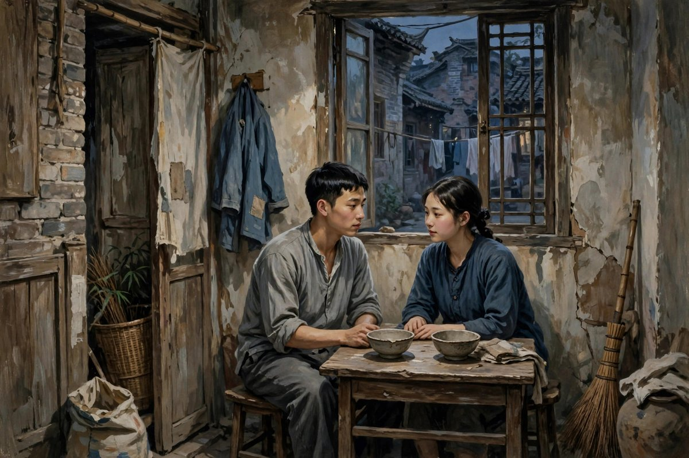
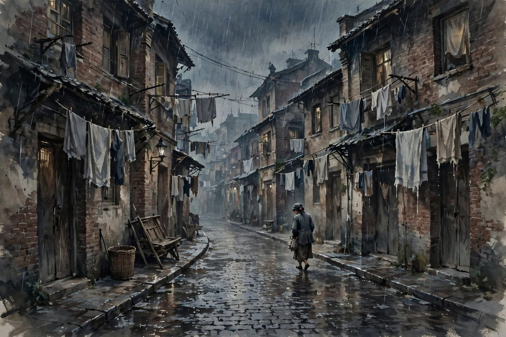

## 杭州女校里的三个姑娘

她是一个弱女子，创作完成于一九三二年三月，同年出版，是郁达夫继沉沦、迷羊之后出版的后来的一部中篇，也是他唯一存世的完整手稿，后来手稿被拍出高价，被展出，被研究，被当成郁达夫小说创作史上的一个特殊位置。小说以一九二七年四一二事变前后，至一九三二年一二八事变为背景，以女学生郑秀岳的成长经历和情感纠葛为主线，描绘了她和冯世芬、李文卿三个青年女性的不同人生道路和她的悲惨结局。故事的开头，是在杭州的一所女校里，郑秀岳十四岁，冯世芬十六岁，李文卿也是女校里的学生，三个姑娘，上课、吃饭、自修、散步、睡觉，都是在一起的，冯世芬还和郑秀岳床背后的同学换床位，晚上帐门一塞紧，她们俩就把床背后的帐子撩起，很自由地可以爬来爬去。这种亲密，在今天看，可能有点特别，可是在那个年代的女校里，是很常见的，是姑娘们之间，最纯真的友谊，是郑秀岳一生里，最干净的一段日子，是她后来无论走到哪里，无论堕落到什么地步，心里都还记得的一段日子。

郑秀岳这个人物，写得非常复杂，复杂到让读者既同情她，又恨她，既觉得她可怜，又觉得她可恨，既想饶了她，又觉得她不值得饶。她温柔，美丽，聪明，成绩好，可是精神上确实是软弱的，在感情上，依赖心极重，当冯世芬离校返家时，她简直就是失魂落魄，看到了冯世芬的那个空席，心里就马上会起绞榨，头上也像有什么东西罩住似地会昏转过去，好像失去了半片，好像不见了半年来片刻不离的冯世芬，叫她如何能够过得惯呢。这种依赖，这种软弱，是她一生的底色，是她后来所有悲剧的根子：她不能一个人活着，不能一个人做决定，不能一个人面对生活，不能一个人面对感情，她需要依赖别人，依赖冯世芬，依赖李文卿，依赖丈夫，依赖情人，依赖任何一个愿意给她一点温暖，愿意给她一点钱，愿意给她一点依靠的人。依赖别人的人，往往会被别人伤害，会被别人抛弃，会被别人利用，会被别人当成工具，会被别人当成玩物，可是依赖的人，自己却不知道，自己正在被伤害，正在被抛弃，正在被利用，正在被当成工具，因为她太需要依靠了，需要到宁可被伤害，也不愿意一个人。

## 冯世芬和李文卿的两条路

冯世芬和李文卿，是郑秀岳的对照，是小说里的另外两条路。冯世芬自立自强，敢爱敢恨，敢和舅舅私奔，敢离开学校，敢自己做决定，敢为自己的感情负责，敢为自己的人生负责，她的路，是自立的路，是勇敢的路，是虽然也会吃苦，可是至少是自己选择的路。李文卿堕落无情，贪慕虚荣，玩弄感情，把感情当成游戏，把身体当成工具，把别人当成垫脚石，她的路，是堕落的路，是无情的路，是虽然看起来风光，可是心里早就空了的路。郑秀岳夹在两个人中间，既不甘像李文卿那样堕落无情，也不能跟冯世芬那样自立自强，她既想学冯世芬的勇敢，又学不会，她既想避免李文卿的堕落，又避免不了，她在两条路中间，摇摆不定，摇摆到最后，摇摆成了一个软弱的人，一个依赖的人，一个被命运推着走的人，一个被别人推着走的人，一个被时代推着走的人。

冯世芬和舅舅私奔而去之后，郑秀岳半推半就地和李文卿相好之后，她对李文卿的热爱，比对冯世芬的更来得激烈，因为李文卿资助她金钱，又领她入了一个肉体的现实的乐园。这种热爱，看起来像爱情，其实更像依赖，像一个失去依靠的人，抓住另一个愿意给她钱，愿意给她快乐的人，紧紧抓住，抓住之后，又被抛弃，因为李文卿的性情，也像一个没有定性的人一样，要好了两个多月，便又觅得新的目标。于是，吵也无效，闹也无效的郑秀岳，和李文卿的关系，划下了休止符。休止符之后，她的报复方式，是和两位教师张康、李得中发生关系，是加速堕落，是用身体来报复，是用堕落来报复，是用伤害自己来报复别人，这种报复，看起来很激烈，其实很可悲，因为报复到最后，伤害的不是别人，是自己，是自己的身体，是自己的名声，是自己的未来，是自己的人生。可是郑秀岳不知道，她只知道，自己被抛弃了，自己要报复，自己要让抛弃她的人后悔，自己要让全世界都知道，她不是好惹的，可是全世界并不知道，全世界只知道，她又堕落了一点，又软弱了一点，又离冯世芬的路，远了一点，又离李文卿的路，近了一点。

## 逃难到上海的日子

郑秀岳将从杭州女校毕业的那年，孙传芳残部正在东南各省作致命的噬咬和绝命的杀人放火，掳掠奸淫，郑秀岳不得不随家人仓皇逃难到上海，租住在沪西一位银行职员的弄堂房子里，遇见了同是房客的妇女杂志编辑吴一粟。这个时间，差不多是作家从广东抵达上海的一九二六年、一九二七年之交，沪杭一带充满了风声鹤唳的白色恐怖的空气，国民革命军一路北伐，浙江已经成了一个遍地红旗的区域，可是淞沪的一隅，还在旧军阀孙传芳的残部手中，但是一夕数惊，旧军阀早也已经感到了他们的末日的将至了。在这样的乱世里，郑秀岳和吴一粟相爱了，相爱之后，结婚了，结婚之后，日子并没有变好，反而变得更难了：组合不久就饱受失业、病痛、贫困折磨的小家庭，在日本侵占东三省以后，更是被杀人的经济压迫，弄得山穷水尽。吴一粟失业了，生病了，没有钱了，郑秀岳也没有钱了，两个人住在沪东一处工人聚居区里，住在穷人堆里，住在没有希望的地方里，日子过得一天比一天难，难到郑秀岳为了免于穷困，铤而走险，向李文卿、张康、李得中投怀送抱，甚至放弃了最后的自尊，向别人出卖身体，换取一点钱，换取一点活下去的希望。

这种为了钱而出卖自己的行为，放在今天看，可能会被很多人骂，骂她不自爱，骂她不检点，骂她活该，骂她自作自受，可是郁达夫写她的时候，给予了她许多宽容和同情，宽容到一次次饶了她的人性之弱，一次次为她的爱欲辩解，为她的穷困辩解，为她的承受所有社会之苦辩解，甚至那个东窗事发的晚上，还是让吴一粟无条件饶恕了她，接纳了她。这种宽容，不是纵容，不是说她做得对，是说她做错事的原因，不只是她自己的原因，更是社会的原因，更是穷困的原因，更是战争的原因，更是时代的原因。一个女人在乱世里，在穷困里，在失业和病痛里，在没有出路的时候，做出了错误的选择，这个错误，有她自己的软弱在里面，可是更多的，是社会的逼迫，是时代的逼迫，是穷困的逼迫，是战争的逼迫，是一个丧失了天良和厚道的时代，对一个柔弱个体，以恶毒打击、逼迫和陷害、摧残的方式，逼她走上绝路的方式。郁达夫写郑秀岳，就是在写这种逼迫，就是在为这种逼迫，做一个证词，做一个控诉，做一个让后来人看到，软弱的人，并不是天生软弱，是被逼软弱的，是被社会逼软弱的，是被时代逼软弱的。

## 丈夫的饶恕和最后的惨死

小说的结尾，是郑秀岳的惨死，是她被日本侵略者掳去，被蹂躏至死，是她在战争里，成了最无辜的牺牲品，是她在丈夫的眼前，被掳走，丈夫只能大呼，饶了她，饶了她，她是一个弱女子。冯世芬在尸堆中寻找郑秀岳，看见她凄惨的死状，也只能流着泪说，你总算也照你的样子，贯彻了你那软弱的一生。这两句话，一句是丈夫的呼喊，一句是朋友的眼泪，呼喊里，有爱，有无力，有对侵略者的恨，有对弱女子的怜，眼泪里，有同情，有遗憾，有对一生的总结，有对软弱的无奈。郑秀岳的一生，就是软弱的一生，从女校里的依赖，到上海的堕落，到结婚之后的出轨，到最后的惨死，每一步，都是软弱的，每一步，都是依赖的，每一步，都是被别人推着走的，可是每一步，也都是值得同情的，因为她的软弱，不是她一个人的软弱，是很多女人在乱世里的软弱，是很多穷人在穷困里的软弱，是很多人在时代面前的软弱，是任何一个没有力量，没有依靠，没有出路的人，都可能有的软弱。

她的毁灭，是人性之弱的悲剧，也是一个丧失了天良和厚道的时代和社会，给予柔弱个体以恶毒打击、逼迫和陷害、摧残的悲剧，更是侵略和战争之反人性、反人类罪恶，制造的悲剧。这三层悲剧，合在一起，就是郑秀岳的一生，就是她是一个弱女子这篇小说的全部意义：一层是她自己的软弱，另一层是社会的逼迫，还有一层是战争的罪恶，三层悲剧，一层比一层大，一层比一层重，一层比一层让人无力，可是郁达夫写到最后，还是让吴一粟饶恕了她，还是让冯世芬流泪了，还是让读者同情她，还是让读者觉得，这个软弱的女子，值得被饶恕，值得被同情，值得被记住，值得被写成小说，值得被后来人读到，读到之后，心里发酸，读到之后，想要为她说一句公道话，想要为所有软弱的人，说一句公道话。

## 吴一粟这个弱男子

郑秀岳的丈夫吴一粟，也是一个值得说一说的人物，他是一个弱男子，是一个和郑秀岳一样软弱的人，是一个在小说里，常常被人忽略，可是其实非常重要的人物。吴一粟是一个妇女杂志的编辑，是一个文人，是一个在上海弄堂里，和郑秀岳一起过穷日子的人，是一个失业了，生病了，没有钱了，还要养家的人，是一个看到妻子出轨，看到妻子向别人投怀送抱，看到妻子放弃自尊，还能无条件饶恕她，接纳她的人。这种饶恕，放在今天看，可能会被很多人骂，骂他窝囊，骂他没有骨气，骂他戴了绿帽子还不离婚，骂他活该，骂他软弱，可是郁达夫写他，不是为了骂他，是为了让读者明白，吴一粟的软弱，和郑秀岳的软弱，是一样的软弱，是穷人的软弱，是乱世里的软弱，是没有力量，没有出路，没有办法的人的软弱。吴一粟饶恕郑秀岳，不是因为他不爱面子，不是因为他不知道妻子做了什么，是因为他爱郑秀岳，是因为他知道，郑秀岳做错事的原因，不只是她自己的原因，更是穷困的原因，更是社会的原因，更是时代的原因，是因为他自己，也是一个弱男子，也是一个在乱世里，活得很艰难的人，也是一个需要被饶恕的人。弱男子饶恕弱女子，弱女子依赖弱男子，两个弱的人，在乱世里，互相取暖，互相饶恕，互相活下去，这种互相饶恕，放在今天，同样是很多人需要的：夫妻之间，朋友之间，家人之间，常常会因为对方的软弱，对方的错误，对方的出轨，对方的失败，而互相指责，互相抛弃，互相不饶恕，可是郁达夫写吴一粟，就是在说，饶恕有时候，比指责更难，比抛弃更难，比离婚更难，饶恕需要爱，需要理解，需要看到对方软弱背后的原因，需要看到自己也是一个弱的人，需要看到，两个弱的人，在一起，总比一个人，在乱世里独自面对，要好一点。

## 上海工人区的伏笔

小说里，吴一粟和郑秀岳，为了免于穷困，随冯世芬搬家到沪东一处工人聚居区，这个搬家，看起来很平常，其实是一个伏笔，是一个为最后郑秀岳的惨死，埋下的灰线和伏笔。工人聚居区，是穷人住的地方，是鱼龙混杂的地方，是日本侵略者容易下手的地方，是战争里，最先遭殃的地方，是郑秀岳最后被掳去，被蹂躏至死的地方。搬家到工人区，意味着两个人离危险更近了，离战争更近了，离死亡更近了，可是两个人并不知道，并不知道搬家之后，等待他们的，是什么，并不知道穷困会把他们逼到什么地步，并不知道战争会把他们带到什么地方。这种不知道，就是乱世里普通人的命运：他们以为搬家是为了省钱，是为了活下去，可是搬家之后，才发现，活下去的路，越来越窄，越来越难，越来越接近死亡。郁达夫写这个伏笔，就是在说，普通人的命运，往往不是自己选择的，往往是被穷困推着走，被时代推着走，被战争推着走，推到工人区，推到危险的地方，推到死亡面前，推到最后，只能大呼，饶了她，她是一个弱女子。可是呼喊是没有用的，战争听不见呼喊，侵略者听不见呼喊，社会听不见呼喊，只有读者听见了，只有后来人听见了，只有我们，读到这篇小说的时候，听见了吴一粟的呼喊，听见了冯世芬的眼泪，听见了郑秀岳的一生，听见了弱女子在乱世里的悲剧。

## 为什么要为弱女子辩解

很多人读完这篇小说，会问，郑秀岳做了那么多错事，为什么还要为她辩解，为什么还要饶恕她，为什么不骂她，不批判她，不让她受到惩罚。郁达夫的答案是，因为她是一个弱女子，因为弱女子在乱世里，本来就没有多少选择，因为她的错，有很多是被逼出来的，因为骂她很容易，理解她很难，因为批判她很容易，同情她很难，因为让她受到惩罚很容易，让她得到饶恕很难。文学的作用，有时候就是这个：不是去骂人，不是去批判人，不是去给人定罪，而是去理解人，去同情人，去为那些没有力量为自己辩解的人，辩解一句，去为那些软弱的人，说一句，饶了她吧，她是一个弱女子。这一句饶了她，放在今天，同样是很多人需要的：今天的社会里，同样有很多软弱的人，同样有很多被逼到绝路的人，同样有很多做错事的人，做错事的原因，往往不只是他们自己的原因，更是社会的原因，更是穷困的原因，更是压力的原因，更是时代的原因。骂他们很容易，理解他们很难，可是理解，才是文学应该做的事，才是人应该做的事。

今天的女性，读郑秀岳的故事，会有更深的感触：今天的女性，虽然已经比一百年前的女性，有了更多的自由，有了更多的工作机会，有了更多的选择，可是在感情里，在家庭里，在职场里，在社会里，依然会遇到软弱的时候，依然会遇到依赖的时候，依然会遇到被抛弃的时候，依然会遇到为了钱，为了生活，为了孩子，而不得不低头的时候，依然会遇到被别人议论，被别人骂，被别人看不起的时候。郑秀岳的故事，告诉今天的女性，软弱并不可耻，依赖并不可耻，做错事也并不可耻到不可饶恕，可耻的是那个逼女人软弱的社会，可耻的是那个让女人没有出路的时代，可耻的是那个在战争里，掳走女人，蹂躏女人，杀死女人的侵略者。女性需要的，不是被骂，不是被批判，不是被要求完美，而是被理解，被同情，被饶恕，被给一条出路，被给一个可以自立的机会，被给一个可以像冯世芬一样，勇敢地活下去的机会。郁达夫写郑秀岳，就是在为所有女性，争取这个机会，争取这个理解，争取这个饶恕。

## 三个姑娘的三种人生

郑秀岳、冯世芬、李文卿三个姑娘，三种人生，三种选择，三种结局，放在一起看，就是一幅民国女性的群像，就是三个年轻女子，在乱世里，在女校里，在上海里，各自选择，各自走路，各自付出代价的群像。冯世芬选择了自立，选择了勇敢，选择了私奔，选择了自己做决定，代价是离开学校，离开朋友，离开安稳的日子，收获是自由，是自己做主的人生，是虽然苦，可是至少是自己选择的苦。李文卿选择了堕落，选择了无情，选择了玩弄感情，选择了把身体当成工具，把别人当成垫脚石，代价是失去真心，失去朋友，失去被人爱的资格，收获是短暂的风光，短暂的钱，短暂的快乐，快乐过后，是空，是冷，是没有人真正爱她。郑秀岳夹在中间，既想学冯世芬，又学不会，既想避免李文卿，又避免不了，摇摆到最后，摇摆成了一个软弱的人，一个依赖的人，一个被命运推着走的人，一个被别人推着走的人，一个被时代推着走的人，一个最后惨死在战争里的人。三种人生，三种选择，三种结局，没有一种是完美的，没有一种是没有代价的，没有一种是值得羡慕的，可是三种人生合在一起，就是真实的人生，就是民国女性的真实人生，就是今天女性的真实人生，今天的女性，同样会在自立和依赖之间摇摆，同样会在勇敢和软弱之间摇摆，同样会在真心和虚荣之间摇摆，摇摆到最后，摇摆成什么样，取决于自己的选择，取决于社会的环境，取决于时代的风浪，取决于有没有人，给自己一句饶了她，取决于有没有人，给自己一个自立的机会，取决于有没有人，愿意理解自己的软弱，愿意同情自己的依赖，愿意为自己的错误，辩解一句。

## 手稿里的修改痕迹

她是一个弱女子，是郁达夫唯一存世的完整手稿，手稿一册，三百一十页，写于一九三二年，后来被展出，被研究，被拍出高价，被当成郁达夫小说创作史上的一个宝贝。手稿里的修改痕迹，写满了郁达夫的心思，写满了他对郑秀岳这个人物的犹豫，写满了他对弱女子这个题目的思考，写满了他一次次饶了她，一次次为她辩解，一次次为她的爱欲辩解，为她的穷困辩解，为她的承受所有社会之苦辩解的心思。手稿里的每一处修改，都是一次心软，都是一次不忍心，都是一次觉得，这个女子，虽然软弱，虽然做错事，可是还是值得被饶恕，还是值得被同情，还是值得被写成小说，还是值得被后来人记住。这种心软，放在今天，同样是写文章的人，应该有的心软：写一个做错事的人，不要急着骂，不要急着批判，不要急着给人定罪，要先看看，这个人为什么会做错事，是不是被逼的，是不是没有出路，是不是太软弱了，是不是太依赖了，是不是太穷了，是不是太年轻了，是不是太没有人疼了，看完之后，再决定，要不要骂，要不要批判，要不要饶恕。郁达夫在手稿里，一次次修改，一次次心软，一次次饶恕，就是在告诉后来人，写人，要心软，要同情，要理解，要饶恕，饶恕不是纵容，饶恕是理解，饶恕是看到一个人软弱背后的原因，饶恕是给软弱的人，一个重新做人的机会，一个被记住的机会，一个被写成小说的机会。

## 弱女子的眼泪

郑秀岳的眼泪，是小说里，最动人的东西，眼泪很多，多到她在女校里哭，在上海里哭，在结婚之后哭，在被抛弃之后哭，在穷困之后哭，在最后被掳去之前哭，哭到丈夫只能大呼，饶了她，哭到朋友只能流着泪说，你总算也照你的样子，贯彻了你那软弱的一生。眼泪，在小说里，不是软弱的证明，是软弱的人，最后一点反抗，是软弱的人，对命运的控诉，是软弱的人，对社会的控诉，是软弱的人，对战争的控诉，是软弱的人，在没有力量的时候，唯一能做的事情：哭，哭出来，哭给丈夫听，哭给朋友听，哭给读者听，哭给后来人听，哭到后来人读到这篇小说的时候，心里也跟着哭，心里也跟着想，这个女子，太苦了，太软弱了，太值得被饶恕了，太值得被同情了，太值得被记住。眼泪哭完之后，郑秀岳死了，死在战争里，死在侵略者的手里，死在尸堆里，死在朋友的眼泪里，死在丈夫的呼喊里，死在小说的结尾里，可是眼泪没有死，眼泪留下来了，留在一篇小说里，留在一个读者的心里，留在一个后来人，读到她是一个弱女子的时候，心里翻起的那股酸，和那股暖里。眼泪留下来，就是希望，就是后来人，看到软弱的人，不要先骂，不要先批判，不要先给人定罪，先问一句，你为什么哭，你是不是被逼的，你是不是没有出路，你是不是需要一点帮助，你是不是需要一句饶了她，这，才是郑秀岳的眼泪，留给今天读者的东西。

## 弱女子的名字

郑秀岳这个名字，放在小说里，放在后来人的记忆里，放在郁达夫的手稿里，放在一九三二年的上海里，放在杭州女校里，放在战争的尸堆里，放在丈夫的呼喊里，放在朋友的眼泪里，放在一篇中篇小说的题目里，放在她是一个弱女子这几个字里。名字很普通，普通到任何一个女校里，都有一个叫秀岳的姑娘，普通到任何一个上海弄堂里，都有一个叫秀岳的女子，可是这个普通的名字，放在郁达夫的笔下，就变得不普通了，变得让人记得了，变得让人心疼了，变得让人想为她说一句公道话了，变得让人想为所有弱女子，说一句饶了她了。名字普通，可是人生不普通，人生从女校开始，从上海开始，从恋爱开始，从结婚开始，从穷困开始，从堕落开始，从惨死开始，从一句话结束：饶了她，她是一个弱女子。这句话，放在今天，同样是很多普通名字的人，需要的一句话：很多普通人，普通到没有人记得他们的名字，普通到死了之后，只剩下一张告示，只剩下几行字，只剩下银灰色的月光，可是普通人的人生，一点都不普通，普通人的人生里，有爱，有恨，有苦，有泪，有软弱，有依赖，有做错事，有被逼到绝路，有被战争带走，有被社会压垮，有被后来人读到，读到之后，心里发酸，心里想着，这个普通人，值得被记住，值得被饶恕，值得被写成小说，值得被后来人，读到她的名字，读到她的故事，读到她的眼泪，读到她的那句话，饶了她。

## 结尾的话

她是一个弱女子，是一篇让人读得心里很沉的小说，读完之后，会觉得，郑秀岳的一生，太苦了，太短了，太让人心疼了，会觉得，冯世芬的路，太难了，李文卿的路，太空了，吴一粟的饶恕，太无力了，战争的罪恶，太大了，社会的逼迫，太重了。可是读完之后，也会觉得，心里还有一点光，光在吴一粟的饶恕里，光在冯世芬的眼泪里，光在郁达夫为弱女子辩解的笔里，光在后来人读到这篇小说，愿意为郑秀岳说一句公道话的心里。这点光，很小，小到只是一句饶了她，小到只是一滴眼泪，小到只是一篇小说，可是小光在黑夜里，显得特别亮，亮到让读者觉得，软弱的人，也值得被爱，软弱的人，也值得被饶恕，软弱的人，也值得被记住，软弱的人，也值得被写成小说，值得被后来人读到，读到之后，心里发酸，心里想着，自己以后，看到软弱的人，不要先骂，不要先批判，不要先给人定罪，先问一句，你为什么会这样，你是不是被逼的，你是不是没有出路，你是不是需要一点帮助，你是不是需要一句饶了她。这，才是她是一个弱女子，留给今天读者的东西，就是一句饶了她，就是一滴眼泪，就是一个弱女子的一生。

## 再说一句

她是一个弱女子写完之后，郑秀岳已经死了，死在战争里，死在侵略者的手里，死在尸堆里，死在丈夫的呼喊里，死在朋友的眼泪里，死在小说的结尾里，可是她的故事，还在，还在手稿里，还在小说里，还在后来人的心里，还在读到这篇小说的人，心里翻起的那股酸，和那股暖里。酸在她的一生太苦了，太短了，太让人心疼了，暖在吴一粟饶恕了她，暖在冯世芬为她流泪了，暖在郁达夫为她辩解了，暖在后来人，愿意为她说一句公道话，愿意为所有软弱的人，说一句饶了她，这，就够了，这就是弱女子，留给后来人的东西。

## 尾声

弱女子的故事，已经讲完了，讲到她从女校开始，讲到她到上海，讲到她恋爱，讲到她结婚，讲到她穷困，讲到她堕落，讲到她惨死，讲到丈夫大呼，饶了她，讲到朋友流着泪说，她贯彻了软弱的一生。故事讲完了，可是同情还在，饶恕还在，理解还在，希望还在，希望是，后来的人，看到软弱的人，不要先骂，不要先批判，不要先给人定罪，先问一句，你为什么会这样，你是不是被逼的，你是不是需要帮助，你是不是需要一句饶了她，这就够了。

## 再补一句

弱女子的眼泪，还在小说里，还在丈夫的呼喊里，还在朋友的眼泪里，还在手稿的修改痕迹里，还在后来人的心里，还在读到她是一个弱女子的时候，心里翻起的那股酸里。眼泪哭完了，人已经死了，故事已经讲完了，可是眼泪还在，眼泪里的同情还在，眼泪里的饶恕还在，眼泪里的理解还在，眼泪里的希望还在，希望是，后来的人，看到软弱的人，先不要骂，先问一句，你为什么哭。

弱女子的眼泪还在小说里，还在丈夫的呼喊里，还在朋友的眼泪里，还在手稿里，还在后来人的心里，眼泪哭完了，人已经死了，故事已经讲完了，可是眼泪里的同情还在，饶恕还在，理解还在，希望还在，希望是，后来的人看到软弱的人，先不要骂，先问一句，你为什么哭，你是不是需要帮助。

软弱的人最怕的，不是哭，而是哭了也没有人问。没有人问的眼泪，只能往肚子里咽，咽多了，人就垮了。有人问一句，你为什么哭，眼泪就有了去处，有了去处的人，才有可能重新站起来。郁达夫写弱女子，写的就是这一句问：别急着骂她软弱，先问问她哭什么，问清楚了，软弱里也能看出一个人的好来。
