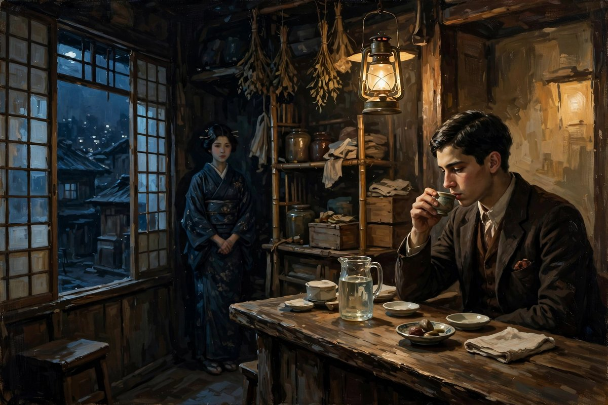
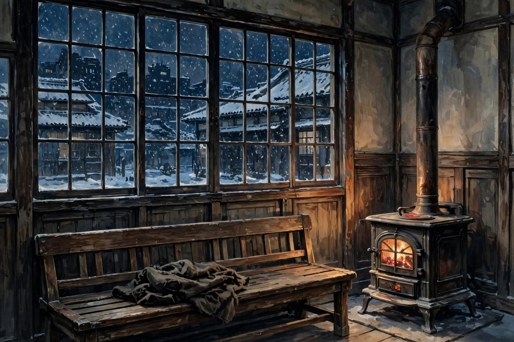

## 银灰色的月光

银灰色的死，收在沉沦集子里，和沉沦、南迁一起，是郁达夫早期写留日学生的三篇小说之一，写的是一个留日学生，和一个酒馆侍者之间的感情纠葛，写的是这个学生，最后因为脑溢血，死在室外的故事。小说的题目，叫银灰色的死，银灰色是什么颜色，是月光的颜色，是冬夜里的月光，照在雪地上，照在街道上，照在人的脸上，照出来的那种灰中带银，银中带灰，冷中带亮，亮中带冷的颜色。死，为什么是银灰色的，死本来应该是黑色的，应该是红色的，应该是惨白色的，可是郁达夫说，死是银灰色的，是月光底下的死，是安静的死，是美丽的死，是带着一点诗意的死，是一个人在银灰色的月光里，慢慢走完最后一段路的死。这种死法，放在今天看，可能有点浪漫化，有点美化死亡，可是放在小说的逻辑里，却是合适的：因为这个学生的死，不是惨烈的死，不是被人杀死的死，不是自杀的死，是病死的死，是脑溢血发作，倒在室外，死在月光底下的死，是安静的，是孤独的，是银灰色的。

小说的主人公，是一个留日学生，姓什么，郁达夫没有明说，只用一个代号来称呼他，代号不重要，重要的是他的处境：他是一个穷学生，钱不够花，身体不好，精神也不好，住在朋友家里，住的楼上，没有火盆，没有生气，只有几本旧书，横摊在黄灰色的电灯光里等他。他原先是有妻子的，妻子去世了，留给他一个金刚石的戒指，戒指是妻子最后的纪念物，他因为缺钱，把戒指当入了当铺，当了一百六十元钱，用不上半个月，如今也只有五元钱存在了。钱花完了，妻子也不在了，朋友也不在了，家也不像家了，他一个人，在东京的街上走，在酒馆里喝酒，在月光底下想过去的事，想妻子，想酒馆里的侍者，想自己这一生的失败，想自己这一生的孤独，想着想着，眼泪就流下来了，流下来之后，也没有人给他擦，只能自己用袖子擦一擦，擦完之后，继续走，继续想，继续在银灰色的月光里，走完最后的路。

## 酒馆里的侍者

酒馆里的侍者，是一个二十岁前后的女子，苍白的脸色，一双迷人的大眼，小小的嘴唇的曲线，灰白的嘴唇，坐在洋灯底下，坐在朝溪的小窗旁边，坐在学生对面，学生看着她，心里就起了波澜，起了欲望，起了感情，起了想和她在一起的念头，起了想被她爱，想爱她的念头。可是侍者对学生，并不是爱情，侍者对学生，更多的是一种同情，一种怜悯，一种看到一个可怜的男人，愿意给他一点温暖，愿意和他说几句话，愿意让他觉得，自己还不是一个人，还不是被全世界抛弃的人。这种同情和爱情之间的界限，在小说里写得非常模糊，模糊到学生自己也分不清楚，侍者对他，到底是爱，还是同情，到底是真心，还是职业性的微笑，到底是愿意和他过日子，还是只是在酒馆里，给他一点安慰，给他一点酒，给他一点笑，给他一点让他在深夜里，不至于冻死的东西。

学生和侍者之间的感情纠葛，写得非常细，细到学生每一次去酒馆，心里想什么，每一次看到侍者，心里翻起什么，每一次和侍者说话，侍者回他一句什么，他回去之后，又想什么，想多久，想到失眠，想到天亮，想到隔日再去酒馆，再看侍者，再想一遍。这种循环，像一个转不出来的圈子，圈子越转越小，小到最后，学生的身体也垮了，精神也垮了，钱也花完了，戒指也当掉了，妻子留下的最后一点纪念，也没有了，人也只剩下一个空壳子，一个在月光底下走路的空壳子，一个在酒馆里喝酒的空壳子，一个在朋友家里住楼上的空壳子。这种空壳子，放在今天，同样是很多人会变成的样子：失去了爱的人，失去了钱，失去了工作，失去了健康，失去了希望，只剩下一个空壳子，在城市里走，在深夜里喝酒，在月光底下想过去的事，想着想着，眼泪就流下来了，流下来之后，也没有人擦，只能自己擦一擦，擦完之后，继续走。

## 死亡的预告和结局

小说的结局，写得非常冷静，冷静到让人觉得，死亡并不是一件突然的事，而是一件早有预告的事，是一件一步一步走来的事，是一件在银灰色的月光里，慢慢走完的事。十二月二十六日的早晨，太阳依旧由东方升了起来，太阳的光线，射到牛込区役所前的揭示场的时候，有一个区役所的老仆，拿了一张告示，正在贴上揭示场的板去。那一张告示说，病为脑溢血，本月二十六日午前九时，在牛込若松町女子医学专门学校前之空地上发见，距死时约可四小时，因不知死者姓名住址，故为代付火葬。这张告示，就是学生的死亡证明，就是他在这个世界上，留下的最后一点痕迹，一张告示，几行字，一个不知道姓名住址的人，一个被代付火葬的人，一个在银灰色的月光里，死去的人。告示贴出来之后，太阳还是升起来了，世界还是照常运转了，酒馆还是开门了，侍者还是上班了，朋友还是过日子了，只有学生一个人，永远地留在了那个冬夜里，留在了银灰色的月光里，留在了区役所的告示上。

这种结局，放在今天看，同样让人觉得心酸：一个人在城市里死去，死了之后，居然没有人知道他的姓名住址，居然要靠一张告示来告诉世界，这里死了一个人，这里曾经活过一个人，这里曾经有一个留学生，有一个丈夫，有一个酒馆的常客，有一个在月光底下想妻子，想侍者，想过去的人。可是世界并不知道，世界只知道，十二月二十六日的早晨，太阳升起来了，告示贴出来了，火葬办完了，日子还要过下去。这种冷漠，比死亡本身更让人难受，因为死亡是身体的结束，冷漠是存在的结束，是一个人活过，却像没有活过一样，是一个人死去，却像没有死去一样，是一个人留下的痕迹，只剩下一张告示，只剩下几行字，只剩下银灰色的月光。郁达夫写这个结局，就是在说，穷人的死，往往就是这样，无声无息，无人知晓，无人惋惜，无人记得，只有月光记得，只有银灰色的月光，照在他的尸体上，照在空地上，照在那个冬夜里，照了很久，很久。

## 病和死的主题

银灰色的死，和沉沦、南迁一起，主题都是病和死，都是留学生的病和死，都是青年人的病和死，都是时代病在个人身上的发作。沉沦里的主人公，得了忧郁症，最后蹈海自杀，南迁里的主人公，身体衰弱，到安房半岛疗养，却发烧得了肺炎，银灰色的死里的主人公，死于脑溢血，死在室外，死在月光底下。三篇小说，三种死法，三种病，可是病的根子，是一样的：都是孤独，都是穷，都是欲望和羞耻，都是弱国子民的自卑，都是前途不明的焦虑，都是在异乡找不到出路的绝望。病，是身体上的病，也是心里的病，也是时代的病，身体上的病，可以用药治，心里的病，可以用感情治，时代的病，却没有药可以治，只能靠时代变，靠国家变强，靠社会变好，靠后来的人，不再重复前人的路。郁达夫写病和死，不是为了让读者觉得绝望，是为了让读者看到，病和死的背后，是社会，是时代，是结构，是压迫，是让一个青年，在异乡活不下去的原因。

这种病和死的主题，放在今天，同样没有过时。今天的年轻人，同样会生病，同样会得忧郁症，同样会焦虑，同样会失眠，同样会因为穷，因为孤独，因为感情，因为前途不明，而生病，而想死，而觉得活着没有意思。区别只在于，今天的病，有药可以治，有医生可以看，有心理咨询可以去，有朋友可以倾诉，有社交平台可以发泄，有各种各样的出路，有各种各样的帮助，可是在郁达夫的年代，这些都没有，一个人生了病，只能自己扛，扛不住，就死了，死了之后，也没有人知道，没有人记得，没有人惋惜。今天的人读银灰色的死，应该珍惜今天的出路，珍惜今天的帮助，珍惜今天的朋友，珍惜今天的医生，珍惜今天的每一个可以拉自己一把的人，不要像小说里的学生一样，把自己关起来，关到最后，关出病来，关到死在月光底下，关到只剩下一张告示。

## 月光为什么是银灰色的

银灰色这个词，值得多说几句。银，是贵金属的颜色，是月光的颜色，是冬天雪地的颜色，是高贵而冷的颜色，灰，是尘土的颜色，是破屋子的颜色，是旧书的颜色，是穷学生的颜色，是生活本身的颜色。银和灰合在一起，就是银灰色，就是高贵和穷，合在一起的颜色，就是月光和尘土，合在一起的颜色，就是理想和现实，合在一起的颜色，就是学生心里那个美好的世界，和他实际上过的穷日子，合在一起的颜色。学生的死，是银灰色的，因为他的死，既有月光的美，又有尘土的灰，既有诗意，又有穷酸，既让人觉得美，又让人觉得惨，既让人觉得，这个人的死，值得被记住，又让人觉得，这个人的死，其实没有人记得。这种矛盾，就是银灰色的本质，就是郁达夫写这篇小说的本质：美和惨，合在一起，诗意和穷酸，合在一起，理想和现实，合在一起，月光和尘土，合在一起，最后合出来的，就是一个人的死，就是银灰色的死。

今天的人，读银灰色的死，读到月光的时候，会觉得美，读到告示的时候，会觉得惨，读到侍者的时候，会觉得温柔，读到戒指当掉的时候，会觉得心酸，读到学生死在室外的时候，会觉得冷，美和惨，温柔和心酸，冷和暖，在这篇小说里，是搅在一起的，分不开的，这就是生活的本质：生活从来都不是纯美的，也从来都不是纯惨的，生活是美和惨搅在一起的，是月光和尘土搅在一起的，是银和灰搅在一起的。郁达夫写银灰色的死，就是在写这种搅在一起的生活，就是在告诉读者，不要只看到生活美的一面，也不要只看到生活惨的一面，要把两面合在一起看，才能看到一个完整的生活，才能看到一个完整的人，才能看到一个完整的小说。这，才是银灰色的死，留给今天读者的东西。

## 戒指和妻子的记忆

小说里的戒指，是一个非常动人的细节，是妻子留下的最后的纪念物，是一个金刚石的戒指，是学生和妻子之间，爱情的证明，是学生过去幸福日子的证明，是学生心里，最柔软的地方。可是学生因为缺钱，把戒指当入了当铺，当了一百六十元钱，用不上半个月，如今也只有五元钱存在了。戒指当掉之后，学生心里，就只剩下记忆了，只剩下妻子坐在洋灯底下，坐在朝溪的小窗旁边，坐在漆桌旁边的样子，只剩下妻子苍白的脸色，大眼，小嘴唇，灰白的嘴唇，只剩下妻子最后的话，只剩下妻子去世之后，留下的空屋子，留下的空床，留下的空日子。戒指当掉，意味着学生连最后一点纪念，都没有了，连最后一点和妻子之间的联系，都断了，连最后一点过去的幸福，都换成了钱，换成了酒，换成了在酒馆里的日子，换成了在月光底下的日子，换成了最后的死亡。这种当掉戒指的行为，放在今天看，可能会被很多人骂，骂学生不珍惜，骂学生不爱妻子，骂学生为了钱，出卖了爱情，可是郁达夫写这个细节，不是为了骂学生，是为了让读者明白，穷到一定地步的人，连爱情的纪念物，都要当掉，连最后一点体面，都要换成钱，换成饭，换成酒，换成活下去的希望，这种穷，才是真正的穷，这种穷到连戒指都要当掉的日子，才是学生最后日子的真实样子。

今天的人，同样会遇到当掉戒指的时候：为了还房贷，当掉首饰，为了治病，卖掉房子，为了生活，卖掉自己喜欢的东西，卖掉自己珍藏的东西，卖掉自己和爱人之间的纪念物，卖完之后，心里空空的，觉得自己连最后一点过去，都没有了，觉得自己活得像一个空壳子，觉得自己在月光底下走路的时候，心里只有冷，只有灰，只有银灰色的月光。可是郁达夫写戒指，就是在说，戒指当掉了，记忆还在，妻子去世了，爱还在，钱花完了，人还在，只要人还活着，记忆就还在，爱就还在，希望就还在，戒指可以当掉，记忆当不掉，爱情可以变成钱，可是爱情本身，是换不掉的，是当不掉的，是死不掉的，是会在银灰色的月光里，一直亮着的。

## 朋友家里的楼上

小说里的学生，住在朋友家里，住的楼上，没有火盆，没有生气，只有几本旧书，横摊在黄灰色的电灯光里等他。这个楼上，写得非常冷，冷到让读者觉得，学生住的地方，根本不像一个家，像一个临时落脚的地方，像一个随时可以离开的地方，像一个没有人等他回去的地方。他晚上不愿意回到那个同地狱似的家里去，不愿意回到那个没有火盆，没有生气，只有旧书的楼上去，他宁可走到上野的火车站去，宁可到火车站的待车室里去烤火，宁可到一个公共的地方去，取一点暖，取一点人气，取一点不让自己冻死的东西。这种不愿意回家，在今天同样是很多人的状态：很多人晚上不愿意回家，不愿意回到那个冷清的屋子里，不愿意回到那个没有人说话的屋子里，宁可到外面去，到便利店去，到网吧去，到火车站去，到任何一个有灯，有人，有暖气的地方去，待一会儿，待到深夜，待到困了，待到不得不回去的时候，才回去。这种不愿意回家，不是恨家，是家已经不像家了，是家里没有人等了，是家里没有火了，是家里只有旧书，只有黄灰色的灯光，只有冷，只有孤独，只有银灰色的月光，从窗户里照进来，照在旧书上，照在空床上，照在学生的心里。

## 东京的冬夜

小说里的东京冬夜，写得非常冷，冷到学生不愿意回到朋友家里的楼上去，冷到学生宁可到火车站的待车室里去烤火，冷到学生的酒已经醒了，觉得冷起来了，冷到学生站在大学的铁栏杆旁边，对着月光，追想过去的情节，追想到最后，眼泪连连续续地流下来，流下来之后，也没有人擦，只能自己擦一擦，擦完之后，继续走，继续想，继续在银灰色的月光里，走完最后的路。冬夜的冷，不只是天气的冷，更是人心的冷，是孤独的冷，是穷的冷，是失去妻子的冷，是失去朋友的冷，是失去钱的冷，是失去希望的冷，是一个人在异乡，在冬夜里，在月光底下，觉得自己被全世界抛弃了的冷。这种冷，放在今天，同样是很多人在冬夜里，会感到的冷：一个人在异乡，在冬夜里，在加班之后，走在回家的路上，觉得冷，觉得孤独，觉得没有人等自己回家，觉得家里没有火，没有人，没有灯，只有旧书，只有黄灰色的灯光，只有银灰色的月光，从窗户里照进来，照在空床上，照在自己的心里。郁达夫写东京的冬夜，就是在写这种冷，写这种异乡人的冷，写这种穷人的冷，写这种失去爱的人的冷，写这种在冬夜里，走完最后一段路的冷，写这种冷到最后，变成银灰色的死，变成一张告示，变成太阳升起来之后，世界照常运转，酒馆照常开门，侍者照常上班，朋友照常过日子，只有学生一个人，永远地留在了冬夜里，留在了月光里，留在了银灰色的死里。

## 侍者的微笑

侍者的微笑，是小说里最温柔的东西，温柔到学生每次去酒馆，都是为了看到这个微笑，都是为了听到侍者说一句话，都是为了让自己觉得，自己还不是一个人，还不是被全世界抛弃的人，还不是一个在冬夜里，只能到火车站去烤火的人。侍者的微笑，是职业性的微笑，还是真心的微笑，学生分不清楚，读者也分不清楚，可是分不清楚，并不重要，重要的是，微笑本身，就是温暖，就是在冷夜里，给学生一点暖，给学生一点光，给学生一点活下去的理由。侍者可能并不知道，自己的一个微笑，对学生来说，意味着什么，可能并不知道，学生回去之后，会想这个微笑，想很久，想很久，想得失眠，想得天亮，想得隔日再去酒馆，再看一次微笑，再想一遍。可是侍者还是笑了，笑得很温柔，笑得很迷人，笑得让学生觉得，这个世界，虽然冷，虽然穷，虽然孤独，可是还是有笑的，还是有温柔的，还是有值得活下去的东西的。这种微笑，放在今天，同样是很多人需要的：今天的人，在城市里，在职场里，在生活里，常常会觉得冷，觉得孤独，觉得没有人对自己笑，觉得没有人给自己一点暖，可是只要还有一个人，对你笑一笑，说一句话，给你一点暖，你就会觉得，日子还是可以过下去的，还是值得过下去的，还是有光的。郁达夫写侍者的微笑，就是在说，微笑很小，可是微笑的意义很大，大到可以让一个快要死的人，多活几天，大到可以让一个在冬夜里走路的人，觉得不那么冷，大到可以让一篇写死亡的小说，里面还有一点温柔，还有一点人性的光，还有一点银灰色的月光里，透出来的一点暖。

## 告示上的名字

区役所的告示上，没有写死者的姓名住址，只写了病为脑溢血，写了发现的时间，写了发现的地点，写了代付火葬，写了一个不知道是谁的人，写了一个在银灰色的月光里，死去的人。没有名字，是因为学生太穷了，穷到没有人知道他是谁，穷到没有人记得他是谁，穷到死了之后，也没有人来认领，穷到只能靠一张告示，来告诉世界，这里死了一个人。没有名字，放在今天，同样是很多穷人的命运：很多人在城市里死去，死了之后，没有人知道他们的名字，没有人记得他们的故事，没有人来认领他们的遗体，没有人来为他们写一篇悼念，没有人来为他们烧一辆纸车，没有人来为他们叫骂一声，他们的名字，只剩下一张告示，只剩下几行字，只剩下银灰色的月光。郁达夫写这张告示，就是在问这个社会，为什么一个活生生的人，死了之后，会没有名字，为什么一个留学生，一个丈夫，一个酒馆的常客，一个在月光底下想妻子，想侍者，想过去的人，死了之后，会变成一个没有名字的人，为什么社会对穷人，连一个名字都不愿意给，连一点记忆都不愿意留。这个问题，放在今天，同样值得问：今天的社会，对穷人，对外卖员，对快递员，对农民工，对那些在城市里，默默干活，默默生活，默默死去的人，是不是也只给了一张告示，只给了几行字，只给了一个没有名字的死亡。郁达夫写告示，就是在为没有名字的人，写一个名字，就是在告诉读者，这个学生，虽然告示上没有名字，可是小说里有名字，小说里有他的故事，小说里有他的妻子，小说里有他的侍者，小说里有他的月光，小说里有他的银灰色的死，读到这篇小说的人，就会记得他，就会记得，一个在东京冬夜里，死去的留学生，曾经活过，曾经爱过，曾经想过，曾经在银灰色的月光里，走完最后一段路。

## 月光下的空地

牛込若松町女子医学专门学校前的空地，是学生最后倒下的地方，是一个很普通的地方，普通到白天的时候，有很多人走过，有很多学生上学，有很多医生上班，有很多路人匆匆忙忙，可是到了冬夜里，到了月光底下，到了学生倒下的时候，空地就变得不普通了，变得安静了，变得冷了，变得银灰色了，变得像一个舞台，舞台上，只有一个人，一个倒下的人，一个死去的人，一个在月光底下，永远地睡着了的人。空地上的月光，照在学生的脸上，照在他的衣服上，照在他的手上，照在他口袋里，只剩下五元钱的皮包上，照在他当掉戒指之后，空空的手指上，照在他这一生的失败上，照在他这一生的孤独上，照在他这一生的爱上，照在他这一生的死上。月光照完之后，太阳升起来了，告示贴出来了，火葬办完了，空地又恢复了普通，又有人走过，又有学生上学，又有医生上班，又有路人匆匆忙忙，可是空地上的月光，还在，空地上的故事，还在，空地上的学生，还在小说里，还在读者的心里，还在银灰色的死里，还在后来人读到这篇小说的时候，心里翻起的那股冷，和那股暖里。

## 银灰色的冬天

小说里的冬天，是银灰色的冬天，是东京的冬天，是雪地的冬天，是月光的冬天，是学生最后日子的冬天，是一个人在冬夜里，走完最后一段路的冬天。冬天的冷，不只是天气的冷，更是人心的冷，是孤独的冷，是穷的冷，是失去妻子的冷，是失去朋友的冷，是失去钱的冷，是失去希望的冷，是一个人在异乡，在冬夜里，在月光底下，觉得自己被全世界抛弃了的冷。可是冬天的银灰色里，还有一点亮，亮在月光里，亮在侍者的微笑里，亮在妻子的记忆里，亮在学生的眼泪里，亮在郁达夫写这篇小说的用心里。亮很小，小到只是一点月光，只是一个微笑，只是一段记忆，只是一滴眼泪，可是小亮在冬天里，显得特别亮，亮到让读者觉得，冬天再冷，月光还在，冬天再长，春天还会来，冬天再难，人还是可以活下去的，还是可以爱下去的，还是可以被记住的。银灰色的冬天，就是这样一个冬天，冷，可是亮，灰，可是银，惨，可是美，死，可是还有一点生，还有一点爱，还有一点记忆，还有一点希望，还有一篇小说，还有一个后来人，读到银灰色的死的时候，心里翻起的那股冷，和那股暖。

## 结尾的话

银灰色的死，是一篇让人读得心里发冷的小说，读完之后，会觉得，东京的冬夜很冷，月光很冷，学生的心很冷，告示很冷，世界很冷。可是冷完之后，会觉得，心里还有一点暖，暖在侍者的一句话里，暖在妻子戒指的记忆里，暖在学生对月光的凝视里，暖在郁达夫写这篇小说的用心里。郁达夫写这篇小说，不是为了让读者觉得冷，是为了让读者在冷里，看到一点暖，看到一点人性的光，看到一点穷学生心里，还没有灭掉的火，看到一点在银灰色的月光里，还在走路的人，看到一点在死亡面前，还在想爱，还在想被爱，还在想活下去的人。这点暖，很小，小到只是一句话，只是一个眼神，只是一张戒指的记忆，可是小暖在冷夜里，显得特别亮，亮到让读者觉得，死并不可怕，可怕的是，活着的时候，没有人爱，没有人记得，没有人给一点暖。银灰色的死，留给读者的，就是这个提醒：趁还活着，多给身边的人一点暖，多给自己一点暖，不要等到死在月光底下，才想起，自己曾经渴望过一点暖，曾经爱过一个人，曾经被一个人爱过。

## 再说一句

银灰色的死写完之后，学生已经死了，死在东京的冬夜里，死在银灰色的月光里，死在区役所的告示上，死在太阳升起来之后，世界照常运转的日子里，可是他的故事，还在，还在小说里，还在月光里，还在侍者的微笑里，还在妻子的戒指里，还在朋友家里的楼上，还在火车站的待车室里，还在后来人，读到银灰色的死的时候，心里翻起的那股冷，和那股暖里。冷在他的死太安静了，太无人知晓了，太没有名字了，暖在月光还照着他，暖在侍者还对他笑过，暖在妻子还爱过他，暖在郁达夫还写过他，暖在后来人，还记得他，这，就够了，这就是银灰色的死，留给后来人的东西。

## 尾声

银灰色的月光，还在东京的冬夜里，还在雪地上，还在街道上，还在学生的脸上，还在侍者的微笑里，还在妻子的记忆里，还在区役所的告示上，还在太阳升起来之后，世界照常运转的日子里。月光在，故事就在，故事在，人就在，人在，记忆就在，记忆在，希望就在，希望是，后来的人，读到银灰色的死的时候，不要只看到冷，不要只看到死，要看到月光里的暖，看到侍者微笑里的暖，看到妻子记忆里的暖，看到一篇小说里，还没有灭掉的火，这就够了。

## 再补一句

银灰色的月光，还在冬夜里照，还在雪地上照，还在街道上照，还在学生的脸上照，还在侍者的微笑里照，还在妻子的记忆里照，还在区役所的告示上照，还在太阳升起来之后，世界照常运转的日子里照。月光照着，故事就还在，故事在，人就在，人在，记忆就在，记忆在，希望就在，希望是，后来的人，读到银灰色的死的时候，看到的不只是冷，还有暖，还有光，还有一篇小说里，没有灭掉的火。

银灰色的月光还在冬夜里照，还在雪地上照，还在街道上照，还在学生的脸上照，还在侍者的微笑里照，还在妻子的记忆里照，还在区役所的告示上照，月光照着，故事就还在，故事在，人就在，人在，记忆就在，记忆在，希望就在，希望是，后来的人看到的不只是冷，还有暖，还有光。

月光的好处，是它不吵不闹，只管照着。照着冬夜，照着雪地，照着街道，照着学生的脸，照着侍者的笑，照着妻子的记忆。照着照着，冷的地方就有了暖，暗的地方就有了光。光不灭，故事就不灭，故事不灭，人心里那点火就不灭。
