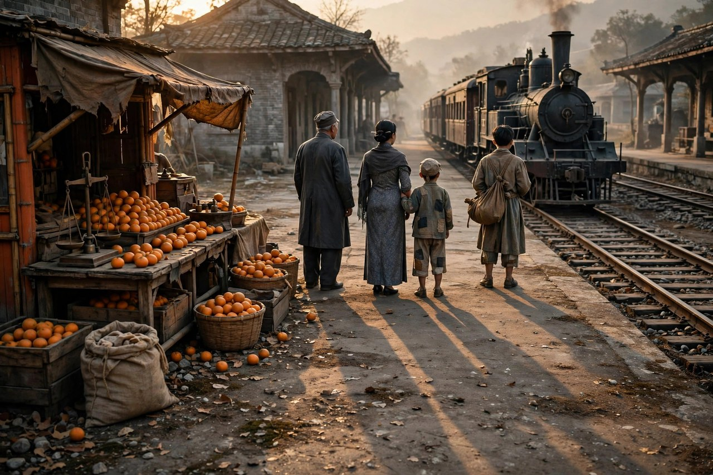
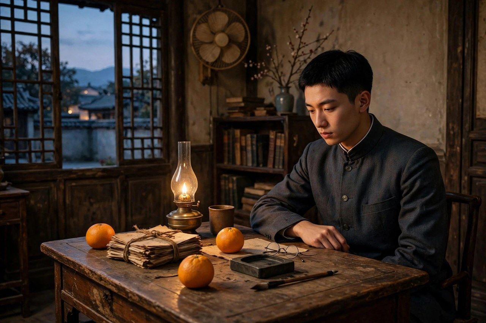

## 冬天里的一场丧事

背影的故事，起点不是车站，而是一场丧事。一九一七年冬天，朱自清的祖母在扬州去世，朱自清从北京赶回徐州，再跟着父亲回家奔丧。那时候父亲任徐州烟酒公卖局长的差事也交卸了，家里一双空手，办丧事的钱是借来的。丧事这种事，最能看出一个家庭的底子，有钱的人家办得体面，没钱的人家办得狼狈，可是再狼狈，丧事也得办，亲人走了，活着的人要把最后一段路送好。朱自清在文章里写祖母去世，写父亲赋闲，写家境惨淡，笔触很克制，没有哭天抢地，就是把事实摆出来，读者自己就能感到那种压得人喘不过气的难。

丧事办完，父亲要到南京去谋事，朱自清要回北京去上学，父子两个人同行，在浦口车站分开。这条路，在今天看来就是一次普通的送别，在当年却是一次不知道前途的分别。父亲丢了差事，到南京去找活路，能不能找到，谁也不知道。儿子回北京上学，学费、生活费从哪里来，谁也不知道。两个人心里都装着难处，嘴上却都不肯多说。中国家庭很多时候就是这样，难处越大，话越少，越是亲近的人，越是把关心藏在行动里，不肯说出口。

朱自清写这篇文章，是在一九二五年十月，距离浦口送别已经过去了八年。八年时间，足够让一个年轻人长大，也足够让很多记忆模糊，可是车站上的那个背影没有模糊，反而越来越清楚。为什么偏偏是这个背影记得最清楚，因为那是父亲在儿子面前最吃力、最不体面、也最动人的一刻。平时父亲在家里是严肃的，是管事的，是说了算的，可在月台上，父亲变成了一个笨拙的、肥胖的、爬起来很吃力的老人。这种反差，让儿子一下子看到了父亲的老，看到了父亲的难，看到了父亲藏在严肃后面的爱。

今天的人读背影，常常只记得买橘子那一段，其实前面的丧事和家境，才是理解这篇文章的钥匙。没有丧事的压抑，没有赋闲的窘迫，买橘子就只是一个小动作，有了前面的铺垫，买橘子就成了一个父亲在困境里还想为儿子做点事的证明。生活里的爱，往往就是这样，越是在难处里，越能看清楚。顺境里的好，人人都会，难处里的好，才见真心。

## 浦口车站的月台

浦口车站那天的情景，朱自清写得极其具体。他和父亲在车站里，父亲嘱咐他路上小心，夜里警醒些，不要受凉，又嘱托茶房好好照应他。儿子心里暗笑父亲的迂，觉得这些话多余，觉得自己已经长大了，不需要这样嘱咐。可是父亲还是不放心，踌躇了一会儿，决定还是自己去买几个橘子。橘子这种东西，在今天看来不值钱，在当年却是一份心意，路上渴了可以吃，饿了可以垫一垫，更重要的是，父亲想让儿子在路上感受到，家里有人惦记着他。

月台和铁道之间的那段路，是文章里最动人的地方。父亲穿着黑布大马褂，深青布棉袍，戴着黑布小帽，肥胖的身子向左微倾，显出努力的样子。他蹒跚地走到铁道边，慢慢探身下去，爬上月台，又爬下月台，动作笨拙，费力，可是每一步都很实在。朱自清写到这里，眼睛里已经有泪了，他赶紧拭干，怕父亲看见，也怕别人看见。这种拭泪的动作，比直接写哭更动人，因为它写出了一个年轻人的倔强，不肯在父亲面前示弱，又写出了他心里已经被打动了。

车站这个地方，在中国文学里常常是离别的地方。送人上火车，送人去远方，送人去谋生，送人去上学，车站上的每一次挥手，背后都是一段人生。今天的车站变了，高铁站宽敞明亮，检票口有闸机，送别的人只能送到安检口，不能送到月台上。可送别的心情没有变，父母送孩子去外地读书，站在安检口外，看着孩子拖着行李箱走进去，背影越来越小，直到看不见，那种感觉，和朱自清当年在浦口是一样的。时代换了交通工具，没有换离别。

朱自清写月台，没有写车站有多大，没有写火车有多气派，他只写父亲的背影。背影这个意象选得极好，正面是表情，是话语，是可以伪装的，背影是真实的，是一个人转过身去之后的样子，是不设防的样子。父亲转过身去买橘子，儿子看到的，是一个老人的背，是一个父亲的难，是一个家庭在困境里的全部温情。读到这里，很多人会想起自己父母的背影，想起他们在厨房里的背影，在田野里的背影，在医院走廊里的背影。背影之所以动人，是因为它不说话，却什么都说了。

## 橘子与皮大衣

父亲买回来的橘子，朱自清写得很细。父亲把橘子放在皮大衣上，弯下身子，把橘子一个一个放在儿子的大衣里。橘子是红的，大衣是黑的，颜色对比鲜明，画面一下子就出来了。父亲做完这件事，脸上现出轻松的样子，好像心里的一块石头落了地。儿子看着父亲，心里有千言万语，却说不出来，只能看着父亲的背影混入来来往往的人里，再找不着了。

橘子在这里，不只是一种水果，它是一种父亲能做的事情的象征。父亲丢了差事，手里没有多少钱，能为儿子做的事已经不多了，买几个橘子，是他还能做到的事。他把这件事做得很认真，像完成一件大事一样认真。这种认真，来自一个父亲的自尊，他不想让儿子觉得父亲已经没有用了，他想让儿子知道，父亲还在，还能照顾他。今天的父母也是这样，孩子长大了，挣钱了，父母能做的事越来越少，可他们还是想做点事，做一顿饭，寄一点家乡的特产，打一个电话问问冷暖。这些小事，在孩子看来可能有点多余，在父母看来，却是他们还被需要的证明。

皮大衣这个细节，也很有味道。儿子穿着皮大衣，父亲把橘子放在大衣上，橘子的红和大衣的黑，衬出一种生活的质感。朱自清写文章，从来不空写感情，他总是用一件具体的东西来承载感情。橘子承载的是父爱，大衣承载的是儿子已经长大的身份，月台承载的是离别的距离。这些东西合起来，感情就有了落脚点，不会飘在空中。今天很多写亲情的文章，写得空洞，就是因为没有找到自己的橘子，没有找到一件具体的东西来装感情。感情需要容器，没有容器的感情，流出来就散了。

父亲走后，朱自清在车上，看着窗外，想着父亲，心里五味杂陈。他后来在文章里说，近几年来，父亲和他都是东奔西走，家中光景是一日不如一日，父亲的背影，成了他心里最深的牵挂。这种牵挂，不是天天挂在嘴上的，是夜里想起来会难受的，是看到车站会想起来的，是吃到橘子会想起来的。亲情的牵挂，往往就是这样，平时不觉得，到了某个情景里，一下子就涌上来了。

## 父子之间的墙

背影之所以能流传百年，还有一个原因，就是它写出了父子之间真实的墙。朱自清和父亲的关系，并不是一直和和睦睦的。年轻的时候，他对父亲的一些做法有意见，父亲对他的一些选择也不满意，两个人有过争执，有过冷战，有过长时间不说话。文章里写儿子暗笑父亲的迂，就是这种关系的真实写照。儿子觉得自己长大了，懂事了，父亲的话是多余的，是迂腐的。这种心理，很多年轻人都有过，觉得父母唠叨，觉得父母不懂自己，觉得父母的关心是负担。

可是时间过去，儿子长大了，自己也当了父亲，自己也开始为孩子操心，才慢慢明白，父亲当年的迂，其实是爱。爱有时候就是迂的，就是啰嗦的，就是不合时宜的，因为爱的人总是怕你出事，怕你受凉，怕你饿着，怕你被人欺负。这种怕，在年轻人看来是多余，在过来人看来是正常。朱自清写背影的时候，已经过了那个觉得父亲迂的年纪，他回头看，才看清了父亲的好。这种回头看，是需要时间的，也是需要经历的。

父子之间的墙，很多时候不是仇恨砌成的，是误解砌成的。一句话没说开，一个动作没理解，一次争执没和解，墙就一点一点高起来。朱自清化解这堵墙的办法，不是吵架，不是讲道理，而是写文章。他把当年的情景原原本本地写下来，让父亲看到，让读者看到，让时间去作证。父亲读到这篇文章，掉了眼泪，父子之间的隔阂，就在眼泪里化掉了。这种化解，比任何大道理都管用，因为它不是说服，是共情。

今天的家庭里，父子、母女之间的墙依然存在。孩子觉得父母管得太多，父母觉得孩子不理解自己，双方都不肯先低头。背影给我们的启示是，低头不丢人，记住对方的好不丢人，把一件小事写下来、说出来，更不丢人。墙是人砌的，也能由人拆掉，拆墙的工具，有时候就是一个背影，就是几个橘子，就是一封信，就是一次回家的探望。等到父母老了，走不动了，墙还在，那就真的晚了。

## 信里的一滴眼泪

背影发表之后，朱自清的父亲读到了这篇文章。据后人回忆，父亲读完，掉了眼泪，还把文章拿给家里人看。这个细节，很值得细想。一个严肃的父亲，平时不轻易掉泪，读到儿子写的文章却掉了泪，说明文章写到了他心里去。他看到的不是文字，是儿子记得他，儿子理解他，儿子心里一直装着他。这种被记得、被理解的感觉，对一个父亲来说，比什么都重要。

朱自清后来又收到父亲的信，信里说，儿子已经长大了，父亲老了，身体也不如从前，希望儿子在外好好照顾自己。信的语气平和，没有责备，没有抱怨，只有牵挂。这种牵挂，和车站上的嘱咐是一脉相承的。父亲一辈子没有变过，变的是儿子看父亲的眼光。年轻时看父亲，看到的是严厉和迂腐，年长后看父亲，看到的是爱和不容易。眼光变了，文章也就变了，背影就是这种眼光变化的产物。

今天的人，读背影常常会哭，哭的不是文章本身，是文章勾起的自己的记忆。有人想起父亲送自己上大学的情景，有人想起父亲在医院门口等自己的情景，有人想起父亲去世之后，再也看不到背影的情景。文章的力量，就在于它能勾起读者自己的故事，让读者把自己的父亲放进文章里，读着读着，就读成了自己的事。这种力量，是任何技巧都替代不了的，它来自真实，来自具体，来自作者没有撒谎。

背影的结尾，朱自清说，他在晶莹的泪光中，又看见那肥胖的、青布棉袍黑布马褂的背影。这句话，把整篇文章收住了。泪光中的背影，不是清晰的，是模糊的，是被泪水晕开的，可是越模糊，越动人。因为记忆就是这样，时间越久，细节越模糊，感情却越清楚。父亲的脸可能记不清了，父亲说的话可能记不清了，可是父亲的背影，永远记得。这就是亲情在记忆里的样子，不靠脸，不靠话，靠一个转身，靠一次爬月台，靠几个橘子。

## 车站之外的中国家庭

背影写于一九二五年十月，发表在文学周报上，署名佩弦。一九二八年，开明书店出版了同名散文集，背影成了书名，也成了朱自清的代表作。此后几十年，这篇文章进了中学课本，成了几代中国人共同的语文记忆。很多中国人没有读过朱自清别的文章，可是都读过背影，都背过买橘子那一段。这种普及程度，在现代文学里是很少见的。它说明，背影写的不只是一个家庭的故事，它写的是中国家庭的共同故事。

中国家庭的亲情表达，往往是含蓄的，不直说的。父母对孩子的爱，常常藏在饭里，藏在衣服里，藏在路上的一句嘱咐里，藏在车站上的几个橘子里。孩子对父母的爱，也常常藏在心里，不肯说出口，等到父母老了，才后悔没有多说几句。背影把这种含蓄写出来了，写得明明白白，让读者看到，原来含蓄不是冷漠，含蓄背后是深情。这种深情，需要读者自己去体会，去对照自己的家庭，去想想自己的父母是不是也是这样。

今天的中国家庭，形式变了很多，独生子女多了，留守儿童多了，空巢老人多了，家庭成员天各一方，见面越来越少。可是亲情的本质没有变，父母还是会在孩子出门的时候嘱咐几句，孩子还是会在夜里想起父母的背影。背影在今天依然有读者，就是因为它写的是本质，不是形式。形式会变，本质不会变，只要中国家庭还存在，背影就不会过时。

读背影，还要读出一种对普通人的尊重。文章里的父亲不是英雄，不是伟人，就是一个丢了差事的中年人，一个在车站上为儿子买橘子的普通父亲。朱自清没有把他写成高大的人物，他就是把他写成一个普通人，一个会累、会老、会笨拙的人。正是这种普通，让文章有了力量。伟人的故事离我们远，普通人的故事离我们近，近到我们可以在自己家里找到同样的父亲，同样的背影，同样的橘子。文学的力量，有时候就来自这种近，近到读者觉得，写的就是我家。

## 今天车站上的背影

今天的车站，和浦口车站已经完全不一样了。高铁站里人流如织，电子屏上滚动着车次，检票口有工作人员维持秩序，送别的人只能送到安检口。可是送别的场景，依然每天都在上演。开学季，父母送孩子去外地读书，帮孩子提行李，嘱咐孩子到了学校要好好吃饭，要注意身体，要常打电话。孩子嘴上说知道了，知道了，心里却觉得父母啰嗦。等到孩子走进检票口，回头看一眼，父母还站在原地看着他，那一刻，很多孩子会突然明白，父母的啰嗦就是爱。

春节过后，返程的人流里，也有无数个背影。父母送孩子回城，在村口站很久，看着车开远了还不肯走。孩子在车上，看着后视镜里父母的身影越来越小，心里一阵发酸。这种酸，和朱自清当年的酸是一样的。交通工具变了，路变宽了，车变快了，可是离别的酸没有变，父母的牵挂没有变，孩子的愧疚也没有变。背影这篇文章，放在今天读，依然能让人掉泪，就是因为它写的是不变的东西。

今天的人，还可以从背影里学到一种看父母的方法。看父母，不要只看他们的脸，不要只听他们的话，要看他们的背影。背影能告诉你很多东西，父母是不是老了，是不是走路慢了，是不是背驼了，是不是头发白了。这些变化，面对面的时候不容易看出来，因为面对面的时候，大家都在说话，都在笑，都在掩饰。背影不一样，背影是真实的，是掩饰不了的。多看看父母的背影，你就会知道，他们真的老了，需要你多回去看看了。

还有一种方法，是把背影写下来。朱自清把父亲的背影写成了文章，我们也可以把父母的背影写下来，写在日记里，写在信里，写在手机备忘录里。写下来，记忆就不会丢，感情就有了落脚点。将来父母不在了，这些文字就是最珍贵的遗产。遗产不一定是房子和钱，有时候就是几行字，几张照片，几个橘子的故事。这些东西，放在心里，暖一辈子。

## 把误解写成和解

背影的写作，还有一个值得学习的地方，就是它没有回避误解。朱自清没有把自己写成一个从小就理解父亲的孝子，他写自己暗笑父亲的迂，写自己和父亲有过隔阂，写自己后来才明白。这种诚实，让文章有了可信度。如果他把自己写成一个完美的儿子，文章反而假了，读者也不会信。诚实，是写亲情文章最重要的品质，诚实地写自己的不懂，诚实地写自己的后悔，诚实地写自己的眼泪，文章才有力量。

和解，也不是一篇文章就能完成的。朱自清写了背影，父亲掉了泪，父子之间的关系缓和了，可是生活还在继续，家里的难处还在，父子之间的相处还需要时间。文章是和解的开始，不是和解的结束。真正的和解，是在文章之后，父子两个人继续相处，继续通信，继续互相关心，慢慢把墙拆掉。今天的人，读了背影，想和父母和解，不能只停在感动里，要去做，做一次探望，打一个电话，写一封信，买几个橘子，行动才是和解的完成。

背影这篇文章，篇幅不长，语言朴素，可是它讲清楚了一个道理，亲情不是讲出来的，是做出来的，是在难处里做出来的。父亲买橘子，是做出来的，儿子记住背影，是做出来的，父亲读文章掉泪，是做出来的，儿子写文章，是做出来的。做，比说重要，做，比想重要。今天的人，常常想得多，做得少，想着要孝顺父母，却迟迟不行动，想着要和父母和解，却迟迟不低头。背影提醒我们，想，不如做，做一个小动作，胜过想一万遍。

最后，背影留给我们的，是一个看生活的眼光。生活里有很多背影，父母的背影，老师的背影，朋友的背影，爱人的背影，这些背影平时不起眼，可是在某个时刻，会突然变得清晰，变得动人。学会看背影，就是学会看生活里那些不说话的爱。爱不说话的时候，最动人，背影不说话的时候，最动人。把这些背影记在心里，日子就会暖和很多，人也会温和很多。这就是背影这篇短文，留给后来人最实在的东西。

## 月台上的一件大衣

再细看月台那一段，还有一件东西值得琢磨，就是儿子身上的大衣。父亲把橘子放在大衣上，这个动作很自然，可是放在今天看，却很有味道。大衣是儿子在外求学的行头，是儿子已经长大的标志，父亲把橘子放在大衣上，等于把自己的心意放在儿子的新生活上。儿子穿着大衣去北京，父亲希望大衣能挡风，橘子能解渴，儿子在路上不要受委屈。这种希望，藏在一个很小的动作里，不说出来，儿子却能感受到。

大衣还有一层意思，就是父子之间的距离。儿子穿着大衣，站在月台上，看着父亲爬上爬下，两个人之间隔着铁道，隔着月台，隔着年龄，隔着经历。父亲想靠近儿子，儿子想快点上车，这种距离，是成长必须付出的代价。孩子长大了，就要离开家，去远方，去过自己的日子，父母只能站在月台上看着，看着孩子的背影，看着孩子的大衣，看着孩子走进人群。这种看着，是父母一辈子都要练习的事，练习放手，练习目送，练习在心里祝福，而不是拉住不放。

今天的父母，送孩子上学的时候，也常常站在原地看着。孩子拖着行李箱，走进校园，走进宿舍，走进新生活，父母站在校门口，看着孩子的背影，心里既骄傲又失落。骄傲的是孩子长大了，失落的是孩子不需要自己了。这种复杂的感情，朱自清在背影里写得很透。他没有写父母的骄傲，只写了父亲的吃力，可是吃力背后，就是这种复杂的感情。父亲吃力地爬月台，是因为他老了，也是因为他想为儿子多做一点事，想在儿子离开之前，再尽一次父亲的责任。

大衣这个细节，还提醒我们，亲情常常藏在衣服里。母亲给孩子织的毛衣，父亲给孩子买的大衣，奶奶给孩子做的棉袄，这些衣服穿在身上，暖的不只是身体，还有心。孩子长大了，衣服旧了，扔了，可是衣服里的心意还在。朱自清写大衣，不是为了写衣服，是为了写心意。心意放在大衣上，大衣就有了温度，橘子放在大衣上，橘子就有了故事。今天的人，收到父母寄来的衣服，收到父母做的吃的，不要只看东西贵不贵，要看里面的心意，心意到了，东西就是宝贝。

## 橘子红了又一年

橘子这种水果，在背影里出现的时间很短，可是留下的味道很长。橘子红了，说明冬天到了，说明离别的时候到了，说明父亲的心意到了。橘子的颜色是暖的，在冬天里，在车站上，在黑布大衣的衬托下，显得格外暖。这种暖，不是空调的暖，是人心的暖。父亲买橘子的时候，身上没有多少钱，可是他还是买了，买的不是橘子，是心意。心意这个东西，不论贵贱，只要是真心，就能暖人一辈子。

后来朱自清吃橘子的时候，会不会想起父亲，会不会想起月台，会不会想起那个爬上爬下的背影，文章里没有写，可是读者能猜到。吃到橘子，就会想起父亲，这是很自然的事。食物和记忆常常连在一起，一种食物，就是一段记忆。有人吃到红烧肉，想起奶奶，有人吃到饺子，想起过年，有人吃到橘子，想起父亲。朱自清把橘子和父亲连在一起，就是把食物和记忆连在一起，这种连法，让文章有了味道，有了余味。

今天的人，吃橘子的时候，很少会想起父亲，因为橘子太常见了，超市里一年四季都有。可是如果静下心来想一想，父亲有没有给你买过橘子，母亲有没有给你剥过橘子，家里过年的时候，桌上是不是总有一盘橘子，这些记忆，一想起来就会暖。背影的价值，就在于它提醒我们，普通的食物里藏着不普通的故事，普通的日子里藏着不普通的爱。把这些故事找出来，把这些爱记下来，日子就不会白过。

橘子红了又一年，父亲老了一岁，儿子长了一岁，时间就是这样，在橘子红了又黄了的过程里，悄悄过去了。朱自清写背影的时候，父亲已经老了，儿子已经长大了，两个人之间的距离，已经从月台上的距离，变成了时间上的距离。时间上的距离，比空间上的距离更难跨越，因为时间过去了就回不来了。所以读背影，要读出一种紧迫感，趁父母还在，趁橘子还红，趁背影还看得见，多回去看看，多打几个电话，多做几件小事。等到橘子再红的时候，父母还在不在，谁也不知道。

## 读背影的人后来都怎么样了

背影进了课本之后，几代学生都读过它，背过它，考过它。有人背完就忘了，有人背完记了一辈子。记了一辈子的人，后来都怎么样了，他们有的成了父亲，有的成了母亲，有的成了老师，有的成了普通的劳动者。他们当了父母之后，再读背影，感觉完全不一样了。年轻时读背影，读的是儿子，年长后读背影，读的是父亲。身份变了，读法变了，文章还是那篇文章，可是读文章的人变了。

当了父亲的人，读到父亲爬月台那一段，会想起自己送孩子上学的情景，会想起自己为孩子做过的那些笨拙的事。自己也曾像文章里的父亲一样，嘱咐孩子路上小心，夜里警醒，不要受凉，孩子暗笑自己迂，自己却还是要嘱咐。这种轮回，是中国家庭里最动人的地方。父亲当年做的事，儿子当了父亲之后又做了一遍，儿子当年暗笑的事，自己当了父亲之后也做了一遍。轮回不是重复，是理解，理解了父亲，才算真正长大了。

当了老师的人，读背影，会想起怎么教学生读亲情。教背影，不能只讲修辞，不能只讲段落，要讲生活，要讲家庭，要讲学生自己的父母。学生读背影，如果只记得考试要点，那就没有读进去，读进去的标志，是学生回家之后，对父母的态度变了，话变温和了，行动变多了。老师教背影，最好的效果，不是学生考了高分，是学生回家给父母打了一个电话，或者帮父母做了一件事。分数会过去，行动会留下来。

普通劳动者读背影，也会有自己的感受。他们在外打工，过年回家，父母在村口等着，提着一袋橘子，或者一袋家乡的特产，站在路边看着车开过来。这种场景，和浦口车站何其相似。打工的人，平时在城里受委屈，回到家里，看到父母的背影，心里一下子就软了。软，不是软弱，是亲情的力量。亲情的力量，能让一个在外面很硬的人，回到家里变得很软，能让一个平时不掉泪的人，看到父母的背影掉泪。背影这篇文章，就是把这种力量写出来了，写给所有在外打拼的人看，提醒他们，家里有人等着，家里有人惦记着，累了，就回家看看。

## 车站灯下的一声叹息

最后回到车站，回到那个冬天，回到父亲爬月台的样子。车站的灯是暗的，月台是冷的，铁道是长的，父亲的身影在人群里很快就找不着了，可是儿子心里那个背影，却找得着，而且一找就是一辈子。人的一生会遇到很多人，会记住很多事，可是真正刻在心里的，往往就是这样一个背影，就是这样几个橘子，就是这样一声没有说出口的嘱咐。背影这篇文章短，短到可以一口气读完，可是读完之后，心里会留很久，久到足够让你想起自己的父亲，想起自己的母亲，想起自己家里那些没有说出口的话。想起来了，就去做，做一次探望，打一个电话，写一封信，买几个橘子，日子就是在这些小事里，慢慢变暖的。父亲的背影走了，儿子的背影又会出现在下一代的车站上，爱就是这样，一代一代传下去，传下去的不是橘子，是心意，是牵挂，是一个家庭在冬天里互相取暖的办法。把这个办法记在心里，背影就没有白读，朱自清也没有白写。

## 背影之后的回望

背影写完之后，朱自清和父亲的关系并没有立刻变得完美，生活还在继续，家里的难处还在，可是文章像一座桥，桥搭起来了，两个人就可以走过去了。走过去的办法，是通信，是探望，是互相关心，是把当年的事重新说一遍，说的时候不带怨气，带着理解。理解这个东西，需要时间，需要经历，需要自己也当了父母，需要自己也在车站上送过人。送过人的人，才知道送人的人心里是什么滋味，才知道背影为什么动人。背影这篇文章，就是送过人的人写给送人的人看的，也是被送的人写给送自己的人看的，两边的人读了，都会掉泪，掉泪不是软弱，是理解到了，理解到了，墙就塌了，桥就通了，日子就暖了。
