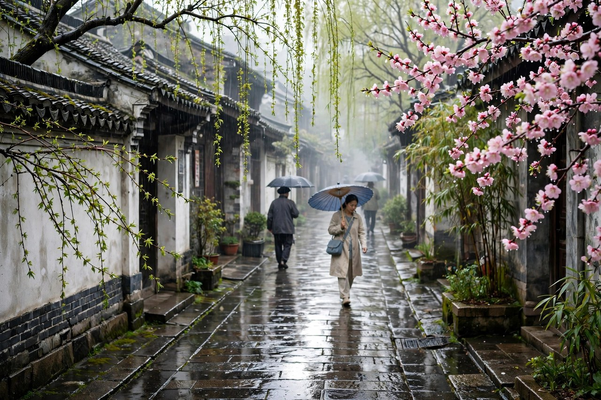
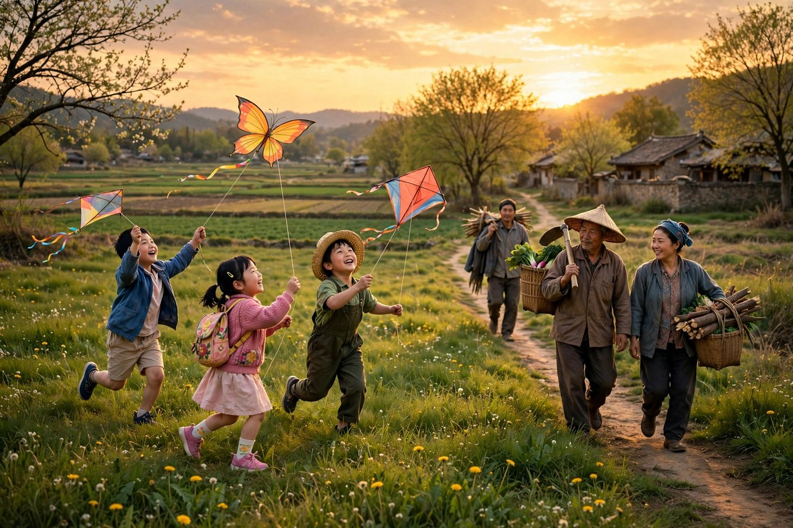

## 盼望着的春天

春的开头，是盼望着，盼望着，东风来了，春天的脚步近了。盼望这个词，用了两遍，盼望着，盼望着，节奏像脚步声，一步一步近了。春天不是突然来的，是盼来的，是冬天里盼来的，是心里盼来的。冬天长，日子冷，人心里盼着暖，盼着绿，盼着花开，盼着风软，盼着春天来。盼着盼着，东风来了，脚步近了，春天就真的来了。这种盼，是中国人对春天最深的感情，盼春天，就是盼好日子，盼好日子来了，人就有力气了。

朱自清写春，是在一九三三年七月，发表在初中国文读本上。那时候的中国，日子并不好过，可是他写春，写得欢快，写得蓬勃，写得充满希望。这种欢快，不是假装的欢快，是他在春天里看到的真实欢快，是草绿了，花开了，风软了，雨细了，人忙了，孩子放风筝了，田野里热闹了。春天这个东西，有一种力量，能让人从冬天里走出来，从低落里走出来，从不宁静里走出来，走到田野里，走到风里，走到花里。

今天的人盼春天，和朱自清当年盼春天，是一样的。冬天过了，年过完了，天气还冷，心里已经开始盼了，盼着暖和，盼着出去走走，盼着换上薄衣服，盼着吃一口春菜，盼着看一眼桃花。盼着盼着，春天就来了，来了之后，人会觉得，盼是值得的，冬天再长，春天也会来，日子再难，好日子也会来。这种盼，是希望的种子，种子在心里，春天来了，种子就发芽了。

盼望着这个开头，还教会我们一种写文章的办法，开头不要绕弯子，不要讲大道理，直接写心情，直接写盼望，直接写脚步声。心情写出来了，读者就进来了，读者进来了，文章就活了。今天很多文章开头，绕来绕去，讲了很多背景，读者读了半天，还不知道作者想说什么。朱自清的开头，一句话就把读者带进了春天，带进了盼望里，带进了东风里。这种直接，是写作最宝贵的品质，直接了，文章就干净了，干净了，读者就舒服了。

## 草软绵绵的田野

春里写草，说小草偷偷地从土里钻出来，嫩嫩的，绿绿的。偷偷地这个词用得极好，草不是大张旗鼓地长出来的，是偷偷地钻出来的，是趁人不注意，悄悄地绿了。春天就是这样，悄悄地来，悄悄地绿，悄悄地暖，等你发现的时候，田野已经绿了一片，山已经青了，水已经涨了。偷偷地，是春天的性格，是不张扬的性格，是温和的性格。

草软绵绵的，园子里，田野里，瞧去，一大片一大片满是的。软绵绵这个词，写出了草的手感，写出了草的温柔，写出了春天的软。冬天里的草，是硬的，是枯的，是黄的，春天里的草，是软的，是嫩的，是绿的。软和硬之间，隔着一个冬天，隔着一场春雨，隔着一阵东风。东风一吹，草就软了，草软了，人的心也软了，心软了，日子就好过了。

坐着，躺着，打两个滚，踢几脚球，赛几趟跑，捉几回迷藏。风轻悄悄的，草软绵绵的。这段写孩子在草地上玩，写得活泼，写得自由，写得无拘无束。孩子在草地上玩，不用想考试，不用想工作，不用想房贷，不用想生活费，就是玩，玩得开心，玩得尽兴。春天对孩子来说，就是玩的季节，就是自由的季节，就是草地上的季节。今天的孩子，玩的时间少了，草地少了，自由少了，春天对他们来说，常常只剩下了作业和补习班。春这篇文章，提醒大人，要给孩子留一点草地，留一点玩的时间，留一点自由，自由里，孩子才能长出春天的样子。

今天的人看草，常常是在公园里看，在阳台上看，在照片里看，很少像朱自清那样，坐下来，躺下来，打个滚，感受草的软。感受草的软，需要时间，需要放下手机，需要躺下来。躺下来，草在身下软着，风在脸上轻着，天在头顶蓝着，心就会静下来，静下来，才能感受到春天。春天这个东西，不只是看的，更是感受的，感受到了，春天就在心里了，心里有春天的人，走到哪里都是春天。

## 桃杏梨花的热闹

春里写花，说桃树、杏树、梨树，你不让我，我不让你，都开满了花赶趟儿。红的像火，粉的像霞，白的像雪。花里带着甜味儿，闭上眼，树上仿佛已经满是桃儿、杏儿、梨儿。这个画面，写得热闹，写得拥挤，写得争先恐后。花开不是一朵一朵慢慢开的，是赶趟儿开的，是你追我赶开的，是热闹开的。热闹这个词，是春天的另一个性格，春天不只是软的，不只是嫩的，还是热闹的，还是拥挤的，还是争着开的。

红的像火，粉的像霞，白的像雪，这三个比喻，颜色分明，画面清楚，读者一下子就能看到桃花的红，杏花的粉，梨花的白。颜色这个东西，在春天里最重要，冬天里的颜色是灰的，是白的，是暗的，春天里的颜色是红的，是粉的，是白的，是绿的，是彩的。颜色多了，世界就亮了，世界亮了，人的心情就亮了。朱自清写花，先写颜色，再写甜味儿，颜色是看的，甜味儿是闻的，看和闻合起来，花就活了。

花下成千成百的蜜蜂嗡嗡地闹着，大小的蝴蝶飞来飞去。蜜蜂闹，蝴蝶飞，花就更热闹了。蜜蜂和蝴蝶，是春天的使者，是花开的证明，没有蜜蜂蝴蝶的花，是静的花，有蜜蜂蝴蝶的花，是活的花。朱自清写花，没有只写花，还写了蜜蜂，还写了蝴蝶，还写了花里的甜味儿，还写了闭上眼想到的果子。花、蜜蜂、蝴蝶、果子，合起来，就是一个完整的春天，就是一个有生命的春天。

今天的人看花，常常是拍照，拍一张桃花的照片，拍一张樱花的照片，发朋友圈，配一句诗，就走了。朱自清看花，是站在花下看，是闭上眼闻，是想到果子，是看到蜜蜂蝴蝶，是感受到热闹。看花和拍照的区别，就在这里，拍照是把花带走，看花是把花留在心里。留在心里的花，明年还会开，带走的照片，存在手机里，很少再翻出来。春天看花，最好的办法，是站在花下，闻一闻，看一看，想一想果子，听一听蜜蜂，花就活了，人也活了。

## 风雨里的温柔

春里写风，说吹面不寒杨柳风，不错的，像母亲的手抚摸着你。风这个东西，在冬天里是冷的，是硬的，是刮脸的，在春天里是暖的，是软的，是抚摸的。母亲的手这个比喻，写得温柔，写得亲切，写得让人心里一暖。风像母亲的手，不是像父亲的手，母亲的手是软的，是暖的，是抚摸的，父亲的手是硬的，是有力的，是拍肩膀的。春风是母亲的手，说明春风是温柔的，是体贴的，是不伤人的。

风里带来些新翻的泥土的气息，混着青草味儿，还有各种花的香，都在微微润湿的空气里酝酿。气息这个词，写出了春风的味道，泥土的气息，青草的味儿，花的香，合起来，就是春天的味道。春天的味道，不是香水味，不是花露水味，是泥土味，是青草味，是花的香混在一起的味道。这种味道，闻到了，就知道春天来了，闻不到，就说明你还没有走到田野里，还没有走到风里。

春雨也写得好，雨是最寻常的，一下就是三两天，可别恼，看，像牛毛，像花针，像细丝，密密地斜织着，人家屋顶上全笼着一层薄烟。牛毛、花针、细丝，这三个比喻，写出了春雨的细，写出了春雨的密，写出了春雨的轻。春雨不是夏天的暴雨，不是冬天的冻雨，是细的，是密的，是轻的，是斜织着的，是笼着薄烟的。春雨下三两天，人会恼，可是朱自清说可别恼，因为春雨是春天的雨，是润物的雨，是让草绿、让花开的雨。恼春雨的人，是没有看到春雨的好，看到春雨的好，就不会恼了。

今天的人，遇到春雨，常常会恼，出门不方便，衣服晾不干，鞋子会湿，路上会滑。可是朱自清提醒我们，春雨是好东西，春雨来了，草会绿，花会开，田野会润，空气会清。春雨下的时候，不要只想着不方便，要想想春雨的好，想想田野里的草，想想花下的蜜蜂，想想雨后天晴的样子。想到了，春雨就不恼人了，春雨就成了春天的音乐，成了春天的诗，成了春天的礼物。

## 田野里的人

春里写人，写的是田野里的人。城里乡下，家家户户，老老小小，也赶趟儿似的，一个个都出来了。舒活舒活筋骨，抖擞抖擞精神，各做各的一份事去。赶趟儿这个词，又出现了，花赶趟儿开，人也赶趟儿出来，人和花一样，都是春天里热闹的一部分。人出来了，田野就活了，田野活了，春天就完整了。春天不是只有花草的春天，是有人的春天，没有人的春天，是空的春天，有人的春天，才是活的春天。

一年之计在于春，刚起头儿，有的是工夫，有的是希望。这句话，是春天的希望，是农民的希望，是所有人的希望。春天刚起头，工夫有的是，希望有的是，日子有的是盼头。这种希望，不是空洞的希望，是具体的希望，是田野里的希望，是种子种下去会发芽的希望，是孩子长大了会成材的希望，是日子过下去会好起来的希望。希望这个东西，在春天里最容易找到，因为春天本身就是希望的季节。

田野里的人，做着各做各的一份事，有人种地，有人放风筝，有人赶集，有人上学，有人做工，每个人都有自己的事，每个人都在春天里忙着。忙这个东西，在春天里是好的忙，是有希望的忙，是不慌的忙。冬天的忙，是冷的忙，是硬的忙，春天的忙，是暖的忙，是软的忙。忙着忙着，日子就过去了，日子过去了，春天就过去了，春天过去了，夏天就来了，夏天来了，秋天就近了，秋天近了，收获就不远了。

今天的人，春天里也在忙，忙着上班，忙着上学，忙着赶项目，忙着写报告，忙着生活。忙和朱自清当年田野里的人的忙，是一样的，都是为了日子，都是为了希望，都是为了将来。不同的是，今天的人忙得常常忘了春天，忘了田野，忘了花，忘了风，忘了雨，忘了自己为什么忙。春这篇文章，提醒今天的人，忙的时候，也要看看春天，也要舒活舒活筋骨，也要抖擞抖擞精神，也要到田野里走走，到花下去站站，到风里吹吹。忙里偷闲，闲里看春，春看了，忙就有了力气，力气有了，日子就好过了。

## 春天像娃娃

春的结尾，写春天像刚落地的娃娃，从头到脚都是新的，它生长着。春天像小姑娘，花枝招展的，笑着，走着。春天像健壮的青年，有铁一般的胳膊和腰脚，领着我们上前去。三个比喻，娃娃、小姑娘、青年，写出了春天的三个阶段，娃娃是新的，是生长的，小姑娘是美的，是笑着的，青年是健壮的，是领着人上前去的。春天从娃娃长到青年，从新长到美，从美长到有力，力量这个东西，是春天的最后落点，春天不是只好看的，春天是有力的，是领着人上前去的。

娃娃这个比喻，写出了春天的新，新到从头到脚都是新的，没有旧的东西，没有脏的东西，没有累的东西。新这个东西，在春天里最重要，冬天里的东西是旧的，是累的，是脏的，春天里的东西是新的，是干净的，是有生命的。新来了，旧就过去了，旧过去了，人就轻松了，轻松了，就有力气上前去了。

小姑娘这个比喻，写出了春天的美，美到花枝招展，美到笑着走着，美到让人看了心里喜欢。美这个东西，在春天里是具体的，是花，是草，是风，是雨，是田野里的人，是孩子放的风筝。美不是抽象的，美是看得见的，是摸得着的，是闻得到的，是春天里的花和草，是春天里的风和雨。美看到了，人就高兴了，高兴了，就有力气了。

青年这个比喻，写出了春天的力，力到铁一般的胳膊和腰脚，力到领着我们上前去。上前去这个词，是春天的行动，是春天的希望，是春天的力量的方向。春天不是只让人看的，春天是让人跟着走的，跟着春天上前去，走到田野里，走到生活里，走到希望里。上前去，不是往后退，不是原地站，不是躲起来，是往前走，往前走，日子就会好起来，往前走，希望就会近起来。

## 春天里的中国

春写的是中国的春天，是江南的春天，是田野里的春天，是家家户户的春天。中国的春天，和别的国家的春天不一样，中国的春天有泥土味，有青草味，有花的香，有田野里的人，有放风筝的孩子，有春雨，有东风，有盼望。盼望这个东西，是中国人对春天最深的感情，盼春天，就是盼好日子，盼好日子来了，人就有力气了，有力气了，日子就好过了。

中国的春天，还有一层意思，就是农耕的春天。春天来了，农民要种地，要播种，要施肥，要浇水，种下去，秋天才能收获。种地这个事，是中国人几千年来的事，春天种，秋天收，循环往复，生生不息。朱自清写春，写田野里的人，写一年之计在于春，就是写这种农耕的循环，写这种生生不息的希望。希望这个东西，在农耕里最实在，种子种下去，就有希望，希望种下去，就有收获。

今天的中国，城市多了，田野少了，种地的人少了，可是春天的感觉还在。城市里的春天，是公园里的花，是街道两边的树，是阳台上的绿，是人们脱下厚衣服的样子，是孩子在小区里放风筝的样子。城市里的春天，没有田野，可是依然有花，有草，有风，有雨，有盼望。盼望这个东西，城市里的人也有，盼着暖和，盼着出去走走，盼着日子好起来。盼着盼着，春天就来了，春天来了，城市也绿了，人也活了。

春这篇文章，放在今天读，依然有力量，因为它写的是希望，写的是新，写的是美，写的是力。希望这个东西，在任何时代都缺，在困难的时候更缺，缺的时候，读一读春，就会找到一点希望，找到一点新，找到一点美，找到一点力。找到了，希望就种下去了，种下去了，日子就好过了，日子好过了，春天就真的来了。

## 今天的春天怎么过

今天的春天，怎么过才算过好了。朱自清的办法是，到田野里去，到花下去，到风里去，到雨里去，到草地上坐一坐，躺一躺，打个滚，踢几脚球，赛几趟跑，捉几回迷藏。今天的人，过春天，常常是在手机里过，看别人发的春天的照片，看别人发的花，看别人发的风筝，自己却没有出去。手机里的春天，不是春天，手机里的花，不会香，手机里的风，不会吹，手机里的草，不会软。春天要出去过，出去看，出去闻，出去感受，感受到了，春天才是自己的。

今天的春天，还可以带着孩子一起过。孩子在春天里，是最快乐的，草地上打滚，花下追蝴蝶，田野里放风筝，雨里踩水，风里跑，这些都是孩子春天的记忆。记忆这个东西，种下去了，将来长大了，会想起来，会暖起来。朱自清写春，写孩子放风筝，写孩子在草地上玩，就是写这种记忆。记忆种下去了，孩子将来夜里睡不着的时候，会想起春天，会想起草地，会想起风筝，会想起和父母一起的春天。

今天的春天，还可以写下来。看到花，写下来，看到草，写下来，看到风，写下来，看到雨，写下来，写下来，春天就留住了，留住了，明年春天再读，还能想起今年的春天。写春天的办法，不必学朱自清的句子，学他的态度，学他的细，学他的真，学他的盼望。态度有了，句子自然就来了，句子来了，春天就留住了，留住了，日子就有了痕迹，痕迹有了，人就不会觉得日子白过了。

今天的春天，还可以和朋友一起过。和朋友一起到田野里走走，到花下去站站，到风里吹吹，到雨里淋淋，朋友在一起，春天就更热闹了，热闹了，春天就更美了。朋友这个东西，在春天里最重要，春天是团圆的季节，是朋友相聚的季节，是大家一起上前去的季节。上前去，不是自己一个人上前去，是和朋友一起上前去，一起上前去，力气就大了，希望就近了，日子就好过了。

## 春雨与春风的道理

春雨和春风，在朱自清笔下，是有道理的。春风是母亲的手，是温柔的，是抚摸的，春雨是牛毛、花针、细丝，是细的，是密的，是轻的。温柔和细密合起来，就是春天的道理，春天不靠大风大雨，靠温柔和细密，温柔地吹，细密地下，草就绿了，花就开了，田野就润了，人就暖了。道理这个东西，在春天里最实在，温柔比粗暴管用，细密比猛烈管用，慢慢来比急着来管用。

今天的人，做事常常急，急着成功，急着赚钱，急着出名，急着看到结果。急是没有用的，急出来的东西，常常是虚的，是空的，是经不起时间的。春天的道理是，慢慢来，温柔地来，细密地来，种子种下去，要等，要浇水，要施肥，要晒太阳，等久了，种子就发芽了，发芽了，就长大了，长大了，就开花了，开花了，就结果了。结果这个东西，急不来，急来了，果子是酸的，慢慢来，果子才是甜的。

春风和春雨的道理，还可以放在教育孩子上。教育孩子，不要靠大风大雨，不要靠吼，不要靠打，要靠春风，要靠春雨，要温柔，要细密，要慢慢来。孩子像小草，像花，像田野，温柔地吹，细密地下，孩子就绿了，就开了，就长大了。吼出来的孩子，是怕的，不是服的，打出来的孩子，是躲的，不是懂的，春风春雨里的孩子，是暖的，是懂的，是愿意上前去的。

春风和春雨的道理，还可以放在做人上。做人，不要太硬，不要太急，不要太猛，要温柔一点，细密一点，慢慢一点。温柔的人，人缘好，细密的人，做事牢，慢慢来的人，走得远。朱自清做人，就是这样，温柔，细密，慢慢来，文章写得温柔，做学问做得细密，教书教得慢慢来，慢慢来，人就稳了，稳了，日子就好了，日子好了，春天就长了。

## 盼望里的力气

春这篇文章，最动人的地方，是盼望里的力气。盼望着，盼望着，力气就来了，力气来了，人就上前去了，上前去了，日子就好起来了。力气这个东西，不是天上掉下来的，是盼出来的，是春天里长出来的，是草绿了给的，是花开了给的，是风软了给的，是雨细了给的。力气给了，人就不再怕冬天了，冬天再长，春天也会来，春天来了，力气就有了。

今天的人，常常觉得没有力气，觉得累，觉得日子难，觉得希望远。没有力气的时候，读一读春，就会找到一点力气。力气不在别处，在春天里，在草里，在花里，在风里，在雨里，在田野里，在朋友里，在孩子放风筝的样子里。找到了力气，人就站起来了，站起来了，就上前去了，上前去了，日子就动起来了，日子动起来了，希望就近了。

盼望里的力气，还有一层意思，就是不要放弃。冬天再长，不要放弃盼春天，日子再难，不要放弃盼好日子，盼着盼着，春天就来了，好日子就来了。放弃的人，春天来了也看不到，因为心里已经没有盼了，没有盼的人，春天来了，草绿了，也觉得和自己无关。盼的人，春天还没有来，心里已经绿了，心里绿了，春天来了，就更绿了。绿这个东西，先在心里绿，再在田野里绿，心里绿了，田野绿了，人就活了。

盼望这个词，在今天特别重要。很多人盼着涨工资，盼着换工作，盼着孩子好，盼着父母健康，盼着日子好起来。盼着，是好的，盼着说明心里还有希望，还有力气，还有往前走的劲。劲这个东西，不能丢，丢了，人就垮了，垮了，春天来了也站不起来。春这篇文章，就是给人劲的文章，读完了，劲就来了，劲来了，人就上前去了，上前去了，春天就真的来了。

## 春天里的普通人

春里写的人，都是普通人，田野里的人，家家户户的人，老老小小的人，孩子，农民，工人，学生，都是普通人。普通人这个词，在春里很重要，春天不是只给文人的，不是只给诗人的，是给所有人的，是给普通人的。普通人在春天里，也有自己的事，有自己的希望，有自己的力气，有自己的快乐。快乐这个东西，普通人也有，春天里，普通人的快乐，是草地上的快乐，是花下的快乐，是风里的快乐，是雨里的快乐，是田野里的快乐。

今天的普通人，春天里也在忙，也在盼，也在希望。普通人的春天，不需要大场面，不需要大排场，只需要一点绿，一点花，一点风，一点雨，一点和家人在一起的时间，一点和朋友在一起的时间。时间这个东西，在春天里最宝贵，时间有了，春天就有了，时间没有了，春天就过去了。春天过去了，再等一年，再等一年，人就老了一岁，老了一岁，春天就少了一次。所以春天来了，要珍惜时间，珍惜和家人在一起的时间，珍惜和朋友在一起的时间，珍惜到田野里去的时间。

普通人的春天，还可以很简单。简单到在阳台上种一盆花，在小区里看一棵树，在公园里走一圈，在田野里站一会儿，简单的事情，做起来，春天就来了。春天这个东西，不需要花很多钱，不需要去很远的地方，只需要一颗肯看的心，一双肯走的脚，一份肯盼的心。心有了，脚动了，春天就来了，春天来了，日子就好过了，日子好过了，人就知足了，知足了，春天就更美了。

春这篇文章，写给普通人看，普通人读了，会觉得，写的就是自己，就是自己的田野，就是自己的花，就是自己的风，就是自己的雨，就是自己的盼望。盼望这个东西，普通人最懂，普通人盼春天，盼好日子，盼孩子好，盼父母健康，盼的日子，就是春天的日子。春天的日子，过好了，普通人的日子就好过了，普通人的日子好过了，春天就真的来了，来了，就不要让它走，要留住它，留住的办法，是写下来，是拍下来，是记在心里，是和家人在一起，是和朋友在一起，是上前去，是生长着，是笑着走着，是健壮地走着。

## 春天来了之后

春天来了之后，日子会怎么样，朱自清没有写完，他写到青年领着我们上前去，就停了。上前去之后，会怎么样，是夏天，是秋天，是收获，是冬天，是下一个春天。春天来了之后，要上前去，上前去，就是做事，就是种地，就是读书，就是工作，就是生活，就是把春天里的希望，变成夏天里的汗水，变成秋天里的收获。希望这个东西，光盼着是不够的，盼着，还要做，做起来了，希望才有结果。

春天来了之后，还要记得春天。记得春天的草，记得春天的花，记得春天的风，记得春天的雨，记得春天的盼望，记得春天的力气。记得了，夏天热的时候，会想起春天的凉，秋天凉的时候，会想起春天的暖，冬天冷的时候，会想起春天的绿。想起来了，心里就暖了，暖了，就有力气过冬天了，冬天过了，春天又来了，春天又来了，希望又来了，希望来了，日子就循环起来了，循环起来了，生活就生生不息了。

春天来了之后，还要把春天传下去。传给孩子，传给学生，传给朋友，传给后来的人。传的办法，是讲春的故事，是读春的文章，是带孩子到田野里去，是带学生到花下去，是带朋友到风里去。传下去了，春天就不会只属于一个人，春天就属于所有人，所有人的春天合起来，就是中国的春天，就是田野的春天，就是希望的春天。希望的春天来了，日子就好过了，日子好过了，人就笑了，笑了，春天就更美了。

最后，春这篇文章留给我们一句话，盼望着，盼望着，东风来了，春天的脚步近了。脚步近了，就不要站在原地等，要上前去，要跟着春天的脚步走，走到田野里，走到花下去，走到风里去，走到雨里去，走到生活里去，走到希望里去。走到希望里了，春天就真的来了，春天来了，就不要让它走，要留住它，留住的办法，是生长着，是笑着走着，是健壮地走着，是领着我们上前去，上前去，上前去，日子就一天比一天好了，好日子来了，春天就长了，春天长了，人就活了，人活了，希望就永远在心里了。

## 春天里的一声问候

春天最后还有一声问候，问候是东风带来的，是花香带来的，是草软带来的，是孩子放风筝的笑声带来的。问候很简单，就是春天来了，你好吗，日子好吗，身体好吗，心里暖吗。问候问到了，心就暖了，暖了，就有力气上前去了，上前去了，春天就长了，春天长了，日子就好了，日子好了，人就笑了，笑了，春天就更美了，美了，就不要让它走，要留住它，留住的办法，是每年春天都出去走走，都看看花，都听听风，都淋淋雨，都和家人在一起，都和朋友在一起，都盼望着，都生长着，都笑着走着，都健壮地走着，走着走着，春天就永远在心里了。

## 春天里的一盏灯

春天里最后还有一盏灯，灯是东风里的灯，是花香里的灯，是草软里的灯，是孩子放风筝的笑声里的灯，是田野里的人的灯，是盼望着的灯。灯这个东西，在春里不亮眼，可是照得远，照着田野，照着花，照着风，照着雨，照着后来读文章的人。后来的人读春，读到灯，心里的灯就亮了，灯亮了，春天就长了，长了，日子就好过了，日子好过了，人就笑了，笑了，春天就更美了，美了，就传下去了，传给孩子，传给学生，传给朋友，传给盼望春天的人，传下去，春就永远是春，灯就永远是灯，盼望就永远是盼望，生长就永远是生长，上前去就永远是上前去。
