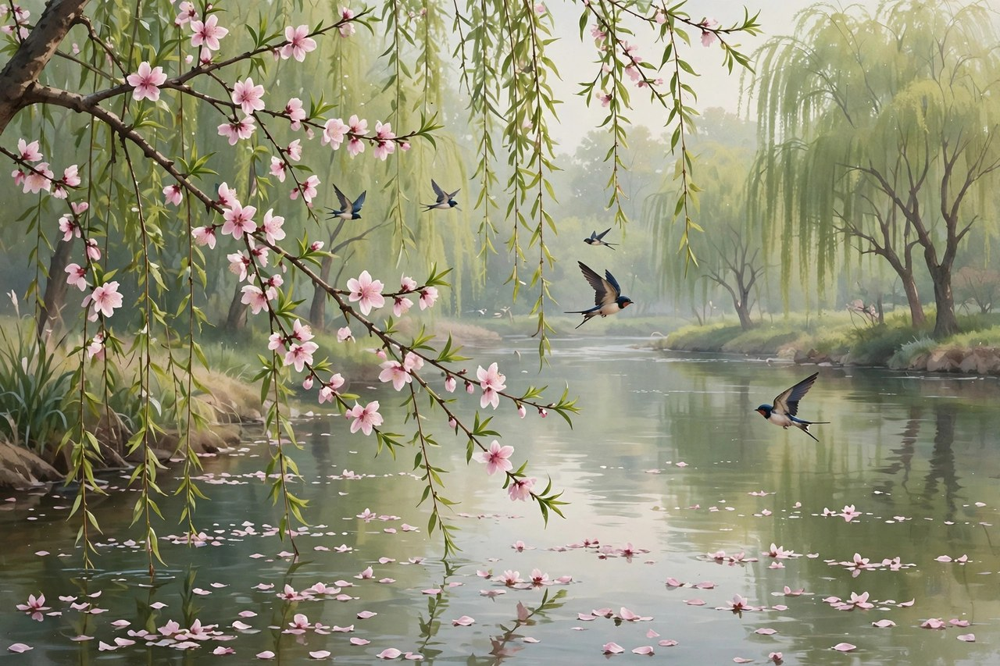

## 燕子去了的时候

匆匆的开头，是三个问句，燕子去了，有再来的时候，杨柳枯了，有再青的时候，桃花谢了，有再开的时候。但是，聪明的，你告诉我，我们的日子为什么一去不复返呢。三个再来、再青、再开，合起来，就是自然的循环，循环这个东西，是安慰人的，燕子走了还会来，杨柳枯了还会青，桃花谢了还会开，循环来了，人就觉得，世界是有规律的，是有盼头的，是不会永远暗下去的。

可是日子不一样，日子去了，就不回来了，日子没有循环，日子只有一条路，往前走，往前走，走过去了，就回不来了。朱自清问，聪明的，你告诉我，我们的日子为什么一去不复返呢，这个问句，问得很直接，问得很动人，问得让人心里一紧。聪明的人，也回答不了这个问题，因为时间就是这样，去了就不回来，聪明也留不住，愚笨也留不住，留不住的东西，才最让人焦虑，最让人不甘。

今天的人，看到燕子，看到杨柳，看到桃花，也会想起匆匆。春天来了，燕子回来了，杨柳绿了，桃花开了，人会觉得，时间过去了，日子过去了，可是燕子回来了，日子却没有回来。日子没有回来，人就老了一岁，老了一岁，日子就少了一年，少了一年，人就更焦虑了。焦虑这个东西，在匆匆里最核心，焦虑不是坏事，焦虑说明人还在乎时间，还在乎日子，还想把日子过好。过好日子的人，才会焦虑，日子过得无所谓的人，是不会焦虑的。

燕子去了的时候，朱自清在台州教书，日子过得并不宽裕，心里也很苦闷。五四运动落潮，现实给人失望，青年知识分子看不清现在，摸不着将来，徘徊在人生的十字路口，感到空虚和惆怅。空虚这个东西，在匆匆里藏着，藏在燕子的问句里，藏在日子的溜走里，藏在作者的手渐渐空虚里。手空虚了，心也空虚了，空虚了，才写匆匆，写匆匆，是为了把空虚写出来，写出来，空虚就轻一点，轻一点，人就站起来了。

## 手渐渐空虚了

我不知道他们给了我多少日子，但我的手确乎是渐渐空虚了。在默默里算着，八千多日子已经从我手中溜去，像针尖上一滴水滴在大海里，我的日子滴在时间的流里，没有声音，也没有影子。我不禁头涔涔而泪潸潸了。手空虚这个意象，写得极好，手是做事的手，是握笔的手，是吃饭的手，是洗脸的手，手空虚了，说明日子从手里溜走了，溜走了，抓不住，抓不住，才空虚。

八千多日子这个数字，算起来，是二十多年的日子，是朱自清从出生到写匆匆的日子。二十多年的日子，算起来很多，可是溜去的时候，却像针尖上一滴水滴在大海里，没有声音，没有影子。针尖上的水滴，是小的，是轻的，是看不见的，大海是大的，是深的，是看不见底的，小水滴进大海，就没了，就找不着了，就没有声音了，就没有影子了。日子就是这样，小日子进大时间，就没了，找不着了，留不下声音，留不下影子。

头涔涔而泪潸潸，这个状态，写出了作者的焦虑，头上出汗，泪水流下来，汗和泪合起来，就是焦虑的身体反应。焦虑这个东西，不只是心里想的，更是身体上的，头出汗，眼流泪，心发紧，手发空，身体和心里合起来，才是完整的焦虑。朱自清写焦虑，没有只写心里，还写了身体，写了头，写了泪，写了手，身体写出来了，焦虑就真实了，真实了，读者就感同身受了。

今天的人，算自己的日子，也会算出很多天，很多年，可是算完了，会发现，日子也是像水滴进大海，没有声音，没有影子。刷手机的日子，过去了，就没有声音了，开会的日子，过去了，就没有影子了，熬夜的日子，过去了，就只剩下黑眼圈了。日子过去了，留下的东西很少，很少的东西里，有记忆，有文章，有和家人在一起的时间，有做过的一件实在事。实在事这个东西，在匆匆里很重要，日子溜走了，实在事留下来了，日子就没有白过，白过的日子，是没有实在事的日子。

## 洗手吃饭的时候

于是，洗手的时候，日子从水盆里过去，吃饭的时候，日子从饭碗里过去，默默时，便从凝然的双眼前过去。我觉察他去的匆匆了，伸出手遮挽时，他又从遮挽着的手边过去，天黑时，我躺在床上，他便伶伶俐俐地从我身上跨过，从我脚边飞去了。洗手、吃饭、默默、躺床上，这几个日常动作，合起来，就是一天的生活，就是日子的全部。日子不是在大事里过去的，是在小事里过去的，是在洗手里过去的，是在吃饭里过去的，是在默默里过去的，是在睡觉里过去的。

遮挽这个动作，写得极动人，伸出手想把日子留住，日子却从手边过去了，过去了，就抓不住，抓不住，才更想抓，更想抓，才更空虚。遮挽这个词，在今天看来，依然动人，人想留住时间，想留住青春，想留住父母的年轻，想留住孩子的童年，伸出手去遮挽，时间却从手边过去了，过去了，就回不来了。回不来了，才要珍惜，珍惜现在的洗手，珍惜现在的吃饭，珍惜现在的默默，珍惜现在的躺床上，因为这些日常，就是日子，就是生活，就是时间本身。

天黑时躺在床上，日子从身上跨过，从脚边飞去了。跨过和飞去这两个词，写出了日子的轻，写出了日子的快，写出了日子的伶俐。伶俐这个词，用得极好，日子是伶俐的，是机灵的，是滑头的，是抓不住的，是跨过去就飞走了的。日子伶俐，人就笨拙，人想抓，抓不住，想留，留不住，想追，追不上，追不上了，才焦虑，焦虑了，才写匆匆，写匆匆，是为了把伶俐的日子写下来，写下来，日子就慢了一点，慢了一点，人就看清了一点。

今天的人，洗手的时候，日子从水盆里过去，可是人常常在想手机，吃饭的时候，日子从饭碗里过去，可是人常常在刷视频，默默的时候，日子从眼前过去，可是人常常在发呆，躺在床上的时候，日子从身上跨过，可是人常常在熬夜。日子过去了，人却没有觉察，没有觉察，日子就白过去了，白过去了，人就老了，老了，才后悔，后悔了，日子也回不来了。匆匆提醒我们，洗手的时候，要觉察水，吃饭的时候，要觉察饭，默默的时候，要觉察眼前，躺床上的时候，要觉察身体，觉察到了，日子就没有白过，白过的日子，是没有觉察的日子。

## 太阳再见的时候

等我睁开眼和太阳再见，这算又溜走了一日。我掩着面叹息，但是新来的日子的影儿又开始在叹息里闪过了。睁开眼和太阳再见，这个说法很妙，太阳每天都会升起来，每天都会和人再见，再见这个词，说明太阳是每天都来的，是循环的，是不会走远的。可是日子呢，日子和太阳不一样，太阳再见了，日子却溜走了一日，溜走了一日，就少了一日，少了一日，人就离老近了一步，离死近了一步，近了一步，才叹息，叹息了，新来的日子又来了，新来的日子来了，叹息里又有影儿了，影儿闪过了，日子又开始溜走了。

掩着面叹息这个动作，写出了作者的无奈，掩着面，是不想让人看到自己叹息，是不想让人看到自己的泪，是不想让人看到自己的焦虑。叹息这个东西，是轻的，是短的，是无声的，可是叹息里藏着很多话，藏着对时间的无奈，藏着对日子的不舍，藏着对自己的责备。责备自己，为什么日子白白过去了，为什么没有做点实在事，为什么没有把时间用好。责备完了，新来的日子又来了，新来的日子来了，又要开始溜走了，溜走了，又要叹息，叹息和溜走合起来，就是人生的循环，循环里，人慢慢老了，日子慢慢少了。

新来的日子的影儿又开始在叹息里闪过了，影儿这个词，写出了新日子的轻，写出了新日子的快，写出了新日子的捉不住。影儿是虚的，是动的，是闪的，闪一下，就过去了，过去了，就抓不住。日子就是影儿，闪一下，就过去了，过去了，就回不来了。回不来了，才要珍惜新来的日子，珍惜新来的影儿，珍惜新来的太阳，珍惜新来的每一天。每一天都是新的，每一天都是影儿，影儿闪过了，就要抓住点什么，抓住点实在事，抓住点记忆，抓住点和家人在一起的时间，抓住点，日子就没有白过。

今天的人，每天睁开眼，看到太阳，看到手机，看到消息，看到工作，看到生活，看到日子又开始了。日子开始了，人常常会叹息，叹息昨天过去了，叹息时间不够了，叹息事情太多了。叹息完了，新来的日子又开始溜走了，溜走了，人又叹息，叹息和溜走合起来，就是今天人的循环。循环里，要打破，就要从叹息里走出来，走出来，就是做事，做一件实在事，做一件对家人好的事，做一件对自己好的事，做完了，叹息就轻了，轻了，日子就有了重量，重量有了，日子就没有白过。

## 时间的追问

匆匆这篇文章，核心是一个追问，日子为什么一去不复返，日子去了哪里，日子是谁偷的，是谁藏的，是自己逃走的，还是被人偷走的。这个追问，朱自清没有给出答案，他问了，问完了，文章就结束了，结束的时候，读者心里还留着问题，问题留着，文章就活了，活了，读者就会自己去想，想日子去了哪里，想自己的日子去了哪里，想自己的时间去了哪里。想清楚了，人就长大了，长大了，就不再问了，就开始做了，做了，日子就有了答案，答案不是写出来的，是做出来的。

追问这个东西，在今天依然重要。今天的人，常常问，时间去哪里了，日子去哪里了，青春去哪里了，父母的年轻去哪里了，孩子的童年去哪里了。问完了，答案在哪里，答案在手机里吗，在工作里吗，在生活里吗，在记忆里吗。答案不在别处，在自己的手里，在自己的日子里，在自己的实在事里。实在事做了，日子就有了答案，实在事没有做，日子就没有答案，没有答案，人就焦虑，焦虑了，就问，问了，又没有答案，循环起来，人就累了。

朱自清的追问，还有一层意思，就是对时间的敬畏。时间这个东西，是公平的，给每个人的都是一样的，一天二十四小时，一年三百六十五天，谁也不会多，谁也不会少。公平的时间，过去了就是过去了，不会因为你有钱就多给，不会因为你有权就少给，不会因为你聪明就留住，不会因为你愚笨就快走。公平这个东西，在时间里最真实，时间公平了，人就要珍惜，珍惜时间的人，日子就过得实在，不珍惜时间的人，日子就过得空虚。

今天的人，对时间常常没有敬畏，觉得时间很多，觉得日子很长，觉得青春很远，觉得父母还年轻，觉得孩子还小，觉得自己还不老。没有敬畏，时间就白白过去了，白白过去了，人就老了，老了，才敬畏，敬畏了，时间也回不来了。匆匆提醒我们，对时间要有敬畏，敬畏时间的人，才会珍惜时间，珍惜时间的人，才会把日子过好，过好日子的人，才会在老的时候，不后悔，不叹息，不掩面，不流泪。流泪这个东西，老的时候流，是后悔的泪，年轻的时候流，是觉察的泪，觉察的泪，比后悔的泪好，因为觉察了，还来得及改，后悔了，就来不及了。

## 今天的时间焦虑

今天的时间焦虑，比朱自清当年更严重。当年的人，焦虑的是日子溜走，今天的人，焦虑的是时间不够用，是手机抢走了时间，是工作抢走了时间，是社交抢走了时间，是各种各样的东西抢走了时间。抢时间的东西太多了，时间就碎了，碎成一片一片的，碎成刷手机的几分钟，碎成开会的几小时，碎成通勤的几小时，碎成熬夜的几小时，碎了，时间就没有整块了，没有整块，日子就过得散，散了，人就累，累了，就焦虑，焦虑了，就更散，散和焦虑合起来，就是今天人的时间困境。

时间碎了，怎么办，朱自清的办法是，觉察，觉察洗手，觉察吃饭，觉察默默，觉察躺床上，觉察到了，时间就整了，整了，日子就有了重量。今天的人，觉察的办法可以是，放下手机，看看水，看看饭，看看眼前，看看身体，看看父母，看看孩子，看看自己。看看，就觉察了，觉察了，时间就慢了，慢了，日子就长了，长了，人就不焦虑了，不焦虑了，日子就好过了。

今天的人，还可以学一学匆匆的办法，把日子写下来。写下来，日子就留住了，留住了，时间就有了痕迹，痕迹有了，人就不会觉得日子白过了。写日记，写备忘录，写一篇文章，写几行字，写下来，日子就慢了，慢了，时间就长了，长了，人就安稳了。安稳这个东西，在今天特别缺，缺安稳，人就焦虑，焦虑了，时间就更碎，碎了，就更焦虑。写下来，是打破循环的办法，写下来，时间就整了，整了，人就安稳了。

今天的时间焦虑，还有一个解法，就是做实在事。实在事这个东西，在匆匆里很重要，日子溜走了，实在事留下来了，日子就没有白过。实在事可以很小，给父母打一个电话，陪孩子玩一会儿，读几页书，写一篇文章，做一顿饭，跑一圈步，实在事做完了，日子就有了重量，重量有了，焦虑就轻了，轻了，时间就慢了，慢了，人就活了。活这个东西，在时间里最重要，活着，就是把日子过成实在事，过成记忆，过成和家人在一起的时间，过成自己想做的事。

## 匆匆与春

匆匆和春，是朱自清的两篇文章，一篇写时间的焦虑，一篇写春天的希望，焦虑和希望合起来，就是朱自清对生活的完整态度。焦虑不是绝望，希望不是盲目，焦虑里藏着希望，希望里藏着焦虑，两个人合起来，才是真实的生活。生活这个东西，就是焦虑和希望交织在一起的，焦虑的时候，想想春，春来了，希望就来了，希望的时候，想想匆匆，匆匆来了，焦虑就来了，焦虑来了，人就不会盲目希望，希望来了，人就不会绝望焦虑。

匆匆写于一九二二年三月，春写于一九三三年七月，中间隔了十一年，十一年里，朱自清从青年变成了中年，从教书人变成了教授，从南方走到了北方，从焦虑走到了希望，从匆匆走到了春。时间过去了，人长大了，文章也长大了，长大了的文章，不再只是焦虑，不再只是问日子去了哪里，而是开始写盼望，写生长，写上前去。上前去这个词，在春里很重要，在匆匆里没有，匆匆里只有溜走，只有叹息，只有掩面，只有影儿，春里有了上前去，有了生长，有了笑着走着，有了健壮地走着。生长这个东西，是时间给人的礼物，时间过去了，人长大了，礼物就来了。

今天的人，读匆匆和春，要合起来读，合起来读，才完整。只读匆匆，人会焦虑，只读春，人会盲目，合起来读，人会明白，焦虑是正常的，希望也是正常的，焦虑和希望合起来，才是生活。生活这个东西，就是要在焦虑里找到希望，在希望里保持清醒，清醒了，焦虑就轻了，希望就实了，实了，日子就好过了，日子好过了，时间就慢了，时间慢了，人就活了。

匆匆和春合起来，还告诉我们一个道理，时间过去了，不一定是坏事，时间过去了，人会长大，会明白，会写出更好的文章，会过出更好的日子。长大这个东西，是时间给的，时间过去了，长大就来了，长大来了，焦虑就少了，希望就多了，希望多了，日子就好过了。日子好过了，时间就慢了，时间慢了，人就安稳了，安稳了，匆匆就不匆匆了，春就永远是春了。

## 匆匆的语言

匆匆的语言，很值得学习。语言是朴素的，是清丽的，是具体的，是不堆砌的。写燕子，写杨柳，写桃花，写洗手，写吃饭，写默默，写躺床上，写太阳，写影儿，每一个词都是日常的，每一个句子都是短的，每一个段落都是清楚的。日常这个东西，在匆匆里很重要，日常写出来了，时间就具体了，具体了，读者就感同身受了，感同身受了，文章就活了。

匆匆的句子，还有音乐感。燕子去了，有再来的时候，杨柳枯了，有再青的时候，桃花谢了，有再开的时候，三个句子，结构一样，节奏一样，读起来像歌，像诗，像音乐。音乐感这个东西，在散文里很重要，有音乐感，文章读起来就顺，顺了，读者就愿意读，愿意读，文章就流传了。流传这个东西，不是靠道理，是靠音乐感，是靠节奏，是靠句子读起来顺口，顺口了，人就记住了，记住了，文章就活了。

匆匆的比喻，也很值得学习。日子像针尖上一滴水滴在大海里，日子像影儿，日子像伶俐的孩子，日子像从手边过去的东西，比喻都是日常的，都是具体的，都是读者能懂的。比喻这个东西，要贴切，要日常，要让人一下子就能懂，懂了，文章就活了，活了，读者就记住了。记住了，匆匆就长进心里了，长进心里了，时间就慢了，慢了，人就安稳了。

今天的人写时间，常常追求大词，追求金句，追求一句话就让人转发。匆匆告诉我们，写时间，不必追求金句，只要写日常，写洗手，写吃饭，写默默，写躺床上，写太阳，写影儿，日常写出来了，时间就出来了，时间出来了，读者就懂了，懂了，文章就好了。好文章，不在金句，在日常，在具体，在真实，在音乐感，在节奏感，在句子读起来顺口，顺口了，人就记住了，记住了，时间就慢了。

## 把日子过成实在事

匆匆最后留给我们的，是一个办法，把日子过成实在事。实在事这个东西，在匆匆里反复出现，日子溜走了，实在事留下来了，日子就没有白过。实在事可以很小，小到给父母打一个电话，小到陪孩子玩一会儿，小到读几页书，小到写一篇文章，小到做一顿饭，小到跑一圈步，小到在水边站一会儿，小到在月光下走一圈。小的实在事，做完了，日子就有了重量，重量有了，焦虑就轻了，轻了，时间就慢了，慢了，人就活了。

把日子过成实在事，还需要一个习惯，就是每天做一件实在事，每天做一件，日子就一天比一天实，实了，人就安稳了，安稳了，时间就慢了，慢了，人就长大了，长大了，匆匆就不匆匆了，春就来了，春来了，希望就来了，希望来了，日子就好过了。习惯这个东西，养成不容易，可是养成之后，好处很多，好处这个东西，在时间里最实在，习惯好了，日子就好了，日子好了，人就好了。

把日子过成实在事，还需要一个提醒，就是每天问自己，今天的日子去了哪里，今天做了什么实在事，今天有没有觉察洗手，有没有觉察吃饭，有没有觉察眼前，有没有觉察身体。问自己，不是责备自己，是提醒自己，提醒自己珍惜时间，提醒自己不要让日子白白过去，白白过去的日子，是没有实在事的日子，没有实在事的日子，是空虚的日子，空虚的日子过多了，人就老了，老了，才后悔，后悔了，日子也回不来了。

把日子过成实在事，最后还要记得，日子过去了，不必太叹息，叹息完了，新来的日子又来了，新来的日子来了，又要开始溜走了，溜走了，又要叹息，叹息和溜走合起来，就是人生，人生就是这样，在叹息和溜走里，慢慢过去，慢慢长大，慢慢明白，明白了，就不再叹息了，就开始做了，做了，日子就有了重量，重量有了，叹息就轻了，轻了，人就活了，活了，匆匆就变成了春，春就永远在心里了。

## 读匆匆的人

读匆匆的人，后来都怎么样了，他们有的成了老师，有的成了作家，有的成了普通劳动者，有的成了父母。父母读匆匆，感觉最深，因为父母的日子，是看着孩子长大的日子，孩子长大了，父母就老了，老了，日子就少了，少了，才珍惜，珍惜了，才想把日子过成实在事，实在事就是陪孩子，陪父母，陪家人，陪自己。陪这个东西，在时间里最重要，陪着，日子就慢了，慢了，人就安稳了。

老师读匆匆，会教学生怎么珍惜时间，怎么把日子过成实在事，怎么觉察洗手，觉察吃饭，觉察眼前。教时间，不能只讲道理，要讲生活，要讲学生自己的日子，学生自己的日子，是上学的日子，是写作业的日子，是和朋友玩的日子，是和父母在一起的日子。日子这个东西，学生常常觉得很多，觉得时间很长，觉得青春很远，老师教匆匆，要告诉学生，时间没有很多，日子没有很长，青春没有很远，珍惜了，日子才长，不珍惜，日子就短，短了，人就老了，老了，才后悔。

普通劳动者读匆匆，也会有自己的感受。他们在城里打工，日子过得很快，早上出门，晚上回来，一天就过去了，一年就过去了，几年就过去了，过去了，才发现，日子像水滴进大海，没有声音，没有影子。没有声音的日子，是白过的日子，白过的日子过多了，人就累了，累了，就想回家，回家了，看到父母，看到孩子，看到家乡，日子就慢了，慢了，人就活了。活这个东西，在打工人的日子里最重要，活着，就是把日子过成实在事，过成和家人在一起的时间，过成自己想做的事。

作家读匆匆，会学朱自清的笔路，学他怎么写燕子，学他怎么写杨柳，学他怎么写桃花，学他怎么写洗手，学他怎么写吃饭，学他怎么写默默，学他怎么写太阳，学他怎么写影儿。学笔路，不是抄笔路，是学一种态度，学一种觉察，学一种把日常写成时间的勇气。勇气有了，文章就有了，文章有了，读者就有了，读者有了，作家就有了存在的意义。存在的意义，不是出名，不是赚钱，是写出真实的东西，写出能流传的东西，写出能让后来人读了心里一动的东西。

## 匆匆之后的日子

匆匆之后的日子，朱自清还在教书，还在写文章，还在做学问，还在面对时间，还在面对日子。日子还在溜走，时间还在过去，可是他不再只是叹息，不再只是掩面，不再只是问日子去了哪里，他开始写春，开始写盼望，开始写生长，开始写上前去。上前去这个词，是匆匆之后的日子给他的礼物，礼物这个东西，是时间给的，时间过去了，人长大了，礼物就来了，礼物来了，日子就好过了。

匆匆之后的日子，今天的人也在过，日子还在溜走，时间还在过去，可是人也在长大，也在明白，也在写自己的匆匆，也在写自己的春。写匆匆的人，是年轻的人，是焦虑的人，是问日子去了哪里的人，写春的人，是长大的人，是有希望的人，是盼望着上前去的人。年轻和长大合起来，就是人生，人生就是从匆匆走到春，从焦虑走到希望，从溜走走到生长，从叹息走到上前去。

匆匆之后的日子，还有一个提醒，就是不要只读匆匆，要读春，要读背影，要读荷塘月色，要读绿，要读桨声灯影里的秦淮河，要读朱自清这个人，读完整了，才明白，匆匆不是绝望，匆匆是觉察，觉察了，才有春，春来了，才有希望，希望来了，才有力气，力气来了，才上前去，上前去了，日子就好过了，日子好过了，匆匆就不匆匆了，时间就慢了，时间慢了，人就活了。

最后，匆匆留给我们一句话，日子从水盆里过去，从饭碗里过去，从眼前过去，从身上跨过，从脚边飞去，过去了，就回不来了，回不来了，才要珍惜，珍惜洗手，珍惜吃饭，珍惜默默，珍惜躺床上，珍惜睁开眼和太阳再见，珍惜新来的日子的影儿，珍惜每一天，珍惜每一天，日子就有了重量，重量有了，焦虑就轻了，轻了，人就活了，活了，匆匆就变成了春，春就永远在心里了，心里有春的人，走到哪里都是春天，走到哪里，日子都是实在事，实在事做完了，时间就慢了，时间慢了，人就安稳了，安稳了，日子就好过了。

## 匆匆里的一盏灯

匆匆里最后还有一盏灯，灯是时间里的灯，是日子里的灯，是洗手时水盆边的灯，是吃饭时饭碗边的灯，是默默时眼前的灯，是躺床上时身边的灯，是睁开眼和太阳再见时的灯。灯这个东西，在匆匆里不亮眼，可是照得远，照着日子，照着时间，照着后来读文章的人。后来的人读匆匆，读到灯，心里的灯就亮了，灯亮了，日子就慢了，慢了，人就安稳了，安稳了，时间就长了，长了，匆匆就不匆匆了，不匆匆了，春就来了，春来了，希望就来了，希望来了，日子就好过了，日子好过了，灯就更亮了，亮了，就传下去了，传给孩子，传给学生，传给朋友，传给夜里睡不着的人，传下去，匆匆就永远是匆匆，灯就永远是灯，日子就永远是实在事。

## 匆匆里的最后提醒

匆匆里的最后提醒很简单，就是今天的日子不要白过，白过的日子是洗手时没有觉察水，吃饭时没有觉察饭，默默时没有觉察眼前，躺床上时没有觉察身体，睁开眼时没有觉察太阳，新来的日子来了没有抓住影儿。抓住影儿的办法，是做一件实在事，做完了，日子就有了重量，重量有了，焦虑就轻了，轻了，人就活了，活了，匆匆就变成了春，春就永远在心里了，心里有春的人，走到哪里都是春天，走到哪里，日子都是实在事，实在事做完了，时间就慢了，时间慢了，人就安稳了，安稳了，日子就好过了。
