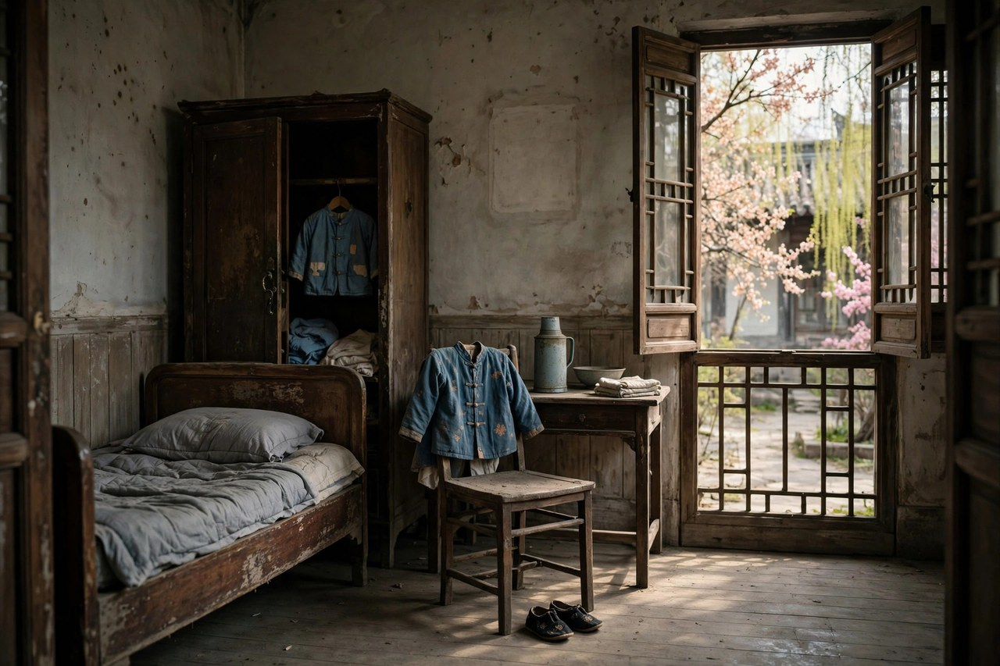

## 一封迟到的信

给亡妇这篇文章，写于一九三二年，距离妻子武钟谦去世，已经过去了三年。三年这个时间，说长不长，说短不短，长到足以让一个人从悲痛里慢慢走出来，短到足以让记忆还很清楚，还能想起妻子的样子，还能想起夫妻之间的家常，还能想起没有奔丧的愧疚。朱自清写这篇文章，不是为了发表，不是为了出名，是为了给亡妻写一封信，信写出来了，心里的话就出来了，话出来了，愧疚就轻一点，轻一点，人就安稳一点。

文章的开头，是一个字，谦。谦是妻子武钟谦的名字里的一个字，也是朱自清对妻子的爱称。爱称这个东西，在夫妻之间很重要，爱称叫出来，亲近就来了，亲近来了，感情就来了。朱自清叫妻子谦，叫得亲切，叫得温柔，叫得让人心里一暖。暖这个东西，在给亡妇里很重要，文章是悼亡的文章，本来应该是冷的，应该是悲的，可是朱自清写得暖，暖到读者读了，不会觉得冷，不会觉得怕，只会觉得，一个丈夫在给妻子写信，信里有爱，有愧，有怀念，有家常。

迟到的信这个说法，很值得细想。信为什么迟到，因为妻子去世的时候，朱自清没有奔丧，没有回去送妻子最后一程，没有看到妻子最后一面。没有奔丧的原因，是清华的课程已经过半，又没有找到代课的人选，他忍痛放弃了奔丧的打算。放弃这个词，在给亡妇里最沉重，放弃奔丧，是一个丈夫最难的决定，决定做了，心里就留下了愧疚，愧疚留了三年，三年之后，写成了文章，文章就是迟到的信，信写出来了，愧疚就说出来了，说出来了，心就轻一点。

今天的人，读给亡妇，会想起自己有没有迟到的信，有没有没有说出口的话，有没有没有回去看的人，有没有没有送最后一程的人。迟到的信，人人都有，写出来，寄不出去，寄不出去，信就留在了心里，留在了文章里，留在了记忆里。记忆这个东西，写下来就留住了，留住了，迟到的信就不再迟到了，信到了，心就安了，心安了，日子就好过了。

## 夫妻十二年的家常

朱自清和武钟谦，结婚十二年，十二年里，妻子为他养育了六个子女，还要照顾丈夫的生活起居，操持日常家务。十二年这个时间，说长不长，说短不短，长到足以让两个人从陌生变成亲近，短到足以让妻子在三十出头就去世了，去世了，留下了孩子，留下了丈夫，留下了没有说完的话。家常这个东西，在给亡妇里最动人，家常不是大事，是小事，是每天吃饭，是每天带孩子，是每天操持家务，是每天等丈夫回家，是每天在屋里拍着孩子哼眠歌。

荷塘月色里写到，妻子在屋里拍着孩子，迷迷糊糊地哼着眠歌，那个妻子，就是武钟谦。眠歌这个东西，在给亡妇里很重要，眠歌是母亲哄孩子睡觉的歌，是温柔的歌，是轻的歌，是夜里的歌。歌这个东西，母亲唱给孩子听，孩子听着歌睡着了，母亲看着孩子睡着了，心里就安了，安了，日子就好过了。朱自清在荷塘边散步，听到屋里的眠歌，心里就暖了，暖了，荷塘月色就有了家的味道，家的味道，就是眠歌的味道，就是妻子的味道。

夫妻十二年的家常，还有一层意思，就是包办婚姻里的真感情。朱自清和武钟谦的婚姻，是父母包办的，是年轻时由父母做主结的婚，包办这个词，在今天看来，是旧的，是不自由的，可是两个人在十二年里，却过出了真感情，过出了恩爱，过出了互相体贴，过出了互相照顾。真感情这个东西，不是靠自由恋爱才有的，包办婚姻里也有，自由恋爱里也不一定有，真感情靠的是日子，靠的是家常，靠的是互相照顾，靠的是十二年里的一点一滴。一点一滴合起来，就是真感情，就是给亡妇里的爱，就是朱自清对妻子的怀念。

今天的人，谈婚姻，常常谈自由，谈爱情，谈浪漫，很少谈家常，很少谈十二年，很少谈带孩子，很少谈操持家务。家常这个东西，在婚姻里最重要，没有家常的婚姻，是空的婚姻，有家常的婚姻，才是实的婚姻。实的婚姻，写出来就是给亡妇，写出来，读者就懂了，懂了，婚姻就有了重量，重量有了，日子就好过了。日子好过了，婚姻就长了，长了，夫妻就老了，老了，回忆就多了，回忆多了，文章就有了。

## 没有奔丧的愧疚

给亡妇里最沉重的部分，是没有奔丧的愧疚。一九二九年十月，武钟谦因肺病带着子女回南方，十一月二十六日，病逝于扬州。消息传到北京，朱自清痛不欲生，可是他没有回去，没有奔丧，没有送妻子最后一程。没有回去的原因，是课程过半，没有代课人选，他忍痛放弃了。放弃这个决定，做了三年，愧疚了三年，三年之后，写成了文章，文章里，他把愧疚写出来了，写得克制，写得温和，写得让人心里一酸。

愧疚这个东西，在给亡妇里很重要，愧疚不是恨，不是怨，是对自己没有做到的事的责备，是对妻子没有照顾好的自责，是对孩子没有母亲的难过。难过这个东西，在文章里藏着，藏在家常里，藏在眠歌里，藏在谦这个爱称里，藏在每一句轻声细语里。轻声细语这个词，是给亡妇的笔调，笔调轻，感情重，轻和重合起来，就是愧疚的味道，就是怀念的味道，就是爱的味道。

今天的人，也会有没有奔丧的愧疚，会有没有回去看父母的愧疚，会有没有陪伴家人的愧疚，会有工作太忙错过了最后一面的愧疚。愧疚这个东西，人人都有，有了愧疚，怎么办，朱自清的办法是，写下来，写成文章，写成信，写成怀念，写下来，愧疚就说出来了，说出来了，心就轻一点，轻一点，人就安稳一点。安稳这个东西，在愧疚里最难得，难得的东西，要靠写，靠说，靠怀念，靠行动，行动这个东西，在愧疚之后最重要，行动就是多回去看看，多陪陪家人，多打几个电话，多做几件小事，小事做完了，愧疚就轻了，轻了，日子就好过了。

没有奔丧的愧疚，还告诉我们一个道理，人生有很多决定，是两难的决定，工作和家庭两难，课程和奔丧两难，责任和感情两难。两难的决定，做了哪一边，另一边都会愧疚，愧疚了，不要只停在愧疚里，要把愧疚写下来，要把愧疚说出来，要把愧疚变成行动，行动就是以后多陪家人，多回去看看，多珍惜眼前人。眼前人这个东西，在愧疚里最重要，眼前人还在，就要珍惜，珍惜了，将来就不会再愧疚，不会再写迟到的信，不会再留遗憾。

## 清华园里的旧居

给亡妇写于清华园，写的是清华园里的旧居，写的是西院的房子，写的是家里的旧家具，写的是孩子的衣物，写的是窗外的春光，写的是妻子不在的空寂。空寂这个东西，在给亡妇里很重要，妻子不在了，房子还在，家具还在，衣物还在，春光还在，可是人不在了，人在的时候，房子是满的，人不在了，房子是空的，空这个词，在文章里反复出现，空的房子，空的椅子，空的心，空合起来，就是失去妻子的感觉，就是悼亡的感觉。

清华园的旧居，在朱自清心里，是家，是和妻子一起生活过的地方，是孩子长大的地方，是眠歌唱过的地方，是家常过过的地方。家这个东西，在给亡妇里最重要，家不是房子，是人，是妻子，是孩子，是眠歌，是家常，是十二年的日子。日子这个东西，在旧居里留下了痕迹，痕迹这个东西，写下来就是文章，文章写下来，家就留住了，家留住了，妻子就留住了，妻子留住了，愧疚就轻了，轻了，人就安稳了。

今天的人，失去亲人之后，也会回到旧居，看到旧家具，看到旧衣物，看到旧照片，心里会空，会难受，会想起亲人。想起来的东西，写下来，就是自己的给亡妇，就是自己的怀念，就是自己的迟到的信。信写下来，旧居就不再空了，旧居里有了文章，有了记忆，有了爱，有了怀念，有了亲人的影子。影子这个东西，在旧居里很重要，影子在，亲人就在，亲人在，家就在，家在，日子就好过了。

清华园的旧居，还告诉我们一个道理，家这个东西，要珍惜，要在人还在的时候珍惜，要在眠歌还在的时候珍惜，要在家常还在的时候珍惜。珍惜这个东西，在失去之后最难得，难得的东西，要靠平时，平时珍惜了，失去之后，愧疚就少了，少了，文章就暖了，暖了，日子就好过了。日子好过了，旧居就不空了，旧居里有了爱，有了记忆，有了文章，有了朱自清，有了武钟谦，有了孩子，有了眠歌，有了十二年的家常。

## 轻声细语的笔调

给亡妇的笔调，是轻声细语的，是温和的，是克制的，是不张扬的。轻声细语这个词，写出了文章的语气，语气轻，感情重，轻和重合起来，就是悼亡的味道，就是怀念的味道，就是爱的味道。轻声细语不是没有感情，是感情太深，深到说不出来大声的话，只能轻声说，只能细语说，只能在夜里说，只能在文章里说。说出来的话，轻，细，温和，克制，可是读者读了，心里会重，会酸，会暖，会掉泪。

轻声细语的笔调，和朱自清其他的文章不一样，背影是朴素的，荷塘月色是幽美的，春是欢快的，匆匆是焦虑的，给亡妇是轻声细语的，是哀婉的，是克制的。哀婉这个东西，在给亡妇里最重要，哀婉不是大哭，不是大闹，是轻声的哀，是细语的婉，是夜里的叹息，是旧居里的空寂。哀婉合起来，就是悼亡的完整感情，感情完整了，文章就动人了，动人了，读者就记住了。

今天的人，写悼亡文章，常常追求大词，追求煽情，追求让人哭，追求让人转发。给亡妇告诉我们，写悼亡，不必追求大词，不必追求煽情，只要轻声细语，只要写家常，只要写眠歌，只要写谦这个爱称，只要写没有奔丧的愧疚，只要写旧居里的空寂，家常写出来了，愧疚写出来了，空寂写出来了，读者自己就会哭，自己哭了，文章就有了力量，力量这个东西，不是喊出来的，是家常写出来的，是轻声细语写出来的。

轻声细语的笔调，还可以放在日常生活里。夫妻之间，说话轻一点，细一点，温和一点，克制一点，日子就好过了。日子好过了，婚姻就长了，长了，回忆就多了，回忆多了，文章就有了。文章这个东西，就是轻声细语的日子写下来的样子，日子写下来了，轻声细语就留住了，留住了，爱就留住了，爱留住了，家就留住了，家留住了，日子就好过了。

## 悼亡文字的传统

给亡妇这篇文章，在中国文学里，有一个传统，叫悼亡。悼亡这个传统，很古老，从古代的悼亡诗，到现代的悼亡散文，都是写失去亲人的痛苦，写对亡人的怀念，写对自己的愧疚，写对生活的感悟。朱自清的给亡妇，就是现代悼亡散文里的佳作，佳作这个词，说得对，给亡妇写得好，好到让人读了心里一酸，好到让人读了想起自己的亲人，好到让人读了想写自己的悼亡文字。

悼亡文字的传统，还有一层意思，就是写给亡人看，写给活人看，写给自己看。写给亡人看，是为了告诉亡人，我还记得你，我还爱你，我还愧疚，我还怀念。写给活人看，是为了告诉活人，失去亲人是什么感觉，珍惜眼前人有多重要。写给自己看，是为了把心里的愧疚说出来，把心里的怀念写出来，把心里的爱留下来。三个看合起来，就是悼亡文字的完整意义，意义完整了，文章就流传了，流传了，悼亡就永远是悼亡，怀念就永远是怀念。

今天的人，失去亲人之后，也会写悼亡文字，写在朋友圈里，写在日记里，写在信里，写在文章里。写下来的悼亡文字，就是自己的给亡妇，就是自己的迟到的信，就是自己的轻声细语。轻声细语写下来，亲人就留住了，留住了，家就留住了，家留住了，日子就好过了。日子好过了，悼亡就不只是悲了，悼亡里还有爱，还有怀念，还有家常，还有眠歌，还有十二年的日子，还有清华园的旧居，还有一封迟到的信。

悼亡文字的传统，还告诉我们一个道理，失去亲人，不必只停在悲里，要把悲写下来，要把爱写下来，要把家常写下来，要把愧疚写下来，写下来，悲就轻了，轻了，爱就重了，重了，日子就好过了。日子好过了，悼亡就变成了怀念，怀念就变成了力量，力量就变成了珍惜眼前人，珍惜眼前人，日子就更实了，实了，悼亡就有了意义，意义有了，文章就流传了。

## 妻子武钟谦这个人

武钟谦这个人，在朱自清的文章里，是温柔的，是娴静的，是贤惠的，是朴素的，是心里永远装着丈夫和孩子，就是没有自己的女子。温柔这个词，在武钟谦身上最贴切，温柔不是软弱，是体贴，是耐心，是把日子过下去的力量。力量这个东西，在武钟谦身上很重要，力量不是大声的，是轻声的，是细语的，是每天带孩子，是每天操持家务，是每天等丈夫回家，是每天在屋里拍着孩子哼眠歌。眠歌这个东西，就是武钟谦的力量，就是武钟谦的爱，就是武钟谦留给朱自清的记忆。

武钟谦是扬州名医的独生女，家境本来不错，可是嫁给朱自清之后，日子过得紧巴，家境不好，孩子多，开销大，可是她没有抱怨，没有把日子过成诉苦，而是把日子过成了家常，家常过好了，日子就好过了。家常这个东西，在武钟谦身上最重要，家常不是大事，是小事，是每天吃饭，是每天带孩子，是每天操持家务，是每天等丈夫回家。小事做完了，日子就实了，实了，家就暖了，暖了，丈夫就安了，安了，文章就有了。

今天的人，谈妻子，常常谈漂亮，谈能干，谈赚钱，很少谈温柔，很少谈娴静，很少谈贤惠，很少谈朴素，很少谈心里装着丈夫和孩子就是没有自己。武钟谦这个人，提醒我们，妻子的好，不在漂亮，不在能干，不在赚钱，在温柔，在体贴，在耐心，在把日子过下去的力量。力量这个东西，在婚姻里最重要，力量有了，婚姻就长了，长了，回忆就多了，回忆多了，文章就有了。

武钟谦去世的时候，年纪还轻，三十出头，留下了孩子，留下了丈夫，留下了没有说完的话。没有说完的话，朱自清在给亡妇里替她说了，说了三年，说了十二年的家常，说了眠歌，说了谦这个爱称，说了没有奔丧的愧疚，说了清华园的旧居。说完了，话就留住了，留住了，武钟谦就永远在文章里了，在文章里，武钟谦还是温柔的，还是娴静的，还是贤惠的，还是朴素的，还是心里装着丈夫和孩子的，还是没有自己的，还是朱自清的谦。

## 再婚与怀念

武钟谦去世三年之后，朱自清写了给亡妇，写完给亡妇之后，他又和陈竹隐结婚，开始了新的生活。新的生活，不是忘记旧的生活，不是忘记武钟谦，不是忘记十二年的家常，不是忘记眠歌，不是忘记谦这个爱称。新的生活，是在怀念里开始的，是在愧疚里开始的，是在文章里开始的。文章写完了，心里的话说出来了，愧疚轻了，人就站起来了，站起来了，就上前去了，上前去了，日子就动起来了，日子动起来了，新的生活就来了。

再婚这个事情，在今天看来，很平常，在当年看来，也很平常，妻子去世了，丈夫带着孩子，要生活，要教书，要做学问，要有人照顾家，要有人陪伴，要有人一起过日子。再婚不是背叛，是生活，是日子要过下去，是孩子要有人带，是家要有人操持。朱自清再婚之后，还带着新妻子去给武钟谦扫墓，还写了悼念的文字，还怀念武钟谦，怀念这个东西，在再婚之后还在，还在，说明怀念不是忘记，怀念是记得，记得了，日子就有了根，根有了，新生活就稳了，稳了，日子就好过了。

今天的人，失去伴侣之后，再婚常常会有愧疚，会觉得对不起亡人，会觉得再婚就是忘记。给亡妇告诉我们，再婚不是忘记，再婚是在怀念里开始新生活，是在文章里说完心里的话之后，开始新生活。新生活开始了，怀念还在，怀念在，新生活就有了根，根有了，日子就实了，实了，再婚就不是背叛，再婚就是生活，就是日子要过下去，就是孩子要长大，就是家要暖起来。

再婚与怀念合起来，就是人生的完整面，失去和开始合起来，就是日子，日子这个东西，就是在失去里开始，在开始里怀念，在怀念里珍惜眼前人，珍惜眼前人，日子就好过了。日子好过了，怀念就轻了，轻了，新生活就更稳了，稳了，家就更暖了，暖了，文章就更动人了，动人了，给亡妇就永远是给亡妇，怀念就永远是怀念，新生活就永远是新生活。

## 给亡妇的今天读法

今天读给亡妇，怎么读才算读进去了。读法这个东西，很重要，读法对了，文章就活了，读法不对，文章就死了。读给亡妇，要轻声读，要细语读，要慢慢读，要想着自己的家人读，想着自己的伴侣读，想着自己的父母读，想着自己的孩子读。想着家人读，文章就和自己的生活连起来了，连起来了，文章就活了，活了，家人就活了，家人活了，日子就好过了。

读给亡妇，还要读出愧疚，读出怀念，读出家常，读出眠歌，读出谦这个爱称，读出没有奔丧的愧疚，读出清华园的旧居，读出轻声细语的笔调。读出来了，文章就读进去了，读进去了，人就长大了，长大了，就不再只想着自己了，也想着家人了，想着家人了，日子就实了，实了，愧疚就少了，少了，怀念就多了，多了，爱就重了，重了，日子就好过了。

读给亡妇，还要读出珍惜眼前人。眼前人这个东西，在给亡妇里最重要，眼前人还在，就要珍惜，珍惜的办法，是多陪陪，多打几个电话，多做几件小事，多说几句轻声细语的话，多唱几首眠歌，多写几封信，多回家看看。珍惜这个东西，在失去之后最难得，难得的东西，要靠平时，平时珍惜了，失去之后，愧疚就少了，少了，文章就暖了，暖了，日子就好过了。

读给亡妇，最后还要写下来，写自己的给亡妇，写自己的怀念，写自己的家常，写自己的眠歌，写自己的爱称，写自己的愧疚，写自己的旧居，写自己的轻声细语。写下来，怀念就留住了，留住了，明年再读，还能想起今年的家人，还能想起今年的家常，还能想起今年的眠歌，还能想起今年的爱称，还能想起今年的愧疚，还能想起今年的旧居。想起来了，日子就没有白过，白过的日子，是没有写下来的日子，没有写下来的日子，是空的日子，空的日子过多了，人就老了。

## 迟到的信终于写完了

给亡妇这篇文章，写完了，可是信没有写完，信在文章里，在读者心里，在清华园的旧居里，在扬州的家里，在孩子的心里，在后来人的日子里。信这个东西，写完了，寄不出去，寄不出去，信就留在了文章里，留在了记忆里，留在了怀念里，留在了爱里。爱这个东西，在信里最重要，爱写出来了，信就到了，信到了，心就安了，心安了，日子就好过了。

迟到的信，终于写完了，写完了，朱自清心里的愧疚轻了，轻了，人就站起来了，站起来了，就上前去了，上前去了，日子就动起来了，日子动起来了，新的生活就来了，新的生活来了，怀念还在，怀念在，日子就有了根，根有了，家就稳了，稳了，文章就流传了，流传了，给亡妇就永远是给亡妇，谦就永远是谦，眠歌就永远是眠歌，家常就永远是家常，清华园的旧居就永远是清华园的旧居。

今天的人，读给亡妇，读完了，也要写一封自己的信，写给亲人，写给伴侣，写给父母，写给孩子，写给已经去世的人，写给还在眼前的人。信写下来，话就说出来了，话说出来了，心就轻了，轻了，日子就好过了。日子好过了，信就不再迟到了，信到了，心就安了，心安了，家就暖了，暖了，日子就长了，长了，怀念就永远在，永远在，永远是给亡妇，永远是朱自清的谦，永远是武钟谦的眠歌，永远是十二年的家常，永远是清华园里的旧居，永远是一封迟到的信，终于写完了，写完了，就传下去了，传下去，后来人读了，也会写自己的信，写自己的怀念，写自己的家常，写自己的爱，写自己的日子。

## 旧居里的春光

清华园旧居里的春光，在给亡妇里也很动人。春光这个东西，在旧居里是亮的，是暖的，是透过窗子照进来的，是照在旧家具上的，是照在孩子衣物上的。春光照进来，房子就亮了，亮了，人就觉得，妻子虽然不在了，可是春光还在，春光在，日子就还在，日子在，家就还在。家这个东西，在春光里最容易被想起，春光照着旧居，旧居里的人不在了，可是春光记得人，春光记得眠歌，春光记得家常，春光记得十二年的日子。日子这个东西，在春光里留下了痕迹，痕迹写下来就是文章，文章写下来，春光就留住了，留住了，妻子就留住了。

今天的人，失去亲人之后，也会看到旧居里的春光，看到春光照在旧家具上，看到春光照在旧照片上，心里会暖，会酸，会想起亲人。想起来的东西，写下来，就是自己的给亡妇，就是自己的怀念，就是自己的迟到的信。信写下来，春光就留住了，留住了，亲人就留住了，留住了，家就留住了，家留住了，日子就好过了。日子好过了，春光就更亮了，亮了，旧居就不空了，不空了，人就安稳了，安稳了，怀念就轻了，轻了，爱就重了。

春光这个东西，在给亡妇里还有一层意思，就是希望。希望这个东西，在旧居里藏着，藏在春光里，藏在窗子里，藏在孩子长大的样子里，藏在新生活的开始里。希望找到了，人就站起来了，站起来了，就上前去了，上前去了，日子就动起来了，日子动起来了，旧居就不再只是空寂了，旧居里有了春光，有了希望，有了文章，有了怀念，有了爱，有了朱自清，有了武钟谦，有了孩子，有了眠歌，有了十二年的家常。

## 孩子长大的样子

武钟谦留下的孩子，在给亡妇里也很动人。孩子这个东西，在文章里是小的，是需要照顾的，是母亲带大的，是父亲要继续带大的。孩子长大了，母亲不在了，父亲要一个人带孩子，要教书，要写文章，要做学问，要操持家务，要把孩子带大。带大这个东西，在给亡妇里最沉重，沉重到朱自清写文章的时候，心里都是孩子，都是妻子，都是愧疚，都是怀念。怀念这个东西，在孩子身上最容易看到，孩子长大了，像母亲了，像父亲了，像家里的旧居了，像清华园的春光了，像眠歌了，像家常了。

孩子长大的样子，在今天看来，依然动人。父母不在了，孩子长大了，长大了，就会想起父母，就会写文章，就会怀念，就会珍惜眼前人。珍惜眼前人这个东西，在孩子长大之后最容易明白，明白了，日子就实了，实了，愧疚就少了，少了，怀念就多了，多了，爱就重了。爱这个东西，在孩子长大之后最重要，爱重了，家就暖了，暖了，日子就好过了。

孩子这个东西，在给亡妇里还有一层意思，就是延续。延续这个东西，是生命的延续，是家的延续，是文章的延续，是怀念的延续。妻子去世了，孩子还在，孩子在，家就在，家在，怀念就在，怀念在，文章就在，文章在，武钟谦就永远在文章里了，在文章里，武钟谦还是温柔的，还是娴静的，还是贤惠的，还是朴素的，还是心里装着丈夫和孩子的，还是没有自己的，还是朱自清的谦。谦这个爱称，在孩子心里，也会留下来，留下来，孩子将来也会叫自己的爱人谦，也会唱眠歌，也会过家常，也会写文章，写下来，延续就传下去了。

## 一封信的余温

给亡妇这封迟到的信，写完了，可是余温还在，余温这个东西，在文章里最动人，余温是轻声细语的余温，是家常的余温，是眠歌的余温，是谦这个爱称的余温，是旧居里的春光的余温，是孩子长大的余温。余温合起来，就是爱的余温，就是怀念的余温，就是愧疚说出来之后的安稳。安稳这个东西，在余温里最难得，难得的东西，要靠写，靠说，靠怀念，靠珍惜眼前人，珍惜眼前人，余温就长了，长了，日子就好过了。

今天的人，读给亡妇，读完了，心里也会留一点余温，余温是暖的，是酸的，是轻的，是细的，是想起自己的家人，想起自己的伴侣，想起自己的父母，想起自己的孩子。想起来了，就去做，做一次探望，打一个电话，写一封信，唱一首眠歌，过一次家常，做完了，余温就更暖了，暖了，日子就好过了，日子好过了，余温就传下去了，传下去，后来人读了，也会留一点余温，余温传下去，给亡妇就永远是给亡妇，谦就永远是谦，眠歌就永远是眠歌，家常就永远是家常，旧居就永远是旧居，春光就永远是春光，孩子就永远长大，信就永远写完，写完就永远传下去。
