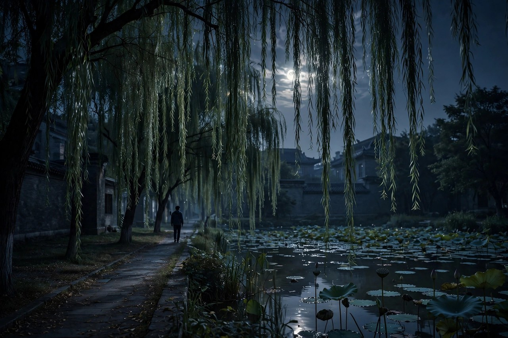

## 夜里走出门去

荷塘月色的开头，是一个睡不着的夜晚。朱自清说，这几天心里颇不宁静，今晚在院子里坐着乘凉，忽然想起日日走过的荷塘，在这满月的光里，总该另有一番样子，于是披了大衫，带上门，出去走走。这段开头写得很平淡，可是平淡里藏着一个人的真实状态，心里不宁静，坐不住，睡不着，只能出去走走。今天很多人也有这样的夜晚，心里有事，躺在床上翻来覆去，手机刷了一遍又一遍，还是睡不着，最后只能起来，到楼下走一圈，到河边站一会儿。这种夜里走出去的动作，古今都是一样的，都是心里装不下了，要找个地方放一放。

他走的路，是清华园里一条曲曲弯弯的小煤屑路，路两边是杨柳和荷塘。月光洒下来，路显得格外安静，格外幽深。朱自清一个人走，身边没有别人，只有月光，只有荷香，只有自己的脚步声。这种独自散步的状态，很值得细想。一个人独处的时候，心里的话才会出来，跟别人在一起的时候，话是说给别人听的，独处的时候，话是说给自己听的。荷塘月色就是说给自己听的话，写给自己看的景，所以读起来特别真，特别贴近。

那时候是夏天，荷塘里的荷花正开着，荷叶正绿着，月亮正圆着，景色正是最好的时候。可是作者的心情却并不好，大革命失败，白色恐怖笼罩，知识分子不知道路在哪里，不知道自己该往哪里走。他没有在文章里直接写这些大事，而是写自己夜里去荷塘，写荷叶，写月光，把大事藏在小景里。这种写法，比直接喊口号高明得多，因为读者先看到景，慢慢才体会到景后面的心情。心情藏在景里，景就有了分量，文章就有了余味。

今天的人，夜里睡不着的时候，常常选择刷手机，刷到眼睛发酸，还是睡不着。朱自清的办法是走出去，到水边去，到月光下去，到荷塘边去。走出去，不一定能解决问题，可是能让心情换一个地方，能让眼睛看到不一样的东西，能让心里的话慢慢理清楚。荷塘月色给今天的人的启示，就是夜里睡不着，别只躺在床上跟手机较劲，起来走走，到窗外看看月亮，到楼下走一圈，回来再睡，可能会好一点。月光这个东西，看着看着，心就会静下来。

## 荷叶与荷花

走到荷塘边，朱自清看到的荷叶，是田田的叶子，叶子出水很高，像亭亭的舞女的裙。这个比喻写得极好，荷叶的姿态，荷叶的舒展，荷叶在月光下的样子，一下子就出来了。舞女的裙，是动着的，是飘着的，是有风情的，荷叶在月光下，也是动着的，风一吹，叶子就轻轻摇，摇起来就像裙摆在动。这种比喻，不是硬想出来的，是作者站在塘边，看了很久，才看出来的。看景要看久，看久了，景才会说话，荷叶才会变成舞女的裙。

荷花呢，层层的叶子中间，零星地点缀着些白花，有袅娜地开着的，有羞涩地打着朵儿的，正如一粒粒的明珠，又如碧天里的星星，又如刚出浴的美人。这个比喻，一连用了三个，明珠、星星、美人，每一个都写出了荷花的一个方面，明珠写出了荷花的亮，星星写出了荷花的远，美人写出了荷花的洁。这种连用比喻的办法，在今天看来可能有点多，可是放在荷塘月色的语境里，却一点也不多，因为荷花在月光下，确实就是这样，一会儿像明珠，一会儿像星星，一会儿像美人，看的人眼睛不够用，比喻也不够用。

荷香也写得好，微风过处，送来缕缕清香，仿佛远处高楼上渺茫的歌声似的。香这个东西，本来是闻到的，朱自清把它写成听到的，歌声似的，这种通感的写法，让香有了声音，有了距离，有了朦胧感。远处高楼上的歌声，听不清词，听不清调，只觉得好听，只觉得远，荷香也是这样，闻不清是哪一朵花的香，只觉得清，只觉得远。这种写法，需要作者有很细的感觉，感觉细了，文章才会细。

今天的人看荷花，常常是拍照，拍一张发朋友圈，配一句诗，就走了。朱自清看荷花，是站着看，坐着看，走着看，看荷叶，看荷花，看荷香，看月光，看水影，看很久，看出感情来。看景和拍照的区别，就在这里，拍照是把景带走，看景是把景留在心里。带走的东西，存在手机里，很少再翻出来，留在心里的东西，随时都能想起来。荷塘月色的荷叶荷花，就是留在心里的景，读了几十年，还能想起来，还能闻到香，还能看到月光。

## 月光如流水

荷塘月色里最有名的句子，是月光如流水一般，静静地泻在这一片叶子和花上。月光本来是光，朱自清把它写成水，泻这个字用得极好，月光像水一样流下来，流在叶子上，流在花上，流在水面上，流进人心里。这种写法，让月光有了动感，有了重量，有了声音，读者读到这里，仿佛能听到月光流动的声音，能看到月光在叶子上滑动的样子。

薄薄的青雾浮起在荷塘里，叶子和花仿佛在牛乳中洗过一样，又像笼着轻纱的梦。青雾、牛乳、轻纱、梦，这几个意象合起来，把月光下的荷塘写成了一个梦境。梦境这个东西，是朦胧的，是不真实的，是美好的，也是易碎的。朱自清那时候的心情，也是朦胧的，想超脱，又超脱不了，想安静，又安静不了，荷塘的梦境，正好映照了他的心情。景和心情合在一起，文章就有了灵魂。

月光下的荷塘，水面是平静的，可是水底有月影，有荷影，有树的影子，影子在水里摇，摇得人心也跟着摇。朱自清写月光，不只是写亮，还写暗，写叶子底下的阴影，写水里的暗影，写月光照不到的地方。这种明暗对比，让荷塘有了层次，有了深度，不再是一张平面的画，而是一个有空间的世界。世界有明有暗，人心也有明有暗，文章写出了明暗，就是写出了人心。

今天的人看月亮，常常是在城市里看，城市里的月亮被灯光盖住了，被高楼挡住了，看着不亮，看着不圆。朱自清的月亮，是在清华园里看的，是在荷塘边看的，是没有灯光干扰的月亮，是干净的月亮。今天要想看到这样的月亮，要到郊外去，要到水边去，要到没有灯光的地方去。月亮还是那个月亮，地方不一样，感觉就不一样。荷塘月色提醒我们，月亮不只在天上，还在水里，还在荷叶上，还在心里，心里有月光的人，走到哪里都能看到月光。

## 塘边的杨柳与蝉声

荷塘四面，长着许多树，蓊蓊郁郁的，路的一旁，是些杨柳，和一些不知道名字的树。杨柳在月光下，影子落在水里，风一吹，柳丝就轻轻摆，摆得水面上的影子也跟着摆。这种柳影，是荷塘月色里很动人的一笔，柳树是柔的，是软的，是多情的，柳影落在水里，更是柔上加柔，软上加软。朱自清写柳，不写柳的绿，写柳的影，影子这个东西，是虚的，是动的，是捉不住的，正好映照了作者捉不住的心情。

蝉声也写得好，塘中的月色并不均匀，但光与影有着和谐的旋律，如梵婀玲上奏着的名曲。蝉声、月光、树影，合起来像一首曲子，曲子这个比喻，把视觉、听觉合在一起，让读者仿佛能听到荷塘的音乐。今天的人到荷塘边，常常只顾着看，忘了听，其实荷塘的音乐很重要，蝉声、蛙声、风声、水声，合起来就是夏夜的交响。朱自清听到了这种交响，所以他的文章有音乐感，读起来像听曲子一样，有节奏，有起伏，有高低。

塘边的树，朱自清没有一一写出名字，他说有一些不知道名字的树。这种写法很诚实，不知道就是不知道，不装懂，不查书，不把文章写成植物图鉴。不知道名字的树，依然好看，依然有影子，依然能入文章。写作的时候，不知道的东西，不必硬写，硬写出来的东西，读者能看出来是硬的。诚实地写不知道，反而让文章更可信，更亲近。

今天的人去荷塘，常常带着植物识别的软件，看到一棵树，先扫一扫，知道名字，再拍照。这种办法，知道是知道了，可是感觉却少了。朱自清的办法是，先看，先听，先感受，名字不重要，感觉最重要。感觉到了，文章就有了，感觉不到，名字知道再多，文章也是空的。荷塘月色的塘边，就是这样一个感觉先行的地方，杨柳的影子，蝉声的旋律，月光的流动，感觉合起来，就是一篇文章。

## 采莲与江南旧梦

写到荷塘的后半段，朱自清想起了采莲的事，想起了江南旧俗，想起了梁元帝的采莲赋，想起了王维的诗。采莲这个意象，在中国文学里很古老，江南的女子，划着小船，采着莲子，唱着歌，画面很美，意境很远。朱自清想起采莲，是因为荷塘让他想起了江南，想起了自己的南方，想起了自己在南方教书的日子。江南这个地方，对他来说，不只是一个地理概念，更是一个情感概念，是家乡，是青春，是过去的好时光。

可是他马上又说，今晚若有采莲人，怕也是要失望的，因为荷塘里没有采莲人，只有他一个人，只有月光，只有荷叶。这种失望，不是真的失望，是作者心里的一种惆怅，过去的好时光回不来了，江南的采莲人不会出现在这里，清华园的荷塘也不是江南的荷塘。这种惆怅，是很多离乡的人都有的，离开家乡久了，看到相似的景色，就会想起家乡，想起过去，可是景色相似，人却不一样了，时间也不一样了。

江南旧梦这个意象，在朱自清的文章里常常出现。他写我的南方，写扬州，写温州，写秦淮河，都是在写江南。江南对他来说，是水的，是柔的，是湿润的，是有灯火的。北方的荷塘，虽然也有荷花，也有月光，可是江南的味道却不一样。朱自清在北方写江南，是在用北方的景，寄托南方的情，这种寄托，让文章有了两层意思，一层是眼前的荷塘，一层是心里的江南。两层意思合在一起，文章就厚了。

今天的人，离开家乡去大城市打拼，看到大城市的荷塘，看到大城市的月亮，也会想起家乡。家乡的荷塘可能没有了，家乡的月亮可能被高楼挡住了，可是记忆里的荷塘和月亮还在。这种记忆，是离乡的人心里最软的地方，平时不碰，碰一下就会疼。荷塘月色写出了这种疼，写得克制，写得温和，疼而不叫，叫而不闹。今天的离乡人，读荷塘月色，会读出自己的江南旧梦，会读出自己的惆怅，会读出一种安慰，原来不只是自己这样，原来朱自清也是这样。

## 想超脱又超脱不了

荷塘月色的核心心情，是想超脱又超脱不了。朱自清说，他想摆脱心里的不宁静，想找一个安静的地方，想让自己暂时忘掉现实，可是走到荷塘边，看到月光，看到荷叶，心里还是不宁静，还是想着现实，还是想着国家的命运，还是想着自己的出路。这种想超脱又超脱不了的矛盾，是那一代知识分子的共同心情。他们想投身革命，可是又有很多顾虑，想逃避现实，可是又逃避不了，想超然，可是又做不到超然。

文章的结尾，朱自清说，他想起了采莲，想起了江南，想起了过去，可是又回到了现实，回到了荷塘边，回到了自己的小屋。他推开门，走进屋里，屋里还是老样子，书桌还是老样子，心里的不宁静还是老样子。这种回到现实的结尾，很真实，没有强行给出一个光明的结局，没有说从此就想通了，就超脱了，就找到了出路。没有给出答案，恰恰是这篇文章最诚实的地方。人生很多时候，就是没有答案的，就是要在不宁静里过下去的。

今天的人，也常常想超脱。工作压力大，生活压力大，心里不宁静，就想去旅游，想去山里，想去水边，想找一个安静的地方躲一躲。躲一躲，回来之后，压力还在，问题还在，心里的不宁静还在。荷塘月色告诉我们，超脱不是躲，躲是躲不掉的，真正的办法，是在不宁静里找到一种安放自己的方式。朱自清安放自己的方式，是写文章，是把心情写进荷塘里，写出来，心里就轻一点。今天的人安放自己的方式，可以是写日记，可以是散步，可以是跟朋友聊聊，可以是读一篇文章，方式不一样，道理是一样的，把心情放出来，不要闷在心里。

想超脱又超脱不了，不是失败，是真实。承认自己超脱不了，比假装超脱了要勇敢得多。朱自清的勇敢，就在于他承认了自己的矛盾，承认了自己的惶惑，承认了自己想超脱又做不到。这种承认，让文章有了力量，让读者觉得，作者和自己是一样的人，一样在矛盾里挣扎，一样在夜里睡不着，一样在荷塘边找安慰。读者和作者成了同路人，文章就有了读者。

## 清华园的荷塘今天

今天的清华园，荷塘还在，名字叫近春园，荷花还在开，月亮还在升，游人很多，拍照的人很多，背诵荷塘月色的人也很多。可是今天的荷塘，和朱自清当年的荷塘，已经不一样了。当年的荷塘，是安静的，是幽深的，是一个人夜里可以独自散步的地方，今天的荷塘，是热闹的，是开放的，是白天人流如织的地方。安静这个东西，在今天的荷塘里，已经很难找到了。

不过，荷塘的月光还在，荷叶还在，荷花还在，月光如流水的感觉，只要夜里去，只要人少的时候去，还是能找到的。找月光的办法，是夜里去，是人少的时候去，是安静下来去。白天去荷塘，看到的是荷花，是游人，是拍照的声音，夜里去荷塘，看到的是月光，是荷影，是自己的心情。荷塘月色是夜里的文章，要夜里读，夜里去，才能读出味道。

今天的清华学生，夜里也会到荷塘边散步，也会想起朱自清，也会想起荷塘月色。他们散步的时候，心里也有不宁静，也有压力，也有对未来的迷茫，这种心情，和朱自清当年是一样的。时代变了，压力的来源变了，可是夜里散步的心情没有变，荷塘还是那个荷塘，月光还是那个月光，人还是那个人。荷塘月色之所以能流传，就是因为它写的是不变的心情，不是变的时代。

游人到荷塘，最好的办法，不是白天去拍照，而是夜里去站一会儿。站一会儿，看看月光，看看荷叶，听听蝉声，想想自己的心事，再读一读荷塘月色，文章就会活起来。活起来的文章，不是课本上的文章，是自己心里的文章。自己心里的文章，读一遍，记一辈子。荷塘这个地方，就是这样一个能让文章活起来的地方，只要你夜里去，只要你安静下来。

## 夜里散步的办法

荷塘月色还教会我们一种夜里散步的办法。夜里散步，不要带着手机，不要带着耳机，不要急着走，要慢慢走，要看，要听，要闻，要感受。朱自清夜里散步，带的是大衫，带的是心情，没有带别的东西。他走得很慢，慢到能看到荷叶的姿态，能听到蝉声的旋律，能闻到荷香的清远。这种慢，是今天的人最缺的东西。今天的人走路快，吃饭快，说话快，做事快，慢下来，反而不会了。

夜里散步，还有一个好处，是能让自己和自己说话。白天的时候，人要应付很多事，要跟很多人说话，说的话很多是应付的，不是真心的。夜里散步的时候，没有人应付，只有自己和月光，说的话才是真心的。朱自清在荷塘边，就是在跟自己说话，说自己的不宁静，说自己的惆怅，说自己的江南旧梦。这种跟自己说话的时间，每个人都需要，没有这种时间，人就会越来越浮躁，越来越不知道自己想要什么。

今天的人，夜里散步常常带着耳机，听着音乐，听着播客，听着别人的话，自己的话反而听不到了。荷塘月色的办法是，把耳机摘下来，听听蝉声，听听风声，听听水声，听听自己的脚步声。自己的脚步声，是最真实的声音，脚步声里藏着自己的节奏，藏着自己的心情。听着脚步声走，走到荷塘边，走到月光下，心就会静下来。静下来，才能想清楚白天想不清楚的事。

夜里散步，还可以带一本书，带一篇文章，走到水边，坐下来读一读。读荷塘月色，在荷塘边读，感觉完全不一样，文章里的荷叶，就是眼前的荷叶，文章里的月光，就是头顶的月光，文章里的心情，就是自己的心情。这种情景交融的读法，是最好的读法。读文章，要到文章写的地方去读，到地方去，文章就活了，地方也活了，人也活了。

## 把心事交给水

荷塘月色里，水是一个很重要的意象。荷塘的水，是平静的，是清澈的，是能照出月光的，是能映出荷影的。水这个东西，在中国文化里，常常象征着心，心如止水，心如明镜，都是用水来比心。朱自清把心事交给水，就是把不宁静的心，放在平静的水面上，让水来安抚它。水的平静，能安抚人的不平静，水的清澈，能照出人的心情。

今天的人，心里有事的时候，也可以把心事交给水。到河边站一会儿，到湖边坐一会儿，到海边走一走，看看水，听听水声，心就会慢慢平静下来。水不会说话，可是水会听，会把你的心事接住，会把你的不宁静带走。这种办法，看起来有点玄，可是很多人都试过，试过之后都觉得管用。水这个东西，有一种安抚的力量，这种力量，不需要解释，只需要去感受。

荷塘的水，还有一层意思，就是时间的流动。水在流，月光在水面上流，荷影在水里摇，时间也在流。朱自清站在塘边，看着水，看着月光，看着荷影，就是在看着时间的流动。时间流过去了，就回不来了，可是水还在，月光还在，荷花还在，这种还在，给了人一种安慰。时间会过去，可是美好的东西还会回来，荷花今年谢了，明年还会开，月亮今晚落了，明晚还会升。这种循环，让人心里有盼头。

把心事交给水，不是逃避，是安放。安放好了，心事就不会在心里乱撞，就不会让人睡不着，就不会让人焦虑。安放的办法有很多种，写文章是一种，散步是一种，看水是一种，读荷塘月色也是一种。方式不重要，重要的是把心事放出来，不要闷着。闷着的心事，会越闷越重，放出来的心事，会越放越轻。朱自清把心事放进了荷塘里，荷塘接住了，读者读到了，也接住了，这就是文章的力量。

## 荷塘里的中国文人

荷塘月色还写出了中国文人的一种传统，就是借景抒情，借水抒怀。中国文人遇到不顺心的事，常常不直接说，而是去看山，去看水，去看月亮，把心情寄托在景色里。李白看月亮，写静夜思，苏轼看赤壁，写赤壁赋，朱自清看荷塘，写荷塘月色，这种传统，一脉相承。景色成了文人心情的容器，容器越美，心情越能被理解。

这种传统的好处，是含蓄，是温和，是不伤人。心情不好，不骂人，不抱怨，而是去看荷塘，去写月光，把心情化成美的东西。这种化法，需要修养，需要学问，需要对生活的热爱。朱自清有这种修养，所以他能把不宁静化成荷塘月色，能把惶惑化成月光如流水。今天的人，心情不好的时候，常常选择发泄，发泄在社交平台上，发泄在别人身上，发泄完了，心情更糟。荷塘月色的办法是转化，不是发泄，转化成美的东西，心情就好了，文章也好了，别人读了也好了。

中国文人的荷塘，还有一层意思，就是出淤泥而不染。荷花长在淤泥里，开出来的花却是干净的，是洁白的，是清香的。这种品质，是中国文人推崇的，处在黑暗里，心里还要干净，处在污浊里，还要保持清香。朱自清那时候处在黑暗里，白色恐怖笼罩，可是他写出来的荷花，依然是干净的，依然是清香的，这就是他的品质。今天的人，处在浮躁里，处在诱惑里，也要保持这种干净，保持这种清香，不随波逐流，不丢掉良心。

荷塘里的中国文人，不是隐士，不是逃避者，是在现实里保持清醒的人。朱自清没有逃到荷塘里不出来，他写完荷塘月色，还是要回到现实里，还是要教书，还是要做学问，还是要面对国家的命运。荷塘是他暂时的安放处，不是永久的避难所。这种态度，很值得学习。安放，不是逃避，是为了更好地回去，回去面对现实，回去做该做的事。荷塘月色，就是这样一个安放处，安放好了，人就回去了，回去的时候，心里轻了一点，脚步稳了一点。

## 读荷塘月色的人后来都怎么样了

荷塘月色进了课本之后，几代学生都读过它，背过它，考过它。有人背完就忘了，有人背完记了一辈子。记了一辈子的人，后来都怎么样了，他们有的成了老师，有的成了作家，有的成了普通的劳动者，有的成了父母。他们再读荷塘月色的时候，感觉和年轻时完全不一样了。年轻时读，读的是景，年长后读，读的是心情。景会变，心情不会变，年轻时的景是荷塘，年长后的景是生活，可是心情是一样的，都是不宁静，都是想超脱又超脱不了。

当了父母的人，读荷塘月色，会想起自己夜里睡不着的时候，会想起自己到水边散步的时候，会想起自己心里不宁静的时候。他们会把这篇文章讲给孩子听，讲荷叶，讲荷花，讲月光，讲朱自清当年的心情。孩子听了，可能不懂，可能觉得好玩，可是种子种下去了，将来孩子夜里睡不着的时候，也会想起荷塘，想起月光，想起这篇文章。文章就是这样一代一代传下去的，传的不是知识，是心情，是安放心情的办法。

当了老师的人，教荷塘月色，不能只讲修辞，不能只讲段落，要讲夜里散步，要讲月光，要讲心情，要讲学生自己的夜晚。学生夜里睡不着的时候，老师可以告诉他们，去散步，去看月亮，去读荷塘月色，去把心情写下来。这种教法，比讲修辞管用，因为修辞会忘，心情不会忘，方法会忘，体验不会忘。老师教文章，最好的效果，是学生将来夜里睡不着的时候，能想起这篇文章，能用这篇文章的办法安放自己。

普通劳动者读荷塘月色，也会有自己的感受。他们在城里打工，夜里回到出租屋，心里不宁静，睡不着，起来到楼下走一圈，看到月亮，看到路边的树，看到水面上的月影，就会想起荷塘月色。荷塘不在眼前，月光却在头顶，心情却是一样的。这种共鸣，是文章的力量，是朱自清留给普通人的礼物。礼物不贵，只是一篇文章，只是一片月光，只是一个夜里散步的办法，可是够用一辈子。

## 月光下的一个提醒

最后，荷塘月色留给我们一个提醒，夜里睡不着的时候，不要怕，不要慌，不要急着用手机把自己灌醉。起来，披一件衣服，带上门，出去走走，到水边去，到月光下去，到荷塘边去，或者到楼下的小河边去，到公园的湖边去，看看月光，看看水影，听听蝉声，闻闻夜里的香。走一圈，回来，心里会轻一点，睡意会来一点，问题不一定解决，可是心情会好一点。心情好了，问题就好解决一点。

月光这个东西，看着看着，心就会静。静，不是没有事，是事还在，心不乱了。心不乱，才能想清楚事，才能做出对的选择。朱自清夜里去荷塘，就是去找这种静，找到了静，文章就写出来了，文章写出来了，心就更静了。这种良性循环，每个人都可以试一试。夜里散步，月光下散步，水边散步，散着散着，心就静了，心静了，路就看清了。

荷塘月色这篇文章，写于一九二七年七月，发表在小说月报上，距离今天已经很久了，可是月光没有变，荷塘没有变，人心没有变。只要夜里还有月亮，只要水边还有荷花，只要人心里还有不宁静，这篇文章就不会过时。读它，不是为了考试，是为了夜里睡不着的时候，有一个地方可以去，有一片月光可以看，有一篇文章可以读，有一个古人可以陪着你散步。陪着你散步的人，是朱自清，他走在前面，你走在后面，月光洒在两个人身上，荷香飘在两个人身边，夜，就没有那么难熬了。

## 荷塘边的一盏灯

荷塘边最后还有一盏灯，不是路灯，是文章里的灯，是朱自清心里的一盏灯。这盏灯不亮眼，可是照得远，照着荷叶，照着荷花，照着月光，照着后来读文章的人。后来的人夜里睡不着，走到水边，想起这篇文章，心里的灯就亮了。灯亮了，夜就不黑了，路就看得清了，心就不慌了。这盏灯传了很久，从清华园传到中学课本，从中学课本传到千家万户，从千家万户传到今天的夜里。传灯的人是朱自清，接灯的人是我们，我们接过来，再传下去，传给孩子，传给学生，传给夜里睡不着的朋友。传下去的办法很简单，就是夜里去散步，就是读一读荷塘月色，就是把心情写下来，就是把月光看进心里。月光看进心里了，灯就亮了，灯亮了，荷塘就在心里了，荷塘在心里了，夜就安稳了，人就安稳了，日子也就安稳了。

## 荷塘月色未写完的话

荷塘月色写完了，可是话没有写完，话在月光里，在荷叶里，在水影里，在后来人的夜里。后来人夜里散步，走到水边，想起这篇文章，就会把没有写完的话接下去，接下去的话是自己的，是夜里的，是月光下的，是荷塘边的。接下去，就是文章的延续，就是月光的延续，就是荷塘的延续。延续下去，文章就不会老，月光就不会暗，荷塘就不会干，人心就不会冷。冷了的心，走到荷塘边，看看月光，就会暖起来，暖起来的心，再去读文章，就会读出新的味道，新的味道，就是未写完的话，就是后来人的话，就是你我的话。
