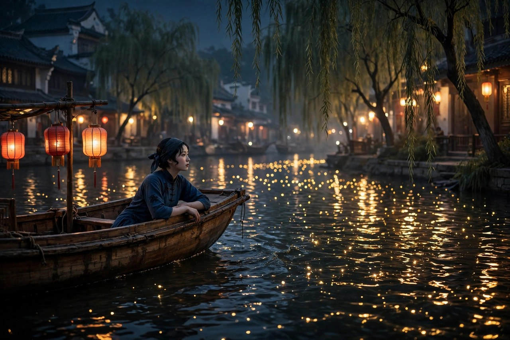
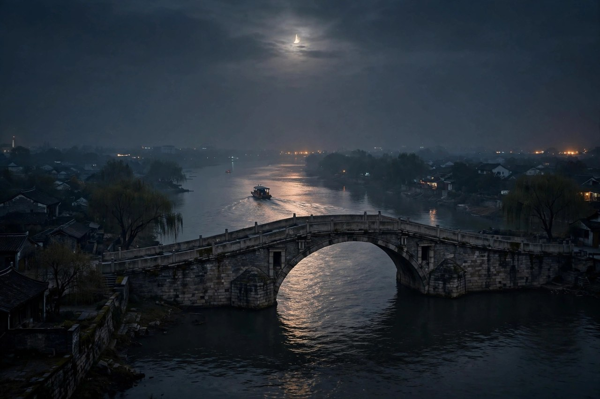

## 夏夜里的一次约游

桨声灯影里的秦淮河，起点是一次夏夜的约游。一九二三年夏天，朱自清去信邀请俞平伯南下度假，两个人先游了西湖，又结伴到南京，游了几天，临分手的时候，相约夜里泛舟秦淮河。夜游这个主意，在今天看来很平常，在当年却很有味道。白天游南京，看的是古迹，看的是街道，看的是人流，夜里游秦淮，看的是灯火，看的是水色，看的是月光，看的是另一种南京。白天是历史的南京，夜里是风情的南京，两种南京合起来，才是完整的南京。

两个人约好，以桨声灯影里的秦淮河为题，各自写一篇文章。这个约定很有意思，同样的题目，同样的夜晚，同样的河水，写出来却是两篇文章，风格各不相同。俞平伯的文章，着重写自己的感觉和思绪，朱自清的文章，着重写灯影月色和水色。两篇文章放在一起读，就像两个人站在同一条船上，看同一条河，却看到了不同的东西。这种同题写作，在今天也很值得学习，同一个地方，不同的人去看，会看到不同的景，写出不同的文章，景没有标准答案，人也没有标准答案。

朱自清的文章，写于一九二三年十月十一日，在温州写成，一九二四年一月二十五日发表在东方杂志上。写文章的时候，距离游秦淮已经过去了几个月，可是夜里的灯火、水色、月光，依然记得清清楚楚。记得清楚，说明那一夜给他留下的印象太深了，深到几个月之后还能写出来，还能写得那么细。印象深的东西，往往不是大事，是小景，是灯火在水里的倒影，是月亮在柳梢上的样子，是桨声在夜里的节奏。这些小景，记在心里，写出来就是大文章。

今天的人去南京，常常白天去夫子庙，晚上去秦淮河坐画舫，坐一圈，拍几张照片，就走了。朱自清的夜游，却是慢慢游，细细看，用心记。他游秦淮，不是为了打卡，是为了感受，是为了把感受写成文章。这种游法，今天的人也可以学一学，去一个地方，不要急着走，不要急着拍，先坐下来，看一会儿，听一会儿，想一会儿，感受到了，再走，感受写下来了，游就没有白游。

## 利涉桥上船

文章的游踪，从利涉桥上船开始。夕阳已经去了，河面上还留着一点余晖，船是七板子，一种小船，两个人坐在船上，桨声轻轻响起来。七板子这个名字，听着就很有江南味道，船小，人少，水近，桨声清楚，灯影也清楚。大船坐着气派，小船坐着亲近，亲近到能听到水声，能看到倒影，能闻到河水的气息。朱自清和俞平伯坐在七板子上，就是坐在秦淮河的心里，河水在船边流，灯火在水里摇，月亮在柳梢上挂着，夜，就这样开始了。

上船的时候，天还没有全黑，灯还没有全亮，河水是暗的，柳影是暗的，人的心情也是暗的，可是暗里藏着期待。期待什么呢，期待灯亮起来，期待月亮升起来，期待秦淮河最美的时候到来。这种期待，是夜游最动人的地方，白天游景点，期待的是看到什么，夜里游河，期待的是灯火亮起来的那一刻。灯亮起来的那一刻，河水就活了，灯影就活了，人的心情也活了。

利涉桥这个地名，也很有味道，利涉是易经里的话，意思是利于渡水，过河要利涉，游秦淮也要利涉。朱自清从利涉桥上船，等于从一个有文化意味的地方出发，出发的时候，心里已经装着文化了。秦淮河这个地方，本身就是文化的河，六朝金粉，唐诗宋词，才子佳人，历史层层叠叠，河水流过的地方，都是故事。坐在船上，桨声一响，历史就跟着水声来了，故事就跟着灯影来了。

今天的人坐画舫，常常是从夫子庙码头上船，船大，人多，讲解员拿着喇叭讲历史，讲得热闹，可是感觉却少了。朱自清的七板子，没有喇叭，没有讲解，只有桨声，只有灯影，只有两个人的话。这种安静的游法，今天很难找到了，可是安静的游法，才是最好的游法。安静下来，河水才能说话，灯影才能说话，月亮才能说话。人安静了，景就说话了，景说话了，文章就有了。

## 灯火与水色

秦淮河夜里最美的，是灯火。灯火不是一盏两盏，是一片一片的，河两岸的灯，船上的灯，楼里的灯，倒映在水里，碎成金点，碎成彩影，碎成流动的光。朱自清写灯火，写得很细，写灯的颜色，写灯的亮暗，写灯在水里的样子，写灯和月亮交融的样子。灯火在水里，不是静止的，是动的，水一动，灯影就动，船一动，灯影也动，动起来的灯影，像活的一样，像有生命一样。

水色也写得好，秦淮河的水，白天看是暗的，夜里看，映着灯火，映着月亮，就变得亮了，变得彩了，变得有层次了。水色和灯色合在一起，分不清哪里是水，哪里是灯，哪里是真实，哪里是倒影。这种分不清，正是秦淮河夜里的魅力，真实和倒影交织在一起，美和幻交织在一起，让人分不清，也不想分清。分清了，美就少了一半，糊涂着，美才完整。

灯火和水色的关系，在朱自清笔下，是互相成就的。没有灯，水是暗的，没有水，灯是干的，灯落在水里，才有了秦淮河的夜。水托着灯，灯亮着水，两个人互相帮忙，才有了桨声灯影里的秦淮河。这种互相成就的关系，在生活里也很常见，人和景互相成就，景美了，人心情好了，人心情好了，景就更美了。游秦淮的人，心情好，灯火就更美，心情不好，灯火也暗一半。景是客观的，感觉是主观的，主观和客观合在一起，才是完整的游记。

今天的秦淮河，灯火更亮了，灯更多了，彩灯、霓虹灯、景观灯，亮得晃眼，可是水色却不如当年了。水里映着的灯太多，太杂，太亮，反而没有了当年的朦胧美。朦胧美这个东西，需要暗，需要少，需要留白。灯太多了，留白就没有了，美就满了，满了就俗了。朱自清当年的灯，是少的，是暗的，是朦胧的，朦胧里才有想象的空间。今天的秦淮河，要想找回当年的美，要学会做减法，灯少一点，暗一点，留白多一点，美就回来了。

## 月亮瘦了几分

那晚的月亮，朱自清写得很动人，那晚月儿已瘦削了两三分，她晚妆才罢，盈盈地上了柳梢头，天是蓝得可爱，仿佛一汪水似的，月儿便更出落得精神了。月亮瘦削了两三分，这个说法很妙，月亮不是圆的，是有点瘦的，瘦了几分，反而更精神，更好看。圆月是团圆的，是饱满的，瘦月是清秀的，是有精神的。朱自清喜欢瘦月，因为瘦月有一种清秀的美，有一种不圆满的美，不圆满，才有想象的空间。

月亮上了柳梢头，这个画面也很美，月亮和柳树合在一起，月是亮的，柳是柔的，亮和柔合在一起，就是秦淮河夜里的主色调。天是蓝得可爱，仿佛一汪水似的，天蓝得像水，水蓝得像天，天和水又分不清了。这种天水一色的感觉，是秦淮河夜里特有的，河水映着天，天映着河水，两个人互相映照，才有了蓝得可爱的天，亮得精神的月。

月亮在朱自清的文章里，常常是心情的镜子。心情好的时候，月亮是圆的，是亮的，心情不好的时候，月亮是瘦的，是暗的。那晚的月亮瘦了几分，说明作者的心情也不是全圆满的，有一点瘦，有一点缺，有一点惆怅。这种惆怅，藏在月亮里，藏在柳梢上，藏在蓝天里，读者要细看，才能看出来。看不出来，文章就只剩下了美，看出来了，文章就有了心情。

今天的人看月亮，常常只看圆不圆，亮不亮，很少看瘦不瘦，精神不精神。朱自清看月亮，看的是精神，看的是气质，看的是月亮和人的关系。月亮瘦了，人也瘦了，月亮精神了，人也精神了，人和月亮互相映照，才有了文章。今天的人看月亮，也可以学一学这种看发，看月亮的精神，看月亮的气质，看月亮和自己的关系，月亮看进心里了，文章就有了，心情也就有了安放处。

## 画舫上的歌声

秦淮河上，除了灯火和月亮，还有歌声。画舫上的姑娘，唱着歌，弹着弦，歌声飘在水面上，飘进船里，飘进人心里。朱自清写歌声，写得很克制，没有大写特写，只是轻轻提了一笔，可是这一笔，就把秦淮河的风情写出来了。秦淮河自古就是歌舞升平的地方，才子佳人，歌声弦声，都是秦淮河的一部分，没有歌声的秦淮河，是不完整的秦淮河。

歌声在夜里，听起来格外清楚，格外远，格外朦胧。歌声从画舫上传来，隔着水，隔着夜，隔着灯影，听不清词，听不清调，只觉得好听，只觉得远。这种听不清，反而更美，听清了，就没有想象的空间了，听不清，才有想象的空间。朱自清写歌声，就是写这种听不清的美，写这种远的美，写这种朦胧的美。美这个东西，有时候就是要朦胧，朦胧了，才有味道。

画舫上的姑娘，在朱自清笔下，不是被猎奇的对象，而是秦淮河风情的一部分。他没有用轻薄的笔调写她们，没有把她们写成玩物，而是把她们写成夜色里的一道风景，写成歌声的来源，写成灯影的一部分。这种尊重的态度，很值得学习。写风月场所，容易写得轻薄，写得俗，朱自清写得克制，写得温和，写得有分寸，分寸这个东西，是一个写作者的修养，有分寸，文章才干净，没有分寸，文章就脏了。

今天的秦淮河，画舫上也有歌舞，有表演，有灯光秀，热闹是热闹了，可是味道却变了。味道变了，是因为表演太直接了，太亮了，太吵了，没有了当年的朦胧，没有了当年的远，没有了当年的克制。克制这个东西，在今天特别缺，什么都想亮出来，什么都想喊出来，什么都想让人看清楚，看清楚了，美就没了。朱自清的克制，是秦淮河夜里最宝贵的东西，克制着写，克制着看，克制着听，美才能留得住。

## 大中桥外的转折

游到大中桥外，文章出现了一个转折。朱自清和俞平伯遇到了秦淮河中的妓船，遇到了连翩而来的请求点唱的小艇，遇到了现实的秦淮河。之前的秦淮河，是灯火，是月亮，是水色，是美的，后半段的秦淮河，是现实的，是复杂的，是让人心里起纠纷的。这种转折，是文章最动人的地方，美到一半，现实来了，美就碎了，碎了之后，剩下的就是怅惘，就是挣扎，就是幻灭的情思。

朱自清写这个转折，写得很诚实。他没有假装没有看到妓船，没有假装秦淮河只有美，没有秦淮河的另一面。他看到了，看到了之后，心里起了纠纷，起了挣扎，起了欲望的微炎，又起了克制，起了摆脱，起了打发小艇，起了打桨而归。这种诚实，让文章有了深度。只写美的文章，是浅的，写了美又写了现实，写了现实又写了挣扎，文章就深了。深，不是故作深沉，是诚实地写出了人的复杂。

大中桥外这个地方，在文章里是一个分界线，桥里是灯火辉煌的秦淮，桥外是渐渐暗下来的秦淮，桥里是游客的秦淮，桥外是生活的秦淮。朱自清和俞平伯打桨而归，归途的感念，心和境的交萦互染，繁密得超出了言说。这种归途的心情，是很多游人都有的，游的时候兴致高，归的时候心里空，空里藏着很多话，说不出来，写不出来，只能放在心里，慢慢想。

今天的人游秦淮，也有这样的转折。白天游夫子庙，看到的是热闹，是小吃，是纪念品，夜里坐画舫，看到的是灯火，是表演，是人流，游完了，回到酒店，心里也会空，也会想，秦淮河到底是什么，是历史，是风情，是商业，还是生活。这种空，不是坏事，空里藏着思考，思考里藏着理解。朱自清的转折，就是这种思考的开始，思考秦淮河的美和现实，思考自己的欲望和克制，思考人和景的关系。思考完了，文章就有了，人也长大了。

## 欲望与挣扎

桨声灯影里的秦淮河，后半段写的是欲望与挣扎。朱自清说，秦淮河艇子上的姑娘，引起了他欲的微炎，他和俞平伯矜持地摆脱并打发了小艇，从颓弛中体会出挣扎来。欲的微炎这个说法，写得很妙，欲望不是大火，是微炎，是小火苗，是心里一点点热，又不敢大热，又想压下去，又压不下去。这种微炎，是人的真实状态，看到美的东西，心里会动，动了之后，又会克制，克制了之后，又会想，挣扎就是在动和克制之间来回。

这种挣扎，在今天看来，依然真实。人看到美好的东西，心里会动，动了之后，要不要去追，要不要去碰，要不要去拥有，这些问题，每个人都会遇到。朱自清的办法是，动了，但是克制了，克制了，但是没有否认动，承认动，又克制动，这种承认和克制的统一，就是一个读书人的修养。修养不是没有欲望，是有了欲望还能管住自己，管住自己不是压抑自己，是让自己不被欲望牵着走。

从颓弛中体会出挣扎来，这句话也很有味道。颓弛是秦淮河给他的感觉，是灯火辉煌背后的空虚，是歌舞升平背后的无聊，是美到极致之后的疲惫。疲惫里，他体会到了挣扎，挣扎着不让自己沉下去，挣扎着打桨而归，挣扎着回到现实。这种挣扎，是积极的，不是消极的，消极是沉下去，积极是挣扎着浮上来。朱自清的挣扎，就是浮上来的挣扎，是不肯沉下去的挣扎。

今天的人，面对诱惑的时候，也常常在挣扎。诱惑很多，灯火很多，歌声很多，美好的东西很多，可是美好的东西背后，往往藏着空虚，藏着代价，藏着后悔。朱自清的挣扎，给今天的人一个提醒，看到美的东西，先不要急着扑上去，先看一看，想一想，问一问自己，这是真的美，还是灯火下的幻影，是值得追的，还是应该打桨而归的。问清楚了，再做决定，决定就不会后悔，后悔少了，人就安稳了。

## 与俞平伯同题不同笔

朱自清和俞平伯同题写作，是现代文学史上的一段佳话。两个人同游秦淮，同题写文章，写出来的风格却完全不同。俞平伯的文章，着重写自己的感觉，写夜泛中的思绪起伏，写心和境的交萦，写得细腻，写得主观。朱自清的文章，着重写灯影月色，写水色灯光，写得客观，写得具体，写得有画面。两个人合起来，秦淮河就完整了，主观和客观合起来，感觉和景色合起来，才是完整的秦淮河。

同题不同笔这个现象，说明写作没有标准答案。同样的景，不同的人写，写出来的就是不同的文章，不同的文章都是对的，都是好的，都是值得读的。今天的人写游记，常常追求标准答案，追求网红打卡点，追求大家都拍的照片，写出来的游记都一个样，没有自己的感觉。朱自清和俞平伯的例子告诉我们，游记要写自己的感觉，写自己的眼睛看到的东西，写自己的心里想到的东西，写出来，哪怕和别人不一样，也是好的，不一样，才是自己的。

两个人同游，互相影响，互相启发，也是写作的好办法。一个人游，容易陷入自己的视角，两个人游，可以互相提醒，你看灯，我看月，你看水，我看影，合起来，景就全了。朱自清和俞平伯就是这样，游的时候互相说，写的时候互相看，写完了互相评，这种朋友之间的切磋，是写作最好的养分。今天的人写作，常常一个人闷头写，写完了也不给人看，看了也不改，文章就闷住了。找一个朋友，同游，同写，互相看，互相改，文章就会活起来。

同题写作还有一个好处，就是可以比较，比较不是比高低，是比不同。比较俞平伯和朱自清的文章，可以看到两种不同的笔路，一种重感觉，一种重景色，两种笔路都是好的，都是值得学的。学写作，不能只学一种笔路，要学多种笔路，学感觉，学景色，学结构，学语言，学多了，自己的笔路就出来了。自己的笔路出来了，文章就有了自己的味道，味道有了，读者就记得住了。

## 秦淮河的旧与新

秦淮河这个地方，旧的时候，是六朝金粉之地，是才子佳人的地方，是歌舞升平的地方，是历史的河。新的时候，是旅游景点，是商业街区，是灯光秀场，是人流如织的地方。旧和新之间，隔着很长的时间，隔着很多变化，隔着很多商业开发。朱自清游秦淮的时候，秦淮河还是旧的，还没有那么多商业，还没有那么多灯光，还没有那么多人流，夜里的秦淮，还是安静的，还是朦胧的，还是可以慢慢游的。

今天的秦淮河，新了很多，亮了很多，热闹了很多，可是旧的味道却少了很多。旧的味道是什么，是灯火的朦胧，是水色的清远，是月亮的瘦削，是桨声的轻响，是歌声的远。这些味道，在今天的秦淮河里，很难找到了，因为灯太亮了，人太多了，船太大了，讲解太吵了。旧的味道，需要安静，需要暗，需要少，需要留白，今天的秦淮河，太亮，太多，太吵，留白没有了，味道也就没有了。

不过，秦淮河的旧，并没有完全消失。夜深的时候，人少的时候，灯暗下来的时候，秦淮河的旧味道还会回来。夜深人静，站在桥上，看着水里的灯影，听着桨声，闻着河水的气息，还是能想起朱自清当年的夜。旧的味道，藏在夜深处，藏在人少处，藏在安静处，要找，就要夜里去，就要安静下来去。白天去，看到的是新，夜里去，看到的是旧，新和旧合起来，才是完整的秦淮河。

读桨声灯影里的秦淮河，就是读秦淮河的旧，读旧，不是怀旧，不是拒绝新，而是要记住，秦淮河曾经有过这样的夜，曾经有过这样的灯火，曾经有过这样的月亮，曾经有过这样的桨声。记住旧，新才有根，新没有根，就会飘，就会俗，就会变成千篇一律的商业街。秦淮河的新，要长在旧的根上，灯要亮得有分寸，商业要做得有文化，游人要游得有感觉，这样，秦淮河才能既新又旧，既热闹又安静，既商业又文化。

## 灯影里的中国夜

桨声灯影里的秦淮河，写的是中国夜。中国夜这个东西，和白天不一样，白天是劳作的，是赶路的，是办事的，夜里是休息的，是散步的，是看灯的，是想心事的。中国人的夜，常常是灯火的夜，是月亮的夜，是水边的夜，是和朋友一起的夜。朱自清的秦淮夜，就是这样一个典型的中国夜，灯火，水色，月亮，朋友，桨声，歌声，合起来，就是中国夜的味道。

中国夜的美，在于朦胧，在于灯火和月光交织，在于真实和倒影交织，在于人和景交织。朦胧这个东西，是中国美学里很重要的东西，画要留白，诗要含蓄，文章要克制，夜也要朦胧。朦胧了，才有想象的空间，想象的空间大了，美就大了。朱自清的秦淮夜，就是朦胧的夜，灯是朦胧的，月是朦胧的，水是朦胧的，歌声也是朦胧的，朦胧合起来，就是中国夜的美。

今天的中国夜，常常太亮了，太吵了，太直接了，灯光秀亮得晃眼，音乐吵得震耳，什么都想亮出来，什么都想喊出来，朦胧没有了，美也就没有了。夜这个东西，需要暗，需要静，需要慢，暗下来，静下来，慢下来，美才能出来。朱自清的秦淮夜，给今天的中国夜一个提醒，夜不要太亮，灯不要太多，音乐不要太吵，留一点暗，留一点静，留一点慢，夜就美了，人也安静了。

中国夜还有一层意思，就是团圆和离别。夜里，人们常常和家人在一起，和朋友在一起，团圆的时候，夜是暖的，离别的时候，夜是凉的。朱自清和俞平伯夜游秦淮，是朋友在一起的夜，夜是暖的，可是游到大中桥外，心里起了纠纷，夜又凉了。暖和凉交织在一起，就是中国夜的真实味道。真实的夜，不是只有暖，也不是只有凉，是暖和凉合在一起，是灯火和月光合在一起，是美和现实合在一起。

## 今天秦淮河的灯

今天到秦淮河，最先看到的是灯。夫子庙的灯，秦淮河的灯，画舫的灯，岸边的灯，灯光秀的灯，灯一盏接一盏，亮成一片，亮成一条河。灯亮是好事，说明地方繁荣了，说明旅游发展了，说明人们生活好了，可是灯太亮了，也会出问题。灯太亮，水里的倒影就乱了，月亮就看不见了，星星就看不见了，夜的朦胧就没有了。夜没有了朦胧，就只剩下了亮，亮是热闹的，可是热闹不是美，美需要朦胧，需要暗，需要留白。

今天秦淮河的灯，要学一学朱自清当年的灯。当年的灯，是少的，是暗的，是暖的，是在水里摇的，是和月亮交融的。今天的灯，是多的，是亮的，是彩的，是在岸上闪的，是和月亮抢光的。抢光的灯，不是好灯，好灯是和月亮互相成就的灯，是让月亮更亮的灯，不是把月亮盖住的灯。秦淮河的灯，要亮得有分寸，亮得有文化，亮得有秦淮河的味道，不要亮得像商业街，不要亮得像游乐场。

游秦淮河的人，今天也可以学一学朱自清的游法。不要只顾着拍照，不要只顾着买东西，不要只顾着跟着讲解员走，要坐下来，看一会儿灯，听一会儿桨声，想一会儿心事。看灯的时候，不要只看亮，要看灯在水里的倒影，看倒影摇起来的样子，看灯和月亮交融的样子。听桨声的时候，不要只听响，要听桨声的节奏，听桨声和歌声的关系，听桨声和夜的关系。想心事的时候，不要急着想出答案，要像朱自清一样，想一想，挣扎一想，打桨而归，归途再想。

秦淮河的灯，今天还在亮，亮了很久，亮了百年，亮了千年，灯亮着，河水流着，月亮升着，游人来着，文章还在。文章在，灯就有文化，灯有文化，河就有灵魂，河有灵魂，游人就有感觉。感觉有了，秦淮河就没有白游，文章就没有白读，朱自清也没有白写。灯这个东西，亮着是容易的，亮得有文化是难的，难的事情，值得去做，做了，秦淮河就还是秦淮河，不是别的什么河。

## 夜游的办法

桨声灯影里的秦淮河，还教会我们一种夜游的办法。夜游，不要赶时间，不要赶景点，不要赶着拍照，要慢慢游，要细细看，要用心记。朱自清夜游秦淮，游了很久，看了很久，记了很久，写了很久，游一次，记几个月，写一篇文章，文章流传百年。这种慢游的办法，今天的人很难做到，因为时间紧，行程满，景点多，可是慢游的好处，是游一次，记一辈子，快游的好处，是游一次，忘一次。记一辈子和忘一次，哪个划算，一算就知道了。

夜游，还要和朋友一起游。一个人游，容易孤单，容易陷入自己的心情，两个人游，可以互相说，互相看，互相提醒。朱自清和俞平伯就是这样，两个人游，两个人写，两个人互相启发，游出了两篇文章。今天的人夜游，常常一个人拿着手机游，游完了，发朋友圈，朋友圈里点赞很多，可是心里还是空。找一个朋友，一起游，一起看灯，一起听桨声，一起说说话，游完了，心里是满的，满的不是照片，是感觉，是朋友之间的情谊，是夜里的灯火和月光。

夜游，还要带一颗安静的心。心不静，游什么都是吵的，心静了，游什么都是美的。朱自清夜游的时候，心里并不静，有不宁静，有惆怅，有挣扎，可是他带着不静的心去游，游完了，心里反而静了一点，文章写出来了，心就更静了。这种以游安心的办法，每个人都可以试一试。心里不静的时候，不要闷在家里，不要刷手机，出去走走，到水边去，到灯下去，到月亮下去，走一圈，回来，心里会轻一点。

夜游的办法，说到底就是慢、友、静三个字。慢下来，游得细，友一起，游得暖，静下来，游得深。慢、友、静合起来，夜游就有了味道，有了感觉，有了文章。没有味道的夜游，是赶路，有味道的夜游，是生活。生活这个东西，需要慢，需要友，需要静，夜游是生活的一部分，生活也是夜游的一部分，把夜游过成生活，把生活过成夜游，日子就有了秦淮河的灯火和月光。

## 绮丽与怅惘之间

桨声灯影里的秦淮河，写的是绮丽与怅惘之间。绮丽是灯火，是水色，是月亮，是歌声，是秦淮河夜里的美，怅惘是现实，是纠纷，是挣扎，是打桨而归之后的空，是美到一半碎掉的感觉。绮丽和怅惘之间，隔着一座桥，桥的名字叫大中桥，桥里是绮丽，桥外是怅惘，游过去是绮丽，游回来是怅惘，绮丽和怅惘合起来，才是完整的秦淮河，才是完整的人生。

人生很多时候，也是绮丽与怅惘之间。年轻的时候，看到美好的东西，觉得世界很美，很绮丽，年长之后，看到美好的东西背后藏着现实，觉得世界很复杂，很怅惘。绮丽没有错，怅惘也没有错，错的是只看到绮丽，看不到怅惘，或者只看到怅惘，看不到绮丽。朱自清的文章，两样都看到了，绮丽写了，怅惘也写了，写全了，文章就真实了，真实了，读者就信了。

绮丽与怅惘之间的那个点，是最动人的点。那个点上，人心里既有美，又有空，既有喜欢，又有克制，既想留下来，又想打桨而归。这种既想又不想的心情，是很多人都有的，看到喜欢的东西，想拥有，又怕拥有之后失望，看到美好的地方，想留下来，又怕留下来之后美就没了。这种心情，朱自清写出来了，写得克制，写得温和，写得让人心里一动。动了之后，人就会想，自己的绮丽和怅惘在哪里，自己的大中桥在哪里，自己的打桨而归在哪里。

今天的人，读桨声灯影里的秦淮河，要读出这种绮丽与怅惘之间的感觉。感觉到了，文章就读进去了，感觉不到，文章就只剩下了灯火和月亮。灯火和月亮是美的，可是美背后还有怅惘，怅惘背后还有挣扎，挣扎背后还有归途，归途背后还有思考。思考完了，人就长大了，长大了，再去游秦淮河，看到的就不只是灯火了，看到的还有自己，还有人生，还有时间。时间这个东西，在秦淮河上流着，在灯影里流着，在桨声里流着，流过去了，就回不来了，回不来了，才要珍惜，珍惜灯火，珍惜月亮，珍惜和朋友一起的夜。

## 读秦淮河的人

读桨声灯影里的秦淮河的人，后来都怎么样了，他们有的成了老师，有的成了作家，有的成了南京人，有的成了游客。南京人读这篇文章，感觉最亲切，因为秦淮河就在家门口，灯火就在眼前，月亮就在头顶，文章写的就是自己家门口的河。南京人读了，会想起自己夜里去秦淮河的情景，会想起自己和朋友一起游的情景，会想起自己心里的纠纷和挣扎。家门口的河，写进了文章，文章就成了家门口的骄傲。

游客读这篇文章，感觉是向往，向往秦淮河的夜，向往灯火和月亮，向往桨声和歌声。向往了，就会去南京，去秦淮河，去坐船，去看灯，去听桨声。去了之后，发现今天的秦淮河和文章里的秦淮河不一样，灯更亮了，人更多了，船更大了，心里会有落差，落差里藏着思考，思考今天的秦淮河应该是什么样，思考文章里的秦淮河应该怎么保护。思考完了，游客就不再只是游客了，游客就成了秦淮河的守护者，守护灯火，守护月亮，守护桨声，守护文章。

老师读这篇文章，会教学生怎么读游记，怎么读灯火，怎么读月亮，怎么读转折，怎么读挣扎。教游记，不能只讲游踪，不能只讲景色，要讲心情，要讲转折，要讲学生自己的夜游。学生夜游过的地方，可能是家乡的河，可能是城市的湖，可能是学校的池塘，夜游的感觉是一样的，灯火是一样的，月亮是一样的，心情也是一样的。老师教文章，要把文章和学生的生活连起来，连起来了，文章就活了，学生就记住了。

作家读这篇文章，会学朱自清的笔路，学他怎么写灯火，学他怎么写水色，学他怎么写月亮，学他怎么写转折，学他怎么写挣扎。学笔路，不是抄笔路，是学一种态度，学一种克制，学一种诚实，学一种把美和现实都写出来的勇气。勇气有了，文章就有了，文章有了，读者就有了，读者有了，作家就有了存在的意义。存在的意义，不是出名，不是赚钱，是写出真实的东西，写出能流传的东西，写出能让后来人夜里读了心里一动的东西。

## 桨声远去之后

桨声远去之后，秦淮河还在流，灯火还在亮，月亮还在升，游人还在来，文章还在。文章在，桨声就没有远去，桨声在文章里，在读者心里，在夜里的水面上。读者读文章的时候，仿佛能听到桨声，听到歌声，听到水声，听到夜里的风声。声音这个东西，文章里是没有的，可是读者能听到，因为文章写得细，写得真，写得有画面，画面里有声音，声音里有夜，夜里有秦淮河。

桨声远去之后，还有一个问题留给读者，秦淮河的夜，到底应该是什么样，是灯火辉煌的夜，还是朦胧安静的夜，是商业热闹的夜，还是文化深厚的夜，是游客打卡的夜，还是朋友夜游的夜。这个问题，没有标准答案，每个人的答案都不一样，可是每个人的答案里，都应该有朱自清的影子，有灯火的影子，有月亮的影子，有桨声的影子。影子在，秦淮河就在，秦淮河在，中国夜就在，中国夜在，文章就在。

最后，桨声灯影里的秦淮河留给我们一句话，夜游的时候，不要只看灯，要看灯在水里的倒影，不要只听歌，要听歌在夜里的远，不要只游秦淮河，要游自己心里的秦淮河。心里的秦淮河，是灯火和月亮合起来的河，是美和现实合起来的河，是绮丽和怅惘合起来的河，是朋友和自己合起来的河。心里的河找到了，眼前的河就美了，眼前的河美了，心里的河就更美了，美和美互相成就，夜和夜互相映照，人和河互相理解，理解了，文章就读进去了，读进去了，日子就暖了，日子暖了，夜就不凉了，夜不凉了，桨声就近了，桨声近了，秦淮河就在身边了。
