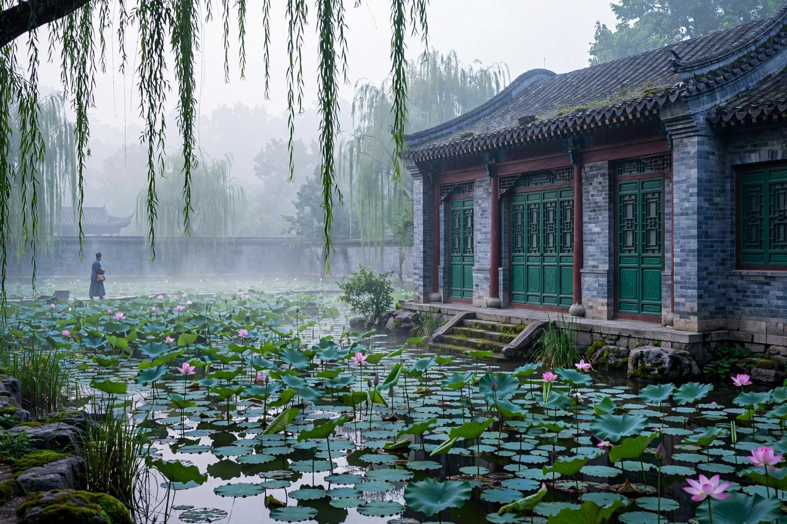
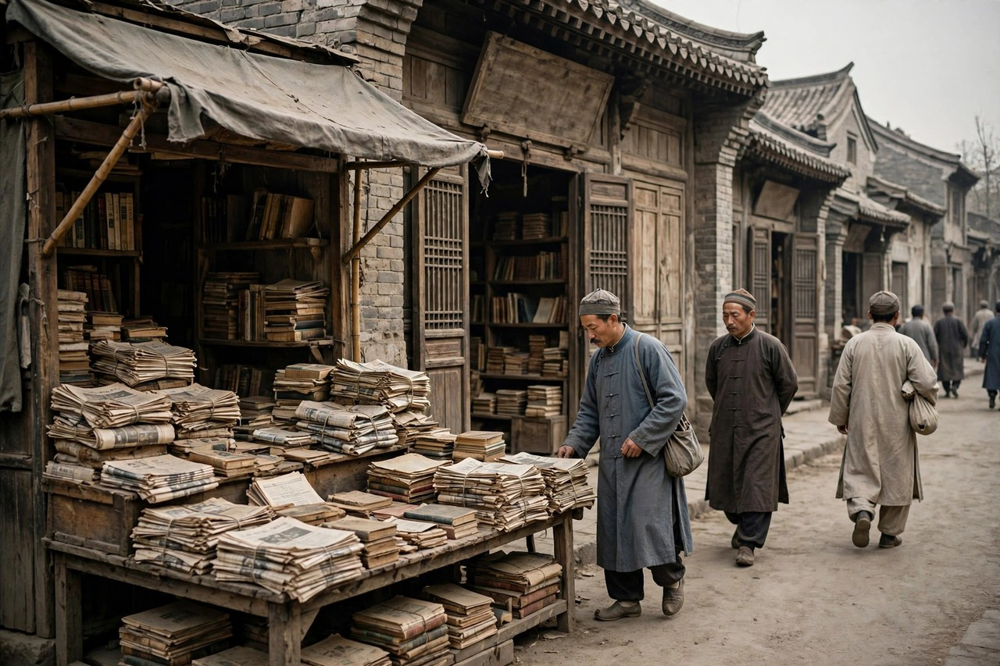

## 扬州巷子里走出来的少年

朱自清原名自华，字佩弦，号秋实，后来改名自清。原籍在浙江绍兴，生在江苏东海，真正长他成人的是扬州。他自己也说自己是扬州人，这话不是客套，是小时候的巷子、河水、灶房和街坊把他养出来的底色。扬州那时候不算富贵地，日子过得紧巴，家里靠父亲一份差事撑着，孩子多，开销大，饭桌上什么都要算计着来。他在这样的家里长大，眼睛很早就学会了看人，看脸色，看一家人怎么在难处里互相体贴，又怎么在体贴里藏着别扭。

少年时候的朱自清并不张扬，读书用功，性子安静，喜欢把心事往肚子里咽。家里祖母去世，父亲丢了差事，那种一夜之间塌下来的感觉，他后来写进散文里，很多人读到都会想起自己家里出事的那个冬天。不是大场面，就是丧事办完，父子两个人在车站分开，一个人去谋事，一个人去上学，谁也不知道往后的日子会不会好起来。这种写法的力量，恰恰在于它不夸张，不煽情，把难处写得像家里厨房里的一盏灯，暗是暗了点，可是还亮着。

扬州给他的，还有一口温润的语言。他的散文读起来不硌牙，句子顺，意思清楚，像跟邻居在门口说话，又比门口说话多了一层讲究。这种讲究不是从书本上硬学来的，是扬州水汽养出来的。他写水，写月亮，写灯影，笔下都有一种湿润感，读者不用费劲就能闻到水气，看到灯火。后来他走到哪里，扬州那股子温和劲儿都跟着他，走到清华园，走到西南联大，走到北平的旧宅子里，都没有丢。

今天的人看扬州，总觉得那是旅游城市，瘦西湖边上拍照打卡，吃一顿淮扬菜就走了。可朱自清那一代的扬州，是过日子的地方，不是景点。他笔下的扬州没有滤镜，有的是柴米油盐，有的是父子之间说不出口的话，有的是一个少年在巷子里学会的体面。今天很多年轻人离开家乡去大城市打拼，回头看父母的背影，心里一酸，那种酸，和朱自清当年在车站看父亲背影的酸，是同一回事。时代换了衣服，人心没有换。

## 北大园子里的穷学生

一九一六年，朱自清考入北京大学预科，后来进了哲学系。那时候的北大，是新文化运动的中心，讲台上站着各路人物，学生宿舍里吵什么的都有。朱自清家境不好，读书靠的是咬牙坚持，衣服旧，饭吃得简单，可他读书读得极认真，诗也写，文章也写，跟同学办刊物，讨论新文学到底该往哪里走。他不是那种站在风口上喊口号的人，他是坐在灯下写字的人，写出来的东西有自己的温度。

在北大的日子里，他参加了文学研究会，跟叶圣陶、俞平伯等人来往密切。一九二二年，他跟俞平伯、叶圣陶等人创办了诗月刊，那是新诗运动以来较早的一份诗刊。那个年代办刊物没有钱，没有人手，全靠一股热气。稿子要自己写，自己改，自己跑印刷，印出来再自己寄。朱自清的长诗毁灭就是在这个时期写出来的，写一个青年在黑暗里寻找光明的痛苦，句子有力量，不绕弯子。那时候很多人夸这首诗，说它像新文学里的离骚一类作品，话说得有点大，但也说明当时的读者确实被打动了。

穷学生的好处，是眼睛不飘。他知道一顿饭多少钱，知道家里寄来的钱能撑几天，知道教书挣来的钱要先寄回家。这种日子让他写文章不爱说空话，写亲情就写车站上的橘子，写时间就写洗手时从水盆里过去的日子，写春天就写田野里放风筝的孩子。他不写自己没见过的东西，不写自己没摸过的生活。今天很多写作者的问题，恰恰是写自己没过过的日子，词藻堆得很高，读起来却没有一滴水。朱自清给后人留下的教训很实在，写作的根在生活里，不在词典里。

北大毕业之后，他没有留在北京享清福，而是到南方去教书。杭州、扬州、台州、温州、宁波，一站一站换地方，教中学，带学生，工资不高，常常搬家。这种漂泊不是潇洒，是谋生。他在台州教书的时候写了匆匆，在温州教书的时候写了温州的踪迹和桨声灯影里的秦淮河，在宁波教书的时候又写了不少文章。每一篇背后，都是一个教书人在异乡的夜晚，灯下写字的心情。今天的年轻人换城市、换工作，觉得累，觉得没有根，读一读朱自清这段经历就会明白，漂泊不是今天才有的事，上一代文人也是这么一站一站走过来的，区别在于他们把漂泊写成了文章，没有只写成抱怨。

## 讲台上站稳的人

朱自清一辈子最踏实的身份，是教书先生。他教中学的时候，对学生很耐心，讲课不摆架子，改作文改得细，学生写得好的地方他会圈出来，写得差的地方他也会讲清楚差在哪里。他相信文章是可以练出来的，不是靠灵感吃饭。他自己写文章也是这样，一字一句改，不图快，不图好看，图的是意思站得住，句子顺得下来。

一九二五年，他到清华学校任教，从此创作以散文为主，同时开始研究中国古典文学。清华那时候正在办大学部，国文系刚起步，俞平伯推荐他去当教授。他在清华住过工字厅单身宿舍，后来搬到西院，家眷也陆续北来。在清华园里，他写出了背影和荷塘月色这样的名篇，也开始系统地做学问，写诗言志辨一类论著。教学和写作在他手里不是两张皮，讲古典文学的时候，他会把自己的写作体会带进去，写散文的时候，他又会把古典诗词的滋味化进去，所以他的散文读起来既有白话的清爽，又有古典的底子。

他当系主任的时候，事情更多，要管课程，要管教师，要管学生的事，可他没有因此把写作丢了。他做学问的态度，和做人的态度是一样的，认真，不投机，不跟风。今天大学里有些人，文章写得花哨，课却讲得空洞，学生听完什么也没留下。朱自清反过来，课讲得扎实，文章写得朴素，学生记得住，读者也记得住。这种踏实，在今天特别值钱，因为浮躁的东西太多了，能把一门课讲好，把一篇文章写清楚，已经是很了不起的本事。

一九三一年，他到英国留学，漫游欧洲各国，写了欧游杂记和伦敦杂记。留学不是去镀金，他是真的去看，去记，去比较。欧洲的风景、街道、学校、人的生活，他都写得具体，不吹不黑。回国之后，他继续在清华任教，并主持中文系。抗战爆发后，他跟着西南联大南下，在昆明等地教书，条件艰苦，住处简陋，粮食不够吃，可课还是要上，书还是要读。那种在颠沛里坚持教书的样子，就是中国读书人最硬的一面，不是喊出来的，是熬出来的。

## 清华园里的荷塘与书房

说起朱自清，很多人头一个想到的就是清华园的荷塘。荷塘月色写于一九二七年七月，写的是他夜里独自到荷塘边散步的心情。那时候大革命失败，白色恐怖笼罩，知识分子心里惶惑，不知道路在哪里。他没有写大道理，而是写荷叶，写荷花，写月光，写塘边的杨柳和蝉声，把心里的不平静藏在景色里。读者读到的，是月光如流水一般静静泻在叶子和花上，是荷塘的幽美，也是作者想超脱又超脱不了的矛盾。

背影写于一九二五年十月，发表在文学周报上，后来收进同名散文集。写的是他父亲在浦口车站送他的情景，父亲穿着黑布大马褂，戴着黑布小帽，蹒跚地走到铁道边，爬上月台去买橘子。那个背影，写得极其具体，肥胖的身子，青布棉袍，黑布马褂，一步一步往上爬的样子，读者读到这里，心里都会被撞一下。朱自清写这篇文章的时候，父子关系其实并不算融洽，家里有过争执，有过误解，可他写的时候没有翻旧账，只是把那个背影写下来，让时间去说话。后来父亲读到这篇文章，掉了眼泪，父子之间的隔阂也就慢慢化了。

清华园的书房，是他做学问的地方，也是他养家的地方。妻子武钟谦操持家务，带孩子，日子过得紧，朱自清在书房里备课、写文章、改学生的作业。荷塘月色里写到妻子在屋里拍着孩子哼眠歌，那个妻子就是武钟谦。家庭生活的细节，到了他笔下都变成了有温度的句子。今天很多人觉得，家庭生活太平淡，写不出来东西，可朱自清恰恰证明，平淡的生活里藏着最动人的东西，关键看你有没有一颗肯细看的心。拍孩子睡觉，买几个橘子，夜里去荷塘边走一圈，这些小事，写好了就是大文章。

清华园给他的不只是风景，还有一种读书人的气节。清华的校风讲究独立之精神，自由之思想，朱自清把这种气节带进了骨子里。他后来拒绝领美援面粉，宁肯饿着也不低头，根子就在这里。今天的清华园，荷塘还在，月光还在，游人很多，拍照的人很多，真正夜里安静下来想一想朱自清当年心情的人却不多。风景还是那个风景，心境却需要自己去找。读荷塘月色，最好的办法不是背诵，而是找一个夜晚，到水边站一会儿，看看月光，听听自己的心跳，再回头读那篇文章，味道就全出来了。

## 南下路上的颠簸岁月

一九三七年抗战爆发，清华、北大、南开三所学校南迁，组成西南联大。朱自清跟着学校一路南下，从长沙到昆明，路途遥远，行李简单，住处是临时搭起来的房子，吃的穿的都缺。可就是在这样的条件下，课没有停，书没有丢，学生们在油灯下读书，先生们在茅屋里讲课。那种场景，今天的人很难想象，手机没有信号，网络没有，书本都是宝贝，借一本书要跑很远。可也就是这种艰苦，让那一代人把学问看得比命还重。

在西南联大的日子里，朱自清的身体已经不太好，胃病时常发作，可他还是坚持上课，坚持写作，坚持做研究。他写文章，讲古典文学，带学生做学问，从不因为环境差就降低标准。今天有些人，条件一差就先找借口，环境一变就先抱怨，读一读西南联大的历史，就会觉得惭愧。真正的读书人，不是顺境里的花瓶，是逆境里的灯，风越大，灯越要护着，不能灭。

一九四六年，他回到清华，回到北平的旧宅。那时候的北平，物价飞涨，日子难过，教授的薪水买不了几袋面粉，全家十几口人吃饭都成问题。朱自清的胃病越来越重，吃的东西很少，多吃一点就要吐，脸瘦得厉害，说话声音也低了。可他没有向困难低头，也没有向权势低头。一九四七年，他为北平当局任意捕人发表抗议，又在反饥饿反内战的宣言上签名。一九四八年六月，他在拒绝领取美援面粉的宣言上签名，抗议美国扶植日本的政策。那时候他家里最困难，孩子多，粮食最缺，可他看完宣言稿子，毫不迟疑就签了名，手颤抖着，还是一笔不苟地写下自己的名字。

临终前，他还嘱咐家人不要去买配售的美国面粉。这句话不是口号，是一个病人用最后的力气说出来的话。后来有人称赞他表现了民族的英雄气概，这话说得对，但更值得记住的是，他不是一时冲动，而是一辈子都是这样的人。从年轻时教书，到中年做学问，到晚年病中签名，他没有变过。今天的人谈骨气，谈得很多，做起来却很难。朱自清的骨气不是表演，是日常，是每一次选择里都不肯把良心卖掉的坚持。

## 笔路到底是什么味道

朱自清的笔路，说到底就是朴素、清丽、真切。他不爱用大词，不爱堆典故，句子写得干净，像洗过的白布，看着简单，其实最难。他写荷叶，说叶子出水很高，像亭亭的舞女的裙，写荷花，说袅娜地开着，有羞涩地打着朵儿的，比喻贴切，不生硬，读者一下子就能看见画面。他写父亲的背影，不说伟大，不说崇高，只说父亲穿什么衣服，怎么爬月台，怎么把橘子放在皮大衣上，细节一出来，感情自己就到了。

他的语言功夫，来自对古典文学的熟悉，也来自对白话的认真。他研究古典诗词，知道一个词用在哪里最合适，知道一句诗的意境怎么化到散文里，可他不掉书袋，不把文章写成考据。他写春，说盼望着，盼望着，东风来了，春天的脚步近了，句子短，节奏快，读起来像春风扑面。他写匆匆，说燕子去了，有再来的时候，杨柳枯了，有再青的时候，桃花谢了，有再开的时候，可是日子为什么一去不复返，问得直接，问得让人心里发紧。

今天的写作环境，流行金句，流行反转，流行情绪化表达，一篇文章开头就要炸，要让人转发。朱自清的文章没有这些，他开头往往很平淡，慢慢往里走，越走越深，读完之后心里留下一盏灯，不是一阵烟花。烟花好看，亮一下就没了，灯虽然不亮眼，却能照很久。几代中学生背过他的文章，成年之后再读，还能读出新的味道，这就是好文章的标志。不是当时热闹，而是经得起时间。

他的散文还有一个特点，就是不端着。他写自己的苦闷，写自己的矛盾，写自己对父亲的误解，写自己对亡妻的愧疚，都不遮掩。他不把自己写成圣人，也不把自己写成受害者，就是一个普通人，在生活里挣扎，在挣扎里保持善良。今天很多公众人物，写文章先立人设，先把自己包装成完美的人，读起来假。朱自清不包装，所以读者信他。信，是一个写作者最宝贵的资产，丢了信，词写得再美也没有用。

## 为什么今天还要读他

今天还要读朱自清，理由很实在。头一个理由，是他教会我们怎么看亲人。很多家庭里，父母和子女之间有隔阂，有话说不出口，有误解懒得解释，时间一长，隔阂就变成了墙。背影的故事告诉我们，化解隔阂的办法不一定是长篇大论的谈心，有时候就是记住对方的一个背影，记住对方为你做过的一件小事，然后在心里原谅，在行动上亲近。等到父母老了，走不动了，你再想看那个背影，可能已经看不到了。所以读背影，不是为了考试，是为了提醒自己，趁父母还在，多回去看看，多打几个电话。

再一个理由，是他教会我们怎么面对时间。匆匆写于一九二二年三月，写的是一个青年对时间流逝的焦虑。洗手的时候，日子从水盆里过去，吃饭的时候，日子从饭碗里过去，默默时，便从凝然的双眼前过去。这话放在今天，一点也不过时。刷手机的时候，时间从屏幕上过去，开会的时候，时间从会议室里过去，熬夜的时候，时间从身体里过去。我们比朱自清那一代人更忙，也更焦虑，可焦虑之后呢，朱自清没有停在焦虑里，他是要在焦虑里找到活法。今天的人读匆匆，不应该只读出焦虑，更应该读出一种提醒，时间不等人，那就把手头的事做好，把日子过得实在一点。

还有一个理由，是他教会我们怎么看风景。荷塘月色和绿这样的文章，写的是风景，也是心境。今天旅游很方便，景点打卡很快，照片拍了一堆，回来却什么也没记住。朱自清看风景的办法，是夜里独自去，慢慢看，细细想，把风景和心情连在一起。下次去荷塘，去梅雨潭，去秦淮河，不要只顾着拍照，试着像他一样，站一会儿，听一听水声，看看月光，再想一想自己的心事，风景就活了。风景活了，人也就活了。

最后一条，是骨气。今天的社会，诱惑多，压力大，很多人为了眼前一点好处，就把原则丢了。朱自清晚年的选择，给后人立了一个标杆，饿着肚子也不领不该领的东西，病着也不说违心的话。这种骨气不是要人去受苦，而是要人在关键时刻分得清什么是该拿的，什么是不该拿的。分得清，就不至于在人生的关键处走错路。

## 留给后来人的灯火

朱自清一九四八年八月十二日因胃病在北平去世，年纪不算大，留下来的作品却很多。诗集踪迹，散文集背影、你我、欧游杂记、伦敦杂记，还有古典文学研究的论著，篇篇都有分量。他去世之后，文章进了课本，背影、荷塘月色、春、匆匆，成了几代人共同的记忆。很多中国人没有读过多少现代文学，可他们都读过朱自清，这就是国民作家的意思，不是封出来的，是读出来的。

他的影响，不在热闹处，在日常处。一个父亲送孩子上火车，会想起背影，一个人在夜里散步，会想起荷塘月色，一个春天到了，会想起盼望着，盼望着，一个人觉得时间过得太快，会想起匆匆。这些文章已经长进了中国人的语言里，成了我们表达感情的工具。工具越常用，越说明它好用。好用的工具，不需要天天夸，它就在手边，随时能用。

今天写朱自清，不是为了把他供起来，而是为了把他请下来，放到我们的日子里。放到饭桌上，放到车站上，放到荷塘边，放到春天里，放到我们和父母相处的日子里，放到我们面对时间焦虑的日子里，放到我们做选择需要骨气的日子里。他不是一个遥远的名字，他是一个教书人，一个父亲，一个丈夫，一个在困难里没有丢掉良心的普通人。普通人能做到的事，我们也能做到，普通人能写出的文章，我们也能学着写。

读他的文章，最好的态度不是崇拜，是亲近。亲近的意思，是把他的句子读到心里去，再用自己的日子去验证。验证之后，你会发现，他的文章没有过时，过时的是我们浮躁的读法。慢下来，细读，夜里读，春天读，送别的时候读，时间不够用的时候读，他的灯就会亮起来。灯亮了，路就看得清了。这就是朱自清留给后来人的东西，一盏灯，不大，不刺眼，可是够用一辈子。

## 扬州与清华之间的书信与家事

朱自清在外教书的时候，家里和学校的信来来往往，信里写的多半是家常事，孩子的病，学费的着落，房租的涨落，父亲身体的好坏。他回信写得细，不敷衍，家里缺什么，他在信里先算一遍，再想办法。那个年代没有电话，信就是一家人维系感情的绳子，绳子细，可是结实。他给父亲的信，语气恭敬又亲近，给妻子的信，语气体贴又实在，给朋友的信，则常常谈文章，谈教学，谈自己读的书。这种书信往来的习惯，今天的人已经很少有了，微信消息发得快，可是留不住，删起来也容易。信不一样，写信的人要先在心里过一遍话，再落笔，收信的人也要慢慢读，读完还会留着。朱自清的很多文章，就是从这种慢慢说话的习惯里长出来的，句子不赶时间，意思不赶潮流。

家事对他的写作影响很大。父亲晚年身体不好，家里经济紧张，他在清华教书，薪水要养一大家子，日子算得紧。可他没有把家事写成诉苦，而是把家事里的温情写出来。父亲送他上车，买几个橘子，看着简单，背后是父亲想为儿子做点事的心。妻子在屋里拍孩子睡觉，看着平常，背后是一个母亲把日子过下去的耐心。这些细节之所以动人，是因为它们真实，没有加工过的痕迹。今天很多家庭，父母为孩子做了很多事，孩子却觉得理所当然，等到父母老了，才想起那些小事的好。读朱自清，就是提前把这些小事记在心里，免得将来后悔。

他和父亲的关系，也值得今天的人细想。年轻的时候，他和父亲有过争执，对父亲的一些做法不理解，信里话说得重，见面也别扭。可时间过去，他写了背影，父亲读了掉泪，两个人之间的墙就塌了一半。父子之间很多矛盾，其实不是大事，就是话没说开，心没贴近。朱自清没有用大道理去化解，而是用一篇文章，把当年的情景重新写了一遍，让父亲看到儿子记得他，儿子也看到父亲的不容易。这种化解方式，比吵架管用，比冷战管用。今天的家庭里，如果父子、母女之间有隔阂，不妨学一学这种办法，把记得的一件小事写下来，或者说出来，让对方知道，你心里一直记着他。

## 他改文章的慢功夫

朱自清写文章慢，改文章更慢。他常常把一篇文章写出来，放几天，再拿出来改，改句子，改词语，改节奏，改到读起来顺口为止。他对语言的要求很严，一个比喻不贴切，就换一个，一个句子太长，就拆成两句，一个词用得太俗，就换一个雅一点又不生硬的词。这种慢功夫，在今天显得有点奢侈，因为现在的文章讲究速度，讲究当天写当天发，错别字都来不及改。可正是这种慢，让他的文章经得起读，读一遍有味道，读十遍还有味道。

他研究古典文学，也帮了他改文章。古典诗词里，一个字可以藏很多意思，一个意象可以带出很多联想，他把这种讲究带到白话散文里，却不让文章变得文绉绉。写荷塘，他用舞女的裙来比荷叶，用明珠来比荷花，用美人来比星星，比喻都来自日常感受，读者不用查字典就能懂。写春天，他用盼望着来开头，反复说，节奏像春风一样一波一波来，读起来有音乐感。这种音乐感不是硬造出来的，是句子长短搭配出来的，是他改出来的。

今天的年轻人写东西，常常追求词新，追求梗多，追求一句话就让人笑或者让人哭。笑和哭都容易，难的是让人读完之后心里留点东西。朱自清的办法是，先把意思想清楚，再把句子写顺，再把多余的词删掉。他删词删得很狠，文章里没有废话，每一句话都有用。这种删繁就简的功夫，值得每一个写作者学。写完一篇文章，先放一夜，隔天再读一遍，把自己都觉得别扭的句子改掉，把自己都觉得多余的段落删掉，文章立刻会干净很多。干净，不是贫乏，是把力气用在该用的地方。

他改学生的作文也是这样，不光改错别字，还改思路，改结构，改语气。学生写得空洞，他会问，你这句话到底想说什么，见过没有，摸过没有。学生写得啰嗦，他会帮着删，删到意思还在，话变少了。这种教学方法，今天依然管用。写文章不是比谁词多，是比谁说得准。说得准，需要生活，需要观察，需要改。朱自清一辈子都在改，改自己的文章，也改自己的做人，改到最后，人和文章都干净了。

## 读他文章的几种打开方式

读朱自清，有几种打开方式，适合不同的人。喜欢亲情的人，可以从背影开始读，读的时候想想自己的父母，想想自己和父母之间有没有没说开的话。读完之后，给父母打个电话，或者回趟家，看看父母的背影，看看他们走路的样子，是不是也像文章里那样，一步一步慢下来了。这篇文章读完如果只记得考试要点，那就白读了，读完要去做点事，才算读进去了。

喜欢风景的人，可以从荷塘月色和绿开始读。读荷塘月色，最好找一个月夜，到水边走走，看看月光，看看荷叶，再读文章，感觉会完全不一样。读绿，最好去一趟梅雨潭，看看潭水的绿，看看瀑布的水花，再读文章里写潭水像荷叶，像裙幅，像碧玉的句子，就会明白他为什么那么激动。风景文章不能只在书桌前读，要走到风景里去读，走到风景里，文章就活了，风景也活了。

心里焦虑的人，可以从匆匆开始读。读匆匆，不要只读出焦虑，要读出行动。时间过去了就是过去了，懊悔没有用，抱怨没有用，真正有用的是从现在开始，把手头的事做好。每天少刷一会儿手机，多读几页书，多陪一会儿家人，多做一点实在的事，时间就不会白白溜走。匆匆的结尾没有给出标准答案，它留给读者一个问题，你的日子到底去哪里了。这个问题，每个人都要自己回答，回答的方式，就是过好今天。

想学写作的人，可以从春开始读，学他的节奏，学他的比喻，学他怎么把平常的景色写出新意。春里写草，写花，写风，写雨，写人，写风筝，写田野，每一段都很短，每一段都有画面，合起来就是一个完整的春天。学写作，不必先学大理论，先学这种一段一段写画面的办法，把一个画面写清楚，再写下一个画面，画面连起来，文章就有了。这种办法，写作文管用，写工作汇报也管用，写朋友圈也管用，因为人都是先看到画面，再理解意思的。

朱自清这个人，留下的不只是几篇文章，更是一种过日子的方法。日子紧的时候，不抱怨，日子好的时候，不张扬，对亲人温和，对学生耐心，对学问认真，对良心负责。这种方法，今天依然管用，放在任何一个普通人身上，都能让日子过得体面一点，干净一点，暖和一点。读他，就是学这种方法，学完了，日子还是自己的日子，可是走路的姿势会不一样，心里的灯会亮一点。

## 巷子深处的一声问候

最后再说一句实在话，朱自清不是挂在墙上的画像，他更像巷子深处一个熟人的问候，听着平常，走了很远还会想起来。很多人年轻时背他的文章是为了分数，中年之后再读，才发现分数早就没用了，文章里的人情还在。父亲的背影还在，荷塘的月光还在，春天的风筝还在，时间匆匆的感觉还在，妻子屋里的眠歌还在，骨气还在。这些东西合起来，就是一个中国读书人留给后人的全部家当，没有金银，没有田产，只有一支笔写下来的日子，和一颗没有卖掉的良心。把这份家当接过来，好好读，好好过，就是对他最好的纪念。日子还会继续往前走，巷子还会有人走过，灯还会亮着，读他的人，也会把这盏灯传下去。

## 读完之后的一点心意

读完朱自清这个人，最后想留一点心意给读者，心意很简单，就是好好过日子，好好对亲人，好好看风景，好好写文章，好好守住良心。日子紧的时候，想想他在清华园里教书的样子，日子好的时候，想想他在荷塘边散步的样子，面对选择的时候，想想他拒绝领面粉的样子，对亲人的时候，想想他写背影的样子，对时间焦虑的时候，想想他写匆匆的样子，对春天到来的时候，想想他写春的样子。这些样子合起来，就是一个普通人过日子的样子，普通人能做到，我们也能做到，做到了，日子就体面了，人就干净了，心就亮了。亮着的心，就是朱自清留下的灯，灯在，路就在，人就在，希望就在。
