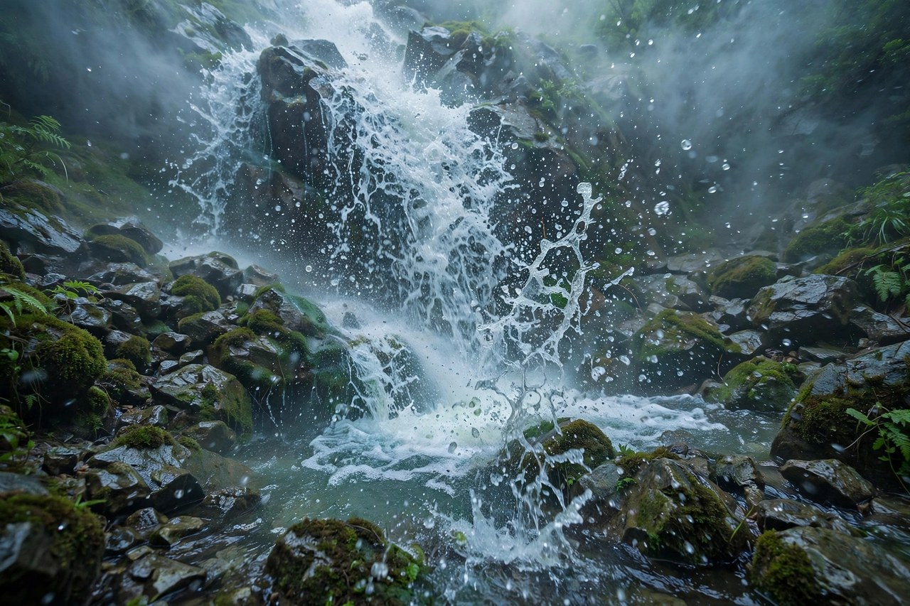
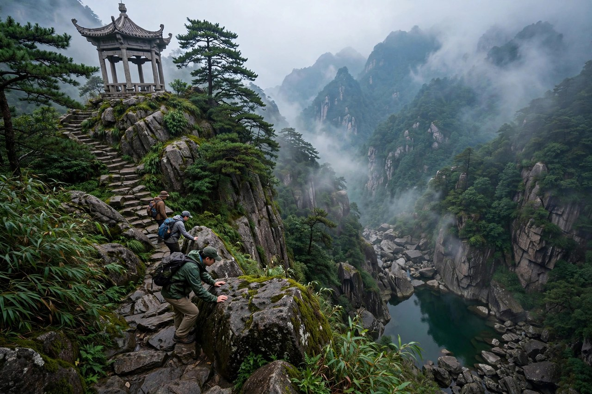

## 再到仙岩的时候

绿的开头，是一句惊诧，我再到仙岩的时候，我惊诧于梅雨潭的绿了。惊诧这个词，用得极好，不是惊讶，不是赞叹，是惊诧，惊诧里有意外，有不敢相信，有被打动的感觉。再到仙岩，说明他之前来过，来过一次，印象已经不错，再来一次，看到的绿，比上次更绿，更醉人，更让人惊诧。再这个字，说明绿不是一次看就看透的，是要看两次，看三次，看很多次，才能看透的。看一次，觉得美，看两次，觉得醉，看三次，觉得绿已经长进心里了。

仙岩这个地方，在温州瑞安，是个名胜，有三个瀑布，梅雨瀑最低，梅雨潭就是梅雨瀑下面的潭。朱自清在温州教书的时候，闲暇时结伴去仙岩游玩，头回去，印象颇佳，再去的时候，和马公愚等几个好友一起，看到梅雨潭的绿，激动得说，一定要写一篇文章。写文章的念头，就是在再到仙岩的时候生出来的，生出来了，就写了，就写成了绿，就写成了一篇贮满诗意的美文。美文这个词，说得对，绿这篇文章，确实美，美到让人读了想去梅雨潭看看，看看那一潭绿到底有多绿。

今天的人去梅雨潭，常常是头回去，去了，拍几张照片，觉得绿是绿，可是没有惊诧，因为只看了一次，没有再看。朱自清的惊诧，是再看的惊诧，是比较之后的惊诧，是头回的印象和再一次的绿撞在一起的惊诧。比较这个东西，在看景的时候很重要，看一次，印象是浅的，看两次，印象是深的，深了，才会惊诧，惊诧了，文章才有力气。今天的人看景，可以学一学再看的办法，一个地方，去两次，去三次，每次看，都会看到不一样的东西，不一样的东西合起来，景就厚了，厚了，就动人了。

再到仙岩的时候，季节是秋季，是薄阴的天气，云在头顶上流着，岩面和草丛都从润湿中透出几分油油的绿意。秋季这个季节，在一般人看来，是萧索的，是悲凉的，是叶子黄了的季节，可是在仙岩，在梅雨潭，秋季却是绿的，是润湿的，是油油的。这种反差，让绿更动人，萧索的季节里看到绿，绿就显得格外珍贵，格外有生机，格外让人惊诧。生机这个东西，在萧索里最容易被看到，萧索里的一点绿，比春天里的一片绿更让人感动。

## 瀑布与梅雨亭

走到山边，便听见花花花花的声音，抬起头，镶在两条湿湿的黑边儿里的，一带白而发亮的水便呈现于眼前了。花花花花的声音，是瀑布的声音，是水流撞击岩石的声音，是远处就能听到的声音。声音先到，景色后到，听觉先到，视觉后到，这种先声后景的写法，让读者仿佛也站在山边，先听到水声，再看到瀑布。瀑布这个东西，先听后看，看的时候，印象就更深了。

梅雨亭正对着那条瀑布，坐在亭边，不必仰头，便可见它的全体了。梅雨亭这个地方，选得极好，亭子踞在突出的一角的岩石上，上下都空空儿的，仿佛一只苍鹰展着翼翅浮在天宇中一般。苍鹰这个比喻，写出了亭子的姿态，亭子在岩石上，空着，浮着，像鹰在天上飞，自由，舒展，有气势。坐在亭边看瀑布，不必仰头，不必费劲，瀑布的全体就在眼前，这种看瀑布的办法，是最舒服的办法，是最从容的办法。

亭下深深的便是梅雨潭，潭在亭下，深，深得看不见底，深得让人想下去看看，想下去摸摸潭水，想下去感受绿。深这个东西，在梅雨潭里很重要，潭深，绿才深，绿深，才醉人，醉人了，才想写文章。朱自清站在亭边，看着潭，心里已经醉了，醉了之后，才下去，才追捉潭水的神光，才写出绿这篇文章。醉这个词，是绿这篇文章的核心，绿是醉人的绿，醉人的绿，是让人看了就醉的绿，醉了，就不想走了，就想留下来，就想写下来。

今天的人去梅雨潭，也会先到梅雨亭，坐在亭边看瀑布，看潭水，看绿。坐在亭边，要慢慢坐，不要急着走，坐下来，听听水声，看看瀑布，看看潭水，看看云，看看岩面，看看草丛，坐久了，绿就进心里了，绿进心里了，人就醉了，醉了，就不想走了，就想写下来，写下来，就是自己的绿，就是自己的梅雨潭。梅雨潭这个地方，就是这样一个让人坐下来就不想走的地方，坐下来，绿就来了，绿来了，人就醉了。

## 水花如白梅

瀑布从上面冲下，仿佛已被扯成大小的几绺，不复是一幅整齐而平滑的布。岩上有许多棱角，瀑流经过时，作急剧的撞击，便飞花碎玉般乱溅着了。那溅着的水花，晶莹而多芒，远望去，像一朵朵小小的白梅，微雨似的纷纷落着。据说，这就是梅雨潭之所以得名了。白梅这个比喻，写出了水花的白，写出了水花的碎，写出了水花的美。白梅是梅花的一种，是白的，是小的，是香的，水花像白梅，就是白的，碎的，美的，香的，合起来，就是梅雨潭的水花。

朱自清又说，但他觉得像杨花，格外确切些。杨花这个比喻，比白梅更确切，因为杨花是轻的，是飘的，是随风的，水花也是轻的，是飘的，是随风的。轻风起来时，点点随风飘散，那更是杨花了。这时偶然有几点送入我们温暖的怀里，便倏地钻了进去，再也寻它不着。杨花钻进怀里，寻不着了，这种感觉，很妙，水花钻进怀里，是凉的，是湿的，是快的，快的让人来不及反应，来不及寻，就没了。没了，才想念，想念了，才觉得美。

水花这个东西，在梅雨潭里很重要，没有水花，瀑布就是一幅布，有了水花，瀑布就活了，就碎了，就美了。碎这个词，在绿里很重要，瀑布碎了，水花碎了，绿也碎了，碎成一片一片的，碎成一点一点的，碎成晶莹的，碎成多芒的。碎了，才好看，整齐的布不好看，碎了的布才好看，因为碎了才有变化，才有层次，才有光。光这个东西，在水花里最重要，水花晶莹，是因为光在水花里折射，光折射了，水花就亮了，亮了，就像白梅，就像杨花，就像梅雨。

今天的人看瀑布，常常只看瀑布的大，瀑布的高，瀑布的壮，很少看瀑布的水花，很少看水花的碎，很少看水花的光。朱自清看瀑布，看的是水花，看的是碎，看的是光，看的是白梅和杨花。看水花，需要细看，需要站在亭边细看，需要走到潭边细看，细看了，水花就活了，活了，就美了，美了，就醉了。醉了，就想写下来，写下来，就是绿，就是梅雨潭，就是一潭醉人的绿。

## 潭水的绿

梅雨潭闪闪的绿招引着我们，我们开始追捉她那离合的神光了。揪着草，攀着乱石，小心探身下去，又鞠躬过了一个石穹门，便到了汪汪一碧的潭边了。追捉这个词，用得极好，绿不是静止的，是动的，是离合的，是神光的，神光这个东西，是捉不住的，是离了又合，合了又离的，追捉神光，就是追捉绿，就是追捉美，就是追捉一种捉不住的东西。捉不住，才想追，追了，才觉得美，美了，才觉得醉。

到了潭边，瀑布在襟袖之间，但我的心中已没有瀑布了，我的心随潭水的绿而摇荡。那醉人的绿呀，仿佛一张极大极大的荷叶铺着，满是奇异的绿呀。荷叶这个比喻，写出了潭水的绿的大，写出了潭水的绿的平，写出了潭水的绿的铺。荷叶铺在水面上，是平的，是大的，是绿的，潭水铺在潭里，也是平的，也是大的，也是绿的。平和大合起来，绿就有了气势，气势有了，人就醉了。

我想张开两臂抱住她，但这是怎样一个妄想呀。抱住绿这个念头，写出了作者对绿的爱，爱到想抱住，抱不住，才知道绿是抱不住的，是只能看的，是只能感受的，是只能醉的。妄想这个词，写出了爱的无奈，爱到极致，就是妄想，妄想着抱住，抱不住，才更爱，更爱，才更醉。醉这个东西，在绿里反复出现，醉人的绿，醉了的心，醉了的眼睛，醉了的文章，醉合起来，就是绿这篇文章的魂。

站在水边，望到那面，居然觉着有些远呢。这平铺着，厚积着的绿，着实可爱。她松松地皱绣着，像少妇拖着的裙幅，她轻轻地摆弄着，像跳动的初恋的处女的心，她滑滑地明亮着，像涂了明油一般，有鸡蛋清那样软，那样嫩。裙幅、处女的心、明油、鸡蛋清，这几个比喻，一连串写出了绿的软，绿的嫩，绿的亮，绿的动。绿不是一种颜色，绿是很多种感觉，软的，嫩的，亮的，动的，合起来，就是梅雨潭的绿，就是醉人的绿。

## 绿的比较

朱自清写绿，还用了比较的办法。他说，我曾见过北京什刹海拂地的绿杨，脱不了鹅黄的底子，似乎太淡了。我又曾见过杭州虎跑寺旁高峻而深密的绿壁，丛叠着无穷的碧草与绿叶的，那又似乎太浓了。其余呢，西湖的波太明了，秦淮河的水又太暗了。可爱的，我将什么来比拟你呢。比较这个办法，写出了梅雨潭绿的恰到好处，不淡，不浓，不明，不暗，恰恰好，恰恰绿，恰恰醉人。

太淡了的绿，是什刹海的绿杨，绿里带着黄，黄里带着淡，淡了，就不够绿，不够醉，不够让人惊诧。太浓了的绿，是虎跑寺的绿壁，绿里叠着绿，浓到看不透，浓到让人觉得压，压了，就不够清，不够亮，不够让人舒服。太明了的波，是西湖的波，明到晃眼，明到没有层次，明了，就不够深，不够厚，不够让人想抱住。太暗了的水，是秦淮河的水，暗到看不见，暗到没有光，暗了，就不够亮，不够醉，不够让人想追捉。

梅雨潭的绿，恰恰在淡和浓之间，在明和暗之间，在浅和深之间，恰恰好，才是最美的绿，最醉人的绿，最让人惊诧的绿。恰恰好这个东西，在生活里也很重要，东西恰恰好，人就舒服了，话恰恰好，人就爱听了，颜色恰恰好，人就醉了。恰恰好不是随便来的，是看多了，比较多了，才知道什么是恰恰好。朱自清看过很多绿，看过什刹海，看过虎跑寺，看过西湖，看过秦淮河，看多了，才知道梅雨潭的绿是恰恰好。看多了，比较多了，眼睛就亮了，眼睛亮了，文章就有了。

今天的人看绿，常常只看一种绿，看公园里的绿，看小区里的绿，看照片里的绿，很少比较，很少看多种绿，很少知道什么是恰恰好。朱自清的办法是，多看，多比较，看多了，比较多了，就知道哪种绿是最好的，哪种绿是最醉人的，哪种绿是最值得写的。多看，不是走马观花，是细看，是站在亭边看，是走到潭边看，是追捉神光看。细看了，比较了，绿就进心里了，绿进心里了，文章就有了，文章有了，人就醉了。

## 绿里的季节

绿写于一九二四年二月，发表在当年的我们的七月杂志上，后来收入散文集踪迹。写绿的时候，朱自清在温州教书，日子过得并不宽裕，经济上有些困顿，可是他看到梅雨潭的绿，心里却亮了，亮了，就写了，写了，就醉了。季节这个东西，在绿里很重要，绿写于秋季，秋季是萧索的季节，可是梅雨潭的绿，却在萧索里亮着，亮着，就有了希望，希望这个东西，在萧索里最珍贵，萧索里的一点绿，比春天里的一片绿更让人感动。

秋季的薄阴天气，云在头顶上流着，岩面和草丛都从润湿中透出几分油油的绿意。薄阴这个词，写出了秋季的天气，不晴，不雨，是薄阴，是云多，是湿润，是绿意。薄阴里的绿，是润湿的绿，是油油的绿，是从岩面和草丛里透出来的绿。透这个词，用得极好，绿不是长在表面，是透出来的，是从里面透出来的，是从石头里透出来的，是从草里透出来的。透出来的绿，才是真的绿，才是醉人的绿，才是让人惊诧的绿。

今天的人，秋季的时候，常常觉得萧索，觉得叶子黄了，觉得天气凉了，觉得日子暗了。可是朱自清在秋季看到了绿，看到了梅雨潭的绿，看到了生机，看到了希望。生机这个东西，在秋季里藏着，藏在潭水里，藏在瀑布里，藏在岩面里，藏在草丛里，要找，就要到山里去，到水边去，到梅雨潭去。找到了，生机就来了，生机来了，秋季就不萧索了，秋季不萧索了，人就不悲凉了，人不悲凉了，日子就好过了。

绿里的季节，还告诉我们一个道理，美好的东西，不只在春天里，秋季里也有，冬天里也有，萧索里也有。春天里的美，是热闹的美，秋季里的美，是安静的美，热闹的美容易看到，安静的美需要细看。细看了，秋季的美就出来了，出来了，人就醉了，醉了，就想写下来，写下来，就是绿，就是梅雨潭，就是一潭醉人的绿。醉人的绿，不只在春天里，秋季里也有，萧索里也有，只要肯去看，肯去追捉神光，绿就在那里等着，等着人去惊诧，去醉，去写。

## 女儿绿的说法

温州人后来把梅雨潭的绿，叫作女儿绿。女儿绿这个说法，很有意思，女儿是温柔的，是嫩的，是软的，是亮的，是让人疼的，绿是女儿绿，就是温柔的绿，嫩的绿，软的绿，亮的绿，让人疼的绿。朱自清祖籍绍兴，绍兴有女儿红，女儿红是最好的酒，梅雨潭的绿，在朱自清心里，就是最好的潭，最好的绿，最醉人的绿。女儿红和女儿绿合起来，就是绍兴和温州的两种好东西，一种是酒，一种是水，酒醉人，水也醉人，醉人的东西，都是好的东西。

女儿绿这个说法，还说明梅雨潭的绿，已经长进了温州人的心里，长进了中国人的语言里。语言这个东西，越用越活，女儿绿这个词，用的人多了，梅雨潭就更出名了，出名了，游人就更多了，游人多了，梅雨潭的绿就更珍贵了，珍贵了，就要保护，保护好了，绿才能长久，长久了，后来的人才能看到，才能惊诧，才能醉，才能写。写下来，绿就传下去了，传下去，女儿绿就永远是女儿绿，不会变黄，不会变暗，不会变淡。

今天的人到梅雨潭，会听到女儿绿这个说法，听到之后，会想起朱自清，会想起绿这篇文章，会想起一潭醉人的绿。想起来了，游梅雨潭就有了文化，有了文章，有了故事，有了朱自清。故事这个东西，在游景点的时候很重要，没有故事的景点，是空的景点，有故事的景点，是活的景点。梅雨潭的故事，就是朱自清的故事，就是绿的故事，就是女儿绿的故事。故事讲给孩子听，孩子将来也会去梅雨潭，也会惊诧，也会醉，也会写，写下来，故事就传下去了。

女儿绿这个说法，还提醒我们，好的东西，要有一个好名字。好名字这个东西，能让东西传得远，传得久，传得动人。梅雨潭的绿，叫女儿绿，名字好听，意思好，听了就想去看看，看看女儿绿到底有多绿，有多醉，有多让人惊诧。名字好，东西就好，东西好，名字就更好，好名字和好东西互相成就，成就了，梅雨潭就永远是梅雨潭，绿就永远是绿，女儿绿就永远是女儿绿。

## 今天梅雨潭的绿

今天的梅雨潭，还在温州仙岩，瀑布还在流，潭水还在绿，梅雨亭还在，游人很多，拍照的人很多，读绿的人也很多。可是今天的梅雨潭，和朱自清当年的梅雨潭，已经不一样了。当年的梅雨潭，是安静的，是幽深的，是可以慢慢看的，今天的梅雨潭，是热闹的，是开放的，是人流如织的。安静这个东西，在今天的梅雨潭里，已经很难找到了，可是绿还在，绿没有变，绿还是醉人的绿，还是让人惊诧的绿。

今天到梅雨潭，最好的办法，是早上去，是人少的时候去，是安静下来去。早上去，瀑布的水声清楚，潭水的绿清楚，梅雨亭的影子清楚，云在头顶上流着，岩面和草丛透着绿意，感觉就回来了。感觉回来了，绿就醉人了，醉人了，就想写下来，写下来，就是自己的绿，就是自己的梅雨潭。梅雨潭这个地方，就是这样一个需要早去、需要安静、需要细看的地方，早去了，安静了，细看了，绿就来了。

今天的人看梅雨潭的绿，常常是拍照，拍一张潭水的照片，拍一张瀑布的照片，发朋友圈，配一句绿，就走了。朱自清看梅雨潭的绿，是站在亭边看，是走到潭边看，是追捉神光看，是想抱住看，是比较着看。看和拍照的区别，就在这里，拍照是把绿带走，看是把绿留在心里。留在心里的绿，明年还会绿，带走的照片，存在手机里，很少再翻出来。看绿的办法，是站在水边，望到那面，觉得有些远，觉得绿平铺着，厚积着，觉得绿松松地皱绣着，觉得绿滑滑地明亮着，觉得绿像鸡蛋清那样软，那样嫩。感觉到了，绿就活了，活了，就醉了。

梅雨潭的绿，今天还在等着人去惊诧，等着人去醉，等着人去写。等着的人，是朱自清的读者，是温州的游人，是中国的学生，是所有喜欢绿的人。喜欢绿的人，去了梅雨潭，看到绿，就会惊诧，惊诧了，就会醉，醉了，就会写，写下来，绿就传下去了，传下去，梅雨潭就永远是梅雨潭，绿就永远是绿，女儿绿就永远是女儿绿。

## 绿的写法

绿这篇文章，写法很值得学习。文章不长，只有四段，可是每一段都有画面，每一段都有感觉，每一段都有比喻。开头一段，写再到仙岩的惊诧，写瀑布和梅雨亭，写薄阴的天气，写油油的绿意。中间两段，写水花如白梅如杨花，写潭水的绿如荷叶如裙幅如处女的心如明油如鸡蛋清。结尾一段，写比较，写什刹海的绿杨太淡，写虎跑寺的绿壁太浓，写西湖的波太明，写秦淮河的水太暗，写梅雨潭的绿恰恰好。结构这个东西，在绿里很清楚，开头惊诧，中间细看，结尾比较，比较完了，文章就收住了，收住了，读者心里还留着绿，留着醉，留着惊诧。

绿的语言，也很值得学习。语言是朴素的，是清丽的，是具体的，是不堆砌的。写瀑布，写花花花花的声音，写白而发亮的水，写湿湿的黑边儿，写得具体，写得清楚，写得让人能听到，能看到，能摸到。写潭水，写汪汪一碧，写平铺着，写厚积着，写松松地皱绣着，写滑滑地明亮着，写得细，写得软，写得嫩，写得亮。语言细了，文章就细了，文章细了，读者就醉了。

绿的比喻，也很值得学习。比喻不是硬想出来的，是看出来的，是站在亭边看出来的，是走到潭边看出来的，是追捉神光看出来的。荷叶、裙幅、处女的心、明油、鸡蛋清，这些比喻，都是从生活里来的，都是从日常感受里来的，都是读者能懂的。比喻这个东西，要贴切，要日常，要让人一下子就能懂，懂了，文章就活了，活了，读者就记住了。记住了，绿就长进心里了，长进心里了，梅雨潭就永远在心里了。

今天的人写景，常常追求词新，追求比喻奇，追求句子长，追求文章长。绿这篇文章告诉我们，写景不必长，不必奇，不必新，只要细，只要真，只要贴切，只要把看到的东西写清楚，把感觉写出来，文章就好了。好文章，不在长短，在细真，细了，真了，文章就醉人了，醉人了，读者就记住了，记住了，文章就流传了，流传了，梅雨潭就永远是梅雨潭，绿就永远是绿。

## 绿与温州

绿和温州的关系，很深。朱自清在温州教书的时候，写了温州的踪迹，绿就是温州的踪迹里的一篇。温州这个地方，在朱自清心里，是水的，是柔的，是湿润的，是有绿的。温州的江，温州的山，温州的雨，温州的潭，合起来，就是温州的味道。味道这个东西，在绿里很重要，温州的味道，是绿的味道，是梅雨潭的味道，是仙岩的味道，是朱自清在温州教书的日子的味道。

温州人对朱自清的感情，也很深。朱自清在温州教书，教的是中学，带的是学生，写的是文章，文章里写温州，写梅雨潭，写绿，温州人读了，觉得骄傲，觉得自己的家乡被写进了文章，觉得自己的梅雨潭出名了。出名了，温州人就更爱梅雨潭了，更爱绿了，更爱朱自清了。爱这个东西，是互相的，朱自清爱温州，温州人爱朱自清，爱来爱去，梅雨潭就成了温州的骄傲，绿就成了温州的名片，名片这个东西，拿出去，人家一看，就知道温州有个梅雨潭，有个朱自清，有个女儿绿。

今天的温州，发展很快，高楼多了，道路宽了，生活好了，可是梅雨潭还在，绿还在，朱自清的文章还在。文章在，温州的文化就在，文化在，温州的根就在，根在，温州人走到哪里，都能想起梅雨潭，都能想起绿，都能想起朱自清。想起来了，人就有了根，根有了，人就不会飘，飘了，就找不到家，找不到家，就找不到绿。绿这个东西，是温州人的根，是朱自清的根，是中国人的根，根在，绿就在，绿在，人就在。

绿与温州的故事，还告诉我们一个道理，一个地方出名，往往是因为一篇文章，一篇文章写好了，一个地方就活了。梅雨潭本来就是个潭，潭很多，梅雨潭因为朱自清的绿，成了名潭，成了游人必去的地方，成了学生必读的文章。文章这个东西，能让一个地方活起来，能让一个潭绿起来，能让一个城市骄傲起来。骄傲起来，地方就更爱文章了，更爱写文章的人了，更爱保护潭了，保护好了，潭就永远绿了，绿了，文章就永远在，文章在，地方就永远活着。

## 绿里的生机

绿这篇文章，最动人的地方，是生机。生机这个东西，在萧索的季节里最珍贵，在秋季的薄阴里最动人，在梅雨潭的绿里最醉人。生机不是春天里才有的，秋季里也有，萧索里也有，潭水里也有，瀑布里也有，岩面里也有，草丛里也有。生机藏在很多地方，要找，就要到山里去，到水边去，到梅雨潭去，找到了，生机就来了，生机来了，人就不悲凉了，人不悲凉了，日子就好过了。

今天的人，常常觉得没有生机，觉得日子暗，觉得工作累，觉得生活没有希望。没有生机的时候，读一读绿，就会找到一点生机。生机不在别处，在潭水里，在瀑布里，在水花里，在绿里，在梅雨潭里，在朱自清的文章里。找到了生机，人就站起来了，站起来了，就上前去了，上前去了，日子就动起来了，日子动起来了，希望就近了。

生机这个东西，还可以放在教育孩子上。孩子像小草，像花，像潭水，需要生机，需要绿，需要水，需要阳光，需要温柔的风，需要细密的雨。生机给了，孩子就长大了，长大了，就绿了，绿了，就醉人了，醉人了，孩子就成了梅雨潭的绿，成了女儿绿，成了让人惊诧的绿。惊诧这个东西，在孩子身上最容易看到，孩子长大了，父母会惊诧，惊诧孩子怎么一下子就长大了，怎么一下子就绿了，怎么一下子就醉人了。

生机这个东西，还可以放在做人上。做人，要有生机，要有绿，要有水，要有光，要有希望。没有生机的人，是暗的，是枯的，是黄的，有生机的人，是绿的，是亮的，是醉人的。朱自清做人，就是有生机的人，教书有生机，写文章有生机，做学问有生机，面对困难有生机，生机这个东西，支撑着他走过温州，走过清华，走过西南联大，走过北平，走过一辈子。走过一辈子，生机还在，绿还在，文章还在，人就在，希望就在。

## 读绿的人

读绿的人，后来都怎么样了，他们有的成了老师，有的成了作家，有的成了温州人，有的成了游客。温州人读绿，感觉最亲切，因为梅雨潭就在家门口，绿就在眼前，瀑布就在耳边，文章写的就是自己家门口的潭。温州人读了，会想起自己去梅雨潭的情景，会想起自己看到绿的惊诧，会想起自己心里的醉。家门口的潭，写进了文章，文章就成了家门口的骄傲。

游客读绿，感觉是向往，向往梅雨潭的绿，向往瀑布的水花，向往潭水的醉人。向往了，就会去温州，去仙岩，去梅雨潭，去看绿，去追捉神光。去了之后，发现今天的梅雨潭和文章里的梅雨潭不一样，人更多了，灯更亮了，路更宽了，心里会有落差，落差里藏着思考，思考梅雨潭的绿应该怎么保护，思考文章里的绿应该怎么传承。思考完了，游客就不再只是游客了，游客就成了梅雨潭的守护者，守护绿，守护水，守护文章，守护朱自清。

老师读绿，会教学生怎么读景，怎么读绿，怎么读比喻，怎么读比较。教景，不能只讲景色，要讲感觉，要讲惊诧，要讲醉，要讲学生自己的绿。学生家乡的绿，可能是公园里的绿，可能是田野里的绿，可能是学校里的绿，绿的感觉是一样的，惊诧是一样的，醉是一样的。老师教文章，要把文章和学生的生活连起来，连起来了，文章就活了，学生就记住了。

作家读绿，会学朱自清的笔路，学他怎么写瀑布，学他怎么写水花，学他怎么写潭水，学他怎么写比较，学他怎么写醉。学笔路，不是抄笔路，是学一种态度，学一种细，学一种真，学一种贴切，学一种把看到的东西写清楚的勇气。勇气有了，文章就有了，文章有了，读者就有了，读者有了，作家就有了存在的意义。存在的意义，不是出名，不是赚钱，是写出真实的东西，写出能流传的东西，写出能让后来人读了心里一动的东西。

## 绿留给后来人的话

绿留给后来人的话，很简单，就是到山里去，到水边去，到梅雨潭去，看看绿，追捉神光，惊诧，醉，写下来。话简单，做起来却不容易，因为山远，水远，梅雨潭远，时间紧，工作忙，生活累。可是话简单，才容易记住，记住，才容易去做，做了，才容易醉，醉了，才容易写，写了，绿就传下去了，传下去，梅雨潭就永远是梅雨潭，绿就永远是绿。

绿留给后来人的话，还有一句，就是比较着看，看多了，才知道什么是恰恰好。恰恰好这个东西，在生活里很重要，东西恰恰好，人就舒服了，话恰恰好，人就爱听了，颜色恰恰好，人就醉了。恰恰好不是随便来的，是看多了，比较多了，才知道的。看多了，比较多了，眼睛就亮了，眼睛亮了，文章就有了，文章有了，人就醉了，醉了，日子就好过了。

绿留给后来人的话，还有一句，就是萧索里也有生机，秋季里也有绿，暗里也有光，难里也有希望。希望这个东西，在萧索里最珍贵，在暗里最亮，在难里最动人。希望找到了，人就站起来了，站起来了，就上前去了，上前去了，日子就动起来了，日子动起来了，梅雨潭的绿就更绿了，绿更绿了，人就更醉了，醉了，就不想走了，就想留下来，留下来，就是自己的梅雨潭，就是自己的绿，就是自己的女儿绿。

最后，绿留给后来人一潭水，一潭汪汪一碧的水，一潭平铺着、厚积着的绿，一潭松松地皱绣着、滑滑地明亮着的绿，一潭像鸡蛋清那样软、那样嫩的绿。绿在潭里，潭在山里，山在温州，温州在中国，中国在读者心里。读者心里有绿了，走到哪里都能看到绿，看到绿了，就会惊诧，惊诧了，就会醉，醉了，就会写，写了，绿就永远在，永远在，永远醉人，永远是梅雨潭的绿，永远是朱自清的绿，永远是女儿绿。
