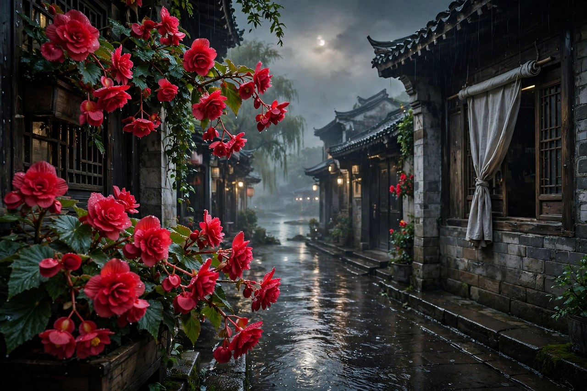

## 温州教书的日子

温州的踪迹，写于朱自清在温州教书的时候。一九二三年，他应邀到温州中学任教，教国文，带学生，日子过得并不宽裕，可是温州的山水，温州的江，温州的雨，温州的夜，给了他很多写作的养分。养分这个东西，在写作里很重要，没有养分，文章就干，干了，读者就读不下去，有养分，文章就润，润了，读者就读得下去，读得下去，文章就活了。温州就是朱自清写作的养分，是江南的养分，是山水的养分，是夜的养分。

他在温州教书，住的地方简陋，工资不高，常常要算计着过日子，可是他没有抱怨，没有把日子过成诉苦，而是把日子过成了文章。文章这个东西，在困顿里最容易长出来，困顿里的人，眼睛更细，心更软，感觉更真，感觉真了，文章就真了。朱自清在温州的文章，篇篇都有温州的味道，有江的味道，有山的味道，有雨的味道，有夜的味道，有绿的味道。味道合起来，就是温州的踪迹，就是江南的岁月。

温州的踪迹这组散文，一共有四篇，写的是月朦胧、鸟朦胧、帘卷海棠红，写的是绿，写的是白水漈，写的是生命的价格七毛钱。四篇合起来，就是温州的四个面，夜的面，绿的面，瀑布的面，人间的面。四个面合起来，就是温州的全部，就是朱自清在温州教书的日子的全部。全部这个东西，在组文里很重要，单篇看，是景，是夜，是绿，是瀑布，合起来看，是生活，是江南，是人间，是一个教书人在异乡的日子。

今天的人到温州，常常是去做生意，去旅游，去吃海鲜，很少像朱自清那样，到温州教书，到温州写文章，到温州把日子过成踪迹。踪迹这个词，用得极好，踪迹是走过的痕迹，是日子留下的痕迹，是文章留下的痕迹。走过的地方，留下了踪迹，踪迹写下来，就成了文章，文章流传下来，就成了温州的骄傲。骄傲这个东西，温州人有，朱自清给的，朱自清在温州教书，温州人记住了，记住了，就传下去了，传下去，温州的踪迹就永远是温州的踪迹。

## 月朦胧的夜

温州的踪迹头一篇，写的是月朦胧，鸟朦胧，帘卷海棠红。月朦胧这个意象，写的是温州夜里的月，月是朦胧的，是不清楚的，是隔着云的，是隔着雾的，是隔着帘的。朦胧这个东西，在温州的夜里最常见，温州多雨，多雾，多水汽，月亮常常是朦胧的，朦胧了，才有味道，味道这个东西，在朦胧里最浓，浓了，人就醉了，醉了，就想写下来。

鸟朦胧，写的是夜里的鸟，鸟在夜里叫，叫声是朦胧的，是远的，是听不清的，是隔着夜的。鸟叫这个东西，在夜里听起来，格外清楚，格外远，格外动人。清楚和远合起来，就是夜里的鸟，鸟在远处叫，人在近处听，听着听着，心就静了，静了，就想起很多事，想起家乡，想起过去，想起江南，想起温州。想起来的东西，写下来，就是文章，文章这个东西，就是想起来的东西写下来的样子。

帘卷海棠红，写的是帘子卷起来，海棠花红了，红在帘外，红在夜里，红在月朦胧里。海棠这个花，在温州的夜里，是红的，是艳的，是隔着帘子看的，隔着帘子看，花更红，更艳，更动人。帘子这个东西，在夜里很重要，帘子隔着，人和花隔着，隔着，才有想象的空间，想象的空间大了，花就更美了，美了，人就醉了。醉这个东西，在温州的踪迹里反复出现，月朦胧醉，鸟朦胧醉，海棠红醉，醉合起来，就是温州的夜。

今天的人，夜里常常不看月，不听鸟，不看海棠，夜里看手机，看视频，看消息，看得眼睛发酸，还是睡不着。朱自清的夜，是看月，是听鸟，是看海棠，是朦胧的夜，是安静的夜，是有味道的夜。味道这个东西，在夜里最重要，夜没有味道，人就睡不着，夜有味道，人就睡得着，睡得着，日子就好过了。温州的夜，月朦胧，鸟朦胧，帘卷海棠红，三个朦胧合起来，就是温州夜的味道，就是江南夜的味道，就是朱自清在温州教书的日子的味道。

## 绿是温州的魂

温州的踪迹里，绿是最出名的一篇，写的是仙岩梅雨潭的绿，绿这个东西，在温州的踪迹里，是魂，是核心，是让人惊诧的东西。魂这个东西，在组文里很重要，没有魂，组文就散了，有魂，组文就聚了。绿就是温州的踪迹的魂，魂在，温州的踪迹就活了，活了，读者就记住了，记住了，梅雨潭就出名了，出名了，温州就骄傲了。

绿写的是再到仙岩的惊诧，写的是瀑布的水花如白梅如杨花，写的是潭水的绿如荷叶如裙幅如处女的心如明油如鸡蛋清，写的是比较，写的是什刹海的绿杨太淡，写的是虎跑寺的绿壁太浓，写的是西湖的波太明，写的是秦淮河的水太暗，写的是梅雨潭的绿恰恰好。恰恰好这个东西，在绿里最重要，恰恰好，才醉人，醉人了，才想写，写了，才流传，流传了，绿就永远是绿。

绿和温州的关系，很深，绿是温州的绿，是仙岩的绿，是梅雨潭的绿，是朱自清在温州教书时看到的绿。绿这个东西，在温州人心里，叫女儿绿，女儿绿这个说法，很温柔，很嫩，很软，很亮，很让人疼。疼这个东西，在女儿绿里很重要，疼绿的人，才会保护绿，保护绿的人，才会让绿长久，长久了，后来的人才能看到，才能惊诧，才能醉，才能写。写下来，绿就传下去了，传下去，女儿绿就永远是女儿绿。

今天的人到梅雨潭，看到绿，会想起朱自清，会想起绿这篇文章，会想起温州的踪迹。想起来了，游梅雨潭就有了文化，有了文章，有了故事，有了朱自清。故事这个东西，在游景点的时候很重要，没有故事的景点，是空的景点，有故事的景点，是活的景点。梅雨潭的故事，就是朱自清的故事，就是绿的故事，就是温州的踪迹的故事。故事讲给孩子听，孩子将来也会去梅雨潭，也会惊诧，也会醉，也会写，写下来，故事就传下去了。

## 白水漈的瀑布

温州的踪迹里，白水漈写的是瀑布，写的是温州的山水，写的是水的力量，写的是水的美。白水漈这个地方，在温州文成，是个瀑布群，瀑布高，水大，声响，气势壮。朱自清写白水漈，写的是瀑布从高处冲下来，写的是水花飞溅，写的是水声轰鸣，写的是山谷幽深，写的是游人远望。远望这个东西，在白水漈里很重要，瀑布太高，太壮，太近了看不清，远了看，才看得全，看得全了，才觉得壮，壮了，才觉得美，美了，才觉得醉。

瀑布这个东西，在朱自清的文章里，常常是力量的象征，是自然的力，是水的力，是生命的力。力这个东西，在白水漈里最明显，瀑布冲下来，力大无比，力大到能把岩石冲出棱角，能把水花溅成碎玉，能把山谷震得回响。回响这个东西，在山谷里很重要，瀑布声在山谷里回响，回响久了，人心里也回响了，回响了，人就觉得自己小了，小了，才觉得自然大，大了，才敬畏，敬畏了，才写文章，写文章，是为了把敬畏写下来，写下来，敬畏就传下去了。

白水漈和梅雨潭，合起来，就是温州水的两个面，梅雨潭是绿的面，是静的面，是醉人的面，白水漈是壮的面，是动的面，是力量的面。静和动合起来，就是温州的水，就是江南的水，就是朱自清在温州看到的水。水的两个面，在温州的踪迹里都很重要，静的水让人醉，动的水让人敬畏，醉和敬畏合起来，就是人对自然的完整感情，感情完整了，文章就完整了，文章完整了，温州就完整了。

今天的人到白水漈，常常是拍照，拍一张瀑布的照片，拍一张水花的照片，发朋友圈，配一句壮，就走了。朱自清到白水漈，是远望，是细听，是感受力量，是敬畏自然。远望和拍照的区别，就在这里，拍照是把瀑布带走，远望是把瀑布留在心里。留在心里的瀑布，明年还会响，带走的照片，存在手机里，很少再翻出来。看瀑布的办法，是远望，是细听，是感受，是敬畏，敬畏了，瀑布就活了，活了，人就小了，小了，才觉得自然大，大了，才写文章，写文章，是为了把大写下来，写下来，大就传下去了。

## 七毛钱的人间

温州的踪迹里，生命的价格七毛钱写的是人间疾苦，写的是当时买卖人口的现象，写的是一个女孩子只值七毛钱的悲惨。七毛钱这个数字，听起来很小，小到买不了一顿饭，小到买不了一件衣服，可是当时，一个女孩子的命，就只值七毛钱。命这个东西，在七毛钱里最沉重，命只值七毛钱，说明世道太暗，说明人命太贱，说明社会太不公平。不公平这个东西，在七毛钱里最刺眼，刺眼了，人才会醒，醒了，才会写，写了，才会有人记得，记得了，才不会再发生。

朱自清写七毛钱，写得很克制，没有大喊大叫，没有煽情，没有骂人，就是把事实写出来，把一个女孩子被卖的情景写出来，把买主和卖主的话写出来，把七毛钱这个数字写出来。数字写出来了，读者自己就会感到震惊，感到难受，感到愤怒。愤怒这个东西，不需要作者喊，读者自己会愤怒，自己愤怒了，文章就有了力量，力量这个东西，在七毛钱里最重要，力量不是喊出来的，是事实写出来的，事实写出来了，力量就来了。

七毛钱这篇文章，和绿、和月朦胧、和白水漈合起来，就是温州的踪迹的完整面，前面三篇写的是景，是美，是自然，后面一篇写的是人，是苦，是社会。景和人合起来，才是完整的温州，才是完整的生活，才是完整的江南。生活这个东西，不只有美，还有苦，不只有绿，还有七毛钱，不只有瀑布，还有买卖人口。美和苦合起来，才是真实的生活，真实的生活写出来了，文章才有分量，分量这个东西，在温州的踪迹里最重要，有分量，文章就流传了，流传了，温州的踪迹就永远是温州的踪迹。

今天的人，读七毛钱，会觉得遥远，会觉得那个时代过去了，买卖人口的事情没有了，人命不只值七毛钱了。可是七毛钱背后的道理，今天依然重要，道理就是，人命是无价的，是不能用钱来衡量的，是不能买卖的，是要尊重的。尊重这个东西，在今天依然缺，缺尊重，人就会被物化，就会被标价，就会被当成商品。商品这个东西，在今天依然存在，存在于各种各样的地方，存在于对人的轻视里，存在于对劳动的压榨里，存在于对弱者的欺负里。七毛钱提醒我们，人不是商品，人是人，人要被尊重，尊重了，社会才好，社会好了，日子才好过。

## 温州江边的夜

温州的踪迹里，江边的夜也很动人。温州在瓯江边，江水在夜里流，渔火在江上点，远山在夜里如黛，老街在夜里灯火，江风在夜里湿润。江这个东西，在温州人的生活里很重要，江是交通，是生计，是风景，是夜里的灯火。灯火这个东西，在江边夜里最美，渔火点点，灯火朦胧，江水朦胧，远山朦胧，朦胧合起来，就是温州江边的夜，就是江南的夜，就是朱自清在温州教书的日子的夜。

江边的夜，朱自清常常一个人走，一个人看，一个人想。想什么呢，想家乡，想扬州，想过去，想将来，想文章，想学生，想日子。想这个东西，在夜里最容易出来，夜里安静，安静了，心里的话就出来了，话出来了，文章就有了。文章这个东西，就是夜里想出来的话写下来的样子，话写下来了，夜就留住了，夜留住了，温州就留住了，温州留住了，踪迹就留住了。

今天的人，夜里到江边走走，也会想起很多事，想起家乡，想起过去，想起将来，想起工作，想起生活。想起来的东西，写下来，就是自己的温州的踪迹，就是自己的江南岁月。岁月这个东西，写下来就留住了，留住了，明年再读，还能想起今年的夜，还能想起江边的灯火，还能想起远山的黛色，还能想起江风的湿润。想起来了，日子就没有白过，白过的日子，是没有想起来的日子，没有想起来的日子，是空的日子，空的日子过多了，人就老了。

温州江边的夜，还告诉我们一个道理，夜这个东西，要慢慢过，要安静过，要走到江边去，要看看渔火，要看看远山，要吹吹江风。慢慢过，夜就长了，长了，心就静了，静了，日子就好过了。快过夜，夜就短了，短了，心就乱了，乱了，日子就难过了。朱自清在温州的夜，是慢慢过的夜，是安静的夜，是走到江边去的夜，夜慢慢过了，文章就有了，文章有了，温州的踪迹就有了，踪迹有了，江南的岁月就有了。

## 温州中学的学生

朱自清在温州中学教书，学生很多，学生对他的感情很深。他教国文，讲课认真，改作文细致，学生写得好的地方他会圈出来，写得差的地方他也会讲清楚。讲清楚这个东西，在教学里很重要，讲清楚了，学生就懂了，懂了，就进步了，进步了，就爱学了，爱学了，老师就欣慰了。欣慰这个东西，在教书人心里最重要，学生进步了，老师就觉得日子没有白过，白过的日子，是学生没有进步的日子。

他在温州中学，还写了校歌，校歌里有一句，英奇匡国，作圣启蒙，成了温州中学的校训，传到今天还在唱。校歌这个东西，在学校里很重要，校歌唱起来，学生就有了归属感，有了归属感，就有了力气，有了力气，就好好读书，好好做人。朱自清写校歌，不是为了出名，是为了学生，是为了学校，是为了温州。温州这个地方，因为一首校歌，记住了朱自清，记住了，就传下去了，传下去，校歌就永远是校歌，朱自清就永远是温州的老师。

今天的人，到温州中学，会听到校歌，会想起朱自清，会想起温州的踪迹。想起来了，学校就有了文化，有了文章，有了故事，有了朱自清。故事这个东西，在学校里很重要，没有故事的学校，是空的学校，有故事的学校，是活的学校。温州中学的故事，就是朱自清的故事，就是校歌的故事，就是温州的踪迹的故事。故事讲给学生听，学生将来也会写文章，也会教书，也会把日子过成踪迹，踪迹写下来，就传下去了。

温州中学的学生，后来很多人都成了有用的人，成了老师，成了作家，成了温州的骄傲。骄傲这个东西，老师最懂，学生成材了，老师就骄傲了，骄傲了，日子就好过了，日子好过了，教书就更有劲了，更有劲了，学生就更进步了，进步了，老师就更骄傲了，骄傲和进步合起来，就是教育的循环，循环起来，学校就活了，活了，温州就活了，活了，踪迹就永远在。

## 温州的雨

温州多雨，雨这个东西，在温州的踪迹里常常出现，雨细，雨密，雨轻，雨润，雨在夜里下，雨在江边下，雨在山里下，雨在梅雨潭上下。雨这个东西，在温州人的生活里很重要，雨来了，江涨了，山绿了，潭满了，夜朦胧了，月朦胧了，鸟朦胧了，海棠红了。雨和朦胧合起来，就是温州的味道，就是江南的味道，就是朱自清在温州教书的日子的味道。

雨在温州，不是夏天的暴雨，不是冬天的冻雨，是春天的细雨，是秋季的薄雨，是梅雨潭的梅雨。梅雨这个词，在温州很有意思，梅雨是梅子黄时的雨，是温州特有的雨，是细的，是密的，是轻的，是润的。梅雨潭的名字，就是从梅雨来的，梅雨潭的水花像白梅，梅雨潭的绿像女儿绿，梅雨潭的雨像梅雨，雨、水花、绿合起来，就是梅雨潭的全部，就是温州的全部。

今天的人到温州，遇到雨，常常会恼，出门不方便，衣服晾不干，鞋子会湿，路上会滑。可是朱自清在温州，遇到雨，却觉得美，觉得雨让山绿了，让潭满了，让夜朦胧了，让月朦胧了，让文章有了味道。味道这个东西，在雨里最浓，雨来了，味道就来了，味道来了，文章就有了。文章这个东西，就是雨里的味道写下来的样子，味道写下来了，雨就留住了，雨留住了，温州就留住了。

温州的雨，还告诉我们一个道理，雨这个东西，不要只看到不方便，要看到雨的好，雨让草绿，让花开，让江涨，让潭满，让夜朦胧，让月朦胧，让人静下来，让人想起很多事。想起来的事，写下来，就是文章，文章写下来，雨就没有白下，雨没有白下，日子就没有白过，日子没有白过，人就活了，活了，温州的踪迹就永远在，永远在，永远是温州的雨，永远是江南的雨，永远是朱自清的雨。

## 温州的山水与人情

温州的山水，和温州的人情，合起来，就是温州的踪迹。山水这个东西，在温州很多，仙岩的山，梅雨潭的水，白水漈的瀑布，瓯江的江，合起来，就是温州的山水。人情这个东西，在温州也很多，老师和学生的人情，朋友和朋友的人情，朱自清和马公愚的人情，朱自清和温州人的人情，合起来，就是温州的人情。山水和人情合起来，才是完整的温州，才是完整的踪迹，才是完整的江南岁月。

山水这个东西，看久了，会生情，情生了，文章就有了，文章有了，山水就活了，活了，人就更爱山水了，爱来爱去，山水和人就分不开了，分不开了，踪迹就留下来了。踪迹这个东西，就是山水和人情合起来的痕迹，痕迹写下来，就是文章，文章流传下来，就是温州的骄傲，骄傲这个东西，温州人有，朱自清给的，给了，就传下去了，传下去，温州的踪迹就永远是温州的踪迹。

人情这个东西，在温州的踪迹里很重要，朱自清在温州，朋友很多，马公愚是朋友，学生是朋友，温州人是朋友，朋友在一起，游仙岩，看梅雨潭，看白水漈，写文章，谈学问，谈日子，谈将来。将来这个东西，在朋友在一起的时候最容易谈，谈将来，日子就有希望，希望有了，人就上前去了，上前去了，日子就好过了。日子好过了，朋友就更亲了，亲了，踪迹就更深了，深了，文章就更动人了。

今天的人到温州，看到山水，会想起朱自清，看到人情，会想起温州的踪迹。想起来了，温州就有了文化，有了文章，有了故事，有了朱自清。故事这个东西，在温州很重要，没有故事的温州，是空的温州，有故事的温州，是活的温州。活的温州，山水活，人情活，文章活，踪迹活，活来活去，温州就永远是温州，踪迹就永远是踪迹，江南的岁月就永远是江南的岁月。

## 温州踪迹的写法

温州的踪迹这组文章，写法很值得学习。组文这个东西，不是单篇的堆积，是四篇合起来写一个地方，写一个日子，写一个人。单篇看，是夜，是绿，是瀑布，是七毛钱，合起来看，是温州，是江南，是生活，是人间。合起来看的办法，是组文的写法，是朱自清的写法，是把一个地方的四个面写出来，写全了，地方就活了，活了，读者就记住了。

组文的写法，还告诉我们，写一个地方，不要只写一面，要写多面，写夜，写绿，写瀑布，写人间，写山，写水，写江，写雨，写朋友，写学生，写日子，写将来。面多了，地方就厚了，厚了，就动人了，动人了，文章就流传了，流传了，地方就出名了，出名了，游人就来了，游人来了，地方就更活了，活来活去，地方就永远是地方，文章就永远是文章。

今天的人写游记，常常只写一面，只写景，只写吃，只写拍照，只写打卡，写出来的游记，面很薄，薄了，读者就记不住，记不住，游记就白写了。朱自清的办法是，写多面，写景，写人，写夜，写绿，写瀑布，写七毛钱，写朋友，写学生，写日子，面多了，游记就厚了，厚了，读者就记住了，记住了，地方就活了，活了，游记就流传了。

温州的踪迹的语言，也很值得学习。语言是朴素的，是清丽的，是具体的，是不堆砌的。写月朦胧，写鸟朦胧，写帘卷海棠红，写得朦胧，写得动人，写得让人能看到月，能听到鸟，能看到海棠。写绿，写得醉人，写得惊诧，写得让人能看到绿，能感受到绿，能想抱住绿。写白水漈，写得壮，写得响，写得让人能听到瀑布，能看到水花，能感受到力量。写七毛钱，写得克制，写得真实，写得让人能感到震惊，能感到难受，能感到愤怒。语言这个东西，在温州的踪迹里很重要，语言朴素了，文章就真实了，真实了，读者就信了，信了，文章就流传了。

## 离开温州之后

朱自清离开温州之后，去了宁波，去了清华，去了北方，去了很多地方，可是温州的踪迹，一直留在他心里，留在他的文章里，留在他的记忆里。记忆这个东西，在离开之后最容易出来，离开了，才想起温州的夜，才想起梅雨潭的绿，才想起白水漈的瀑布，才想起七毛钱的悲惨，才想起温州中学的学生，才想起温州的雨，才想起温州的江。想起来了，文章就有了，文章有了，温州就永远在心里了，心里有温州的人，走到哪里都能想起温州，想起温州，日子就暖了，暖了，人就活了。

离开温州之后，他还写了我的南方，写了南方的山乡水乡，写了南方的醉乡梦乡，写了对南方的怀念。怀念这个东西，在离开之后最浓，浓了，文章就有了，文章有了，南方就活了，活了，温州就活了，温州活了，踪迹就活了。怀念这个东西，不是空想，是具体的怀念，是怀念温州的夜，怀念梅雨潭的绿，怀念白水漈的瀑布，怀念温州中学的学生，怀念温州的雨，怀念温州的江。具体的怀念，写下来，就是文章，文章写下来，怀念就传下去了，传下去，温州就永远是温州，南方就永远是南方。

今天的人，离开家乡之后，也会怀念家乡，怀念家乡的夜，怀念家乡的山，怀念家乡的水，怀念家乡的人，怀念家乡的味道。怀念这个东西，写下来，就是自己的温州的踪迹，就是自己的江南岁月。岁月这个东西，写下来就留住了，留住了，明年再读，还能想起今年的家乡，还能想起今年的夜，还能想起今年的山水，还能想起今年的人情。想起来了，日子就没有白过，白过的日子，是没有怀念的日子，没有怀念的日子，是空的日子，空的日子过多了，人就老了。

离开温州之后，朱自清的文章里，温州的影子一直都在，荷塘月色里有温州的影子，背影里有温州的影子，春里有温州的影子，匆匆里有温州的影子，影子这个东西，在文章里很重要，影子在，温州就在，温州在，踪迹就在，踪迹在，江南的岁月就在。岁月这个东西，在影子里最动人，影子动了，人就想了，想了，就写了，写了，就传下去了，传下去，温州的踪迹就永远是温州的踪迹，江南的岁月就永远是江南的岁月。

## 温州踪迹今天的读法

今天读温州的踪迹，怎么读才算读进去了。读法这个东西，很重要，读法对了，文章就活了，读法不对，文章就死了。读温州的踪迹，要到温州去读，要到仙岩去读，要到梅雨潭去读，要到白水漈去读，要到瓯江边去读，要到温州中学去读。到了地方读，文章就活了，活了，地方就活了，地方活了，人就活了。人活了，文章就记住了，记住了，温州的踪迹就永远在心里了。

读温州的踪迹，还要合起来读，四篇合起来读，夜、绿、瀑布、七毛钱合起来读，合起来读，才完整，完整了，才明白，温州不只有美，还有苦，不只有绿，还有七毛钱，不只有瀑布，还有人间。美和苦合起来，才是真实的温州，才是真实的生活，才是真实的江南。真实这个东西，在合起来读的时候最容易看到，看到真实了，文章就读进去了，读进去了，人就长大了，长大了，就不再只看美了，也看苦了，看苦了，才会珍惜美，珍惜美了，日子就好过了。

读温州的踪迹，还要带着自己的温州去读，自己的温州，可能是家乡，可能是工作的地方，可能是上学的地方，可能是旅游去过的地方。带着自己的地方去读，文章就和自己的生活连起来了，连起来了，文章就活了，活了，自己的地方就活了，活了，日子就有了踪迹，踪迹有了，人就不会觉得日子白过了，白过的日子，是没有踪迹的日子，没有踪迹的日子，是空的日子，空的日子过多了，人就老了。

读温州的踪迹，最后还要写下来，写自己的踪迹，写自己的夜，写自己的绿，写自己的瀑布，写自己的人间，写自己的家乡，写自己的日子。写下来，踪迹就留住了，留住了，明年再读，还能想起今年的踪迹，还能想起今年的夜，还能想起今年的绿，还能想起今年的瀑布，还能想起今年的人间。想起来了，日子就没有白过，白过的日子，是没有写下来的日子，没有写下来的日子，是空的日子，空的日子过多了，人就老了，老了，才后悔，后悔了，日子也回不来了。

## 温州踪迹留给后来人的话

温州的踪迹留给后来人的话，很简单，就是到温州去，到仙岩去，到梅雨潭去，到白水漈去，到瓯江边去，看看夜，看看绿，看看瀑布，看看人间，看看山水，看看人情，看看日子，看看将来。话简单，做起来却不容易，因为温州远，仙岩远，梅雨潭远，白水漈远，时间紧，工作忙，生活累。可是话简单，才容易记住，记住，才容易去做，做了，才容易醉，醉了，才容易写，写了，踪迹就传下去了，传下去，温州的踪迹就永远是温州的踪迹。

温州的踪迹留给后来人的话，还有一句，就是美和苦合起来看，看美的时候，也要看苦，看苦的时候，也要看美，美和苦合起来，才是真实的生活，真实的生活写出来了，文章才有分量，分量这个东西，在温州的踪迹里最重要，有分量，文章就流传了，流传了，温州就永远是温州，踪迹就永远是踪迹。

温州的踪迹留给后来人的话，还有一句，就是离开之后也要记得，记得温州的夜，记得梅雨潭的绿，记得白水漈的瀑布，记得七毛钱的悲惨，记得温州中学的学生，记得温州的雨，记得温州的江。记得了，温州就永远在心里了，心里有温州的人，走到哪里都能想起温州，想起温州，日子就暖了，暖了，人就活了，活了，踪迹就永远在，永远在，永远是温州的踪迹，永远是江南的岁月，永远是朱自清在温州教书的日子，永远是后来人读温州的踪迹的日子。
